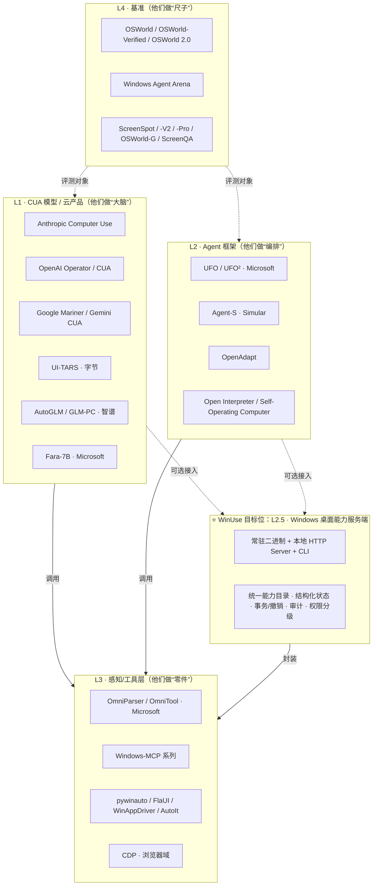

# 01 · 竞品与技术调研（WinUse 前置调研）

> 项目：WinUse（Windows Desktop Agent Control）
> 调研日期：2026-09-22（联网检索）
> 调研人：许清楚（PM）

---

## 0. 阅读约定：证据分级

本文严格区分三类信息，禁止把后两类写成第一类：

| 标记 | 含义 | 处理原则 |
|---|---|---|
| ✅ **已核实** | 有可点击的一手/权威二手来源，且我在本次检索中读到了原文 | 可直接作为设计依据，附来源 |
| 🧩 **推断** | 我基于已核实事实做的推论 | 明确标注为推断，需工程验证 |
| ❓ **待验证** | 未找到可靠来源，或来源之间互相矛盾 | 列入《待验证清单》，不做承诺 |

**特别提醒**：本调研的目标是**找差距与可借鉴点**，不是证明别人不行。凡竞品在我们关注维度上做得更好的，会直接写出（见 §6.2）。

---

## 1. 执行摘要（TL;DR）

1. **赛道已分层**：上层是「CUA 模型/产品」（Anthropic / OpenAI / Google / 字节 UI-TARS / 智谱 AutoGLM / 微软 Fara-7B），中层是「Agent 框架」（微软 UFO²、Simular Agent-S、OpenAdapt），下层是「能力供给」（pywinauto / FlaUI / UIA / Windows-MCP）。**"Windows 桌面能力服务端"这一层几乎是空白**——这正是 WinUse 的定位。✅（见 §5 横向对比表的"形态"列）
2. **Windows 原生最深的方案是微软 UFO²**：UIA + 视觉混合检测、GUI–API 统一动作层、推测式多动作执行、PiP 虚拟桌面隔离。它是我们最重要的参照物，也是最大的"致敬对象"。✅ [arXiv 2504.14603](https://arxiv.org/abs/2504.14603)、[GitHub microsoft/UFO](https://github.com/microsoft/UFO/)
3. **但 UFO² 不是我们要的东西**：它是 Python 库 + 自带 LLM 编排（HostAgent/AppAgent ReAct），不是中立的能力服务；HTTP/CLI 传输层缺失；PiP 至今仍标注 coming soon。✅（UFO 文档 / sourcepulse 项目页）
4. **最接近"形态"的竞品是 Windows-MCP**（MCP server 暴露 Windows 能力，UIA 优先坐标兜底），但它 stdio-only、绑定 MCP 客户端、无任务/事务/撤销/审计模型。✅ [windowsmcpserver.dev/architecture](https://windowsmcpserver.dev/architecture)、[GitHub CursorTouch/Windows-MCP](https://github.com/CursorTouch/Windows-MCP)
5. **模型侧能力已不是短任务的瓶颈**：OSWorld-Verified（369 短任务）前沿系统已到 ~85%，超过 72.36% 人类基线 ✅（[OSWorld 官网榜单](https://os-world.github.io/)）；但 OSWorld 2.0（108 个长任务，人类中位 1.6 小时，平均 318 次工具调用）严格通过率仍只有 ~20–42% ✅（[OSWorld 2.0 分析](https://agentmarketcap.ai/blog/2026/07/17/osworld-2-long-horizon-cliff-computer-use-benchmark)）。**长任务的失败在"上下文管理 / 状态验证 / 收尾"，不在"会不会点"**——这直接指向 WinUse 必须做好的三件事：结构化状态返回、动作可验证、可回滚。🧩
6. **Windows 特有的硬约束**（UIPI 完整性级别、UAC 安全桌面、锁屏/屏保/RDP 最小化、混合 DPI、IME）在所有头部方案中**都没有被系统性处理**。这是 WinUse 最真实的差异化空间。✅（[Microsoft UIPI 故障排查文档](https://learn.microsoft.com/en-sg/troubleshoot/power-platform/power-automate/desktop-flows/ui-automation/uipi-issues)、[PROCESS_DPI_AWARENESS](https://learn.microsoft.com/nl-nl/windows/desktop/api/ShellScalingApi/ne-shellscalingapi-process_dpi_awareness)、[SendInput KEYEVENTF_UNICODE](https://www.cnblogs.com/liuzhaoyzz/p/6208670.html)）

---

## 2. 赛道地图



**关键判断**（🧩 推断，基于上表结构）：L1 与 L2 都需要 L3，但 L3 目前是"库"而不是"服务"。把 L3 服务化、并补上 L1/L2 都不做的 Windows 硬约束处理，就是 WinUse 的价值捕获点。

---

## 3. 竞品档案（统一结构）

> 每个竞品按：定位 / 形态 / 感知方式 / 动作空间 / 开放性 / Windows 优先 / 关键局限。

### 3.1 Anthropic Computer Use ✅
- **定位**：把"屏幕+鼠标+键盘"做成模型内建工具，让 Claude 驱动一台（通常是虚拟的）电脑。
- **形态**：API 层的 `provider-defined tool`，**没有 input schema，schema 内建在模型里**；宿主（开发者）负责执行。参考实现是 Docker（Xvfb + Linux 桌面 + xdotool）。
- **感知方式**：截图（纯像素）。模型自己估计坐标，误差约 ±20–50px（小控件会完全点不中）。
- **动作空间**（三版演进，✅ 多来源交叉一致）：
  - `computer_20241022`：`screenshot / left_click / type / key / mouse_move / cursor_position`
  - `computer_20250124`（随 Claude 3.7）：新增 `right_click / middle_click / double_click / triple_click / left_click_drag / left_mouse_down / left_mouse_up / hold_key / wait / scroll(direction, amount)`
  - `computer_20251124`：新增 `zoom`（对屏幕子区域请求更高分辨率视图），并放宽图像分辨率上限
- **开放性**：工具定义开放（任何宿主可实现），模型闭源。
- **Windows 优先**：**否**。参考实现是 Linux/X11；Windows 需要开发者自己实现执行层。
- **关键局限**：(a) 纯坐标 grounding，无 OS 语义；(b) 每步截图 token 成本高（1024×768 PNG ≈ 800–1200 token/步，50 步累计 4–6 万 token）；(c) 无窗口/进程/文件系统等 OS 级能力，全靠 bash 工具补；(d) 官方明确要求沙箱运行。
- **来源**：[aiwiki: Anthropic Computer Use](https://aiwiki.ai/wiki/anthropic_computer_use)、[DeepWiki: ComputerTool](https://deepwiki.com/anthropics/anthropic-quickstarts/2.2.2-computertool)、[docs.rs computer_20241022](https://docs.rs/llm-kit-anthropic/0.1.0/llm_kit_anthropic/provider_tool/computer_20241022/fn.computer_20241022.html)

### 3.2 OpenAI Operator / CUA ✅
- **定位**：消费级产品（Operator）→ 并入 ChatGPT agent mode → 云浏览器。对外 API 为 Responses API 的 `computer_use_preview`（`computer_call`）。
- **形态**：云端托管的浏览器（后为云 VM）；开发者侧是通过 Responses API 拿 `computer_call`，自己回 `computer_call_output`。
- **感知方式**：**像素 + 可访问性树双通道**（外部技术分析称其同时摄入截图与 a11y snapshot，a11y 树显著降低幻觉）。
- **动作空间**：`click(x,y,button) / type(text) / scroll(direction,amount) / keypress(含修饰键组合) / drag / screenshot / wait`
- **开放性**：模型闭源；动作协议事实开放（成为行业 de facto 词汇表之一）。
- **Windows 优先**：**否**，浏览器/云 VM 为主。
- **关键局限**：(a) 高风行为（登录、购买、提交表单）会停下请求用户确认——安全设计好，但托管能力受限；(b) 仅视口坐标，屏幕外元素必须先滚动；(c) 产品形态几经变更（Operator → agent mode → cloud browser），API 稳定性存疑 ❓（产品终止与迁移路径来自二手汇总源，需以官方文档为准）。
- **来源**：[n4n.ai: OpenAI Operator explained](https://n4n.ai/blog/openai-operator-explained-how-it-browses-the-web)、[hivebook: OpenAI Operator/CUA](https://www.hivebook.wiki/wiki/openai-operator-computer-using-agent-cua-for-browser-tasks)

### 3.3 Google Project Mariner / Gemini Computer Use ✅
- **定位**：DeepMind 的浏览器 agent 研究原型，2024-12-11 首次公开（trusted tester），2025-05 Google I/O 后并入 Gemini API / Vertex AI 与 AI Ultra 订阅（$249.99/月，先限美国）。
- **形态**：早期=用户设备上的 Chrome 扩展；2025-05 后=**云端 VM**，支持最多 10 个并行任务。
- **感知方式**：浏览器内元素理解（文本/代码/图片/表单），纯浏览器域。
- **动作空间**：未公开完整词汇表 ❓；公开信息仅描述"点击/滚动/输入"级别。
- **开放性**：通过 Gemini API 开放给开发者（含 Automation Anywhere、UiPath 作为测试方）。
- **Windows 优先**：**否**——有意识地**只做浏览器**，Google 将其框定为"缩小动作空间与安全面"的 deliberate choice。
- **关键局限**：(a) 仅限浏览器，不碰桌面应用；(b) 早期版本锁定用户浏览器、无法多任务；(c) 价格与地域门槛高。
- **来源**：[Google I/O 2025 keynote](https://blog.google/intl/ja-jp/company-news/inside-google/google-io-2025-keynote-sundar-pichai/)、[aiwiki: Project Mariner](https://aiwiki.ai/wiki/project_mariner/revisions/2)

### 3.4 ⭐ Microsoft UFO / UFO²（最重要的竞品）✅
- **定位**：**Desktop AgentOS**——把 CUA 从概念原型提升为系统级自动化。论文作者几乎全部来自微软（亚研院/工程院），MIT 许可。
- **形态**：**Python 库 + 自带多 Agent 编排**。要求 Windows 10+、Python 3.10/3.11，需自备 LLM API Key（OpenAI / Azure OpenAI / Qwen / Gemini）。v2.0.0 于 2025-04 发布。
- **架构**：
  - `HostAgent`：任务分解与跨应用协调（中心化）
  - `AppAgent`：每个应用一个专精 agent，带 ReAct 循环 + 原生 API + 领域知识 + 统一 GUI–API 动作层
  - `Knowledge Substrate`：RAG，来源=文档 / Web 搜索 / 执行轨迹
  - `Speculative Executor`：一次预测多步动作，再对照实时 UI 状态批量校验（论文报告减少约 51% 的 LLM 查询）
  - `Hybrid Control Detection`：**UIA + 视觉解析融合**
  - `Picture-in-Picture (PiP)`：在隔离虚拟桌面里跑自动化，用户与 agent 互不干扰
- **感知方式**：UIA（Windows UI Automation）为主，视觉解析补充；同时整合 Win32 与 WinCOM（对 Office 走 COM 直达）。
- **动作空间**：GUI 动作 + 原生 API 调用的**统一层**（不是纯像素动作）。
- **开放性**：MIT 开源，代码在 [github.com/microsoft/UFO](https://github.com/microsoft/UFO/)。
- **Windows 优先**：**是，且仅支持 Windows**。
- **基准成绩**：Windows Agent Arena（154 任务）与 OSWorld-W（49 任务）上评测；二次来源报告 **WAA ~30.5%、OSWorld-W ~32.7%**，优于此前 CUA。❓（不同二手来源数字不一致，某中文技术博客称"89% 成功率"，与论文口径明显不符，**以 30.5%/32.7% 为准并待查原文表格**）
- **关键局限（我们的机会）**：
  1. **不是服务**：无 HTTP / CLI 传输层，任何 Agent 想用必须进 Python 进程、接受它的 LLM 编排。
  2. **编排耦合**：HostAgent/AppAgent 的 ReAct 与 prompt 是方案的一部分，不可替换成你自己的 Agent。
  3. **PiP 未落地**：roadmap 标注 coming soon（2026-09 检索时状态）。❓
  4. **AppAgent 需人工沉淀**：每个应用的原生 API 与知识库要人工建设，泛化成本在应用侧。
  5. **无权限/审计/撤销模型**：论文未涉及危险操作确认、审计日志、回滚。
- **来源**：[arXiv 2504.14603 UFO²: The Desktop AgentOS](https://arxiv.org/abs/2504.14603)、[sourcepulse: UFO by microsoft](http://sourcepulse.org/projects/1237414)、[joshuaberkowitz.us 综述](https://joshuaberkowitz.us/blog/quick-research-reviews-4/revolutionizing-windows-automation-inside-microsoft-research-s-ufo2-agentos-166)

### 3.5 Microsoft Fara-7B ✅
- **定位**：微软首个 **agentic SLM（70 亿参数）**，专注 computer use，主打本地运行（低延迟 + 数据不出设备）。基于 Qwen2.5-VL-7B，MIT 许可，已上 Hugging Face / Foundry，并提供 Copilot+ PC 量化版。
- **形态**：模型权重 + Magentic-UI 集成。
- **感知方式**：**纯截图，明确不依赖 a11y tree / HTML**（"uses the same modalities as humans"）。
- **动作空间**：预测坐标 → 映射为 Playwright 的鼠标/键盘动作；另有 `web_search`、`visit_url` 等"浏览宏"。鼠标位置离散化为 4096 token 词表。
- **Windows 优先**：否（Web 任务为主；只是能跑在 Windows 设备上）。
- **对我们的启示**：**"浏览宏"（visit_url / web_search）这个设计值得抄**——高频长流程收敛成一个语义动作，能显著压缩步数（Fara-7B 平均 ~16 步 vs UI-TARS ~41 步）。这是"可组合性"的直接证据。✅
- **来源**：[Microsoft Research: Fara-7B](https://www.microsoft.com/en-us/research?p=1155843)、[the-decoder 报道](https://the-decoder.com/?p=29509/)

### 3.6 OSWorld / OSWorld-Verified / OSWorld 2.0（基准，也是动作空间的事实标准）✅
- **定位**：第一个可扩展的**真实计算机环境**基准，支持 Ubuntu / Windows / macOS；369 个真实任务 + 执行式（execution-based）评估脚本。
- **形态**：VM 快照 + 初始状态配置 + 自定义评估脚本；环境以 POMDP 建模（S, O, A, T, R）。支持 VMware/VirtualBox/Docker/AWS，可并行。
- **对 Agent 的接口（重要）**：Agent 接收观察（截图 / a11y tree / terminal output），**通过原始鼠标键盘动作**交互；`action_space="pyautogui"` 是默认动作空间之一。→ **OSWorld 的动作集实际上定义了"桌面原子动作"的最小集合**，WinUse 的能力目录应至少覆盖它。
- **成绩演进**：
  - 2024-04 原始论文：人类 72.36%，最强模型 **12.24%**
  - 2025-07-28：升级为 **OSWorld-Verified**
  - 2026-06-26：**OSWorld 2.0** 发布（108 个长工作流，人类中位 1.6 小时，平均 318 次工具调用，500 步预算）
  - 2026 年中：OSWorld-Verified 前沿系统 ~85%（榜单第一梯队：claude-fable-5 86.0%、claude-opus-5 83.4%、Muse Spark 1.1 80.7%）；OSWorld 2.0 严格通过率 Claude Fable 5.1 **41.7%**（部分分 77.9%）
  - ⚠️ 榜单数据为**厂商自报为主**，无独立第三方复核；且部分模型名（claude-fable-5 / Muse Spark / GPT-6 Astra）超出我的先验知识，**引用时须以官网为准**。❓
- **关键结论**（对我们最有价值）：OSWorld 2.0 论文的错误分析指出，长任务失败主因是——**丢失早期建立的约束、漏掉流程中途出现的信息、遇到歧义时猜测而不问用户、宣称完成前跳过验证**。🧩 这四条恰好都可以由"能力服务端"来兜底（结构化状态 / 事件订阅 / 歧义升级 / 强制验证原语）。
- **来源**：[OSWorld 官网](https://os-world.github.io/)、[OSWorld 2.0 分析](https://agentmarketcap.ai/blog/2026/07/17/osworld-2-long-horizon-cliff-computer-use-benchmark)、[itdoeswhatnow: OSWorld explained](https://itdoeswhatnow.com/benchmarks/osworld)

### 3.7 Windows Agent Arena（WAA）✅
- **定位**：微软把 OSWorld 框架移植到**真实 Windows 11**，154 个跨应用任务（LibreOffice Calc/Writer、Edge/Chrome、File Explorer/Settings、VS Code、VLC、Notepad/Clock/Paint）；Azure 并行化，全榜 20 分钟跑完。
- **形态**：Docker 容器包 Win11 VM，容器内 Flask server 作为桥接。
- **配套 Agent（Navi）**：SoM（Set-of-Marks）把 **UIA a11y tree + OCR + icon detector + OmniParser** 叠加到截图上喂 VLM。
- **成绩**：Navi 最佳配置（UIA + OmniParser + GPT-4V-1106）**19.5%**，人类 **74.5%**。
- **最有价值的一条数据**：**纯像素 OCR + icon 检测 = 12.5%；加上 UIA 无障碍树 = 19.5%，相对提升 57%**。→ **UIA 是 Windows 上性价比最高的感知通道，必须以它为默认，视觉为兜底。** 这是本调研中对我方设计影响最大的单一事实。✅
- **另一个信号**：Office / Windows Utils 类任务几乎全 0%，Web Browser / Windows System 相对最好。→ Office 自动化是 Windows 上最难啃的骨头，不能当作"顺手就能做"。
- **来源**：[Windows Agent Arena 官网](https://microsoft.github.io/WindowsAgentArena/)、[arthurfenderbucker 论文页](https://arthurfenderbucker.github.io/publications/Windows_Agent_Arena)、[DeepRead 摘要](https://kendrick-stein.github.io/MCISLAB_DeepRead/Papers/2409-WindowsAgentArena)

### 3.8 UI-TARS（字节 Seed + 清华）✅
- **定位**：**原生 GUI agent 模型**，端到端，只吃截图，输出类人键鼠动作。
- **形态**：开源模型（多尺寸，7B 推荐本地跑）+ UI-TARS Desktop（Electron 应用）+ Agent TARS；Apache 2.0；MCP 集成。
- **感知方式**：**纯视觉，明确不使用 a11y tree / DOM / HTML**。
- **动作空间**：统一动作建模（跨平台统一空间）：click(left/right/double)/drag/scroll/type/hotkey/sequence 等。
- **成绩**：OSWorld 24.6@50 步 / 22.7@15 步（对比 Claude 22.0 / 14.9）；AndroidWorld 46.6（对比 GPT-4o 34.5）；10+ 榜单 SOTA。后续榜单显示 UI-TARS-72B 在 ScreenSpot-Pro 38.1、UI-TARS-1.5-7B 在 OSWorld-G 64.2。
- **Windows 优先**：否（跨平台是卖点）。
- **我们必须承认的事实**：**在"视觉 grounding"这一单点上，UI-TARS 这类专用模型做得比我们打算自研的任何东西都好**。WinUse 不应在感知模型上竞争，而应把自己定位成"可被这类模型调用的底座"。这一点必须写进 PRD 的非目标。✅
- **来源**：[arXiv 2501.12326](https://ar5iv.arxiv.org/html/2501.12326)、[alphaxiv 概览](https://www.alphaxiv.org/overview/2501.12326)、[GTA1 对比表](https://huggingface.co/blog/HelloKKMe/grounding-r1)

### 3.9 AutoGLM / GLM-PC（智谱）✅
- **定位**：GUI 自主控制，先做手机（2024-11 AutoGLM 1.0），2025-08 AutoGLM 2.0 扩展为**云手机 + 云电脑 + 浏览器**跨端执行型 agent。桌面侧产品名 GLM-PC。
- **形态**：**云端设备**（云手机 / 云电脑），用户本机不被占用；用户可随时接管。
- **感知方式**：GUI 视觉（未见公开细节关于 a11y tree）❓
- **动作空间**：未公开完整词汇表 ❓；公开材料强调"点、拖、输"三原子 + 支付/发送文件等关键步的人工确认。
- **Windows 优先**：否（云端桌面，OS 中立）。
- **可借鉴点**：**"云端设备不占本机"+"需要登录时主动停下等人"** 两个交互契约很成熟。尤其后者——遇到需人工介入的状态主动挂起并回报，而不是猜。✅
- **已知短板（其自述）**：跳出后任务中止、个别 App 连续执行会掉登录态、不同站点适配度不一致、长链路偶有失步。→ **中文国民级 App（微信/抖音/小红书/美团）适配是它的强项，这是纯海外方案的空白，也是 WinUse 在中文场景的价值点。**
- **来源**：[证券时报：AutoGLM 2.0](https://www.stcn.com/article/detail/3202210.html)、[aitop100: AutoGLM](https://www.aitop100.cn/tools/autoglm)

### 3.10 OmniParser / OmniTool（微软）✅
- **定位**：**纯视觉 GUI 屏幕解析器**：把截图转成结构化元素，**不调用 LLM**。
- **技术**：微调 YOLOv8 图标检测 + Florence-2 caption；V2 相比 V1 延迟降 60%，ScreenSpot-Pro 平均 39.6；A100 上约 0.6s/帧。
- **输出**：带 bbox + 数字 ID 的标注截图 + local semantics（文本 + 图标功能描述）。
- **OmniTool**（2025-02）：用 OmniParser + 自选 VLM 控制一台 **Windows 11 VM**（支持 OpenAI 4o/o1/o3-mini、DeepSeek R1、Qwen 2.5VL、Anthropic Computer Use）。
- **开放性**：代码开源；**icon_detect 权重为 AGPL**（源自 YOLO），caption 权重 MIT。⚠️ **AGPL 是商用集成的重要约束，WinUse 若要内置需评估许可**。✅
- **Windows 优先**：否，但 OmniTool 明确以 Windows 11 VM 为演示对象。
- **来源**：[microsoft.github.io/OmniParser](https://microsoft.github.io/OmniParser/)、[GitHub microsoft/OmniParser](https://github.com/keith-fischer/OmniParser)、[Azure Foundry Labs: OmniParser V2](https://labs.ai.azure.com/?p=997/)

### 3.11 Windows-MCP（注意：有两个同名/近名项目）✅
> 检索发现两个不同实现，务必区分，不要混淆。

| | **Windows-MCP (CursorTouch)** | **Windows MCP Server (Sbroenne / windowsmcpserver.dev)** |
|---|---|---|
| 语言 | Python（PyPI: `windows-mcp`，`uvx windows-mcp` 一行启动） | .NET 10（`Sbroenne.WindowsMcp.exe`，免运行时发布包） |
| 传输 | MCP over stdio | MCP over stdio |
| 工具数 | ~20（Snapshot / Click / Type / Scroll / Move / Shortcut / MultiSelect / MultiEdit / Screenshot / Scrape / DisplayInventory / App / PowerShell / FileSystem / Clipboard / Process / Notification / Registry / Wait / WaitFor） | 10（ui_automation / ui_find / ui_click / ui_type / ui_read / file_save / window_management / screenshot_control / mouse_control / keyboard_control / app） |
| 感知 | **UIA 无障碍树**（Snapshot 是主感知口），浏览器可 `use_dom=True` 切 DOM | **UIA 优先**；截图+鼠标+键盘作为兜底（游戏 / canvas / OpenGL 自绘） |
| 亮点 | 非多模态 LLM 也能用；0.2–0.5s/动作（v0.6.0 后 ~6x 提速）；DisplayInventory 读显示器布局与 DPI | **多显示器 + per-monitor DPI 全支持**；自动快照 diff（重复观察时只在更小时返回 compact diff，实测 84–96% token 节省）；LLM 实测工具质量（130+ 测试） |
| 局限 | stdio-only，依赖 MCP 客户端；无任务/事务/撤销/审计 | stdio-only；无任务/事务/撤销/审计；工具粒度较粗 |
- **诚实评价**：这两个项目在"**UIA 优先、坐标兜底、token 优化、DPI/多显示器**"上做得**很好，且已经验证过**——我们不应当假装这些不存在，而应把它们当作已验证的设计基线，在其之上补缺失的部分（服务化、事务、撤销、审计、权限分级、模态/UAC/IME 处理）。
- **来源**：[chatforest: Windows-MCP Server 评测](https://chatforest.com/reviews/windows-mcp-server?ref=feedbagel.com)、[windowsmcpserver.dev/architecture](https://windowsmcpserver.dev/architecture)、[windowsmcpserver.dev 首页](https://windowsmcpserver.dev/)、[GitHub altxxr0/mcp-windows](https://www.github.com/altxxr0/mcp-windows)

### 3.12 Agent-S / Simular ✅
- **定位**：开源 GUI agent 框架，经验增强的层次化规划 + **Agent-Computer Interface (ACI)**（不直接吃原始像素，通过中间层更精确感知 GUI 元素）+ 双重记忆（叙事记忆 / 情景记忆）。
- **形态**：Python 库 `gui-agents`。
- **成绩**：S1 在 OSWorld 上相对基线 +9.37%（83.6% 相对提升）；S3（2025-12）**72.60%，首个超过人类基线**；Sai（2026-08）在 OSWorld 2.0 上 73%。
- **Windows**：明确做了 WindowsAgentArena 泛化验证（v0.1.2 起支持 Linux 与 Windows）。
- **可借鉴**：**ACI 这一层抽象**（在像素与模型之间插一层"计算机接口"，提供元素级语义 + 动作校验）与 WinUse 的"能力服务端"定位高度同构。✅
- **来源**：[ICLR 2025 Agent S](https://proceedings.iclr.cc/paper_files/paper/2025/hash/394c7c30ea87b5c3521b4d9e9d419071-Abstract-Conference.html)、[GitHub simular-ai/Agent-S](https://github.com/simular-ai/Agent-S)

### 3.13 OpenAdapt ✅
- **定位**：**"Verified last-mile execution for agents"**——**录制一次人类演示 → 编译成可重放的程序 → 执行时不再调用生成式模型 → 每个声明的副作用都按证据等级核验，才返回 VERIFIED**。
- **形态**：Python CLI + `openadapt-agent serve`；录制/编译运行时在 `openadapt-flow`。
- **核心理念（非常值得抄）**：
  1. **"绝不把 halt 总结成 success"**——UI 上显示成功横幅但独立读取系统记录发现写入失败时，`--break-it` 演示会**停止并报失败**。
  2. **效果契约（effect contract）**：从演示前后的 delta 中挖掘副作用声明，运行时逐条核验。
  3. **人工准入（admission）**：一个具名的人承认这个程序，它才获得权威。
  4. **0 次模型调用**：编译后的执行不进 LLM 循环。
- **对我们的直接启示**：**"验证必须独立于产生结果的那个通道"**（不能靠被操作 App 自己显示的成功横幅）。这条应写进 WinUse 的验证原语设计原则。✅
- **来源**：[GitHub OpenAdaptAI/OpenAdapt](https://github.com/OpenAdaptAI/OpenAdapt)

### 3.14 Open Interpreter / Self-Operating Computer / Cradle ✅（简述）
- 这一类以**截图 + pyautogui + SoM 提示**为主，跨平台，无 OS 语义层。Self-Operating Computer 提供 OCR 模式生成"可点击元素坐标哈希图"与 SoM 标签（模型只需输出数字即可定位）。
- **可借鉴**：**SoM（在元素上叠加数字标签，模型输出编号而非坐标）**——显著降低 grounding 输出难度。WinUse 的 `screen.capture(annotate=true)` 应原生支持。✅
- **来源**：[开源 AI 控制电脑项目合集](https://xmsumi.com/detail/2126)

### 3.15 基准族：ScreenSpot / -V2 / -Pro / OSWorld-G / ScreenQA ✅
| 基准 | 数据 | 环境 | 指标 | 价值 |
|---|---|---|---|---|
| ScreenSpot (ACL24) | 人工裁剪截图 | 静态图，跨平台 | Accuracy | grounding 基础榜 |
| ScreenSpot-V2 | 1.2k+ 修订指令 | 静态图 | Accuracy + IoU | 修 V1 问题 |
| ScreenSpot-Pro (ICLR25) | 1.5k+ 高分辨率专业应用截图 | 静态图，**Desktop** | Accuracy | 高分辨率桌面场景 |
| OSWorld-G | 564 精细标注样本 | **真实 OS（桌面）** | Accuracy + Success Rate | 含字符级光标定位、滑块控制、**不可能命令的拒绝处理** |
| ScreenQA (NAACL25) | 86k+ QA（基于 RICO） | 静态图，移动 | F1 | 屏幕问答 |
- **对我们的意义**：
  1. **OSWorld-G 把"拒绝不可能命令"列为评测项**——WinUse 的失败语义必须能表达"此操作不可行/不存在目标"，而不是硬点一下。✅
  2. **字符级光标定位、滑块控制**被单独列为精细操作类——说明"文本光标"与"连续控件"是两个必须单独建模的能力（我会在能力清单里单列 `text.caret.*` 与 `element.set_range_value`）。🧩
- **来源**：[A Survey on Benchmarks of LLM-based GUI Agents (OpenReview)](https://openreview.net/pdf/6a50832c621d22b446947f699e7f8ce219d9a8ab.pdf)、[OSWorld-G 论文页](https://www.sota2.com/research/paper/68fa79861e209131cea7e01e)

---

## 4. 横向对比表

> 图例：✅=支持且较强；⚠️=部分支持/较弱；❌=不支持；❓=未获可靠信息

| 方案 | 定位 | 形态 | 感知方式 | Windows 优先 | 开放 | 有 OS 语义层 | 服务化(HTTP/CLI) | 事务/撤销 | 权限分级 | 审计 | 关键局限 |
|---|---|---|---|---|---|---|---|---|---|---|---|
| **Anthropic Computer Use** | CUA 工具 | API 工具 + 宿主执行 | 纯截图(坐标) | ❌ | 模型闭源/协议开放 | ❌ | ❌ | ❌ | ❌(沙箱替代) | ❌ | 坐标 grounding 脆弱;token 成本高 |
| **OpenAI CUA / Operator** | CUA 产品+API | 云浏览器 | 截图 + a11y tree | ❌ | ❌ | ❌ | ❌ | ❌ | ⚠️(危操作停顿) | ❌ | 仅浏览器;产品形态多变 |
| **Google Mariner** | 浏览器 agent | 云 VM | 浏览器元素 | ❌ | ⚠️(API 开放中) | ❌ | ❌ | ❌ | ⚠️(确认购买/密码) | ❌ | 刻意不做桌面 |
| **⭐ UFO² (Microsoft)** | Windows AgentOS | Python 库 + 自带编排 | **UIA + 视觉 + Win32/COM** | ✅✅ **仅 Windows** | ✅ MIT | ✅✅ **最强** | ❌ | ❌ | ❌ | ❌ | 编排耦合;无传输层;PiP 未落地 |
| **Fara-7B (Microsoft)** | 端侧 CUA SLM | 权重 + Magentic-UI | 纯截图 | ❌ | ✅ MIT | ❌ | ❌ | ❌ | ⚠️(Critical Point 停顿) | ⚠️(行为日志) | Web 为主;纯视觉 |
| **UI-TARS (字节)** | 原生 GUI 模型 | 模型 + Desktop App | 纯截图 | ❌ | ✅ Apache2.0 | ❌ | ❌ | ❌ | ❌ | ❌ | 无 OS 语义;感知强但执行弱 |
| **AutoGLM / GLM-PC (智谱)** | 云端跨端 agent | 云手机/云电脑 | GUI 视觉 | ❌ | ❌ | ❌ | ❌ | ❌ | ✅(关键步人工确认) | ❌ | 闭源;中文 App 强 |
| **OmniParser** | 屏幕解析器 | 库 + 权重 | 纯视觉(检测+caption) | ⚠️(OmniTool 面向 Win11 VM) | ✅(detect 为 AGPL⚠️) | ⚠️(只出 bbox+描述) | ❌ | ❌ | ❌ | ❌ | 只解决感知,不解决执行 |
| **Windows-MCP (Python)** | MCP server | stdio 服务 | **UIA + DOM** | ✅ | ✅ MIT | ✅ | ⚠️(仅 stdio) | ❌ | ❌ | ❌ | 无任务/事务/撤销 |
| **Windows MCP Server (.NET)** | MCP server | stdio 服务 | **UIA 优先 / 截图兜底** | ✅ | ✅ MIT | ✅ | ⚠️(仅 stdio) | ❌ | ❌ | ❌ | 工具粒度粗 |
| **Agent-S (Simular)** | Agent 框架 | Python 库 | ACI 中间层 + 视觉 | ⚠️(支持 Win/Linux) | ✅ | ⚠️ | ❌ | ❌ | ❌ | ❌ | 自带编排;非服务 |
| **OpenAdapt** | 录制-编译-核验 | CLI + serve | 录制时多模态 | ⚠️ | ✅ | ✅(Win/Mac) | ⚠️(`serve`) | ✅ **效果契约+独立核验** | ✅ 人工准入 | ✅ 运行回执 | 需先录制演示,非通用控制 |
| **pywinauto / FlaUI / AutoIt** | 自动化库 | 库 | UIA / Win32 | ✅ | ✅ | ✅ | ❌ | ❌ | ❌ | ❌ | 面向测试脚本,非 Agent |
| **UiPath / Power Automate** | 商业 RPA | 桌面产品 | UIA + 选择器 | ✅ | ❌ | ✅ | ⚠️ | ❌ | ⚠️ | ⚠️ | 脚本脆弱;闭源;不面向 LLM |
| **⭐ WinUse（目标）** | **Windows 桌面能力服务端** | **常驻二进制 + HTTP + CLI + MCP** | **UIA 优先 → OCR → SoM视觉 → 坐标** | ✅✅ **仅 Windows** | 待定 | ✅ | ✅✅ | ✅ | ✅ | ✅ | — |

---

## 5. 归因分析：现有方案为什么在 Windows 上做得不够好

> 要求：不许泛泛而谈。以下每条都给出**机制**，并标注证据强度。

### 5.1 机制一：Windows 没有"统一可访问性平面"（技术根因）✅
Windows 的 GUI 技术栈是四十年叠加的产物，UIA 覆盖率因框架而异：

| UI 技术栈 | UIA 可用性 | 典型应用 |
|---|---|---|
| Win32 / MFC / VB6 | 一般（老程序属性缺失严重，但句柄/消息机制可用） | 老旧行业软件、金融终端 |
| WinForms | 好 | 企业内部系统 |
| WPF | 好（暴露详细 UIA 树） | 现代 .NET 应用 |
| UWP / WinUI | 好 | Microsoft Store 应用 |
| **Electron / CEF** | ⚠️ **取决于是否启用 a11y**；未启用时 Inspect.exe 下是"一片空白的 Pane" | VS Code、Slack、Teams、微信/企微/飞书桌面版 |
| Java Swing / Qt（未启用 a11y） | ❌/⚠️ | 跨平台桌面工具 |
| **DirectX / OpenGL / Canvas 自绘** | ❌ | 游戏、绘图软件、部分国产壳浏览器 |
| **控制台程序** | ❌（无 GUI）→ 但有 Console Screen Buffer 可另辟通道 | CMD / PowerShell |

**归因**：macOS 上 AppleScript + Accessibility 的覆盖率与一致性天然更高，所以"Mac 应用多"是**成本低**的自然结果。Windows 上做同样的抽象，必须**为每种技术栈准备不同通道并动态降级**——这是一份没人愿意干的脏活。
**来源**：[UI Automation 不支持哪些应用（技术问答）](https://wenku.csdn.net/answer/c7ej96fb2kas)、[pywinauto 在复杂 Windows 环境下的对抗性运维实战](https://tsight.io/articles/15302205)、[19 Desktop Automation Tools (TestMu AI)](https://www.testmu.ai/blog/desktop-automation-tools)

### 5.2 机制二：Windows 权限模型比别的 OS 更"反自动化"✅
**UIPI（User Interface Privilege Isolation，用户界面特权隔离）**按完整性级别阻断跨进程交互。微软官方文档明确列出会导致自动化失败的清单：

| 触发条件 | 后果 | 官方建议 |
|---|---|---|
| 桌面被锁定（locked） | 所有模拟输入失败 | 解锁桌面 |
| UAC 对话框打开（安全桌面） | 主流程被完全阻断，且**无法自动化** | 调低 UAC 或避免触发 |
| RDP 窗口被最小化 | 自动化失败 | 改注册表 `RemoteDesktop_SuppressWhenMinimized=2` |
| 目标应用以提升权限运行 | `SendInput` 被拒 | 取消管理员运行，或自身也提权 |
| 屏保激活 | 失败 | 关闭屏保 |
| 最近 Windows 更新 | 行为变化 | 回滚/排查 |

**关键工程发现**（来自 GitHub issue 的一线验证）：`SendInput` 被 UIPI 拦时，**改用 UIA 的 `Invoke`/`SetValue`/`Toggle` 模式调用可以绕过**——提权的应用会刻意通过无障碍树暴露这些模式，非提权进程即可驱动它，无需 `uiAccess=true` 或签名二进制。
→ **这直接决定了 WinUse 的动作执行优先级：UIA Pattern > SendInput > 其他。** 不是"风格偏好"，是"能不能跑"的硬约束。
**来源**：[Microsoft: UIPI issues with UI and browser automation](https://learn.microsoft.com/en-sg/troubleshoot/power-platform/power-automate/desktop-flows/ui-automation/uipi-issues)、[inputsimulator issue #30](https://github.com/michaelnoonan/inputsimulator/issues/30)

### 5.3 机制三：混合 DPI / 多显示器带来"三套坐标系"✅
Windows 有三种 DPI 感知等级，且**跨进程查询时系统会按调用方的感知等级自动缩放返回值**：

| 调用方感知等级 | 查询一个在 300% 显示器上的非感知窗口（实际 500×500 物理像素）时拿到的值 |
|---|---|
| `PROCESS_DPI_UNAWARE` | 500×500（按 96 DPI 折算） |
| `PROCESS_SYSTEM_DPI_AWARE` | 1000×1000（按系统 DPI 192 折算） |
| `PROCESS_PER_MONITOR_DPI_AWARE` | 1500×1500（真实物理值） |

**归因**：截图是物理像素、UIA 的 `BoundingRectangle` 是逻辑坐标、`GetCursorPos` 是物理像素——**三者不一致是常态**。任何"截图 → 模型给坐标 → 直接点击"的链路在混合 DPI 下必然漂移。这解释了为什么 WAA/OSWorld 这类评测都在**单一 DPI 的 VM**里跑（从而掩盖了问题），而真实用户机器上一跑就崩。
→ WinUse 必须**显式声明自己的 DPI 感知等级、在 API 层统一坐标空间、并在返回体里带上坐标系元数据**。
**来源**：[PROCESS_DPI_AWARENESS (Microsoft Learn)](https://learn.microsoft.com/nl-nl/windows/desktop/api/ShellScalingApi/ne-shellscalingapi-process_dpi_awareness)

### 5.4 机制四：中文 IME 会吞掉键盘输入✅
`SendInput` 发送虚拟键（VK）时，消息会进入 **IME 的 Composition 窗口**并被转换为象形文字或丢弃：
- 想输英文 → 必须 IME 处于英文态
- 想输中文 → 必须 IME 开启且知道编码方案（拼音/五笔）——这对自动化几乎不可行

**正解（已验证）**：`KEYEVENTF_UNICODE` + `KEYBDINPUT.wScan = 字符 Unicode 码`，走 `VK_PACKET` → `TranslateMessage` → `WM_CHAR`，**完全绕过 IME，中英文都不需要切换输入法状态**。
**归因**：主流方案（Anthropic/OpenAI/UI-TARS）的动作词汇表里只有 `key` / `type(text)`，其参考实现基于 xdotool / Playwright，**从未面对过 IME 组合窗口问题**。Windows-MCP、UFO² 也没有把 IME 状态作为一等公民。
→ **这是中文 Windows 用户的真实痛点，也是 WinUse 在中文市场最硬的差异化之一**：提供 `keyboard.type`（Unicode 直注）与 `keyboard.ime.*`（状态读写/显式切换）两套语义。
**来源**：[SendInput 模拟键盘输入的问题](https://www.cnblogs.com/liuzhaoyzz/p/6208670.html)、[CSDN 同主题](https://blog.csdn.net/weixin_30653097/article/details/96917331)

### 5.5 机制五：大厂从"浏览器/云 VM"切入是理性的安全选择，代价是放弃桌面 ✅
Mariner 明确把"只做浏览器"框定为**缩小动作空间与安全面**的设计选择；Operator/CUA 也在云 VM 中跑。
**归因**：桌面 agent 的攻击面（任意程序、文件系统、凭据、UAC）远大于浏览器沙箱，大厂在责任与安全上天然保守。结果是：**Windows 桌面被留给了 RPA 厂商（UiPath / Power Automate / Automation Anywhere）**，而 RPA 的产品假设是"人写脚本、稳定界面、企业内网"——脚本脆弱、UI 变更即失效（UFO² 论文亦如此批评）、闭源、不面向 LLM。
→ 中间地带（**开放、Agent 友好、面向真实 Windows 桌面的能力服务**）因此长期空缺。

### 5.6 机制六：学术基准的产物是 harness，不是可长期运行的服务 ✅
OSWorld / WAA 要解决的是"**一次性、可复现、可并行**的评测"，所以其工程投入在 **VM 快照、初始状态编排、execution-based 评估脚本、Azure 并行调度**上——这些都是评测基础设施，不是运行时能力服务。
**归因**：研究成果的形态（论文 + harness）与产品形态（常驻服务 + 稳定协议）之间存在结构性错配。这解释了为什么"Windows 上最强的东西"（UFO²）是库而不是服务。

### 5.7 机制七：缺少"能力服务端"这一层（结构性空白）🧩
把现有方案按"是否可被任意第三方 Agent 通过标准传输层消费"来审视：

```
CUA 模型/云产品  → 消费者自己就是 Agent，不对外开放能力
Agent 框架       → 自带编排，要求你用它的循环
自动化库         → 要求你写 Python/C#，要求同进程或同机
RPA 产品         → 闭源、面向脚本、面向企业流程
MCP server       → 形态对了，但 stdio-only + 无任务/事务/撤销/审计
```

**结论（推断）**：没有一个方案把"Windows 桌面控制"做成**独立、常驻、自描述、可被任意 Agent 通过 HTTP/CLI 消费、且内建安全与可观测性**的服务。这就是 WinUse 的定位。

---

## 6. 诚实性声明：竞品做得比我们打算做的好在哪里

> 这一节是刻意写的，避免稻草人论证。

### 6.1 我们不该竞争、应该集成的点
| 维度 | 谁更强 | 强多少 | 我们的正确做法 |
|---|---|---|---|
| **视觉 grounding** | UI-TARS / Fara-7B / Qwen2.5-VL / 前沿多模态大模型 | 专用模型在 ScreenSpot-Pro 上 40–58%，我们自己绝无可能做得更好 | **不做感知模型**。把自己做成"这些模型的手"，提供 UIA 结构化通道让它们少依赖 grounding |
| **长程编排与记忆** | Agent-S（叙事+情景双重记忆）、UFO²（Knowledge Substrate RAG） | 有论文验证的相对提升 | **不做编排**。提供可被任意编排消费的稳定能力面 |
| **已验证的 UIA 工程细节** | Windows-MCP（.NET 版）的多显示器 + per-monitor DPI、自动快照 diff（84–96% token 节省） | 已上线、有实测数据 | **直接采纳为设计基线**，不做无谓的重新发明 |
| **执行核验理念** | OpenAdapt 的"效果契约 + 独立通道核验 + 绝不把 halt 说成 success" | 理念层面明显领先于所有 CUA | **抄**。写进验证原语设计原则 |
| **步数压缩** | Fara-7B 的"浏览宏"（visit_url 等）使平均步数 16 vs 41 | 直接影响成本 | **抄**。能力目录要支持宏/复合动作 |
| **中文 App 适配** | AutoGLM（微信/抖音/小红书/美团） | 有真实产品化落地 | 承认差距；WinUse 只提供底座，适配交给生态/技能包 |

### 6.2 我方的真实差异化（不是贬低别人得来的，是补位）
1. **服务化传输层**：HTTP + CLI（+ MCP 适配），任意 Agent / 任意语言可消费。
2. **Windows 硬约束的第一类公民化处理**：UIPI 完整性级别感知、UAC/锁屏/屏保/RDP 前置探测与显式失败语义、混合 DPI 坐标统一、IME 双通道输入。
3. **Agent 友好的可观测性**：结构化状态而非截图；机器可读的错误码；动作前后 diff；验证原语与独立通道核验。
4. **安全边界**：危险操作分级 + 确认门 + 全量审计 + 可回滚事务。
5. **只做 Windows**：不做跨平台妥协，把深度做出来。

---

## 7. 对 WinUse 设计的直接启示（给架构师的输入）

| # | 启示 | 依据 | 优先级 |
|---|---|---|---|
| 1 | **默认感知通道 = UIA**，视觉是兜底 | WAA：加 UIA 后 12.5% → 19.5%（+57%） | P0 |
| 2 | **动作执行优先级 = UIA Pattern > SendInput** | UIPI 会拦 SendInput，但不拦 Invoke/SetValue/Toggle | P0 |
| 3 | `keyboard.type` 必须走 **KEYEVENTF_UNICODE** | 否则中文 Windows 上被 IME 吞掉 | P0 |
| 4 | API 层**统一坐标空间**，并在响应里带坐标系/DPI 元数据 | 三种 DPI 感知等级导致跨进程坐标不一致 | P0 |
| 5 | **前置环境探测**（锁屏/UAC/屏保/RDP/提权状态）作为一等能力 `session.preflight` | 微软官方列出的失败清单 | P0 |
| 6 | **验证必须能走独立通道**，不能信被操作 App 自己的成功提示 | OpenAdapt `--break-it` 演示 | P0 |
| 7 | 失败语义要能表达 **"目标不存在 / 操作不可行"**（拒绝） | OSWorld-G 将"拒绝不可能命令"列为评测项 | P0 |
| 8 | **重复观察返回 diff 而非全量**（token 优化） | Windows MCP Server 实测 84–96% 节省 | P1 |
| 9 | 截图支持 **SoM 标注**（元素编号叠加），让模型输出编号而非坐标 | Self-Operating Computer / WAA Navi | P1 |
| 10 | 支持**宏 / 复合动作**（如 `browser.visit_url`），压缩步数 | Fara-7B 16 步 vs 41 步 | P1 |
| 11 | **动作词汇表兼容 Anthropic / OpenAI CUA 的子集**，降低接入成本 | 两者已成 de facto 标准 | P1 |
| 12 | **不自建视觉模型**；OCR 走可选插件，注意 OmniParser detect 权重为 **AGPL** | 许可合规 | P2（但决策要早） |
| 13 | Office 自动化**不要当作"顺手能做"**，需单独投入 | WAA 上 Office 类任务近 0% | 认知项 |
| 14 | 长任务失败主因是**上下文丢失 / 漏信息 / 歧义猜测 / 跳验证** → 服务端应提供状态订阅、歧义升级、强制验证 | OSWorld 2.0 错误分析 | P1（设计原则） |

---

## 8. 待验证清单

| # | 待验证问题 | 为什么重要 | 建议验证方式 |
|---|---|---|---|
| 1 | UFO² 在 WAA / OSWorld-W 的**准确数字**（30.5% / 32.7% vs 中文博客的 89%） | 决定我们的目标基线是否合理 | 读 arXiv PDF 中的实验表格 |
| 2 | OSWorld-Verified / 2.0 榜单中 `claude-fable-5`、`Muse Spark 1.1`、`GPT-6 Astra` 等模型名的真实性 | 榜单为厂商自报，我无法交叉验证 | 人工打开 os-world.github.io 核对 |
| 3 | UFO² 的 **PiP 虚拟桌面**当前是否已落地 | 影响我们是否要自己实现会话隔离 | 查 microsoft/UFO release notes |
| 4 | **Electron 应用（微信/企微/飞书/钉钉）的 UIA 覆盖率**实测 | 直接决定中文场景可行性 | 在本机用 Accessibility Insights / Inspect.exe 实测 |
| 5 | `SendInput(KEYEVENTF_UNICODE)` 在**中文 IME 活跃 + 目标为中文应用**时是否 100% 可靠 | 是我们的核心卖点，必须实测 | 实测矩阵：搜狗/微软拼音 × 记事本/微信/Chrome |
| 6 | UIA `Invoke` 模式能否真的绕过 UIPI 驱动**提权进程** | 决定动作优先级 | 实测：非提权 WinUse → 管理员运行的 Notepad |
| 7 | Windows 11 与 Windows 10 上 **同一逻辑对话框的 UIA 树差异**（如"未保存更改"提示：Win10 是子对话框、Win11 是窗口内嵌） | 选择器可移植性 | 双系统实测（已有二手来源指出该差异） |
| 8 | 文件选择对话框的**稳定 AutomationId**（如文件名输入框常为 1148）在 Win10/Win11 是否一致 | 影响选择器库设计 | 实测 |
| 9 | Windows Terminal 的**控制台缓冲区读取**路径（ConPTY 下 `ReadConsoleOutput` 只能读当前视口、读不到 scrollback；需 UIA 兜底） | 终端能力设计 | 实测 + 参考 [microsoft/terminal discussion #19614](https://github.com/microsoft/terminal/discussions/19614) |
| 10 | 两个 Windows-MCP 项目的**最新工具清单与 DPI 处理实现** | 是我们的设计基线 | 读各自仓库 README / FEATURES.md |

---

## 9. 参考来源（本次检索实际访问/读取）

**一手论文 / 官网**
- UFO²: The Desktop AgentOS — https://arxiv.org/abs/2504.14603
- UI-TARS — https://ar5iv.arxiv.org/html/2501.12326
- OSWorld — https://os-world.github.io/
- Windows Agent Arena — https://microsoft.github.io/WindowsAgentArena/
- OmniParser — https://microsoft.github.io/OmniParser/
- Microsoft Research: Fara-7B — https://www.microsoft.com/en-us/research?p=1155843
- Agent S (ICLR 2025) — https://proceedings.iclr.cc/paper_files/paper/2025/hash/394c7c30ea87b5c3521b4d9e9d419071-Abstract-Conference.html

**微软技术文档（硬约束依据）**
- UIPI issues with UI and browser automation — https://learn.microsoft.com/en-sg/troubleshoot/power-platform/power-automate/desktop-flows/ui-automation/uipi-issues
- PROCESS_DPI_AWARENESS — https://learn.microsoft.com/nl-nl/windows/desktop/api/ShellScalingApi/ne-shellscalingapi-process_dpi_awareness
- Open and Save As dialog boxes — https://learn.microsoft.com/en-us/windows/win32/dlgbox/open-and-save-as-dialog-boxes
- ReadConsoleOutput — https://learn.microsoft.com/en-us/windows/console/readconsoleoutput
- Microsoft Terminal discussion #19614（ConPTY 缓冲区读取） — https://github.com/microsoft/terminal/discussions/19614

**竞品实现 / 仓库**
- microsoft/UFO — https://github.com/microsoft/UFO/
- microsoft/OmniParser — https://github.com/keith-fischer/OmniParser
- CursorTouch/Windows-MCP — https://github.com/CursorTouch/Windows-MCP
- Windows MCP Server (.NET) 架构 — https://windowsmcpserver.dev/architecture
- altxxr0/mcp-windows — https://www.github.com/altxxr0/mcp-windows
- simular-ai/Agent-S — https://github.com/simular-ai/Agent-S
- OpenAdaptAI/OpenAdapt — https://github.com/OpenAdaptAI/OpenAdapt

**中文 / IME / 工程实践**
- SendInput 模拟键盘输入的问题 — https://www.cnblogs.com/liuzhaoyzz/p/6208670.html
- pywinauto 在复杂 Windows 环境下的对抗性运维实战 — https://tsight.io/articles/15302205
- 19 Desktop Automation Tools（UI 技术栈 × 工具覆盖矩阵） — https://www.testmu.ai/blog/desktop-automation-tools
- UI Automata: Handling Popups and Dialogs（Win10/Win11 对话框差异） — https://automata.visioncortex.org/docs/writing-workflows/handling-popups

**综述 / 榜单 / 二次分析**
- A Survey on Benchmarks of LLM-based GUI Agents — https://openreview.net/pdf/6a50832c621d22b446947f699e7f8ce219d9a8ab.pdf
- WindowsAgentArena DeepRead 摘要（SoM/UIA 提升 57%） — https://kendrick-stein.github.io/MCISLAB_DeepRead/Papers/2409-WindowsAgentArena
- OSWorld 2.0 长任务断崖分析 — https://agentmarketcap.ai/blog/2026/07/17/osworld-2-long-horizon-cliff-computer-use-benchmark
- Anthropic Computer Use 版本演进 — https://aiwiki.ai/wiki/anthropic_computer_use
- Project Mariner — https://aiwiki.ai/wiki/project_mariner/revisions/2
- 智谱 AutoGLM 2.0 / GLM-PC — https://www.stcn.com/article/detail/3202210.html
- GTA1 grounding 对比表（含 UI-TARS / CUA / Claude） — https://huggingface.co/blog/HelloKKMe/grounding-r1
