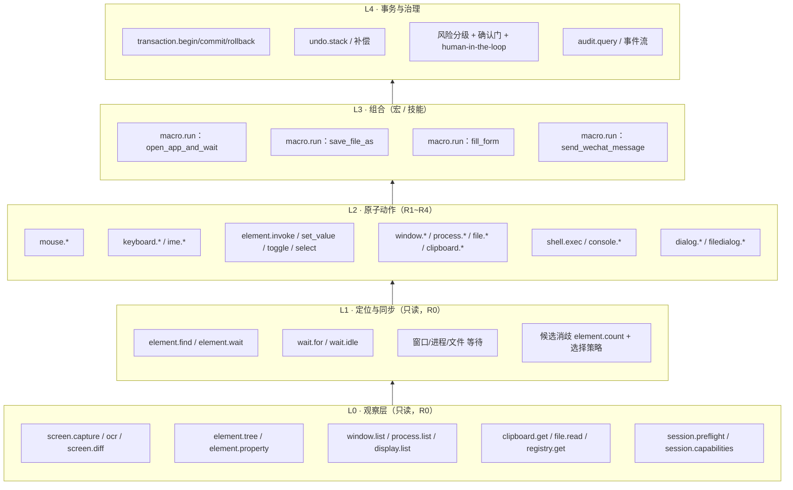
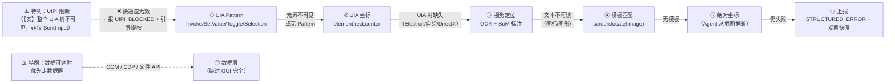

# 02 · Windows 操作模式抽取与能力需求清单

> 项目：WinUse　｜　作者：许清楚（PM）　｜　日期：2026-09-22
> **本文档是整个调研的核心**。§2 做场景枚举，§3 定义抽象分层，§4 抽取交互模式，§5 输出能力需求清单（架构师据此设计协议）。

---

## 1. 目标与术语

**要回答的问题**：一个人在 Windows PC 上一天会做哪些操作？从这些操作中能抽出哪些**可复用的交互模式**？支撑这些模式需要哪些**具体能力**？

**术语约定**

| 术语 | 英文 | 定义 |
|---|---|---|
| 作用域 | Scope | 一次动作的作用边界：整个桌面 / 某个显示器 / 某个窗口 / 某个控件子树 |
| 元素 | Element | UIA 树中的一个节点（对应一个逻辑控件） |
| 稳定句柄 | Stable Handle | 服务端生成、跨调用可复用的元素/窗口引用（内含失效检测） |
| 选择器 | Selector | 声明式定位表达式（name / control_type / automation_id / path / index …） |
| 原语 | Primitive | 不可再分的原子能力（如 `mouse.click`） |
| 宏 | Macro | 由原语组合、可命名复用、单次调用完成的复合能力 |
| 事务 | Transaction | 一组动作，要么整体提交、要么整体回滚的边界 |
| 验证原语 | Verifier | 独立于执行通道、用于确认副作用真实发生的读操作 |
| 降级链 | Degradation Chain | 首选通道失败时的备用通道序列 |
| 风险级 | Risk Level | R0（只读）～ R4（系统级不可逆），见 §6 |

---

## 2. 场景枚举：一个人在 Windows PC 上会做什么

> 每个场景域给出：**操作清单 / 用户的实际做法 / 可用的自动化通道 / 真实难点**。
> 难度标记：🟢 易（有稳定 API）｜🟡 中（需降级或多步）｜🔴 难（无稳定通道或受系统约束）

### S1 应用生命周期 🔴

| 操作 | 用户怎么做 | 自动化通道 | 难点 |
|---|---|---|---|
| 启动应用 | 开始菜单搜索 → Enter；任务栏固定图标点击；桌面快捷方式双击；Win+R 输入；双击文件关联打开 | `process.start`（含 AppUserModelID / 开始菜单项 / UWP 激活 / ShellExecute 关联打开） | **UWP/Store 应用不能用 exe 路径启动**，需 `ApplicationActivationManager`；应用启动后"主窗口出现"的判定时机不确定 |
| 激活/切换到已有实例 | Alt+Tab；点击任务栏图标；任务视图 | `window.focus` + `process.start`（若未运行则启动，需 power=幂等） | 很多应用是单实例（再启动只会激活已有窗口）；Splash 窗口与真实主窗口是不同 HWND |
| 关闭应用 | 点 X；Alt+F4；任务管理器结束进程 | `window.close`（温和） / `process.terminate`（强制） / `process.kill` | **close 会触发"是否保存"对话框**（→ S9）；强制终止可能丢数据 |
| 以管理员身份运行 | 右键 → 以管理员身份运行 | `process.start(elevated=true)` | **必然弹 UAC**（→ S12），不可自动化 |
| 判断应用是否在运行 | 任务管理器 | `process.list` / `process.find` | 后台进程 vs 有窗口进程；多实例同名 |
| 等待应用就绪 | 看着加载动画 | `wait.for(window exists & idle)` + `wait.idle` | "窗口出现了"≠"可以操作了" |

### S2 窗口与布局 🟡

| 操作 | 用户怎么做 | 通道 | 难点 |
|---|---|---|---|
| 最大化/最小化/还原 | Win+↑ / Win+↓ / 标题栏按钮 | `window.maximize/minimize/restore` | 某些自绘标题栏应用不响应标准消息 |
| 移动 / 调整大小 | 拖拽标题栏 / 边框 | `window.move` / `window.resize` | 最小化状态下 SetWindowPos 无效；需先 restore |
| **贴靠布局 Snap Layouts** | 拖拽到屏幕边缘；**Win+Z** 调出贴靠布局面板；Win+←/→ | `window.snap(preset)`；Win+Z 面板本身是 Win11 独有 UI | **Snap Layouts（Win11）目前没有公开的稳定 API** 🔴，需靠 `keyboard.hotkey("Win+Z")` + 视觉定位，或直接用 SetWindowPos 计算分区坐标 |
| 多窗口平铺 | 手动拖拽对齐 | `window.snap` 组合调用 | — |
| 移到另一个显示器 | Win+Shift+←/→ | `window.send_to_monitor` | 混合 DPI 下移动会触发 `WM_DPICHANGED`，尺寸会变 |
| 虚拟桌面切换 | Win+Ctrl+←/→；Win+Tab | `window.virtual_desktop.*`；`keyboard.hotkey` | **虚拟桌面没有官方公开 API**（COM `IVirtualDesktopManager` 仅部分可用，且未文档化）🔴 |
| 置顶 / 取消置顶 | 第三方工具 | `window.set_topmost` | 系统级修改，风险 R1 |
| Z 序管理 | 点击切换 | `window.focus` / `window.bring_to_front` | 焦点可能被 UIPI 拒绝（→ 5.2 机制二） |

### S3 文件与资源管理器 🟡

| 操作 | 用户怎么做 | 通道 | 难点 |
|---|---|---|---|
| 打开某路径 | Win+E → 地址栏输入 → Enter；Win+R 输入路径 | `shell.exec("explorer <path>")` / `file.list` + `window.navigate` | Explorer 地址栏的 UIA 名称在 Win10/Win11 不同 |
| 导航（前进/后退/上级） | Alt+← / Alt+↑ | `keyboard.hotkey` / `element.invoke` 工具栏按钮 | 工具栏按钮常无稳定 AutomationId |
| 搜索 | 右上角搜索框 | `element.set_value` + Enter | 索引未完成时结果不完整（需 `wait.for`） |
| 新建文件夹 | Ctrl+Shift+N | `file.mkdir` **或** GUI 模拟 | **GUI 模拟会进入"重命名"编辑态**，名称输入框是临时控件 |
| 重命名 | F2 → 输入 → Enter | `file.rename` / F2 + `keyboard.type` | 编辑态控件树变化 |
| 复制/移动/删除 | Ctrl+C / Ctrl+X / Ctrl+V / Delete | `file.copy/move/delete` | 大文件进度对话框；同名冲突对话框（→ S9）；Delete 是"回收站"还是"永久删除"取决于设置与 Shift |
| 多选 | Ctrl+点击 / Shift+点击 / Ctrl+A | `element.select(add=true)`（SelectionPattern）**或** Ctrl+click 坐标 | **Explorer 的 ListView 虚拟化为导致未渲染项无法选中** 🔴 |
| 查看属性 | Alt+Enter / 右键属性 | `file.stat` | — |
| 压缩/解压 | 右键 → 发送到 / 第三方 | `file.archive` / `file.unarchive`（可用 tar/7z 后端） | 系统自带解压的对话框与第三方不同 |
| 回收站 | 打开回收站 → 还原 | `file.recycle.list/restore/empty` | 无官方稳定 API，需 Shell 命名空间 🔴 |

### S4 文本编辑 🟡

| 操作 | 用户怎么做 | 通道 | 难点 |
|---|---|---|---|
| 光标定位 | 点击 / 方向键 / Ctrl+Home/End | `element.caret.set(offset)`（TextPattern）**或** 点击坐标 | **TextPattern 覆盖率低**；编辑器（VS Code/CodeMirror/富文本）多为自绘 → 只能坐标 |
| 选中 | 拖选 / Shift+方向键 / Ctrl+A / 双击选词 / 三击选段 | `element.selection.set(start,end)` / `mouse.drag` / `keyboard.hotkey` | 选区在自绘编辑器里**无法读回**（除非走剪贴板或 OCR） |
| 删除 | Backspace / Delete / Ctrl+Backspace | `keyboard.press` / `element.set_value`（整体替换） | `set_value` 不触发应用的 OnChange 事件（→ 需 `type_keys` 风格） |
| 查找替换 | Ctrl+F / Ctrl+H | 应用对话框 + `element.set_value` | 每个应用对话框都不一样 |
| 撤销重做 | Ctrl+Z / Ctrl+Y | `keyboard.hotkey` | 撤销栈在多控件间是共享的；**错误焦点会导致撤销到错误的地方** |
| 格式（加粗/字号/颜色） | 工具栏 / Ctrl+B | `element.invoke` 工具栏 / COM（Office） | 状态型按钮读"是否被按下"需要 TogglePattern 或视觉 |
| **富文本 vs 代码编辑器差异** | — | 富文本（Word/RTF）可用 COM/UIA；代码编辑器（VS Code/JetBrains）**基本只能坐标+键鼠** | 见 §5.4 降级链 |

### S5 剪贴板 🟢

| 操作 | 通道 | 难点 |
|---|---|---|
| 复制/粘贴 | `clipboard.get` / `clipboard.set` **或** Ctrl+C/Ctrl+V | 走剪贴板比走键盘**更快更可靠**，但会**污染用户剪贴板**（需保存/恢复） |
| 多格式 | `clipboard.formats` / `clipboard.get(format)` | CF_TEXT / CF_UNICODETEXT / CF_HTML / CF_BITMAP / CF_HDROP（文件列表） |
| 剪贴板历史 | **Win+V**；`clipboard.history` | Win10 1809+ 才有；**历史面板的 UIA 支持不稳定** 🟡 |
| 纯文本粘贴 | Ctrl+Shift+V（部分应用） | 应用相关 |

### S6 浏览器与网页 🟡

| 操作 | 通道 | 难点 |
|---|---|---|
| 地址栏导航 | `browser.navigate` / `element.set_value` 地址栏 + Enter | 地址栏与搜索框在 Chrome/Edge 中是**同一个控件**（ Omnibox），焦点态不同 |
| 标签页管理 | `browser.tabs.*` / Ctrl+T / Ctrl+W / Ctrl+Tab | 标签条 UIA 支持一般；`browser.tabs` 需 CDP |
| 书签 | `browser.bookmarks.*`（需 CDP 或书签文件解析） | 无稳定 API |
| 下载 | 点击下载链接 → **"另存为"对话框或浏览器下载栏** | 下载完成判定：`wait.for(file exists & size stable)`；Chrome 下载栏是 WebUI |
| 表单填写 | CDP `DOM` 定位 → 填；或 UIA → 填 | **CDP 更可靠但需 `--remote-debugging-port` 启动参数**——对已运行的浏览器**需用户授权重启** 🔴 |
| 登录态 | 复用用户 profile | Cookie/凭据属敏感数据，能力需 R3 授权 |
| **CDP 可行性** | `browser.cdp.attach` | Chrome/Edge 支持；**国产壳浏览器（360/QQ/搜狗/UC）多数是 Chromium 定制，CDP 端口策略不一** ❓待验证 |
| 网页内容抽取 | CDP DOM / `browser.dom.get` | 截图 OCR 是兜底 |

### S7 终端 / PowerShell / CMD 🔴

| 操作 | 通道 | 难点 |
|---|---|---|
| 执行命令 | `shell.exec`（新建进程，拿 exit_code/stdout） | ✅ **最可靠** |
| **交互式 shell**（ssh / python REPL / 需要 sudo 输入密码） | `console.send`（向已附加会话发送 stdin） | 需要维护持久会话；Windows Terminal / ConPTY 下**外部进程无法拿到 console HWND** |
| **长任务** | `shell.exec_async` → job → 轮询 | 需处理超时、取消、输出截断 |
| **读取屏幕输出** | `console.read_buffer`（`ReadConsoleOutput`） | ⚠️ **ConPTY 下只能读当前视口，读不到 scrollback**；需 UIA 读屏兜底（且 UIA 读终端性能差）。见 [microsoft/terminal#19614](https://github.com/microsoft/terminal/discussions/19614) |
| 退出码 | `shell.job.status` | 交互式会话无退出码概念 |
| 中文/编码 | — | **控制台代码页（936/65001）混乱是真实痛点**，需显式设置 `chcp 65001` 并在读取时按 UTF-8 解码 |

### S8 系统设置与控制面板 / 注册表 🔴

| 操作 | 通道 | 难点 |
|---|---|---|
| Settings 应用（Win10/Win11） | UIA（Settings 的 UIA 支持尚可） | **Win10 控制面板 vs Win11 Settings 是两套完全不同的 UI**；同一设置在两代系统的路径不同 |
| 旧控制面板（.cpl） | `shell.exec("control.exe <cpl>")` | 直接启动子面板比导航更可靠 |
| 注册表 | `registry.get/set/delete`（Win32 Registry API） | 🔴 高危；**修改系统设置时走 GUI 比改注册表更安全可审计** |
| 环境变量、区域、时区 | `system.setting.get/set` | 需管理员权限 |
| 显示设置（分辨率/缩放） | UIA / `display.*` | 改缩放会触发全局 DPI 变化，正在进行的自动化会失效 |

### S9 对话框与弹窗 🔴（Windows 上最高频的失败源）

| 类型 | 通道 | 难点 |
|---|---|---|
| **模态对话框**（MessageBox / #32770） | `dialog.detect` / `dialog.button.click` | **模态对话框会阻塞主窗口的消息循环**——不是"慢"，是"死等"。必须先解除阻塞才能继续主流程 |
| **文件打开/保存对话框** | `filedialog.set_path` + `filedialog.confirm` | Windows 上极常见且难缠：① 属于**调用方进程**而非 Explorer；② 文件名输入框常为 `AutomationId=1148`，但**不同 Windows 版本/是否"另存为"会变**；③ 路径中不能有非法字符；④ 点"保存"后可能弹"是否覆盖" |
| **Win10 vs Win11 差异** | — | 已核实：记事本"未保存更改"提示，**Win10 是子对话框（DialogPresent 可检测），Win11 是窗口内嵌（DialogPresent 不触发）**。选择器必须能同时覆盖两种形态 |
| UAC 提权提示 | ❌ **不可自动化** | 见 S12 |
| 通知 / Toast | `toast.list/dismiss/click` | Toast 在 Action Center 中，**UIA 覆盖不稳定** 🟡 |
| 系统托盘图标与右键菜单 | `tray.list` / `tray.click` | 托盘区（含"隐藏图标"溢出区）的 UIA 支持差 🔴 |
| 应用内弹窗（广告/更新提示/登录过期） | `element.find` + `element.invoke`（关闭按钮） | 无统一模式，需"意外弹窗恢复处理器"（→ 模式 P5） |
| 错误消息读取 | `element.text.get` / OCR | 有的错误在状态栏、有的在对话框、有的在日志 |

### S10 输入设备 🟢（但 IME 见 S15）

| 操作 | 通道 | 难点 |
|---|---|---|
| 鼠标移动/单击/双击/右键/中键 | `mouse.*` | 双击有时间间隔要求（系统双击时间） |
| 拖拽 | `mouse.drag(from,to,steps,delay)` | **拖拽目标需滚动到可见**；某些应用需要中间 hover 触发（如树形控件展开） |
| 滚轮 | `mouse.scroll(direction,amount,target)` | amount 单位在不同应用差异大（行数 vs 像素） |
| 悬停 | `mouse.hover` + `wait.for(tooltip)` | Tooltip 是延迟出现的浮动窗口 |
| 组合键 / 快捷键 | `keyboard.hotkey("Ctrl+Shift+S")` | 系统级热键（Win+L / Ctrl+Alt+Del / Win+Tab）**部分被系统保留，SendInput 无效** 🔴 |
| 长按 | `keyboard.down` + `wait` + `keyboard.up` | — |
| 输入文本 | `keyboard.type`（**Unicode 直注**） | 见 S15 |

### S11 多显示器 / 虚拟桌面 / DPI 🔴

| 操作 | 通道 | 难点 |
|---|---|---|
| 获取显示器布局 | `display.list`（含 bounds/work area/primary/scale/orientation） | 坐标可为负（主屏左侧的副屏） |
| 按显示器截图 | `screen.capture(monitor=N)` | 需处理不同分辨率 |
| 混合 DPI 坐标换算 | API 层统一（服务端声明 `PerMonitorV2`） | **已核实**：三种感知等级导致同一个窗口 rect 有三种返回值（500×500 / 1000×1000 / 1500×1500）。截图=物理像素，UIA rect=逻辑坐标，`GetCursorPos`=物理像素 |
| 窗口跨屏移动 | `window.send_to_monitor` | 触发 `WM_DPICHANGED`，窗口尺寸自动变化 |
| 虚拟桌面管理 | `window.virtual_desktop.*` | **无官方公开 API**；COM `IVirtualDesktopManager` 非文档化且版本易变 🔴 |

### S12 会话状态约束 🔴（**自动化失效的硬边界**）

| 状态 | 后果 | 处理 |
|---|---|---|
| **桌面锁定（Win+L / 屏保）** | 所有模拟输入失败；截图为锁屏画面 | `session.preflight` 检出锁屏 → 返回 `SESSION_LOCKED`，**不可自动解锁**，需 human-in-the-loop |
| **UAC 安全桌面** | 完全不可访问，自动化被阻断 | 检出 → 返回 `UAC_PROMPT_OPEN` + 请求人工；或预先用提权模式运行 WinUse |
| **RDP 窗口最小化** | 会话无渲染，自动化失败 | 检出 → 提示；已知注册表规避项 `RemoteDesktop_SuppressWhenMinimized=2` |
| **休眠 / 待机** | 进程挂起 | 需唤醒策略；唤醒后可能需重新登录 |
| **目标应用已提权运行** | ~~UIPI 阻断 SendInput → 改用 UIA Pattern~~ **【实】整个 UIA 树也不可见** | **检出并上报 `UIPI_BLOCKED` + 恢复指引（引导以管理员身份重启 WinUse）**；恢复路径是**提升 WinUse 自身 IL**，不是换通道。⚠️ 另注意：IL 查询本身有 **~47% 概率失败**（290 进程中 135 个查不到）→ 检出应为三态 `match / mismatch / unknown`（登记 A-15） |
| **UAC 关闭但 UIPI 生效** | 同上 | 同上 |
| **远程会话断开（非最小化）** | 会话被锁 | 同上锁屏处理 |

> 已核实来源：[Microsoft: UIPI issues](https://learn.microsoft.com/en-sg/troubleshoot/power-platform/power-automate/desktop-flows/ui-automation/uipi-issues)

### S13 任务栏 / 开始菜单 / 托盘 / 桌面小组件 🟡

| 操作 | 通道 | 难点 |
|---|---|---|
| 任务栏图标点击 | `taskbar.click(app)` / UIA | 图标按 UWP 名称或 exe；分组/合并后的图标需展开 |
| 任务栏右键菜单 | UIA | Win11 任务栏右键菜单改为新样式，UIA 支持有差异 |
| 开始菜单搜索 | `keyboard.hotkey("Win")` + `keyboard.type` + Enter | 搜索结果索引延迟；**开始菜单是 XAML，UIA 支持尚可但结构随版本变** |
| 固定到任务栏/开始 | 右键菜单 | 应用相关 |
| 系统托盘 | `tray.*` | 见 S9 |
| 操作中心 / 快速设置 | Win+A / Win+N | 浮动面板，UIA 覆盖一般 |
| 桌面小组件（Win11 Widgets） | Win+W | Web 内容，UIA 基本不可用 🔴 |
| 桌面图标 | `display.desktop_icons` | SysListView32，UIA 支持一般 |

### S14 国民级应用（中文场景）🔴

| 应用 | 技术栈（推测需实测） | 预计通道 | 主要难点 |
|---|---|---|---|
| **微信（Windows）** | 自绘 / Duilib 类 | **坐标 + 键鼠为主** | 聊天列表与消息区多为自绘；**UIA 覆盖率极低**（业界公认）；截图 OCR 是主要感知手段 |
| **企业微信** | Electron 类 | UIA（若启用 a11y）/ 坐标 | 需实测是否暴露 a11y 树 |
| **钉钉** | 自绘 / CEF | 坐标 + OCR | 类似微信 |
| **飞书** | Electron 类 | UIA / 坐标 | 需实测 |
| **Office（Word/Excel/PPT）** | 原生 + Ribbon | **COM（WinCOM）最优**；UIA 次之；坐标兜底 | Excel 单元格可用 COM 直达（UFO² 的做法）；**WAA 基准中 Office 类任务成功率近 0%**，说明这是最硬的骨头 |
| **WPS** | 自绘 Ribbon | COM（兼容 Office 对象模型）/ 坐标 | 与 Office 的对象模型不完全一致 |
| **国产壳浏览器** | Chromium 定制 | 坐标；CDP 需验证 | CDP 端口策略不一 ❓ |

> ⚠️ 上表"技术栈"为**推断（🧩）**，必须实测（已列入 01 号文档待验证清单第 4 项）。

### S15 【单独深挖】中文输入法（IME）🔴

> 这是中文 Windows 用户的核心痛点，也是海外方案完全没处理的领域。

**问题机制（已核实）**

1. `SendInput` 发送的是**虚拟键码（VK）**。若目标窗口的 IME 处于**中文态**，按键消息会先进入 **IME 的 Composition（组字）窗口**，被转换为汉字或丢弃。
2. 因此：想输英文必须 IME 在英文态；想输中文必须 IME 开启**且知道编码方案（拼音/五笔）**——对自动化几乎不可行。
3. `SendKeys`（WScript/UIA 的 SendKeys 风格）同样受 IME 状态影响；社区常见 workaround 是"发送 Ctrl+Shift+1/2 强制切换输入法"——**脆弱且会改变用户状态**。

**正解（已核实）**

使用 `SendInput` + `KEYEVENTF_UNICODE`，把 `KEYBDINPUT.wScan` 设为字符的 Unicode 码，走 `VK_PACKET` → `TranslateMessage` → `WM_CHAR`。**完全绕过 IME，中英文都不需要切换输入法状态。** 另需注意：不指定 `KEYEVENTF_KEYUP` 才会生成可转字符的 `WM_KEYDOWN`。

**由此推导的能力设计**

| 需求 | 能力 | 说明 |
|---|---|---|
| 输入任意 Unicode 文本（含中文），不受 IME 状态影响 | `keyboard.type(text)` | **默认走 KEYEVENTF_UNICODE**。这是 `type` 的默认语义，不是可选项 |
| 输入控制键/快捷键（这些**必须**走 VK 路径） | `keyboard.press` / `keyboard.hotkey` | 与 `type` 分开，语义清晰 |
| 需要**真实模拟中文输入过程**（测试 IME、触发应用的组字事件） | `keyboard.type_pinyin(text)` + `keyboard.ime.*` | 走 VK 路径 + IME，属高级/测试用途，风险高 |
| 读取当前 IME 状态 | `keyboard.ime.status` | 返回：当前输入法名称 / 中英模式 / 组字窗口是否打开 / 候选列表是否显示 |
| 显式切换中/英或切换输入法 | `keyboard.ime.set` | 会改变用户状态，**必须在审计中记录并在任务结束时恢复** |
| 读取候选词 | `keyboard.ime.candidates` | 候选窗口 UIA 覆盖不稳定 ❓，可能只能 OCR |
| **避免污染用户 IME 状态** | 事务性保证 | 任务开始时快照 IME 状态，结束时恢复 |

**关键设计约束**：`keyboard.type` 不得改变用户的 IME 状态。若必须改变（走 VK 路径时），需在 `transaction` 内并自动回滚。

> 已核实来源：[SendInput 模拟键盘输入的问题](https://www.cnblogs.com/liuzhaoyzz/p/6208670.html)、[CSDN 同主题](https://blog.csdn.net/weixin_30653097/article/details/96917331)

### S16 增补场景 🟡

| 操作 | 通道 | 难点 |
|---|---|---|
| 安装 / 卸载软件 | 启动安装包 → **向导式安装程序**（NSIS/Inno/WiX/MSIX） | 安装向导是 Windows 上最典型的"长流程 + 多分支 + UAC"场景；**每步都有不同对话框** |
| 打印 | Ctrl+P → 打印对话框 | 打印机选择、驱动对话框 |
| 截图 / 录屏 | `screen.capture` | 游戏/视频受**受保护内容（DRM）**限制，截图为黑屏 🔴 |
| 音频设备切换 / 音量 | 托盘音量面板 | UIA 覆盖一般 |
| 网络 / VPN / 代理 | 设置应用 | 需管理员 |
| 时间日期 / 区域语言 | 设置应用 / intl.cpl | 区域变更需重启 |
| 账户登录 / Windows Hello | ❌ 不可自动化 | 凭据与生物识别属禁区 |
| 密码输入框 / 凭据输入 | `keyboard.type` | **属高风险，必须 human-in-the-loop 或显式授权** |
| 验证码 / 二次验证 | ❌ 不可自动化 | 必须 human-in-the-loop（→ 模式 P11） |
| 拖拽跨应用（如文件拖到微信窗口） | `mouse.drag` + 目标应用 hover 触发 | 目标应用需先置前；微信类自绘应用拖拽落点判定靠 OCR |
| 游戏 / 3D 应用 | 纯坐标 + 模板匹配 | 无 UIA；受反作弊拦截风险（**WinUse 应明确声明不面向游戏作弊**） |

---

## 3. 抽象分层：从场景到能力



**分层原则**
1. **L0/L1 全只读、零风险** → 可无限重试、无需授权。Agent 应该被鼓励多观察。
2. **L2 是唯一会产生副作用的地方** → 所有风险分级、确认门、审计都挂在 L2 上。
3. **L3 是 Agent 友好的关键** → 把高频长流程预置成宏，压缩步数与 token（证据：Fara-7B 靠"浏览宏"把平均步数从 41 降到 16）。
4. **L4 是安全与可回滚的边界** → 不要求所有动作可撤销，但要求**要么可撤销、要么事前确认、要么事后可审计**。

---

## 4. 交互模式（Pattern）

> 每个模式：**模式名 / 触发场景 / 组成步骤 / 依赖原语 / 失败模式与应对**。

### P1 · Locate → Observe → Act → Verify（主循环）

- **触发**：一切有副作用的操作。
- **步骤**：
  1. `Locate`：`scope` 确定（P3）→ `element.find` / `window.find`
  2. `Observe`：读属性（name / state / enabled / rect / value）
  3. `Act`：按执行优先级（P10 降级链）执行
  4. `Verify`：**独立通道**复验（P9）
- **依赖**：`element.*`、`wait.*`、`screen.diff`
- **失败模式**：
  - Locate 失败 → 进入降级链（P10）
  - Act 无报错但没生效 → **最常见且最危险**；靠 Verify 兜底
  - Verify 失败 → 重试一次（幂等，P6）→ 仍失败则上报结构化错误

### P2 · 选择器优先、坐标兜底（Selector-First）

- **触发**：所有元素定位。
- **步骤**：先尝试 UIA 选择器（`automation_id` > `name+control_type` > `path` > 文本模糊），失败再退到 OCR/SoM 视觉定位，最后才用绝对坐标。
- **依赖**：`element.find`、`ocr.recognize`、`screen.locate`、`screen.capture(annotate)`
- **证据**：WAA 上"加 UIA a11y tree"让成功率从 12.5% → 19.5%（+57%）。
- **失败模式**：选择器在多语言 UI 上失效（name 随系统语言变）→ 选择器应支持**多语言别名**与 `automation_id` 优先。

### P3 · 作用域 / 焦点契约（Scope & Focus Contract）

- **触发**：**任何**动作之前。
- **约定**：每个请求必须携带 `scope`，取值：
  - `desktop`（全桌面 / 某显示器）
  - `window:<handle>`（某窗口及其子树）
  - `element:<handle>`（某控件子树）
  - `process:<pid>`（该进程所有窗口）
- **不变量**：所有 `element.find` 只在 scope 内搜索；`keyboard.*` 只发给 scope 对应的前台窗口（执行前先 `window.focus`）。
- **依赖**：`window.focus`、`session.set_scope`
- **失败模式**：**焦点漂移**（用户/其他程序抢焦点）→ 执行前校验 `element.get_focused() ∈ scope`，不符则拒绝执行并返回 `FOCUS_LOST`。

### P4 · 等待与同步（Wait & Sync）

- **触发**：任何异步状态变化（窗口出现、加载完成、文件写入完成、动画结束）。
- **四类等待**：
  | 类型 | 原语 | 说明 |
  |---|---|---|
  | 元素等待 | `element.wait(exists/visible/enabled/text)` | 首选 |
  | 进程/窗口等待 | `process.wait` / `window.wait` | 启动应用后 |
  | 空闲等待 | `wait.idle(input_idle_ms, cpu_idle_ms)` | 通用兜底 |
  | 防抖/稳定等待 | `wait.stable(condition, duration)` | 文件大小稳定、UI 连续 N 次采样不变 |
- **反模式**：`wait.timeout(固定 sleep)` —— 必须提供但不推荐，且审计中标记。
- **失败模式**：超时 → 返回 `TIMEOUT` + 最后一次观察快照，**让 Agent 能自己决定下一步**。

### P5 · 模态阻断处理（Modal Interception）

- **触发**：模态对话框、UAC、文件对话框、应用内弹窗阻塞主流程。
- **步骤**：
  1. `dialog.detect(scope)`：是否存在模态窗口（含跨进程：属于同一进程树的顶层窗口）
  2. 分类：`UAC` / `FILE_DIALOG` / `MESSAGE_BOX` / `APP_MODAL` / `UNKNOWN`
  3. 分派：
     - `FILE_DIALOG` → `filedialog.set_path` + `confirm`
     - `MESSAGE_BOX` → `dialog.button.click(name)`（支持 `DialogPresent` / `DialogAbsent` 校验）
     - `UAC` → **不可自动化**，升级至 P11
     - `UNKNOWN` → 返回结构化描述 + 请求 Agent 决策
  4. 解除后重新校验主流程状态（P1 的 Verify）
- **依赖**：`dialog.*`、`filedialog.*`
- **失败模式**：Win11 的"内嵌式提示"不是子对话框（已核实：记事本未保存提示）→ `DialogPresent` 不触发 → 需同时检测"窗口内出现特定按钮"。
- **补充**：**意外弹窗恢复处理器**——可注册全局 handler，在任何步骤后自动检查并关闭已知干扰弹窗（广告/更新提示）。

### P6 · 幂等与幂等键（Idempotency）

- **触发**：所有会改变状态的写操作（尤其文件写入、消息发送、表单提交）。
- **机制**：请求携带 `idempotency_key`（客户端生成）。服务端对相同 key 的重复请求：
  - 已完成 → 直接返回首次结果（`replayed: true`），**不重复执行**
  - 进行中 → 返回 `IN_PROGRESS`，可轮询
- **语义分级**（每个能力必须声明）：
  - `idempotent`（设置值、删除已不存在的文件）
  - `conditional`（带 `if_match` 前置条件，如"仅当值等于 X 时才设置"）
  - `non_idempotent`（发送、追加、计数）→ **必须要求 idempotency_key**
- **失败模式**：网络断开后重试导致重复发送 → 幂等键 + 服务端去重窗口解决。

### P7 · 可回滚与补偿（Undo / Compensation）

- **触发**：高风险动作。
- **机制**（**不追求完美撤销，追求明确声明**）：
  1. 每个写能力声明其补偿能力：`none` / `exact`（可精确撤销）/ `compensating`（可用反向操作补偿）
  2. `transaction.begin` 内的动作记录补偿信息（如 `file.delete` 记录回收站位置；`file.write` 记录原内容哈希与备份）
  3. `transaction.rollback` 按逆序执行补偿
- **依赖**：`transaction.*`、`undo.*`
- **失败模式**：补偿本身失败 → 返回**部分回滚报告**（哪些成功、哪些失败、当前状态是什么），绝不静默。

### P8 · 批量/循环操作（Batch）

- **触发**：列表逐项处理（批量重命名、逐条发消息、表格逐行填写）。
- **机制**：
  - `element.find_all` 返回候选列表 → 服务端支持 `foreach` 语义的 `macro.run(items=[...])`
  - **关键**：虚拟化列表（Explorer ListView、长聊天记录）未渲染项不可见 → 需 `element.scroll_into_view` 后重新定位，或走数据层（COM/CDP/文件 API）
- **失败模式**：中途某项失败 → 需要"继续 / 中止 / 回滚已完成项"三选一策略，由 Agent 指定 `on_error`。

### P9 · 状态快照与 diff（Snapshot & Diff）

- **触发**：每次观察，以及每次动作后的验证。
- **机制**：
  - `element.tree(scope)` 返回**结构化快照**，带 `snapshot_id`
  - 再次调用携带 `since=<snapshot_id>` → 只返回 diff（新增/移除/属性变更）
  - `screen.diff(a,b)` 返回差异区域（截图级）
- **依赖**：`element.tree`、`screen.diff`
- **证据**：Windows MCP Server（.NET 版）实测自动快照 diff 带来 **84–96% 的 byte/token 节省**。
- **用途**：① 降低 token 成本；② **作为 Verify 的独立证据**（"确实有 3 个元素变化了"）。

### P10 · 降级链（Degradation Chain）

- **触发**：首选通道失败。
- **链路**：



- **关键**：
  1. ~~**UIPI 阻断时不是降级，是换通道**：SendInput 被拒 → 改用 UIA Pattern（已核实可行）~~
     **❌ 已证伪（2026-09-22 第一轮 PoC【实】，登记 A-01）**：阻断粒度是**高 IL 进程的整个 UIA 树**，不是"仅 SendInput 被拒"。实测 Medium IL 进程对「管理员: Windows PowerShell」（High IL，pid 17860）**在 UIA 中一个元素都看不到**（0/1）；同机 Medium IL 且真正可见的窗口 8/8 全见。
     **修正后的语义**：UIPI 阻断时**既不是降级也不是换通道，而是检出 + 上报 `UIPI_BLOCKED` + 可执行恢复指引**（引导以管理员身份重启 WinUse）。恢复路径是**提升 WinUse 自身的 IL**，不是换感知/执行通道。
     来源：`poc/poc-results.json` → `uipi_cross_check`（`A01_verdict=BLOCKED`）；见 `12-poc-findings.md` C1、`11-assumptions-register.md` A-01。
  2. **数据层永远优先于 GUI**：能走 COM（Office）、CDP（浏览器）、文件 API 的，不要走 GUI
- **失败模式**：降级成功后**执行通道变了但 Agent 不知道** → 响应必须返回 `channel_used` 与 `degraded_from` 字段。

### P11 · 人机接管（Human-in-the-Loop）

- **触发**：
  - 风险级 ≥ R3 且未预授权的动作
  - UAC / 锁屏 / 凭据 / 验证码 / 二次验证 / 支付
  - 歧义无法自动消解（多个候选元素且无法判定）
- **机制**：服务端返回 `NEEDS_HUMAN`（非错误，是一种**挂起状态**）→ 本地托盘弹确认 UI → 用户确认/输入/接管 → 请求以 `resume_token` 继续
- **契约**：**挂起不是失败**。Agent 必须能区分 `NEEDS_HUMAN`（等待人）与 `FAILED`（做不成）。
- **借鉴**：AutoGLM 在需登录时"主动停下等人"；OpenAI/Mariner 在敏感操作时停顿。

### P12 · 风险分级与权限边界（Risk Tiering）

- **机制**：每个能力标注风险级（§6）；服务端有 `permission_mode`：
  - `observe`：仅 R0（只读）
  - `standard`：R0–R2，R3 需确认
  - `elevated`：R0–R4，R3/R4 需确认
- **依赖**：`session.set_mode`、`session.capabilities`（返回当前模式下的可用能力）
- **失败模式**：越权 → 返回 `PERMISSION_DENIED` + 明确"需要哪种授权"，**不要静默降级**。

### P13 · 前置环境校验（Preflight）

- **触发**：会话开始、每个事务开始、长任务恢复时。
- **检查项**：桌面是否锁定 / UAC 是否打开 / 屏保是否激活 / 是否 RDP 且最小化 / 自身与目标进程完整性级别 / 显示器布局是否变化 / DPI 是否变化
- **依赖**：`session.preflight`
- **失败模式**：环境不满足 → 返回具体原因码（`SESSION_LOCKED` / `UAC_OPEN` / `SCREENSAVER_ACTIVE` / `RDP_MINIMIZED` / `INTEGRITY_MISMATCH`），**不尝试执行**。
- **证据**：微软官方 UIPI 文档把这些列为自动化的首要失败原因。

### P14 · 上下文成本控制（Context Budgeting）

- **触发**：每次观察返回。
- **手段**：
  1. 默认返回**结构化文本**（UIA 树 / OCR 结果），**不是截图**
  2. `element.tree` 支持过滤（`interactive_only` / `depth` / `hide_offscreen` / `hide_disabled`）
  3. 重复观察默认返回 diff（P9）
  4. 截图可选：缩放、JPEG、区域裁剪、**默认不返回图像只返回元素标注**（SoM 元数据）
  5. 响应支持 `max_tokens` 预算提示，超出时服务端自动裁剪并标明 `truncated: true`
- **证据**：Windows MCP Server 实测数据；Anthropic 单步截图 800–1200 token，50 步累计 4–6 万 token。

### P15 · 候选消歧（Candidate Disambiguation）

- **触发**：`element.find` 返回多个匹配。
- **机制**：
  1. 返回全部候选（含 name / control_type / rect / 层级路径），并给出**排序理由**（精确匹配 > 前缀 > 包含 > 模糊）
  2. 支持 **`element.count` 先问数量**再决定（便宜）
  3. 支持 `disambiguate_by`（位置：最靠近某元素/在某元素内/最大面积/第一个可交互）
- **失败模式**：Agent 盲选第一个 → 支持 `require_unique: true`，非唯一时直接返回 `AMBIGUOUS` 而非猜测。

### P16 · 组合为宏 / 技能（Composition）

- **触发**：高频多步流程。
- **机制**：
  - 内置宏库（服务端预置，如 `save_file_as`、`open_app_and_wait`、`fill_form`、`send_message`）
  - 用户/Agent 可定义**命名宏**（一次定义，后续单次调用）
  - 宏内部自带 P1/P4/P5（等待、验证、模态处理），对外暴露为**单个能力**
- **价值**：把 30 步压成 1 步 = 省 29 次 LLM 往返（Fara-7B 的实证方向）。
- **失败模式**：宏内部某步失败 → 返回**已完成步骤轨迹** + 失败点，而不是笼统失败。

### P17 · 验证独立于执行通道（Independent Verification）

- **触发**：所有"声称成功"的动作。
- **原则**：**不能用产生结果的那个通道来验证结果**。
  - ❌ 点"保存"后读应用自己的"保存成功"横幅
  - ✅ 点"保存"后用 `file.stat` 读文件系统
- **依赖**：每种副作用必须至少有一个**独立的只读验证手段**：
  | 副作用 | 执行通道 | 独立验证通道 |
  |---|---|---|
  | 保存文件 | GUI 点击保存 | `file.stat` / `file.hash` |
  | 修改设置 | Settings UI | `registry.get` / `system.setting.get` |
  | 发送消息 | GUI 输入发送 | 消息列表 `element.text.get` / OCR |
  | 修改单元格 | GUI 或 COM | COM 读回 / 另存后读文件 |
  | 提交表单 | 点击提交 | 导航后 DOM/URL 校验 |
- **借鉴**：OpenAdapt 的 `--break-it` 演示——UI 显示成功但独立记录未变更时**必须报失败**。

---

## 5. 能力需求清单（Capability Catalog）

> 交付给架构师的直接输入。
> **风险级**：R0 只读 ｜ R1 可逆本地变更 ｜ R2 难可逆本地变更 ｜ R3 跨应用/外部可见副作用 ｜ R4 系统级/不可逆
> **幂等**：I=幂等 ｜ C=需条件前置 ｜ N=非幂等（**必须带 idempotency_key**）

### 5.1 会话与环境 `session.*`

| 能力 | 语义 | 关键参数 | 返回 | 失败语义 | 风险 | 幂等 |
|---|---|---|---|---|---|---|
| `session.hello` | 握手 | `client`, `protocol_version` | server 版本、能力摘要 URL、当前 `permission_mode`、会话 ID | `VERSION_MISMATCH` | R0 | I |
| `session.capabilities` | **自描述**：返回完整能力目录（含每个能力的 JSON Schema、风险级、幂等性、参数/返回结构） | `filter`（namespace/risk/updated_since） | 能力目录（可分页） | — | R0 | I |
| `session.preflight` | 环境前置校验（P13） | `checks[]` | 每项状态；`ready: bool` | 具体原因码：`SESSION_LOCKED`/`UAC_OPEN`/`SCREENSAVER_ACTIVE`/`RDP_MINIMIZED`/`INTEGRITY_MISMATCH` | R0 | I |
| `session.status` | 健康与负载 | — | 运行态、队列长度、当前动作、uptime | — | R0 | I |
| `session.set_mode` | 切换权限模式 | `mode: observe\|standard\|elevated` | 生效模式 | `PERMISSION_DENIED`（需提权重启） | R1 | I |
| `session.subscribe` | 订阅事件流（SSE/WS）：元素出现、窗口创建/销毁、剪贴板变化、进程退出、Toast、DPI 变化、锁屏 | `events[]`, `scope` | `subscription_id` | — | R0 | I |
| `session.cancel` | 取消进行中的动作 | `action_id` / `cancel_token` | 取消结果 | `NOT_CANCELLABLE` | R1 | I |
| `session.resume` ⭐**新增** | **恢复被挂起的动作**（`NEEDS_HUMAN` 挂起-恢复协议的另一半；挂起 ≠ 失败，见 P11） | `resume_token`, `outcome`（`completed` / `aborted`） | 恢复结果；**`resume_token` 过期返回 `TIMEOUT` 而非 `APPROVAL_DENIED`**（语义不同：前者是没人来处理，后者是被拒绝） | `RESUME_TOKEN_INVALID` / `TIMEOUT` | R1 | C |

> ⭐ **`session.resume` 为什么新增（2026-09-22）**：`06` §9.3 已定义这个方法（含 `resume_token`、到期转 `TIMEOUT` 的完整挂起-恢复协议），但它**既不在本节，也不在 `07` §0.7.1** —— 按 team-lead 的命名权威口径，**能力 ID 以本节为唯一权威**，因此 `session.resume` 此前是**未授权 ID**。现补入本节，使 T17（UAC 上报）依赖的能力有权威 ID。
> **连带**：`session.*` 由 7 条变为 **8 条**，本节合计随之变化；**`07` §0.7.1 需同步补一行**（架构师维护），条数权威口径仍以 `07` §0.7 为准。

### 5.2 系统 `system.*` / 显示器 `display.*`

| 能力 | 语义 | 关键参数 | 返回 | 失败语义 | 风险 | 幂等 |
|---|---|---|---|---|---|---|
| `system.info` | OS 版本/构建/系统语言/区域/时区/用户名/会话 ID/完整性级别 | — | 结构化信息 | — | R0 | I |
| `system.idle` | 用户输入空闲时长 | — | `ms` | — | R0 | I |
| `system.power` | 电源状态查询 | — | 状态 | — | R0 | I |
| `system.setting.get` | 读系统设置项 | `key` | 值 | `UNSUPPORTED_KEY` | R0 | I |
| `system.setting.set` | 写系统设置项 | `key`, `value` | 前后值 | `PERMISSION_DENIED`/`UNSUPPORTED_KEY` | R4 | C |
| `system.env.get` | 读环境变量 | `name`, `scope: user\|machine` | 值 | — | R0 | I |
| `display.list` | 显示器列表 | — | `[{id, bounds, work_area, primary, scale_percent, dpi, orientation, name}]` | — | R0 | I |
| `display.dpi` | 每显示器 DPI + 本进程感知等级 | `monitor` | DPI、感知等级、**坐标系说明** | — | R0 | I |

> **坐标系约定（P0 级设计约束）**：所有对外坐标统一为**物理像素 + 显示器索引**，响应中携带 `coordinate_space` 元数据；服务端内部负责 UIA 逻辑坐标 ↔ 物理像素的换算。

### 5.3 进程 `process.*` / 窗口 `window.*`

| 能力 | 语义 | 关键参数 | 返回 | 失败语义 | 风险 | 幂等 |
|---|---|---|---|---|---|---|
| `process.list` | 进程列表 | `filter`（name/pid/has_window） | `[{pid, name, exe, integrity_level, session_id, window_count}]` | — | R0 | I |
| `process.start` | 启动（含 exe / 开始菜单项 / UWP AppUserModelID / ShellExecute 关联打开） | `target`, `args`, `cwd`, `elevated`, `wait_ready` | `pid`, 主窗口 handle | `NOT_FOUND`/`ELEVATION_REQUIRED`/`UAC_BLOCKED` | R1 | N |
| `process.terminate` | 温和终止 | `pid`, `timeout` | 结果 | `TIMEOUT`→ 建议 `kill` | R2 | C |
| `process.kill` | 强制终止 | `pid` | 结果 | — | R2 | C |
| `process.wait` | 等待状态 | `pid`, `state: running\|exited`, `timeout` | 结果 + exit_code | `TIMEOUT` | R0 | I |
| `window.list` | 窗口列表（含 z-order、显示器、状态、虚拟桌面、进程） | `filter`, `include_minimized` | 列表（带稳定 handle） | — | R0 | I |
| `window.find` | 按条件查找 | `title`（精确/正则）, `class`, `process`, `handle` | 候选列表（去重、排序） | `NOT_FOUND`/`AMBIGUOUS` | R0 | I |
| `window.focus` | 激活到前台 | `handle` | 激活结果 | `FOCUS_LOST`（被抢）/`UIPI_BLOCKED` | R1 | I |
| `window.state.get` | 状态 | `handle` | `normal\|minimized\|maximized`, rect, monitor | — | R0 | I |
| `window.minimize` / `maximize` / `restore` / `close` | 窗口状态操作 | `handle` | 新状态 | `NOT_SUPPORTED`（自绘标题栏） | R1 | I |
| `window.move` / `window.resize` / `window.set_rect` | 几何操作 | `handle`, 坐标/尺寸 | 实际 rect | `INVALID_RECT`（越界/最小化态） | R1 | I |
| `window.snap` | 贴靠布局 | `handle`, `preset: left\|right\|top\|bottom\|quadrant_*\|maximize` | 实际 rect | `UNSUPPORTED_PRESET` | R1 | I |
| `window.send_to_monitor` | 移到指定显示器 | `handle`, `monitor`, `preserve_relative` | 实际 rect（**含 DPI 变化后的新尺寸**） | — | R1 | I |
| `window.virtual_desktop.get` / `.switch` / `.move` | 虚拟桌面 | `handle`, `index` | 结果 | `UNSUPPORTED`（无公开 API） | R1/R2 | I/C |
| `window.wait` | 等待窗口状态 | `predicate`, `timeout` | 结果 | `TIMEOUT` + 末次快照 | R0 | I |
| `window.tree` | 窗口 UIA 子树 | `handle`, `depth`, `filter` | 树 + `snapshot_id` | — | R0 | I |
| `window.capture` | 窗口截图 | `handle`, `format`, `scale`, `annotate` | 图像 / 标注元数据 | `MINIMIZED` | R0 | I |

### 5.4 元素 `element.*`（核心）

| 能力 | 语义 | 关键参数 | 返回 | 失败语义 | 风险 | 幂等 |
|---|---|---|---|---|---|---|
| `element.find` | 选择器定位（P2） | `scope`, `selector`（见下）, `require_unique`, `max_results` | 候选列表（含稳定 handle、name、control_type、rect、层级路径、可用 patterns） | `NOT_FOUND`/`AMBIGUOUS`/`SCOPE_INVALID` | R0 | I |
| `element.count` | 只问数量（便宜、用于消歧 P15） | 同 find | `count` | — | R0 | I |
| `element.get` | 用稳定句柄取元素 | `handle` | 属性快照 | `STALE_HANDLE`（元素已销毁）→ 需重新 find | R0 | I |
| `element.tree` | 子树快照（P9） | `scope`/`handle`, `depth`, `interactive_only`, `hide_offscreen`, `hide_disabled`, `since` | 树 / diff | `STALE_HANDLE` | R0 | I |
| `element.property.get` | 读属性 | `handle`, `properties[]` | `name/value/state/enabled/visible/rect/patterns/class/framework_id` | `UNSUPPORTED_PROPERTY` | R0 | I |
| `element.wait` | 等待（P4） | `selector`/`handle`, `predicate: exists\|visible\|enabled\|text_contains\|stable`, `timeout` | 结果 | `TIMEOUT` + 末次快照 | R0 | I |
| `element.invoke` | **UIA InvokePattern**（首选执行通道；⚠️ **仅在 WinUse IL ≥ 目标进程时可用** —— 【实】高 IL 进程 UIA 树完全不可见，A-01） | `handle` | 结果 + `channel_used` | `PATTERN_UNAVAILABLE`（→ 降级坐标点击） | R1–R3 | C |
| `element.set_value` | UIA ValuePattern 设值 | `handle`, `value` | 前后值 | `PATTERN_UNAVAILABLE`/`READ_ONLY` | R1–R3 | C |
| `element.set_range_value` | 滑块/数值/进度控件 | `handle`, `value` | 新值 | `OUT_OF_RANGE` | R1 | C |
| `element.toggle` | 勾选/开关 | `handle`, `target_state`（可空=切换） | 结果状态 | `PATTERN_UNAVAILABLE` | R1 | C |
| `element.select` | 列表/树/标签选择 | `handle`, `add`(多选) | 选中状态 | `PATTERN_UNAVAILABLE` | R1 | C |
| `element.expand_collapse` | 树/组合框展开收起 | `handle`, `target` | 状态 | — | R1 | C |
| `element.scroll` | 滚动 / 滚动到可见 | `handle`, `direction`, `amount`, `scroll_into_view` | 结果 + 是否到底 | `NOT_SCROLLABLE` | R1 | C |
| `element.focus` | 设置键盘焦点 | `handle` | 结果 | `FOCUS_LOST` | R1 | I |
| `element.text.get` | 读文本（TextPattern） | `handle`, `range` | 文本 + 选区 | `PATTERN_UNAVAILABLE`（→ OCR） | R0 | I |
| `element.caret.get` / `.set` | **字符级光标定位**（OSWorld-G 明确列为精细操作） | `handle`, `offset` | 位置 | `PATTERN_UNAVAILABLE` | R1 | C |
| `element.selection.get` / `.set` | 文本选区 | `handle`, `start`, `end` | 选区 | `PATTERN_UNAVAILABLE` | R1 | C |
| `element.rect` / `element.center` | 几何 | `handle`, `coordinate_space` | rect / 中心点 | `OFFSCREEN` | R0 | I |
| `element.highlight` | 调试用：高亮元素（可视化） | `handle`, `duration` | — | — | R0 | I |
| `element.exists` | 是否存在 | `handle`/`selector` | bool | — | R0 | I |

**选择器（Selector）语法需求**（P0，需架构师细化）：
```
selector := { automation_id?, control_type?, name?, name_match: exact|prefix|contains|regex,
              class?, framework_id?, path?, index?, nth?,
              near?: {handle, direction}, within?: handle,
              visible_only?, enabled_only?, depth? }
```
必须支持**多语言别名**（`name_aliases: {zh: "保存", en: "Save"}`）。

### 5.5 鼠标 `mouse.*` / 键盘 `keyboard.*`

| 能力 | 语义 | 关键参数 | 返回 | 失败语义 | 风险 | 幂等 |
|---|---|---|---|---|---|---|
| `mouse.position.get` | 当前光标位置 | `coordinate_space` | x,y + monitor | — | R0 | I |
| `mouse.move` | 移动 | `x,y` 或 `relative`, `smooth` | 结果 | `OUT_OF_BOUNDS` | R1 | I |
| `mouse.click` | 点击 | `x,y` 或 `handle`, `button`, `click_count`, `modifiers` | 结果 + `channel_used` | `UIPI_BLOCKED` | R1–R3 | N |
| `mouse.down` / `mouse.up` | 按下/释放（拖拽、长按） | `button` | 结果 | — | R1 | N |
| `mouse.drag` | 拖拽 | `from`, `to`, `steps`, `delay_ms`, `modifiers` | 结果 | `DRAG_REJECTED` | R1–R3 | N |
| `mouse.scroll` | 滚轮 | `x,y`/`handle`, `direction`, `amount`, `unit: lines\|pixels` | 结果 + 是否触底 | — | R1 | C |
| `mouse.hover` | 悬停（含 tooltip 等待） | `x,y`/`handle`, `wait_for_tooltip` | 结果 + tooltip 内容 | — | R0/R1 | I |
| `keyboard.type` | **输入 Unicode 文本（默认走 KEYEVENTF_UNICODE，绕过 IME）** | `text`, `delay_ms` | 结果 | `FOCUS_LOST` | R1–R3 | N |
| `keyboard.press` | 单键 | `key`（Enter/Tab/F5/方向键…） | 结果 | `RESERVED_KEY`（Win+L/Ctrl+Alt+Del 等系统保留键） | R1–R3 | N |
| `keyboard.hotkey` | 组合键 | `keys: ["Ctrl","Shift","S"]` | 结果 | `RESERVED_KEY` | R1–R3 | N |
| `keyboard.down` / `keyboard.up` | 长按保持 | `key`, `duration_ms` | 结果 | — | R1 | N |
| `keyboard.type_pinyin` | **走 IME 的真实中文输入**（测试/特殊场景） | `pinyin`, `candidate_index` | 结果 | `IME_UNAVAILABLE` | R2 | N |
| `keyboard.ime.status` | IME 状态 | — | `{input_method, mode: zh\|en, composing, candidates_visible}` | — | R0 | I |
| `keyboard.ime.set` | 切换中/英或输入法（**自动记录并恢复**） | `mode` 或 `input_method` | 结果 | `IME_SET_FAILED` | R1 | C |
| `keyboard.ime.candidates` | 读候选词 | — | 候选列表 | `UNSUPPORTED`（UIA 覆盖不稳） | R0 | I |

### 5.6 剪贴板 `clipboard.*`

| 能力 | 语义 | 关键参数 | 返回 | 失败语义 | 风险 | 幂等 |
|---|---|---|---|---|---|---|
| `clipboard.get` | 读剪贴板 | `format`（默认 unicode_text） | 内容（文本/HTML/图片 base64/文件列表） | `EMPTY`/`UNSUPPORTED_FORMAT`/`BUSY`（被占用） | R0 | I |
| `clipboard.set` | 写剪贴板（**默认记录原内容，事务结束自动恢复**） | `content`, `format` | 结果 | `BUSY` | R1 | C |
| `clipboard.formats` | 当前可用格式列表 | — | 格式列表 | — | R0 | I |
| `clipboard.clear` | 清空 | — | 结果 | — | R1 | I |
| `clipboard.history` | Win+V 历史（能力取决于系统） | `limit` | 历史条目 | `UNSUPPORTED` | R0 | I |

> 注：剪贴板是**跨应用副作用的共享资源**，默认行为必须是"用完恢复"。

### 5.7 屏幕与视觉 `screen.*` / `ocr.*`

| 能力 | 语义 | 关键参数 | 返回 | 失败语义 | 风险 | 幂等 |
|---|---|---|---|---|---|---|
| `screen.capture` | 截图 | `target: monitor\|window\|region\|desktop`, `format`, `scale`, `annotate`(SoM), `include_image` | **默认：元素标注元数据（不含图像）**；可选图像 base64 | `PROTECTED_CONTENT`（DRM 黑屏） | R0 | I |
| `screen.annotate` | SoM 标注（元素编号叠加） | `target` | 编号→元素映射表（供模型输出编号而非坐标） | — | R0 | I |
| `screen.diff` | 两快照差异区域 | `a`, `b`, `threshold` | 差异矩形列表 | — | R0 | I |
| `screen.locate` | 模板匹配定位 | `template_image`, `target`, `confidence` | 匹配位置 | `NOT_FOUND` | R0 | I |
| `screen.pixel` | 取色 | `x,y` | RGB | — | R0 | I |
| `ocr.recognize` | 区域 OCR | `target`/`region`, `lang: zh\|en\|auto` | 文本块 + bbox + 置信度 | `NO_TEXT` | R0 | I |

### 5.8 文件 `file.*`

| 能力 | 语义 | 关键参数 | 返回 | 失败语义 | 风险 | 幂等 |
|---|---|---|---|---|---|---|
| `file.list` | 列目录 | `path`, `recursive`, `pattern`, `max` | 条目列表 | `NOT_FOUND`/`PERMISSION_DENIED` | R0 | I |
| `file.stat` | 元信息（**P17 的主要验证手段**） | `path` | 大小/时间/属性/hash | `NOT_FOUND` | R0 | I |
| `file.exists` | 存在性 | `path` | bool | — | R0 | I |
| `file.read` | 读文件 | `path`, `encoding`, `range` | 内容（文本/base64） | `LOCKED`/`TOO_LARGE` | R0 | I |
| `file.write` | 写文件（**默认在事务内备份原内容**） | `path`, `content`, `create_dirs` | 结果 | `LOCKED`/`PERMISSION_DENIED` | R2 | C |
| `file.copy` / `file.move` | 复制/移动 | `src`, `dst`, `overwrite` | 结果 | `ALREADY_EXISTS`/`LOCKED` | R2 | C |
| `file.rename` | 重命名 | `path`, `new_name` | 结果 | `ALREADY_EXISTS`/`INVALID_NAME` | R2 | C |
| `file.delete` | 删除 | `path`, `to_recycle_bin`（**默认 true**） | 结果 + 回收站位置（可回滚） | `NOT_FOUND`/`LOCKED` | R2(回收站)/R3(永久) | C |
| `file.mkdir` / `file.rmdir` | 目录操作 | `path` | 结果 | — | R2/R3 | C |
| `file.watch` | 目录变更订阅 | `path`, `events[]` | `subscription_id` | — | R0 | I |
| `file.archive` / `file.unarchive` | 压缩/解压 | `src`, `dst`, `format` | 结果 | `UNSUPPORTED_FORMAT` | R2 | C |
| `file.recycle.list` / `.restore` / `.empty` | 回收站 | — | 结果 | `UNSUPPORTED` | R2/R3 | C |
| `file.wait_stable` | 等待文件大小稳定（下载完成判定） | `path`, `duration`, `timeout` | 结果 | `TIMEOUT` | R0 | I |

### 5.9 对话框 `dialog.*` / `filedialog.*`

| 能力 | 语义 | 关键参数 | 返回 | 失败语义 | 风险 | 幂等 |
|---|---|---|---|---|---|---|
| `dialog.detect` | 检测模态阻断（P5） | `scope`/`process` | `{blocked, kind: UAC\|FILE_DIALOG\|MESSAGE_BOX\|APP_MODAL\|UNKNOWN, handle, title, buttons[]}` | — | R0 | I |
| `dialog.wait` | 等待对话框出现/消失 | `predicate`, `timeout` | 结果 | `TIMEOUT` | R0 | I |
| `dialog.dismiss` | 关闭（Esc / 取消 / X） | `handle`, `method` | 结果 | `UAC_NOT_DISMISSIBLE` | R1 | C |
| `dialog.button.click` | 按名称点按钮 | `handle`, `button_name`（支持多语言别名与模糊） | 结果 | `BUTTON_NOT_FOUND` | R1–R3 | N |
| `filedialog.set_path` | 设置文件路径（**专化能力，Windows 高频**） | `handle`, `path`, `filename`, `filter` | 结果 | `INVALID_PATH`/`EDIT_NOT_FOUND` | R1 | C |
| `filedialog.confirm` / `.cancel` | 确认/取消 | `handle`, `overwrite_if_prompted` | 结果 + 后续对话框（如覆盖确认） | — | R1–R3 | N |

### 5.10 浏览器 `browser.*` / 终端 `shell.*` / `console.*`

| 能力 | 语义 | 关键参数 | 返回 | 失败语义 | 风险 | 幂等 |
|---|---|---|---|---|---|---|
| `browser.tabs.list` / `.open` / `.close` / `.switch` | 标签页 | `browser`, `url`, `index` | 结果 | `BROWSER_NOT_FOUND` | R1/R2 | C/N |
| `browser.navigate` | 导航 | `target`, `url` | 结果 | `NAV_TIMEOUT` | R1 | C |
| `browser.cdp.attach` | **逃逸口**：连接 CDP（需显式授权，可能要求带调试端口重启浏览器） | `browser`, `port` | `session_id` | `CDP_UNAVAILABLE`/`REQUIRES_RESTART` | R2 | I |
| `browser.cdp.call` | 透传 CDP 命令 | `session`, `method`, `params` | CDP 响应 | `CDP_ERROR` | R3 | N |
| `browser.dom.get` | DOM 快照（需授权） | `session`, `selector` | DOM 子树 | `PERMISSION_DENIED` | R2 | I |
| `shell.exec` | 同步执行命令 | `command`, `shell: cmd\|pwsh\|powershell`, `cwd`, `encoding`, `timeout` | `{stdout, stderr, exit_code}` | `TIMEOUT`/`NON_ZERO_EXIT`（**非异常，返回 exit_code**） | R3 | N |
| `shell.exec_async` | 异步执行（长任务） | 同上 | `job_id` | — | R3 | N |
| `shell.job.status` / `.read` / `.cancel` | 任务管理 | `job_id`, `stream_offset` | 状态/增量输出 | `JOB_NOT_FOUND` | R1/R2 | I/C |
| `console.attach` / `console.detach` | 附加到交互式会话 | `window`/`pid` | `console_session` | `UNSUPPORTED`（ConPTY 无外部 HWND） | R1 | I |
| `console.read_buffer` | 读终端屏缓冲 | `session`, `region` | 文本（**ConPTY 下仅视口，无 scrollback**） | `UNSUPPORTED` | R0 | I |
| `console.send` | 向交互 shell 发送输入 | `session`, `text`, `send_enter` | 结果 | `SESSION_ENDED` | R2/R3 | N |

### 5.11 注册表 `registry.*` / 通知托盘 `notify.*`

| 能力 | 语义 | 关键参数 | 返回 | 失败语义 | 风险 | 幂等 |
|---|---|---|---|---|---|---|
| `registry.get` | 读 | `hive`, `path`, `name` | 值 | `NOT_FOUND` | R0 | I |
| `registry.set` | 写（**默认 `permission_mode=standard` 下拒绝**） | `hive`, `path`, `name`, `value`, `type` | 前后值 | `PERMISSION_DENIED` | R4 | C |
| `registry.delete` | 删除 | 同上 | 结果 | `PERMISSION_DENIED` | R4 | C |
| `toast.list` / `.dismiss` / `.click` | Toast 通知 | `filter` | 结果 | `UNSUPPORTED` | R0/R1 | I/C |
| `tray.list` / `.click` / `.context_menu` | 系统托盘（含溢出区） | `filter` | 结果 | `UNSUPPORTED` | R0/R1 | I/C |
| `taskbar.list` / `.click` | 任务栏 | `app` | 结果 | `NOT_PINNED` | R0/R1 | I/C |
| `startmenu.search` | 开始菜单搜索并启动 | `query`, `launch` | 结果 | `NOT_FOUND` | R1 | C |

### 5.12 宏 / 事务 / 撤销 / 审计 `macro.*` `transaction.*` `undo.*` `audit.*`

| 能力 | 语义 | 关键参数 | 返回 | 失败语义 | 风险 | 幂等 |
|---|---|---|---|---|---|---|
| `macro.list` / `macro.describe` | 发现内置与自定义宏（**自描述的一部分**） | `namespace` | 宏清单 + Schema | — | R0 | I |
| `macro.run` | 执行宏 | `name`, `params`, `items[]`(批量), `on_error: abort\|continue\|rollback`, `idempotency_key` | 结果 + **分步轨迹** | `MACRO_FAILED_AT_STEP` | 取决于宏 | C/N |
| `macro.record_start` / `.stop` / `.save` | 录制演示并保存为宏 | `name` | 宏定义 | — | R2 | N |
| `transaction.begin` / `.commit` / `.rollback` | 事务边界（P7） | `name`, `isolation` | `tx_id` | `ROLLBACK_PARTIAL`（**必须返回部分回滚报告**） | — | — |
| `undo.stack` | 当前可撤销栈 | `tx_id` | 条目（含补偿类型） | — | R0 | I |
| `undo.undo` / `.redo` | 撤销/重做 | `tx_id`, `steps` | 结果 | `NOT_UNDOABLE` | R2 | C |
| `audit.query` | 查询审计日志 | `since`, `risk`, `result`, `scope` | 日志条目 | — | R0 | I |
| `audit.export` | 导出 | `format`, `range` | 文件/流 | — | R1 | I |

### 5.13 等待 `wait.*`

| 能力 | 语义 | 关键参数 | 返回 | 失败语义 | 风险 | 幂等 |
|---|---|---|---|---|---|---|
| `wait.for` | 统一条件等待 | `condition`（元素/窗口/进程/文件/文本/剪贴板/自定义表达式）, `timeout`, `poll_interval` | 结果 + 末次观察 | `TIMEOUT` | R0 | I |
| `wait.idle` | 空闲等待 | `input_idle_ms`, `cpu_idle_ms`, `timeout` | 结果 | `TIMEOUT` | R0 | I |
| `wait.stable` | 防抖稳定等待 | `condition`, `duration` | 结果 | `TIMEOUT` | R0 | I |
| `wait.timeout` | 固定等待（**不推荐，审计中标记**） | `ms` | 结果 | — | R0 | I |

### 5.14 能力统计

| 命名空间 | 能力数 | 主要风险分布 |
|---|---|---|
| `session.*` | 8（含新增 `session.resume`，见 §5.1） | R0–R1 |
| `system.*` / `display.*` | 8 | R0–R4 |
| `process.*` / `window.*` | 17 | R0–R2 |
| `element.*` | 21 | R0–R3 |
| `mouse.*` / `keyboard.*` | 15 | R0–R3 |
| `clipboard.*` | 5 | R0–R1 |
| `screen.*` / `ocr.*` | 6 | R0 |
| `file.*` | 14 | R0–R3 |
| `dialog.*` / `filedialog.*` | 6 | R0–R3 |
| `browser.*` / `shell.*` / `console.*` | 13 | R0–R3 |
| `registry.*` / `notify.*` | 7 | R0–R4 |
| `macro.*` / `transaction.*` / `undo.*` / `audit.*` | 10 | R0–R2 |
| `wait.*` | 4 | R0 |
| **合计** | **~134** | — |

> ⚠️ **口径说明（2026-09-22）**：本表按**表格行**统计为 ~134 条；按**能力逐个展开**后的条数见 `07-capability-registry.md` §0.7（**权威口径**，该表为逐条展开口径，本表为表格行口径，两者不矛盾）。
> 两者**不矛盾**：本表大量行用 `a / b / c` 合并书写（如 `window.minimize/maximize/restore` 占一行），展开后条数自然变多。**凡涉及能力条数、版本归属、tier 分布的引用，一律以 `07` §0.7 为准**，本表的 ~133 仅用于说明"覆盖了多少个功能面"。

---

## 6. 风险分级矩阵与权限门

| 级别 | 定义 | 典型能力 | 默认权限模式要求 | 确认门 | 审计 |
|---|---|---|---|---|---|
| **R0** | 只读观察，无副作用 | 所有 `*.get/list/capture/find/wait`、`ocr`、`screen.diff` | `observe` | 否 | 记录 |
| **R1** | 可逆的本地 UI/状态变更 | `window.*`、`mouse.*`（非破坏性）、`element.set_value`、`clipboard.set`、`keyboard.ime.set` | `standard` | 否 | 记录 |
| **R2** | 难可逆的本地变更（有备份/回收站可补偿） | `file.write/copy/move/delete(回收站)`、`process.terminate`、`macro.record` | `standard` | 否（可配置要求） | 记录 + 补偿信息 |
| **R3** | 跨应用 / 外部可见副作用 | `file.delete(永久)`、`shell.exec`、`browser.cdp.call`、`element.invoke`（提交/发送/支付类）、`dialog.button.click`（确认类） | `standard` | **是**（可预授权白名单） | 记录 + 前后快照 |
| **R4** | 系统级 / 不可逆 / 影响整机 | `registry.set/delete`、`system.setting.set`、`system.power` | `elevated` | **是，且不可预授权** | 记录 + 前后快照 + 回滚建议 |

**不可自动化清单（永远返回 `NOT_AUTOMATABLE`，不尝试）**
- UAC 提权提示（安全桌面）
- 锁屏解锁 / 凭据输入 / Windows Hello / 生物识别
- 验证码 / 人机验证 / 短信二次验证
- 支付密码 / 交易最终确认（除非用户显式预授权且本地确认）

---

## 7. 错误码体系（机器可读，P0 设计约束）

> Agent 友好性的一半在于"失败是否可理解"。

| 错误码 | 含义 | Agent 应如何应对 |
|---|---|---|
| `NOT_FOUND` | 目标不存在 | 换选择器 / 降级链 |
| `AMBIGUOUS` | 多个候选 | 用 `element.count` + `disambiguate_by` |
| `STALE_HANDLE` | 稳定句柄失效（元素/窗口已销毁） | 重新 `find` |
| `TIMEOUT` | 等待超时 | 看返回的末次快照再决策 |
| `FOCUS_LOST` | 焦点被抢 | 重新 `window.focus` 后重试 |
| `UIPI_BLOCKED` | 权限隔离阻断 —— 【实】**不只是 SendInput 被拒，整个 UIA 树也不可见** | **上报 `UIPI_BLOCKED` + 恢复指引（以管理员身份重启 WinUse）**；~~改走 UIA Pattern~~（已证伪，A-01）。IL 查询失败时返回 `UIPI_SUSPECTED`（疑似而非确认） |
| `PATTERN_UNAVAILABLE` | UIA 无对应 Pattern | 降级到坐标/视觉 |
| `SESSION_LOCKED` / `UAC_OPEN` / `SCREENSAVER_ACTIVE` / `RDP_MINIMIZED` | 会话状态阻断 | **升级 human-in-the-loop**，不要重试 |
| `INTEGRITY_MISMATCH` | 与目标进程权限级别不匹配 | 提示以同等权限运行 |
| `PERMISSION_DENIED` | 当前权限模式不允许 | 请求提权 / 申请预授权 |
| `NOT_AUTOMATABLE` | 设计上不可自动化（UAC/验证码/凭据） | **升级 human-in-the-loop** |
| `NEEDS_HUMAN` | **挂起（非失败）**，等待人工 | 轮询 `resume_token` 或等待事件 |
| `VERIFY_FAILED` | 动作执行无错但独立验证未通过（**最重要**） | 重试一次 / 上报 / 回滚 |
| `ROLLBACK_PARTIAL` | 部分回滚 | 读报告决定后续 |
| `PROTECTED_CONTENT` | 受保护内容（DRM）无法截图 | 换验证手段 |
| `RESERVED_KEY` | 系统保留键（Win+L / Ctrl+Alt+Del） | 放弃该路径 |
| `VERSION_MISMATCH` | 协议版本不一致 | 重新 `session.capabilities` |

---

## 8. 待验证 / 待定（给架构师与工程验证）

| # | 问题 | 影响的设计点 |
|---|---|---|
| 1 | Electron 应用（微信/企微/钉钉/飞书）的 UIA 覆盖率实测 | 决定中文场景是否必须重度依赖 OCR |
| 2 | `SendInput(KEYEVENTF_UNICODE)` 在中文 IME 活跃 + 各类目标应用下的可靠性矩阵 | `keyboard.type` 的默认实现 |
| 3 | UIA `Invoke` 是否真能绕过 UIPI 驱动提权进程 | 动作执行优先级的硬依据 |
| 4 | Win10 / Win11 同一逻辑对话框的 UIA 差异清单 | 选择器库的多版本适配 |
| 5 | 文件对话框文件名输入框 `AutomationId` 的稳定性 | `filedialog.set_path` 实现 |
| 6 | Windows Terminal（ConPTY）外部读取屏缓冲的可行路径 | `console.read_buffer` 是否值得做 |
| 7 | 虚拟桌面是否有可用的（哪怕非公开）稳定接口 | `window.virtual_desktop.*` 是否保留 |
| 8 | Win11 Snap Layouts 是否存在非视觉的稳定触发方式 | `window.snap` 实现路径 |
| 9 | 剪贴板历史（Win+V）面板的可编程访问性 | `clipboard.history` 是否保留 |
| 10 | 国产壳浏览器的 CDP 可用性 | `browser.cdp.*` 覆盖范围 |
| 11 | Explorer ListView 虚拟化对多选/遍历的影响与规避 | 批量操作（P8）的可行性 |
| 12 | 稳定句柄（Stable Handle）的实现方式：RuntimeId + 属性指纹 vs 弱引用缓存 | `element.*` 的失效检测机制 |

---

## 9. 一句话总结（给架构师）

> **把"Windows 桌面"抽象成一个有作用域、可等待、可验证、可回滚、风险可分级的结构化资源，通过 UIA 优先 + 数据层优先 + 视觉兜底的降级链对外提供约 130 个自描述能力；所有会改变状态的动作都必须能回答三个问题：成功了吗（独立验证）、失败了为什么（机器可读错误码）、能撤回吗（事务/补偿/审计）。**
