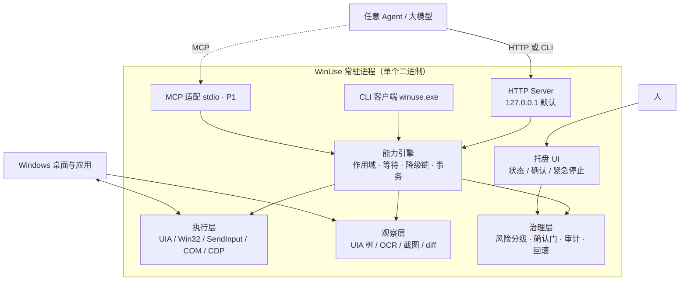
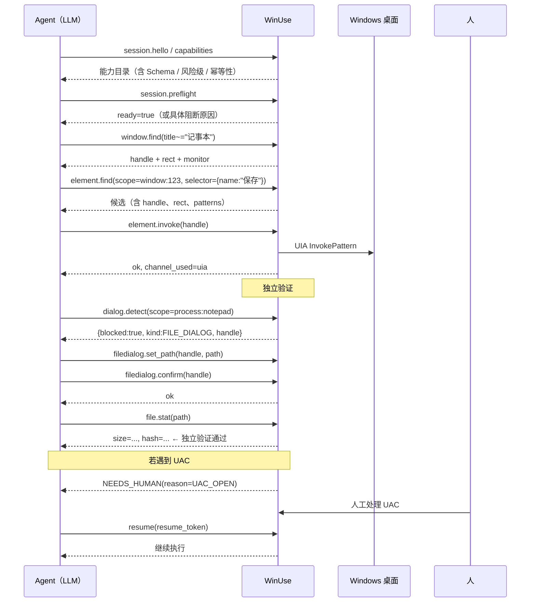

# 03 · WinUse 产品需求文档（PRD）

> 项目代号：**WinUse**（Windows Desktop Agent Control）
> 版本：v0.1（初版，基于 01 调研 + 02 模式抽取）
> 作者：许清楚（PM）　日期：2026-09-22
> 上游输入：`01-market-research.md`、`02-windows-operation-patterns.md`

---

## 1. 项目信息

| 项 | 内容 |
|---|---|
| Project Name | `winuse` |
| Language | 中文（用户语言） |
| 目标平台 | **仅 Windows**（Windows 10 1809+ / Windows 11），x64 + ARM64 |
| 技术栈 | 待架构师确定（文档 02 的能力清单为唯一约束；个人建议：执行层 Rust 或 C# / 服务层任选，见 Open Questions） |
| 分发形态 | 单个可安装二进制（托盘常驻）+ 可选便携版 |
| 原始需求复述 | 一个本地运行的二进制 App，开启本地 HTTP server 与 CLI，任何 AI 可通过 HTTP 或 CLI 连接它来控制 Windows 桌面应用：模拟鼠标键盘、读取应用状态，实现类 Computer Use 能力；只做 Windows；需先抽取 Windows 操作模式与交互协议，再设计成 Agent 友好的接口，让 Agent 能自动接管机器。 |

**一句话定位**

> WinUse = **Windows 桌面的能力服务端（Desktop Capability Server）**：把一台 Windows PC 的"看见 + 操作 + 验证 + 撤销"封装成自描述、可组合、有安全边界的 HTTP / CLI / MCP 接口，供任意 Agent 消费。

---

## 2. 产品定义

### 2.1 产品目标（Goals，3 条，正交）

| # | 目标 | 可衡量标准 |
|---|---|---|
| **G1** | **让任意 Agent 能可靠地操作 Windows 桌面** | **两条性质型承诺（2026-09-22 由"SR ≥70%"换口径而来，见 §2.1.1）**： ① **零静默失败** —— **在有内置校验或显式 `expect` 的动作上，`SFR-server` = 0**（>收窄后口径，裁定采纳；机械判据 = 审计中是否出现 `unverified: true`，见 `10` §6.2.1）； 　　🔒 **`VCR`（校验覆盖率）必须与 `SFR-server` 并列公布，不得单独公布 `SFR-server`** —— 单独报一个分母更小的失败率，与 §6.5.2 已堵死的"剔题涨 SR"是同一类问题，只是这次缩的是分母而非题集； ② **能力层可控任务 SR ≥ 80%** —— 在 WinUse-Bench 的**冻结题号清单**上（**清单见 `10` §6.5.1，题号冻结、不得事后重划；分母由清单导出，本文不写死数字**），接入 Claude/GPT 级模型后端到端成功率 ≥ 80% |
| **G2** | **让接入成本趋近于零** | 一个新 Agent 从"看到能力目录"到"完成第一个真实任务"**≤ 30 分钟、≤ 50 行代码**；提供 `GET /capabilities` 自描述 + CLI `winuse capabilities` + 一份可直接喂给 LLM 的工具 Schema |
| **G3** | **让接管一台真机是安全的** | 所有 R3/R4 动作默认需确认；100% 动作进审计日志；R2 及以上动作可回滚或可补偿；**默认不采集、不上报任何屏幕内容到外部** |

#### 2.1.1 为什么 G1 从"SR ≥70%"换成了两条性质型承诺（2026-09-22）

> 裁定编号 **D1**（team-lead 采纳 PM 评估）。原 G1 的"端到端成功率 ≥70%"是**无实测依据的目标值**（登记 B-09）。第一轮 PoC 后重估，结论不是"把它改成另一个数字"，而是**换口径**。

| 项 | 说明 |
|---|---|
| **为什么不能只换数字** | 下调到 60% 或 55%，同样没有依据 —— 等于把一次拍脑袋换成另一次拍脑袋 |
| **重估结果**【推】 | 按 29 道主分数题分堆加权估算约为 **70%，正好压线**；但它被两个未验证假设和一个分母口径选择支配 |
| **最大单一下行风险** | **A-05**（`KEYEVENTF_UNICODE` 实际效果未实测）：若失败，中文输入组 6 道题从 ~72% 掉到 ~35%，SR 掉到约 **63%** —— 已升级为 🔴 阻塞，第二轮 PoC 侵入式测试优先级最高 ⚠️ **本行三个数字均为【推】推算值，不是实测结论**（2026-09-22 标注）。A-05 的侵入式实测**已获授权并开工**（工程路径 `poc/WinUse.PoC.Input`），**实测出结果后必须回来重算这三个数** —— 证实或推翻都要改，**不得在实测完成前把 63% 当既定结论引用** |
| **最需要防的作弊** | **剔除低分题会让 SR 从 70% 涨到约 76%**（国产 IM 组无样本被剔除 → 剔掉的正是低分题）。所以分层口径**必须冻结题号**，且**分母变化必须留痕** |

**四层分目标**（详细题号与规则见 `10-winuse-bench.md` §6.5）：

| 层 | 题数 | 目标 |
|---|---|---|
| `SR-core`（X 组） | **13**（原 14，T22 移出，见下方 D5 注） | **≥ 85%** |
| `SR-ime`（Y 组，中文输入到标准控件） | 6 | **≥ 70%** |
| `SR-selfdraw`（Z 组，自绘 UI） | 4 | **不设通过率目标**，只观测"降级路径是否被正确触发"；🟡 **v1 可跑**（`ocr.recognize` 已提前到 v1 并进 core，**A-17 结案**），但**中文 OCR 准确率未实测**（`PoC-P0-OCR` 阻塞）→ 不得据此宣称"自绘 UI 可控" |
| `SR-privilege`（T17，跨权限） | 1 | **单列**；harness PoC 通过前不计入主分数 |
| `SR-main`（29 题） | 29 | **第一轮实测后据实公布，暂不设目标** |

> ⚠️ **D5（2026-09-22，team-lead 裁定，已执行）**：对冻结清单做**逐题能力归属校验**后发现，**T15 依赖 `console.*`（v2）、T22 依赖 `transaction.*`（v1.5）** —— 两题的能力**不在 v1**。
> 处置：**T15 / T22 移出冻结清单，归入 v1.5 / v2 组**（能力落地后并入，届时重记一行）。`SR-core` 14 → **13**，G1 ② 的分母 22 → **20**（X 13 + Y 6 + T26 1）。
> **目标值不变**：`SR-core ≥85%`、G1 ② `≥80%` 均按原值执行 —— **D5 只动分母，不动目标**，与"不得靠改口径凑分"的纪律一致。
> 另：同一次校验曾发现 **Z 组 4 题（T03/T08/T09/T10）与 T30 含非 v1 依赖**（`ocr.recognize` 当时归 v1.5）。
> ✅ **2026-09-22 后续裁定（架构师，A-17 结案）**：`ocr.recognize` **提前到 v1 并进 core** —— 原归属是一次**混淆**：被推到 v1.5 的是**重引擎插件**（PaddleOCR / RapidOCR），不是 `Windows.Media.Ocr`（ADR-008 本就写了「v1 默认内置」）。**因此 Z 组与 T30 在 v1 可跑，上述标注已解除**；Z 组**仍维持"不设通过率目标"**，但理由变为「**能力已进 v1，中文 OCR 准确率未实测**」（`PoC-P0-OCR` 阻塞）。
> 逐题校验表与全部口径变更记录见 `10` §6.5.1 / §6.6。

**为什么性质型承诺更可辩护**：数值目标可以被"删题、调判定、换分母"注水；**"零静默失败"和"冻结清单上的通过率"都无法注水** —— 前者有机械判定协议，后者清单一旦冻结就不能事后重划。

### 2.2 非目标（Non-Goals —— 明确不做什么）

> 这一节与 Goals 同等重要。写清楚不做什么，是为了不把资源烧在错误的战场上。

| # | 不做 | 理由 |
|---|---|---|
| **N1** | **不做视觉感知模型** | UI-TARS / Fara-7B / Qwen-VL / 前沿多模态模型在 grounding 上远强于我们自研（ScreenSpot-Pro 40–58%）。我们提供**结构化通道**让模型少做 grounding，而不是自己做 grounding |
| **N2** | **不做 Agent 编排 / 规划 / 记忆** | 这是 Agent 框架（UFO²、Agent-S）与模型厂商的地盘。WinUse 是被调用的能力层，不内置 ReAct 循环 |
| **N3** | **不做跨平台** | 明确只做 Windows。跨平台会迫使抽象向最小公倍数妥协，恰恰毁掉我们想要做的深度 |
| **N4** | **不做云端服务 / 远程托管** | 默认纯本地。远程访问是可选能力，但**不提供任何由我们运营的云中继** |
| **N5** | **不做浏览器专用自动化** | 浏览器优先走 CDP（`browser.cdp.*` 逃逸口即可），不重建 Playwright |
| **N6** | **不做 RPA 式可视化流程编排器** | 不提供拖拽式流程图 IDE。宏以代码/JSON 定义 |
| **N7** | **不面向游戏自动化 / 反作弊绕过** | 明确排除。风险与法律问题，且自绘游戏无稳定通道 |
| **N8** | **不自动化 UAC / 锁屏 / 凭据 / 验证码 / 生物识别** | 返回 `NOT_AUTOMATABLE` 并升级 human-in-the-loop。这是设计约束不是缺陷 |
| **N9** | **不做应用专属适配作为核心** | 通用能力为主；Office/微信等适配以**可选技能包（Skill Pack）**形式由生态提供，不进核心 |
| **N10** | **不隐藏失败** | 绝不允许"执行无报错但没生效"。验证失败必须上报 `VERIFY_FAILED` |

### 2.2.1 能力边界（Windows 物理限制 —— **不是非目标**）

> 裁定编号 **D3**。这一节与"非目标"严格区分：**非目标是我们选择不做；能力边界是 Windows 不允许我们做。** 混为一谈会让用户误以为"我们以后会做"。

| # | 边界 | 实测依据 | v1 行为 |
|---|---|---|---|
| **L1** | **以更高完整性级别（IL）运行的目标进程，v1 完全不可控** —— 不只是 `SendInput` 被拒，**连 UIA 树都看不到** | 【实】第一轮 PoC（登记 A-01）：Medium IL 进程对「管理员: Windows PowerShell」（High IL，pid 17860）**在 UIA 中一个元素都看不到**（0/1）；同机 Medium IL 且真正可见的窗口 8/8 全见。来源 `poc/poc-results.json` → `uipi_cross_check`（`A01_verdict=BLOCKED`） | 检出并返回 **`UIPI_BLOCKED`** + **引导用户显式选择**是否以管理员身份重启 WinUse（见下方三条纪律） |
| **L2** | **中文输入无法预判 IME 状态** | 【实】8/8 真实窗口 `ImmGetContext` 返回 NULL（登记 A-14） | 不预判；直接 Unicode 直注 → 读回校验 → 不符则降级（见约束 C15） |
| **L3** | **自绘 UI（微信/企微/钉钉等）无 UIA 文本通道** | 【推】+ 本机无样本（登记 **A-04**，第一轮 PoC 未采到）；**OCR 准确率未实测**（`PoC-P0-OCR` 阻塞） | ✅ **`ocr.recognize` 已提前到 v1 并进 core**（架构师 2026-09-22 裁定，**A-17 结案**）：原因是把「`Windows.Media.Ocr`（ADR-008 本就写了 v1 默认内置）」与「重引擎插件（PaddleOCR/RapidOCR，仍 v1.5）」混为一谈了 —— 后者才是被推到 v1.5 的那一个。 → **L0 降级链在 v1 是通的**：降级到 **OCR + 坐标**；**判定"有没有做校验"必须可判定**（见 `10` §6.5.3）；**不得盲打后报成功**。 ⚠️ **但对外口径必须区分两句话**（差别很大）： ① ❌ 不得说"**v1 自绘 UI 可控**" —— 那是把一个没实测的能力包装成卖点； ② ✅ 只能说"**v1 有降级通道，中文 OCR 准确率待实测**"。已知数据：印刷体 **75–85%【实】**；12/14px 小字 **<60%**、手写 **>40% 错误率【推，未实测】**。 🔴 **待办**：`PoC-P0-OCR`（≥100 张真实桌面截图样本集、测中文分档阈值）出结果前，**本行对外口径维持 ②**。 |

#### L1 的三条表述纪律（硬）

> 这三条是措辞纪律，不是技术条款。**对外文档、README、话术都必须遵守**。

| # | 纪律 | 反例（禁止） |
|---|---|---|
| **①** | **写"能力边界"，不写"非目标"** —— 这是 Windows 的物理限制，不是我们选择不做 | ❌ "我们不做提权场景支持" |
| **②** | **必须同时写明代价，不能只写引导** —— 正确表述是"**引导用户显式选择重启**，并在引导时说明代价"，**不是"自动提权"**。代价包括：UAC 弹窗打断、更高攻击面、杀软/EDR 更敏感（ADR-002 定默认 Medium IL 正是为避开这些） | ❌ "自动以管理员身份重启 WinUse" ／ ❌ "点这里一键提权" |
| **③** | **不许写成"未来会支持"** —— 我们**没有任何依据**承诺后续版本能解决 UIPI。固定表述为："**v1 不支持；后续是否支持视实测结果决定**" | ❌ "v1 暂不支持，v2 将支持" ／ ❌ 路线图里写"提权场景支持" |

### 2.3 差异化定位（一句话）

> 现有方案要么是一个 **Agent**（自己是大脑，不对外开放），要么是一个 **库**（要求你写 Python/C#、同进程调用）；WinUse 是**服务**——常驻、自描述、任意语言/任意 Agent 可消费，并且**把 Windows 特有的硬约束（UIPI / UAC / 锁屏 / 混合 DPI / 中文 IME）当一等公民处理**。

---

## 3. 目标用户画像

| # | 画像 | 特征 | 核心诉求 | 首要使用的能力 |
|---|---|---|---|---|
| **U1** | **AI 应用开发者**（做"电脑助手"类产品） | 熟 LLM 工具调用，不熟 Win32/UIA | 一周内把桌面控制塞进自己的 Agent | HTTP API + 能力目录 + 宏 |
| **U2** | **Agent 框架作者**（LangChain / AutoGen / 自研框架） | 需要稳定的工具 Schema 与错误语义 | 可发现、可组合、错误码一致 | `session.capabilities`（自描述）+ 统一错误码 |
| **U3** | **企业自动化 / RPA 迁移者** | 现有 UiPath/Power Automate 脚本脆弱、UI 一变就崩 | 用 LLM 替代脆弱脚本；要审计合规 | 事务 + 审计 + 权限分级 + 宏录制 |
| **U4** | **个人玩家 / 效率极客** | 想让 AI 帮自己干活（整理文件、批量填表、发消息） | 装了就能用；不能把机器搞坏 | CLI + 托盘 UI + 确认门 + 回滚 |
| **U5** | **测试 / QA 工程师** | 需要跨 Win10/Win11 的桌面 E2E 测试 | 稳定选择器 + 等待/同步 + 可重放 | `element.wait`、`wait.stable`、宏录制/回放、审计导出 |
| **U6** | **无障碍 / 辅助技术开发者** | 关注 UIA 与语义化操作 | 结构化语义优先于坐标 | `element.*`（语义通道）+ 稳定选择器 |

**主要用户**：U1 + U2（决定接口形态）；**付费/落地用户**：U3 + U5（决定安全与合规特性）；**口碑来源**：U4。

---

## 4. 用户故事（User Stories，15 条）

> 格式：作为…，我希望…，以便…

| # | 用户故事 | 关联模式 |
|---|---|---|
| **US-1** | 作为 **AI 应用开发者**，我希望用一个 HTTP 请求拿到完整能力目录及其 JSON Schema，以便我能自动生成工具定义喂给我选的任意大模型 | 可发现性 |
| **US-2** | 作为 **AI 应用开发者**，我希望默认返回的是**结构化的 UI 元素树**而不是截图，以便我的 token 成本下降一个数量级 | 上下文成本 (P14) |
| **US-3** | 作为 **Agent 框架作者**，我希望所有失败都返回统一的机器可读错误码（如 `STALE_HANDLE` / `UIPI_BLOCKED` / `VERIFY_FAILED`），以便我的框架能自动决定重试、降级还是上报 | 可观测性 |
| **US-4** | 作为 **Agent 框架作者**，我希望 `keyboard.type` 默认走 Unicode 直注，以便我的 Agent 在中文 Windows + 中文输入法环境下能正常打字 | IME (S15) |
| **US-5** | 作为 **AI 应用开发者**，我希望每个动作能指定 `scope`（桌面/窗口/控件），以便我的 Agent 不会误点到别的窗口 | 作用域契约 (P3) |
| **US-6** | 作为 **AI 应用开发者**，我希望有 `element.wait` 与 `wait.idle` 而不是自己 `sleep`，以便我的 Agent 不会因为时序问题随机失败 | 等待同步 (P4) |
| **US-7** | 作为 **企业自动化工程师**，我希望危险操作（删除文件、执行 shell、提交表单）会自动停下来等我确认，并且每一步都进审计日志，以便我能合规地部署到生产 | 权限边界 (P12) |
| **US-8** | 作为 **企业自动化工程师**，我希望能在事务里执行一串动作并在失败时回滚，以便一次失败的自动化不会留下半损状态 | 事务回滚 (P7) |
| **US-9** | 作为 **AI 应用开发者**，我希望动作执行后服务端会**用独立通道复验**（例如保存文件后读文件系统），以便我的 Agent 不会把"点了没生效"当成成功 | 独立验证 (P17) |
| **US-10** | 作为 **AI 应用开发者**，我希望文件保存对话框这种 Windows 高频难缠场景有专门的 `filedialog.set_path` 能力，以便我不必为此写一堆视觉定位逻辑 | 模态阻断 (P5) |
| **US-11** | 作为 **Agent 框架作者**，我希望写操作支持 `idempotency_key`，以便网络重试不会导致同一条消息被发两次 | 幂等 (P6) |
| **US-12** | 作为 **个人玩家**，我希望在遇到 UAC / 锁屏 / 验证码时托盘弹窗提示我手动处理，处理完 Agent 能接着跑，以便我不会因为一次提权就前功尽弃 | 人机接管 (P11) |
| **US-13** | 作为 **AI 应用开发者**，我希望常用长流程有内置宏（打开应用并等待就绪、另存为、填表），以便我的 Agent 一步完成而不是三十步 | 可组合性 (P16) |
| **US-14** | 作为 **测试工程师**，我希望 UIA 不可用时服务端自动降级到 OCR / 视觉定位并**告诉我用了哪个通道**，以便我知道结果的可信度 | 降级链 (P10) |
| **US-15** | 作为 **个人玩家**，我希望用一条 CLI 命令就能看到当前桌面有哪些窗口、并让 AI 帮我操作其中一个，以便我不用先学一套 SDK | 形态：CLI |

---

## 5. 需求池（P0 / P1 / P2）

> **P0 = Must have（MVP 不可缺）｜P1 = Should have（首发后 1–2 个版本）｜P2 = Nice to have**
> 每条含验收标准（Acceptance Criteria, AC）。

### 5.1 P0（Must Have）

| ID | 需求 | 验收标准（AC） |
|---|---|---|
| **P0-1** | **常驻二进制 + 本地 HTTP server** | ① 安装后托盘常驻，开机可选自启；② 默认监听 `127.0.0.1:<port>`（**仅回环**），端口可配；③ 提供 `GET /health`；④ 非回环监听必须显式配置 + 认证令牌 + 启动警告 |
| **P0-2** | **CLI 客户端** | `winuse <capability> --params` 覆盖所有能力；支持 `--json` 输出；支持 `winuse capabilities`、`winuse doctor` |
| **P0-3** | **自描述能力目录** | `GET /capabilities` 返回全部能力的：名称、语义描述、参数 JSON Schema、返回 Schema、**风险级**、**幂等性**、所属命名空间；可被直接转成 OpenAI/Anthropic tools 格式 |
| **P0-4** | **统一响应与错误信封** | 所有响应统一 `{ok, result\|error, action_id, channel_used, degraded_from, duration_ms}`；错误统一 `{code, message, hint, observation}`；实现 §7 全部错误码 |
| **P0-5** | **结构化感知：UIA 元素树** | `element.tree/find/get/property` 可用；支持 scope、depth、interactive_only、hide_offscreen 过滤；返回稳定句柄 |
| **P0-6** | **动作执行：UIA Pattern 优先 + SendInput 兜底** | ① `element.invoke/set_value/toggle/select` 走 UIA Pattern；② 无 Pattern 时降级到坐标点击并标注 `degraded_from`；③ **UIPI 阻断时必须检出并返回 `UIPI_BLOCKED` + 可执行恢复指引**（引导"以管理员身份重启 WinUse"），且**不得静默返回成功** —— `SendInput` 在 UIPI 下是静默失败，实现上必须做回读校验。 ✅ **PoC 已出结论（2026-09-22，回写）**【实】：`PoC-P0-UIPI` 已实测，**原断言被证伪，"自动改走 UIA 并成功"永久删除**。
 实测环境：Windows 11 Build 26200（25H2）、单屏 1920×1080 @125%（120 DPI）、探测进程 IL=Medium 未提权（与 v1 默认形态一致）。
 结果：同机 Windows Terminal 的普通窗口（IL=Medium）UIA 可见；**「管理员: Windows PowerShell」（IL=High，pid 17860）在 UIA 中完全不可见**（`high_il_windows_visible_in_uia = 0/1`，`A01_verdict = BLOCKED`）。对照组：11 个 Medium IL 窗口中 8 个**真正可见**的 **100% 被 UIA 看到**；另 3 个不可见的正是 cloaked 幽灵窗口（与约束 C13 同源，非 UIPI 所致）。
 **结论：UIPI 的阻断粒度是"高 IL 进程的整个 UIA 树"，不是"仅 SendInput 被拒"。** 因此 v1 语义固定为 **"看不到即报 `UIPI_BLOCKED`"**。
 来源：`poc/poc-results.json` → `uipi_cross_check`；`poc/poc-run.log` §6。登记编号 **A-01**（状态：已证伪），见 `11-assumptions-register.md`。 |
| **P0-7** | **输入：Unicode 直注 + 组合键** | ① `keyboard.type` 在中文输入法（搜狗/微软拼音）活跃时，向记事本/微信/Chrome 输入中文**结果与 IME 状态无关**（判定看**落盘/输入框最终文本**，不看是否检测到 IME 状态）；② `keyboard.hotkey("Ctrl+Shift+S")` 等可用；③ ~~`keyboard.ime.status` 可读~~ → **降级为可选，见注 P0-7-a** |
|---|---|---|

> **注 P0-7-a（【实】2026-09-22 PoC 回写）**【实】：8 个真实目标窗口（`Chrome_WidgetWin_1` ×4、`Tauri Window` ×1、`Windows.UI.Core.CoreWindow` ×2、`ApplicationFrameWindow` ×1、`CabinetWClass` ×1）的 `ImmGetContext` **全部返回 NULL** —— Chromium / Tauri / UWP / 资源管理器都拿不到 IMM 上下文。
> **结论：IME 开关状态无法前置预判**，原 AC③「`keyboard.ime.status` 可读」在多数真实窗口上不可实现，降级为**尽力而为**（best-effort，拿不到返回 `UNSUPPORTED`，不报错）。
> **AC① 的判定方式同步修订**：判"最终文本正确"，**不判"是否检测到 IME 状态"**。实现路径固定为：**不预判 → Unicode 直注（`KEYEVENTF_UNICODE`）→ 读回校验 → 不符则逐级降级**。
> ⚠️ **仍未验证**：本次为只读探测，**未实际注入按键**，`KEYEVENTF_UNICODE` 本身在各 IME/各应用下的效果**尚未实测**（`PoC-P1-IME` 待跑）。
> 来源：`poc/poc-results.json` → `ime_state`。登记编号 **A-14**（本轮已推翻并结案）+ **A-05**（`KEYEVENTF_UNICODE` 实际效果仍待侵入式 PoC），见 `11-assumptions-register.md`。 |
| **P0-8** | **窗口 / 进程基础能力** | `window.list/find/focus/state/minimize/maximize/restore/close/move/resize`、`process.list/start/terminate/wait` 全部可用。**`window.list` 另须满足约束 C13（过滤 cloaked 幽灵窗口与零尺寸窗口）** |
| **P0-9** | **等待与同步** | `element.wait`（exists/visible/enabled/text）、`wait.idle`、`wait.stable`、`wait.for` 可用；超时返回 `TIMEOUT` + 末次观察快照 |
| **P0-10** | **作用域与焦点契约** | 每个请求必须带 `scope`；执行前校验焦点在 scope 内，否则返回 `FOCUS_LOST` 且不执行 |
| **P0-11** | **风险分级 + 权限模式** | 每个能力标注 R0–R4；`observe/standard/elevated` 三档模式；越权返回 `PERMISSION_DENIED` + 明确授权提示 |
| **P0-12** | **确认门 + human-in-the-loop** | R3 及以上默认挂起返回 `NEEDS_HUMAN` + 托盘确认 UI；用户处理后凭 `resume_token` 继续；UAC/锁屏/验证码返回 `NOT_AUTOMATABLE` |
| **P0-13** | **前置环境校验 `session.preflight`** | 能检出并区分：锁屏 / UAC 打开 / 屏保 / RDP 最小化 / 完整性级别不匹配 / 显示器布局变化；不满足时拒绝执行并返回对应原因码。 ⚠️ **【实】完整性级别检出不可靠**：290 个进程中 **135 个（约 47%）IL 查询被拒**（⚠️ 进程级统计是瞬时快照，相邻两次运行 131↔135，引用时应写**约 45%~47%**，不要当作精确值）（`poc/poc-results.json` → `integrity_landscape`）→ 该检出项**必须有三态** `match / mismatch / unknown`，查询失败时返回"怀疑"而非"确认正常"（登记 **A-15**） |
| **P0-14** | **DPI / 多显示器坐标统一** | ① 服务端声明 `PerMonitorV2`；② 对外坐标统一为物理像素 + 显示器索引，响应带 `coordinate_space`；③ **验收用例（有前置条件，见注 P0-14-a）**：主屏 100% + 副屏 200% 时，跨屏点击目标元素误差 **≤ 2px** —— **该目标仅在"已完成点击坐标系 ↔ 截图像素坐标系换算"的前提下成立**；未做换算时 ≤2px **不成立**，不得作为验收口径 |
|---|---|---|

> **注 P0-14-a（【实】2026-09-22 PoC 回写）**：≤2px 这个数原本是**拍脑袋的目标值**【推】，现已由 PoC 给出物理含义。
> 实测（12 窗口，125% 缩放）：UIA `BoundingRectangle` 与 `GetWindowRect` **delta = 0**；但 `DWMWA_EXTENDED_FRAME_BOUNDS` 比它们**小 8~9px**（最大化每边 9px；非最大化 left/right/bottom 各 8px、top 0px）。
> **截图走 DWM 视觉边界，点击走 UIA/`GetWindowRect` —— 不换算就是 8~9px 量级的系统性偏移。**
> 因此 AC 修订为两段：① **必须实现 DWM↔UIA 换算**（这是可验收的硬要求）；② 换算完成后再测 ≤2px（该数值仍为【推】，待 `PoC-P0-COORD` 在**双屏 + 混合 DPI** 环境复测）。
> 来源：`poc/poc-results.json` → `coordinate_consistency`。登记编号 **A-16**（"UIA 是逻辑坐标"已被推翻）、**A-02**、**B-01**（≤2px 阈值待校准），见 `11-assumptions-register.md`。
>
> **📌 第二轮 PoC 更新（2026-09-22，双屏异构 DPI：主 125% / 副 100%，VSC 负坐标 y=−1200）**：
> ① **只读侧已结案** —— UIA − `GetWindowRect` delta **恒为 `[0,0,0,0]`**，**含副屏、含负坐标**，上一条 delta=0 不再是"单屏外推"；
> ② **偏移量不是常量** —— 主屏 125% 最大化 `9,9,−9,−9`、**副屏 100% 最大化 `8,8,−8,−8`**、主屏 125% 非最大化 `8,0,−8,−8` → **= f(是否最大化, 该屏 DPI)**，AC ① 的换算实现**禁止硬编码 8px 或 9px**（详见 §2.2.1 C14 依据）；
> ③ **仍待测的是侵入式四项**（非只读，第二轮未做）：`SetCursorPos` 到负坐标的可达性、副屏实际点击命中误差、跨屏拖拽、`MonitorFromPoint` 在屏间隙的行为 → **`PoC-P0-COORD` 仍然开着**，② 的 ±2px 阈值**仍未校准**。 |
| **P0-15** | **审计日志** | 100% 动作落本地日志（时间、能力、参数摘要、**风险级**、结果、耗时、前后快照引用）；`audit.query/export` 可用；**日志默认不出机** |
| **P0-16** | **文件能力（基础）** | `file.list/stat/exists/read/write/copy/move/rename/delete(默认回收站)/mkdir`；`file.write` 与 `file.delete` 在事务内可补偿 |
| **P0-17** | **对话框与文件对话框** | `dialog.detect/button.click/dismiss`、`filedialog.set_path/confirm/cancel`；验收：在 Win10 与 Win11 上均能完成"记事本 → 另存为 → 指定路径 → 保存" |
| **P0-18** | **剪贴板** | `clipboard.get/set/formats`；`set` 默认记录并在事务结束时恢复原内容 |
| **P0-19** | **幂等键** | 非幂等写操作要求 `idempotency_key`；重复请求返回首次结果且 `replayed: true`，**副作用只发生一次** |
| **P0-20** | **最小内置宏集** | 至少 5 个：`open_app_and_wait` / `save_file_as` / `fill_form` / `close_all_dialogs` / `wait_ready`；`macro.run` 返回分步轨迹 |
| **P0-21** | **安全默认值** | ① 默认仅回环监听；② 默认 `permission_mode=standard`；③ 默认不联网、不上报；④ 默认不写注册表（`registry.*` 默认禁用） |
| **P0-22** | **WinUse-Bench 自评测集** | 建立 ≥ 30 个真实中文 Windows 任务的评测集（覆盖 S1/S3/S4/S9/S15 场景域），作为 G1 的度量口径 |

### 5.2 P1（Should Have）

| ID | 需求 | 验收标准（AC） |
|---|---|---|
| **P1-1** | **快照 diff** | `element.tree(since=...)` 与 `screen.diff` 返回差异；重复观察默认返回 diff；实测 token 节省 ≥ 50%（对标 R3 已有实测 84–96%） |
| **P1-2** | **OCR 与 SoM 标注** | `ocr.recognize`（中英）、`screen.capture(annotate=true)` 返回编号→元素映射，使模型可输出编号而非坐标；OCR 引擎可插拔（默认本地，无网可用） |
| **P1-3** | **事务与回滚** | `transaction.begin/commit/rollback`；R2 动作自动记录补偿；部分回滚返回 `ROLLBACK_PARTIAL` + 详细报告 |
| **P1-4** | **独立验证原语** | 每个副作用类能力至少提供一个独立只读验证手段；`macro.run` 内置验证步骤；验证失败返回 `VERIFY_FAILED`（**不是静默成功**） |
| **P1-5** | **终端能力** | `shell.exec(cmd/pwsh)` 同步返回 stdout/stderr/exit_code；`shell.exec_async` + job 管理；UTF-8 编码正确（显式处理代码页）；`console.read_buffer` 尽力而为 |
| **P1-6** | **浏览器 CDP 逃逸口** | `browser.cdp.attach/call` 可连 Chrome/Edge（需授权，必要时提示带调试端口重启）；`browser.tabs.*` |
| **P1-7** | **事件订阅** | `session.subscribe` 支持：元素出现、窗口创建/销毁、剪贴板变化、进程退出、Toast、DPI 变化、锁屏；通过 SSE 或 WebSocket |
| **P1-8** | **意外弹窗恢复处理器** | 可注册全局 handler，自动识别并关闭已知干扰弹窗（广告/更新提示/登录过期） |
| **P1-9** | **多语言选择器别名** | 选择器支持 `name_aliases {zh, en}`，使同一脚本在中英文系统上可用 |
| **P1-10** | **MCP 适配层** | 以 MCP server 形态暴露（stdio），能力目录自动映射为 MCP tools；使 Claude Desktop / Cursor 等零配置接入 |
| **P1-11** | **动作取消** | 支持 `action_id` / `cancel_token` 取消进行中的动作（尤其是 `shell.exec_async` 与拖拽） |
| **P1-12** | **批量操作** | `macro.run(items=[...])` + `on_error: abort\|continue\|rollback` |
| **P1-13** | **注册表能力（默认关闭）** | `registry.get` 默认可用；`registry.set/delete` 需 `elevated` 模式 + 逐次确认 |
| **P1-14** | **托盘 UI** | 显示运行状态、当前动作、待确认请求、最近审计；支持一键"暂停自动化"与"紧急停止" |
| **P1-15** | **虚拟桌面 / Snap 布局（尽力而为）** | `window.virtual_desktop.*` 与 `window.snap` 在可行范围内实现，不可行时返回 `UNSUPPORTED` 而非崩溃 |
| **P1-16** | **性能** | 单次原子动作服务端开销 P95 ≤ 100ms（不含等待）；`element.tree` 全桌面 P95 ≤ 500ms |

### 5.3 P2（Nice to Have）

| ID | 需求 | 验收标准 |
|---|---|---|
| **P2-1** | 宏录制（演示 → 编译为可重放宏） | 录制一次人类演示，编译后可无 LLM 重放 |
| **P2-2** | 效果契约（对标 OpenAdapt） | 宏声明其副作用，运行时按独立通道逐条核验，才返回 VERIFIED |
| **P2-3** | 技能包（Skill Pack）机制 | Office / 微信 / 企微 适配以可选包形式加载，不进核心 |
| **P2-4** | 模板匹配 `screen.locate` | 基于 OpenCV 的图像定位，作为降级链一环 |
| **P2-5** | 通知与托盘操作 | `toast.*` / `tray.*` / `taskbar.*` |
| **P2-6** | 压缩解压 / 回收站管理 | `file.archive/unarchive/recycle.*` |
| **P2-7** | 远程访问（可选、显式开启） | 非回环监听 + 令牌 + mTLS 选项；**不提供我方运营的中继** |
| **P2-8** | PiP / 虚拟桌面隔离执行 | 在独立虚拟桌面中执行，用户主桌面不受干扰（对标 UFO² PiP） |
| **P2-9** | 录制回放与回归测试工具 | 供 QA 用户（U5）使用 |
| **P2-10** | 能力用量统计与成本面板 | 本地统计 token / 步数 / 耗时，帮助用户优化 |

---

## 6. Agent 友好性专项需求 ⭐（用户明确要求）

> 这是 WinUse 相对所有竞品的**主要设计约束**，不是附加特性。

### 6.1 可发现性（Discoverability）

| 需求 | 说明 | AC |
|---|---|---|
| **能力目录端点** | `GET /capabilities` 与 `winuse capabilities`，返回含 Schema 的完整目录 | 见 P0-3 |
| **LLM 可直接消费** | 目录可一键导出为 OpenAI tools / Anthropic tools / MCP tools 三种格式 | 一条命令生成，零手工改写 |
| **能力描述面向模型写** | 每条能力的 `description` 用"什么时候用 / 用了会怎样 / 失败了怎么办"结构写，**并经过真实模型可用性测试** | 参照 Windows MCP Server 的做法：用真实模型跑测试集，工具描述不好用就改工具，而不是改测试 |
| **渐进式发现** | 支持 `filter` 按命名空间/风险级/关键字缩小目录，避免一次性灌入全部 130+ 能力 | 目录支持分页与过滤 |
| **示例内嵌** | 每个能力带 1–2 个可直接复制的调用示例 | 覆盖率 100% |
| **元能力** | `session.hello` 返回"我是什么版本、我现在能做什么、我当前处于什么权限模式" | 见 P0-3 |

### 6.2 可组合性（Composability）

| 需求 | 说明 | AC |
|---|---|---|
| **宏 = 一等公民** | 宏与普通能力**走同一套调用接口与自描述机制**，Agent 无需区分 | `macro.run` 与原子能力在 `/capabilities` 中并列 |
| **内置宏库** | 高频长流程预置（打开应用并等待就绪 / 另存为 / 填表 / 关闭所有对话框 / 等待就绪） | 见 P0-20 |
| **用户可定义宏** | 用 JSON/YAML 声明步骤序列 + 等待条件 + 验证步骤 + 错误处理策略 | P1 提供，P2 支持录制生成 |
| **批量语义** | `macro.run(items=[...], on_error=...)` 一次处理一批 | 见 P1-12 |
| **组合原子性** | 宏可声明 `transactional: true`，整体成功或整体回滚 | 见 P1-3 |
| **步数压缩是硬指标** | 目标：典型任务（"打开 X 应用，新建文档，写入内容，保存到 Y"）≤ 4 次 LLM 往返 | 纳入 G1/Bench 度量 |

### 6.3 可观测性（Observability）

| 需求 | 说明 | AC |
|---|---|---|
| **结构化状态优先于截图** | 默认返回 UIA 元素树 / 文本 / 属性，**不是图像** | 见 US-2、P0-5 |
| **机器可读错误码** | 统一错误码体系（02 文档 §7 共 17 个），每个错误带 `hint`（建议下一步）与 `observation`（末次观察快照） | 见 P0-4 |
| **挂起 ≠ 失败** | `NEEDS_HUMAN` 是一种**挂起状态**，与 `FAILED` 严格区分 | Agent 能据此轮询或等待事件 |
| **通道透明** | 响应必带 `channel_used` 与 `degraded_from`，让 Agent 知道这次是不是走了降级 | 100% 覆盖 |
| **独立验证** | 每个副作用有独立只读验证通道；验证失败返回 `VERIFY_FAILED` | 见 P1-4、US-9 |
| **分步轨迹** | 宏执行失败时返回**已完成步骤 + 失败点 + 当时的观察**，而不是一句"失败" | 见 P0-20 |
| **事件流** | 支持订阅（元素出现/窗口变化/剪贴板/DPI/锁屏），让 Agent 不必轮询 | 见 P1-7 |
| **耗时与诊断** | 每个响应带 `duration_ms`；服务端提供 `winuse doctor` 自检 | — |

### 6.4 安全性与权限边界（Safety）

| 需求 | 说明 | AC |
|---|---|---|
| **风险分级** | R0–R4 五级，标注在每个能力的元数据里 | 见 P0-11 |
| **权限模式** | `observe` / `standard` / `elevated` 三档，默认 `standard` | 越权返回 `PERMISSION_DENIED` + 授权提示，**不静默降级** |
| **确认门** | R3 及以上默认挂起等确认；R4 不可预授权 | 见 P0-12 |
| **不可自动化清单** | UAC / 锁屏 / 凭据 / 验证码 / 生物识别 → `NOT_AUTOMATABLE` + human-in-the-loop | 见 N8 |
| **事务与回滚** | R2 及以上在事务内可补偿；部分回滚必须明确报告 | 见 P1-3 |
| **全量审计** | 100% 动作落本地日志；含参数摘要与前后快照引用；可查询导出 | 见 P0-15 |
| **数据不出机** | 默认不联网、不上报；截图/文本默认只在本地流转 | 网络访问需在 `winuse doctor` 中可见 |
| **紧急停止** | 托盘一键暂停/停止，且硬件级（用户可直接夺取鼠标键盘） | 见 P1-14 |
| **剪贴板/IME 状态不污染** | 使用用户共享资源（剪贴板、IME）后自动恢复 | 见 P0-18、P0-7 |
| **提示注入防护** | 从屏幕读取的文本在返回时标记 `untrusted: true`，并在文档中警告 Agent 不要把屏幕文本当指令 | P1 |

### 6.5 上下文成本（Context Budget）

| 需求 | 说明 | AC |
|---|---|---|
| **默认不返回图像** | 截图默认只返回元素标注（SoM 元数据），取图需显式 `include_image=true` | 见 P1-2 |
| **结构化过滤** | `element.tree` 支持 `interactive_only` / `depth` / `hide_offscreen` / `hide_disabled` | 见 P0-5 |
| **重复观察返回 diff** | `since=<snapshot_id>` 只返回变更 | 见 P1-1 |
| **截图可控** | 区域裁剪、缩放、JPEG 质量可调 | 见 P0-14 相关 |
| **预算提示** | 请求可带 `max_tokens`，超出时服务端裁剪并标 `truncated: true` | P1 |
| **SoM 降低输出难度** | 截图叠加元素编号，模型输出编号而非坐标 | 见 P1-2 |
| **量化目标** | 典型"打开应用 + 定位 + 操作"循环单次增量 ≤ 800 token | 纳入 Bench 度量 |

### 6.6 幂等性与重试语义（Idempotency）

| 需求 | 说明 | AC |
|---|---|---|
| **每个能力声明幂等性** | `idempotent` / `conditional`（带 `if_match`）/ `non_idempotent` | 100% 覆盖，且写进能力目录 |
| **幂等键** | 非幂等写操作强制 `idempotency_key`；重复请求返回首次结果 `replayed: true`，副作用只发生一次 | 见 P0-19 |
| **条件写** | `if_match: {property, value}` 让"仅当处于某状态时才改"成为原子操作 | P1 |
| **重试安全** | 所有 R0/L0/L1（只读与等待）操作可无限重试无副作用 | 设计约束 |
| **失败分类指导** | 错误码自带 `hint`，告诉 Agent 这次**该重试 / 该降级 / 该上报 / 该等人** | 见 P0-4 |
| **不重试清单** | `NOT_AUTOMATABLE` / `PERMISSION_DENIED` / `RESERVED_KEY` 明确标注"重试无意义" | 见 P0-4 |

---

## 7. 产品形态与关键界面

### 7.1 形态总览

### 7.2 三种接入方式

| 方式 | 面向 | 示例 |
|---|---|---|
| **HTTP（主）** | 任意 Agent / 任意语言 | `POST http://127.0.0.1:8787/v1/call {"capability":"element.find", ...}` |
| **CLI** | 人、Shell 脚本、小模型 | `winuse element.find --scope window:123 --selector '{"control_type":"Button","name":"保存"}'` |
| **MCP（P1）** | Claude Desktop / Cursor / 各类 MCP 客户端 | 配置文件里加一行 |

### 7.3 托盘 UI（最小界面）

| 区域 | 内容 |
|---|---|
| 状态 | ● 运行中 / ⏸ 已暂停 / 🔒 仅观察模式；当前监听地址与端口 |
| 当前动作 | 正在执行的能力名 + 耗时；一键"中断当前动作" |
| 待确认 | R3/R4 动作的确认卡片（显示：谁调用的、要做什么、影响范围）→ 允许 / 拒绝 / 总是允许此类 |
| 人工接管 | `NEEDS_HUMAN` 队列（UAC / 锁屏 / 验证码 / 登录）→ 处理完成后点"继续" |
| 最近审计 | 最近 20 条动作，可展开看前后快照；"导出审计" |
| 设置 | 权限模式、监听地址、开机自启、OCR 引擎、日志保留期 |
| **紧急停止** | 醒目按钮，立即暂停一切自动化并释放输入控制 |

### 7.4 典型调用流程（Agent 侧）

---

## 8. 关键设计约束汇总（给架构师的硬约束）

> 全部来自 01/02 文档，此处集中列出，避免遗漏。

| # | 约束 | 来源 |
|---|---|---|
| C1 | 默认感知通道 = **UIA**；视觉是兜底（WAA：+57% 成功率） | 01 §7-1 |
| C2 | 动作执行优先级 = **UIA Pattern > SendInput**（仅在 WinUse 自身 IL ≥ 目标进程时成立）；**UIPI 阻断时改为"检出 + 上报 `UIPI_BLOCKED` + 恢复指引"** —— 【实】PoC 已证实高 IL 进程的整个 UIA 树对 Medium IL 进程不可见，**不存在"自动切换后成功"的通路** | 01 §7-2 + 【实】`poc/poc-results.json` |
| C3 | `keyboard.type` 必须走 **KEYEVENTF_UNICODE** | 01 §7-3 / 02 S15 |
| C4 | 坐标空间必须**统一并自描述**（物理像素 + 显示器索引） | 01 §7-4 / 02 S11 |
| C5 | **前置环境探测**是一等能力 | 01 §7-5 / 02 P13 |
| C6 | **验证必须能走独立通道** | 01 §7-6 / 02 P17 |
| C7 | 失败语义要能表达"**目标不存在 / 操作不可行**"（拒绝） | 01 §7-7 |
| C8 | 数据层永远优先于 GUI：能走 COM / CDP / 文件 API 就不走 GUI | 02 P10 |
| C9 | 共享资源（剪贴板、IME、焦点）必须**用完恢复** | 02 S5 / S15 |
| C10 | 挂起（`NEEDS_HUMAN`）与失败（`FAILED`）严格区分 | 02 P11 |
| C11 | 每个能力必须声明：**风险级 / 幂等性 / 补偿能力** | 02 §5 |
| C12 | 不可自动化清单（UAC/锁屏/凭据/验证码）返回 `NOT_AUTOMATABLE`，不尝试 | 02 §6 |
| **C13** | **窗口枚举必须二次过滤**：`window.list` 及任何返回窗口列表的能力，**必须过滤 `DWMWA_CLOAKED != 0` 的幽灵窗口与零尺寸窗口**，且**不得以 UIA 桌面直系子元素列表直接充当"用户可见窗口列表"**（`IsWindowVisible` 不可信） | 【实】`poc/poc-results.json` → `window_and_dialog_samples`（C5/C6） |
| **C14** | **坐标精度目标有前置条件**：必须先完成**点击坐标系（UIA/`GetWindowRect`）↔ 截图像素坐标系（DWM 视觉边界）换算**；未做换算时跨屏 ≤2px 目标**不成立** | 【实】同上 → `coordinate_consistency`（C3） |
| **C15** | **中文输入不做 IME 状态前置预判**：目标窗口的 IME 开关状态**无法可靠读取**，只能"不预判 + 逐级尝试 + 读回校验" | 【实】同上 → `ime_state`（C4） |

### 8.1 C13–C15 的实测依据（2026-09-22 PoC 回写）

> 以下三条均为**新增硬约束**，来自本项目第一次只读 PoC 实测。环境：Windows 11 Build 26200（25H2）、单屏 1920×1080 @125%（120 DPI）、探测进程 IL=Medium 未提权。来源统一为 `poc/poc-results.json` + `poc/poc-run.log`。

**C13 依据 —— 幽灵窗口与 UIA 顶层列表不可信**【实】〔登记 **A-13**，本轮新增并推翻〕

| 观测 | 数据 |
|---|---|
| `IsWindowVisible=TRUE` 的顶层窗口 | 12 个 |
| 其中**真正可见** | **9 个** |
| 其中 **cloaked 幽灵** | **3 个**（「设置」的 `Windows.UI.Core.CoreWindow`、「设置」的 `ApplicationFrameWindow`、「Windows 输入体验」的 `Windows.UI.Core.CoreWindow`，均为 `CLOAKED_SHELL`） |
| 幽灵窗口特征 | 有标题、有进程、`rect` 正常（如 `[-9,-9,1929,1029]`），**但用户看不到** |
| UIA 顶层列表中的"仅 UIA 可见"元素 | **4 / 12**（任务栏、Program Manager、Tauri/Chromium 的隐藏事件窗口） |
| 顶层 `FrameworkId` | **一律 `Win32`**（Chromium / Tauri 也是）→ 顶层无区分度 |

→ 产品语义：**"用户可见窗口列表"是加工产物，不是任何单一 API 的直接输出。** 若 `window.list` 直接吐幽灵窗口，Agent 会去枚举/点击用户根本看不见的东西，属于高频静默失败源。

**C14 依据 —— DWM ↔ UIA/Win32 偏移量**【实】〔登记 **A-16**（"UIA 是逻辑坐标"被推翻）+ **B-01**（≤2px 阈值）〕

> ⚠️ **2026-09-22 第二轮 PoC（双屏异构 DPI）推翻了"8~9px 固定偏移"这一写法** —— 偏移量**不是常量**。原先的写法是 C14 的**观测记录**，不是 C14 的**结论**；结论只剩下面加粗那一条。

| 观测 | 数据 |
|---|---|
| UIA `BoundingRectangle` vs `GetWindowRect` | **delta 恒为 `[0,0,0,0]`** —— 第一轮（12 窗口，单屏 125%）一致；**第二轮坐实含副屏、含 VSC 负坐标（y=−1200）仍为 0**。只读侧**已结案** |
| 第一轮：单屏 125% | 最大化窗口**每边小 9px**；非最大化 **left/right/bottom 各小 8px、top 0px** |
| **第二轮：双屏异构（主 125% / 副 100%）** | 主屏 125% 最大化 **9,9,−9,−9**；**副屏 100% 最大化 8,8,−8,−8**；主屏 125% 非最大化 **8,0,−8,−8** |
| PMv2 切换生效 | `True`（`lastError=0`），切换后 Win32 值变化 12/12、DWM 值变化 0/12 |

**→ 结论：偏移量 = f(是否最大化, 该屏 DPI)，文档里不得写死数值。**

> **"8~9px"是怎么错出来的（教训已登记）**：单屏只有 125% 一档，**8 与 9 分别来自"非最大化"与"最大化"这两个不同状态**，被误读成同一个量的取值范围。单屏数据里两个自变量**共线**，看不出是哪个在起作用 —— 换到副屏 100% 一测就露了。

→ 产品语义：**截图对应 DWM 视觉边界，点击对应 UIA/`GetWindowRect`。** 二者不是同一坐标系。
→ **工程含义（硬）**：换算偏移**禁止硬编码常量**。硬编码 8px 时，125% 最大化窗口每边就错 1px；跨屏错得更多。**必须每次实测 `dwm - win32` 再换算**（口径见 `06` §5.4.1）。
→ **对 ≤2px 目标的含义**：不做 DWM↔UIA 换算，**偏移是 8~9px 量级且随窗口状态与所在屏缩放变化**，≤2px 必然失守（见 P0-14 修订与 §10 注）。**注意：I 组（T23/T24）的容差判据不得引用"8~9px"这个数值本身** —— 它在副屏 100% 上应为 8 而非 9，直接引用会吃掉 ±2px 容差的一半。

**C15 依据 —— IME 状态无法预判**【实】〔登记 **A-14**，本轮新增并推翻〕

| 观测 | 数据 |
|---|---|
| 采样窗口（8 个真实窗口） | `Chrome_WidgetWin_1` ×4、`Tauri Window` ×1、`Windows.UI.Core.CoreWindow` ×2、`ApplicationFrameWindow` ×1、`CabinetWClass` ×1 |
| `ImmGetContext` 返回值 | **全部 NULL** |
| 结论 | Chromium / Tauri / UWP / 资源管理器**都拿不到 IMM 上下文**，无法预判中文输入法开关 |

→ 产品语义：**`keyboard.ime.status` 这条能力（原 P0-7 AC③）在多数真实目标窗口上拿不到有效值**，不能作为前置判断依据。改为：**不做预判 → 直接按 Unicode 直注尝试 → 读回校验 → 不符则逐级降级**（对应 02 P10 降级链）。**P0-7 AC③ 相应降级**（见 §5.1 注 P0-7-a）。

---

## 9. 待确认问题（Open Questions）

| # | 问题 | 影响 | 建议决策人 |
|---|---|---|---|
| **Q1** | **执行层语言选型**：Rust（内存安全、单文件分发、UIA 需 FFI/windows-rs）vs C#/.NET（UIA/FlaUI 原生、生态最好、需运行时或 AOT）vs Go+CGO | 开发效率、分发体积、UIA 覆盖质量 | 架构师（重） |
| **Q2** | **UIA 库选择**：自研 P/Invoke / windows-rs vs FlaUI vs UIAutomationClient COM | 稳定性与维护成本 | 架构师 |
| **Q3** | **传输层**：HTTP（REST）vs JSON-RPC vs gRPC；事件流用 SSE 还是 WebSocket | Agent 接入体验 | 架构师 |
| **Q4** | **是否首发就做 MCP 适配**（P1-10 是否提为 P0）？ | 决定能否零配置接入 Claude Desktop/Cursor | PM + 架构师 |
| **Q5** | **OCR 方案**：内置（PaddleOCR/ RapidOCR，体积大）vs 可选插件（用户装）vs 调用 Windows 自带 OCR API | 安装包体积、离线可用性、中文准确率 | 架构师 |
| **Q6** | **OmniParser 集成与否**：其 icon_detect 权重为 **AGPL**，商用受限；自研视觉解析器 vs 只做 OCR | 许可合规 + 视觉定位能力 | PM（法务）+ 架构师 |
| **Q7** | **稳定句柄（Stable Handle）实现机制**：RuntimeId + 属性指纹，还是进程内缓存 + 版本号？ | `element.*` 的失效检测可靠性 | 架构师 |
| **Q8** | **Windows 版本支持矩阵**：Win10 1809+ 全支持，还是只 Win11？Win10 与 Win11 的对话框差异要投入多少？ | 适配工作量（已核实两者 UIA 树存在差异） | PM |
| **Q9** | **权限模式 elevation 的交互**：WinUse 自身以管理员运行时，能否/是否应自动化 UAC 触发的动作？ | 安全边界定义 | PM + 架构师 |
| **Q10** | **Bench 任务集（P0-22）的构成与评分口径** | G1 的度量是否可信 | PM |
| **Q11** | **商业/开源策略**：核心开源（MIT/Apache）＋ 企业版闭源特性（审计合规、集中管控）？ | 治理与商业模式 | 决策层 |
| **Q12** | **技能包（Skill Pack）机制**：是否需要第三方分发生态与签名机制？ | P2-3 的范围 | PM |
| **Q13** | **遥测**：是否采集匿名使用统计（默认关闭 + 显式 opt-in）？ | 产品迭代速度 vs 隐私承诺 | PM |
| **Q14** | **ARM64（Windows on ARM）支持优先级** | 构建与测试矩阵 | 架构师 |
| **Q15** | **同名竞品"Windows-MCP"的命名与定位冲突**：我们是否要强调"服务端"而非"MCP server"？ | 对外沟通口径 | PM |

---

## 10. 成功度量（上线后 3 个月）

| 指标 | 目标 |
|---|---|
| **能力层可控任务成功率**（G1 ②，题号清单见 `10` §6.5.1，**已冻结**；分母由清单导出，本文不写死数字） | **≥ 80%** |
| ~~WinUse-Bench 端到端成功率 ≥70%~~ → **已换口径**（D1） | `SR-main` 第一轮实测后据实公布，**暂不设目标**；分四层报告（`SR-core` ≥85% / `SR-ime` ≥70% / `SR-selfdraw` 不设 / `SR-privilege` 单列） |
| 静默失败率（执行无报错但实际未生效） | **0**（靠 `VERIFY_FAILED` 兜底；机械判定见 `10` §6.2） |
| 新用户"首次成功任务"耗时 | ≤ 30 分钟 |
| 典型任务 LLM 往返次数 | ≤ 4 次 |
| 单次观察增量 token | ≤ 800 |
| 服务端动作开销 P95 | ≤ 100ms |
| 高危动作人工确认率 | 100%（无绕过路径） |

> ⚠️ **上表均为目标值【推】，无实测依据**，且部分可能显著高于当前 SOTA（参考：UFO²(o1) 在 WAA 上 30.5%、OSWorld-W 上 32.7%；OSWorld 2.0 长任务严格通过率 20.6–41.7%）。
> **全部已登记进 `11-assumptions-register.md` 二类条目**，第一轮 Bench 跑完必须据实回校——**调整目标值，而不是调整题目**。
>
> 🔒 **SR 类指标的额外纪律（D1 收紧，2026-09-22）**：
> ① **题号清单冻结**：`SR-core ≥85%` 的题号清单与 G1 ② 的"能力层可控任务"清单（`10` §6.5.1 中的 **X 组 + Y 组 + T26**）已在 `10` §6.5.1 **逐条列出并冻结**，**不得事后重划**；任何题目进出某层必须记入 `10` §6.6「口径变更日志」并说明理由。
> 　　**冻结的前置条件是逐题校验能力已进 v1；未校验的题不得进入冻结清单**（逐题能力归属校验表见 `10` §6.5.1；D5 即因该校验发现 T15/T22 能力在 v1 之外而将其移出）。
> ② **分母变化必须留痕并双数并列**：题目剔除、分组调整、判定标准修订，每次都要记录**变更前后两个 SR 数字**；**没有口径变更日志的 SR 数字不得对外引用**。
> ③ **防作弊的动机已提前声明**：剔除国产 IM 组（无样本）会让 SR 从约 70% 涨到约 76% —— 这个诱惑是真实存在的，规则必须在有诱惑之前就立好。
> ④ 🔒 **测试环境必须与分数并列披露**（2026-09-22 第二轮 PoC C11 实测后新增；**口径经 team-lead 裁定为"原则 + 可扩展清单"**）：
> 　　**原则（稳定）**：任何对外的 Bench 分数，**必须并列披露测试环境中全部「已知会影响可测性」的维度**；缺任一项的分数**不得对外引用**。
> 　　**当前已知清单（会增长）**：① 显示器拓扑（单屏 / 多屏）；② 各屏缩放比例；③ VSC 是否存在负坐标（副屏位于主屏上方/左侧时成立）。
> 　　　　—— 第 ① 项的依据（`12` §8 **C11**）：DPI-unaware 进程在 **100% 缩放的屏上"看起来是对的"**（虚拟化用的 `GetDpiForSystem` 恒返回 96，恰好等于该屏真实值；PMv2 切换前后主屏 125% 的 6 个窗口全变、**副屏 100% 一次都没变**）→ **单屏 100% 环境下永远测不出 DPI 感知 bug**，在那里跑出来的分数对 DPI 相关能力**没有鉴别力**。
> 　　⚠️ **原则与清单必须分开写，不得合并成一条硬编码的"DPI 三项"**：写死成三项，下次出现另一个"挑环境"的维度（例：**挑一台没装国产 IM 的机器去跑自绘 UI 覆盖率**）就又漏了 —— 那正是本条要防的事。**原则是稳定的，清单是会长的。**
> 　　**这条与 ①②③ 是同一类问题，只是漏洞不在分母里，而在测试环境本身**：前三防的是"改题集/改分母/改判定"，这条防的是"挑一个测不出问题的环境去跑"。

---

## 11. 待验证依赖与假设登记

**本文档中所有断言 Windows 具体行为的验收标准、以及所有数值型指标，均已在 `docs/11-assumptions-register.md` 中登记**并分为三类：

| 类型 | 含义 | 条数 | 当前状态 |
|---|---|---|---|
| 1 类 | 断言了**尚未实测的 Windows 行为** | 12 | ✅ 结案 1（A-01）｜🟡 2｜❓ 7｜❌ 2；**剩余阻塞 6 条** |
| 2 类 | 把**产品期望值**写成了事实（阈值/指标） | 11 | 🟡 1（B-01）｜🔴 1（B-08，与 07 冲突）｜❓ 9；**阻塞 2 条** |
| 3 类 | 依赖**互相矛盾或无法独立复核的二手数据** | 5 | 🔴 1（C-05 需法务）｜🟡 4 |
| **新增** | **第一轮 PoC 新登记的隐含前提**（此前不在册） | **+4** | **A-13 / A-14 / A-16 已被推翻，A-15 部分成立** |

**已据此修订的条款**（2026-09-22 第一轮 PoC 后）：

| 条款 | 修订 | 依据 |
|---|---|---|
| P0-6 AC③ | 原"自动改走 UIA 并成功"**删除**，改为"检出 + 报 `UIPI_BLOCKED` + 恢复指引" | A-01（已证伪） |
| P0-7 AC①③ | IME 状态**不预判**；判定看最终文本；`keyboard.ime.status` 降级 best-effort | A-14 |
| P0-8 | `window.list` 须满足新增约束 C13（过滤 cloaked 幽灵窗口） | A-13 |
| P0-13 | IL 检出改为三态 `match / mismatch / unknown` | A-15 |
| P0-14 AC③ | ≤2px 目标**附前置条件**：须先完成 DWM↔UIA 换算；**2026-09-22 第二轮**：偏移量改判为 **f(最大化, 该屏 DPI)**，"固定 8~9px"撤销，**换算禁止硬编码常量**；只读侧（含副屏/负坐标）已结案，侵入式四项（A-02）仍待测 | A-16 / A-02 / B-01 |
| 新增 C13 / C14 / C15 | 三条新硬约束 | A-13 / A-16 / A-14 |

**维护规则**：新增任何验收标准时，若断言了具体 Windows 行为或给出数值阈值，必须先在该登记表中登记，否则视为未完成。PoC 出结果后**必须回写**本表与对应条款，**不能只改实现不改登记**。
