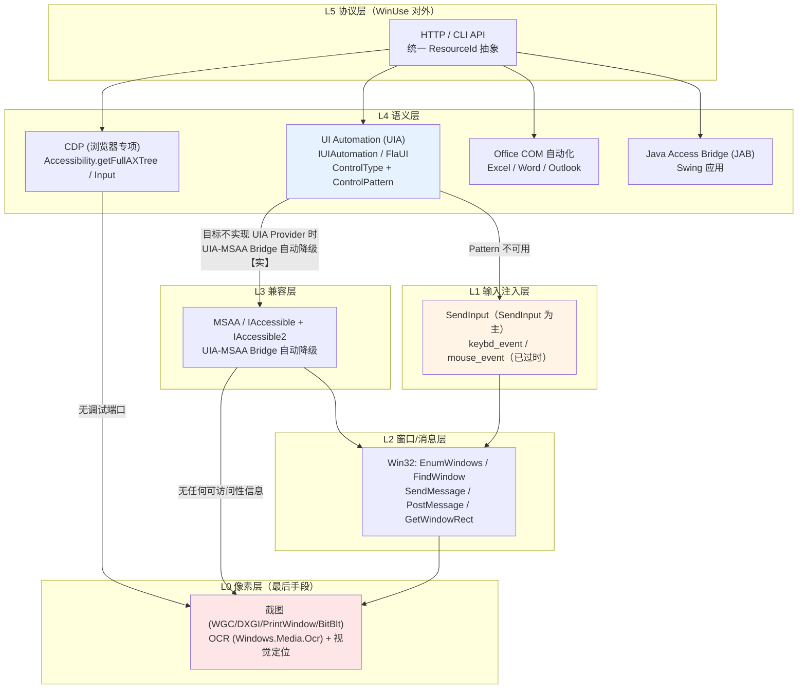
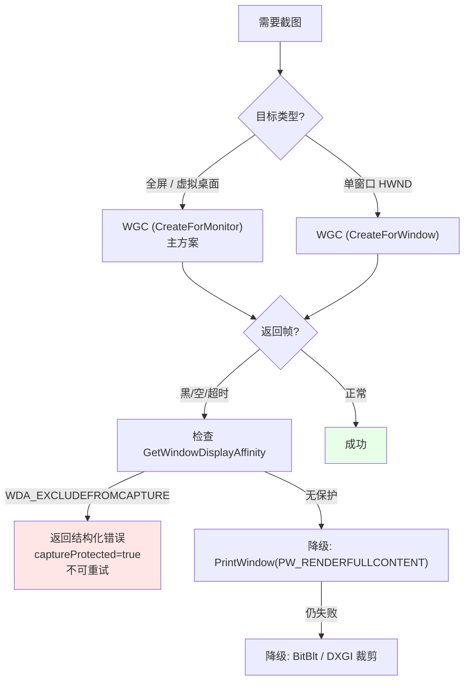
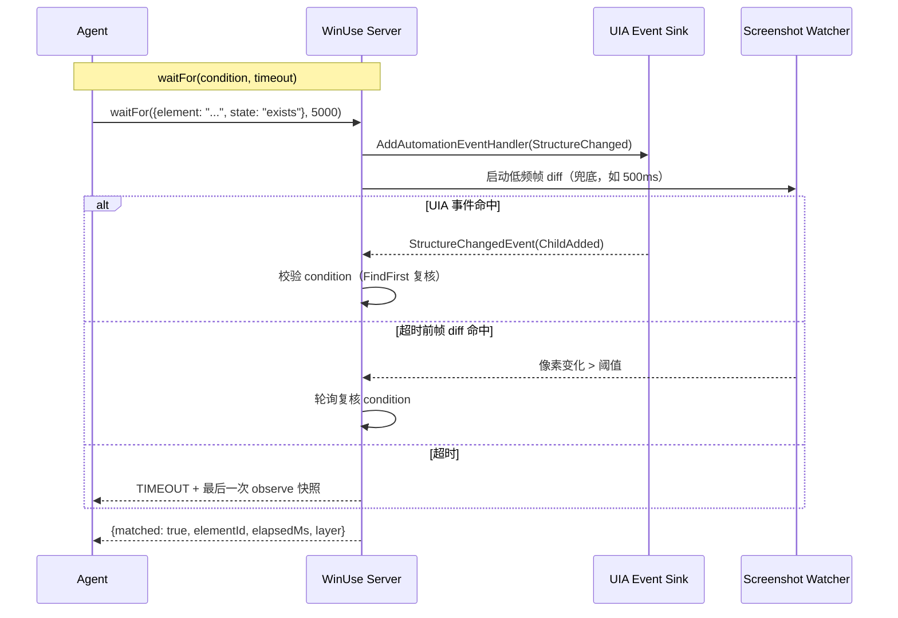
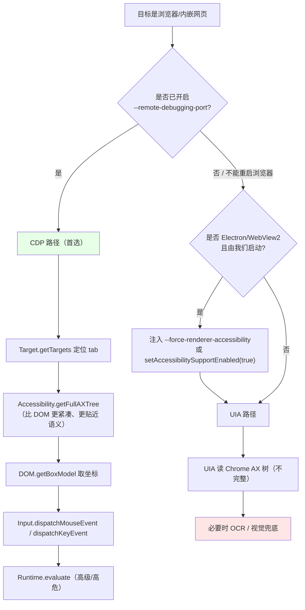
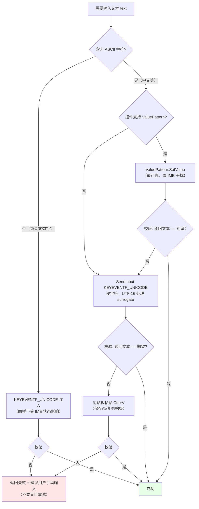
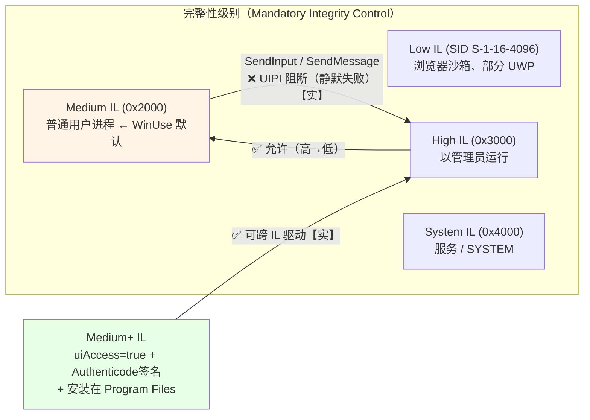
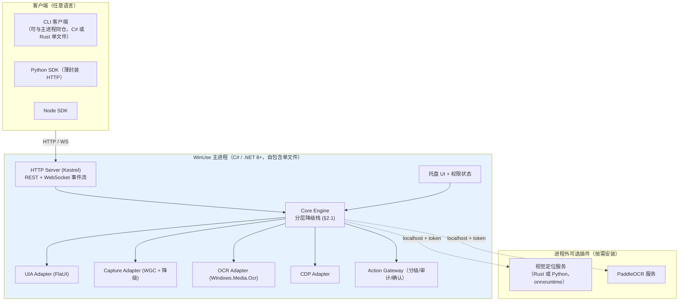

# WinUse 技术底座预研报告（Windows 桌面 Agent 控制）

> 文档编号：04 | 作者：高见远（架构师） | 状态：第一版（技术预研，不含架构与协议设计）
> 项目代号：**WinUse** | 目标形态：Windows 常驻托盘 App + 本地 HTTP Server + CLI
> 写作日期：2026-09 | 适用 Windows 版本：Windows 10 1809+ / Windows 11（以 Win11 23H2/24H2 为主要目标）

---

## 0. 阅读须知：本可信度标注体系

本文严格要求区分三类陈述，读者（尤其是后续做协议设计的我本人与工程师）必须据此判断风险：

| 标记 | 含义 | 处理方式 |
|---|---|---|
| **【实】** | 已核实事实：来自 Microsoft Learn 官方文档、Chromium 官方文档，或业界公认的稳定行为（附来源） | 可直接作为设计依据 |
| **【推】** | 推断：基于原理与经验的类推，未经本项目实测 | 设计时需留出降级路径 |
| **【PoC】** | 待验证：存在真实不确定性或社区结论互相矛盾，**必须先做 PoC 再写进协议** | 阻塞性，需排期验证 |

> 诚实性声明：Windows 桌面自动化是一个"每个能力都有边界、且边界随 Windows 版本漂移"的领域。本文档刻意**不**为了显得可行而弱化难度。核心技术风险排序见 §9。

---

## 1. TL;DR：本轮预研的核心结论

1. **Windows 上没有"一招通吃"的桌面控制能力。** 必须建立**分层降级栈**（UIA → MSAA/IAccessible2 → Win32 消息 → 输入注入 → 像素/视觉），并由协议层显式暴露"本次结果来自哪一层、置信度如何"。这是 WinUse 与"看起来能跑的 demo"之间的分水岭。
2. **自绘 UI（微信/企业微信/钉钉/QQ/游戏/Office 部分区域）是硬边界，不是工程能解决的问题。**【实】这类应用不上报 UIA 树，只能退回坐标 + 视觉/OCR。协议必须允许"视觉定位"作为一等公民，而不是 fallback 补丁。
3. **权限是最大的隐性复杂源。** UIPI（User Interface Privilege Isolation）决定"能不能给高权限窗口发输入"；UAC 安全桌面（Secure Desktop）是**绝对不可达**区域【实】。WinUse 必须在安装期就明确"以何种完整性级别运行"，并提供明确的用户可见提示。
4. **中文输入必须走 `KEYEVENTF_UNICODE` 或 UIA `ValuePattern.SetValue`，绝不能模拟拼音按键序列。**【实】这是中文 Windows 场景最大的区分点，也是竞品（多为英文语境开发）最容易翻车的地方。
5. **语言选型推荐：C# / .NET 8+（自包含单文件发布）为主进程。** 理由不是"生态好"这种泛泛之词，而是本项目的**三个核心技术资产**（UIA、Windows.Graphics.Capture、Windows.Media.Ocr）全部是 **COM / WinRT** 资产，C# 是唯一能同时低成本吃下这三者的语言。详见 §6。
6. **NativeAOT 不作为 v1 承诺**，列为【PoC】：COM interop 与 WinRT 事件 sink 在 AOT 下的支持度需要实测。
7. **能力可行性矩阵（§9，75 条）是后续协议设计的边界依据。** 其中 ✅ 23 条（31%）、⚠️ 35 条（47%）、❌ 17 条（23%）。**超过一半的能力是"有条件支持"** —— 这一数字本身就是最重要的结论：它量化证明了"分层降级 + 显式暴露 grounding 层"不是一个可选的工程美学，而是本项目的生存前提。

---

## 2. UI 自动化与可访问性层（UIA / MSAA / Win32）

### 2.1 分层能力模型（核心心智模型）



**关键设计含义**：WinUse 的每个"动作"都应返回一个 `grounding` 字段，形如
`{layer: "UIA"|"MSAA"|"WIN32"|"INPUT"|"PIXEL", confidence: 0..1, fallbackReason?: string}`。
**Agent 能否可靠工作，取决于它知不知道自己踩在哪一层。** 这一点在协议设计中必须强制。

### 2.2 UIA 核心要素清单

WinUse 需要覆盖的 UIA 面（这是后续 `element` 协议对象的字段来源）：

| 类别 | 具体项 | 说明 / 用途 |
|---|---|---|
| **树遍历** | `TreeScope`（Element / Children / Descendants / Parent / Ancestors / Subtree） | **【实】** `Descendants` 在大窗口（如 Excel、Explorer）上可能非常慢（秒级），必须支持 `TreeScope.Children` + 深度限制 + `IsControlElement` 过滤 |
| **查找** | `FindFirst` / `FindAll` + `AndCondition` / `OrCondition` / `PropertyCondition` / `ControlViewCondition` / `ContentViewCondition` | 条件查找比全树遍历快一个数量级 |
| **ControlType** | Button / Edit / CheckBox / ComboBox / ListItem / MenuItem / TreeItem / TabItem / Document / Text / Hyperlink / Window / Pane / Custom / DataGrid / DataItem / ScrollBar / ToolBar / MenuBar / Dialog ... | **【实】** UFO（微软 Windows Agent 论文）实测覆盖了 Button/Edit/TabItem/Document/ListItem/MenuItem/TreeItem/ComboBox/Hyperlink/ScrollBar 十类作为主力集[^ufo] |
| **控件模式** | `InvokePattern`、`ValuePattern`、`TextPattern`、`SelectionItemPattern`、`SelectionPattern`、`ScrollPattern`、`ScrollItemPattern`、`TogglePattern`、`ExpandCollapsePattern`、`GridPattern`、`GridItemPattern`、`TablePattern`、`RangeValuePattern`、`WindowPattern`、`LegacyIAccessiblePattern`、`ItemContainerPattern`、`VirtualizedItemPattern` | 模式可用性决定"能做什么动作"；`LegacyIAccessiblePattern` 是 UIA→MSAA 的逃生口 |
| **属性** | `Name` / `AutomationId` / `ClassName` / `ControlType` / `FrameworkId` / `IsOffscreen` / `IsEnabled` / `IsControlElement` / `IsContentElement` / `BoundingRectangle` / `ProcessId` / `NativeWindowHandle` / `HelpText` / `AcceleratorKey` / `AccessKey` / `HasKeyboardFocus` / `IsKeyboardFocusable` / `RuntimeId` | **`FrameworkId` 是关键诊断字段**：取值 `Win32`/`WPF`/`WinForm`/`DirectUI`/`XAML`/`Chrome`/`Qt`/`Java`，可用于判断自绘 UI 并提前降级【推】 |
| **事件** | `AutomationEventHandler`、`FocusChangedEvent`、`PropertyChangedEvent`（`AutomationPropertyChangedEventHandler`）、`StructureChangedEvent`、`WindowClosedEvent`、`MenuOpenedEvent`、`MenuClosedEvent`、`AutomationFocusChangedEvent` | **【实】** 事件是"等待语义"的正解（比轮询高一个数量级的效率）；但事件源在多进程/多桌面下不可靠，必须**事件 + 轮询兜底**双保险【推】 |
| **缓存** | `IUIAutomationCacheRequest` | 大树上把属性批量取回，避免逐个跨进程 COM 调用。**【推】** Explorer / Excel 场景必须开，否则延迟不可接受 |

**已知坑（UIA）**：
- **【实】** UIA 客户端在**中等完整性级别（Medium IL）**运行，**不能驱动更高完整性级别的进程**；这需要 `uiAccess=true`（见 §5.1）。Akamai 安全研究亦确认此机制，并指出 UIA 可被恶意软件滥用于规避 EDR[^akamai] —— 这意味着 **WinUse 天然处于杀软/EDR 的高风险关注名单**（见 §7.4）。
- ~~**【PoC】**~~ → **【实】已验证（PoC 第一轮，结论 C1）**：从非提权进程扫描**提权进程**的 UIA 树 —— **完全看不到元素**。实测：Medium IL 探测进程下，高 IL 进程窗口在 UIA 中可见数 **0/1**（管理员版 Windows PowerShell），对照组 Medium IL 窗口 **8/11** 可见。阻断粒度是"高 IL 进程的**整个 UIA 树**"。详见 `poc/poc-results.json` 与 `12-poc-findings.md`。
- **【实】** Java Swing 应用默认**不支持 UIA**（Accessibility Insights 会报 "framework does not support UI Automation"），需 Java Access Bridge[^so-java]。
- **【推】** UIA 树遍历是**跨进程 COM**，单次 `FindAll` 在复杂窗口上可达数百毫秒；必须做服务端缓存 + 增量刷新。

### 2.3 UIA vs MSAA（对比 + 降级关系）

| 维度 | MSAA / IAccessible | UIA |
|---|---|---|
| 引入 | Windows 95 附加包【实】 | Windows Vista / .NET 3.0，Win7 起提供 COM 客户端 API【实】 |
| 对象模型 | 单一 `IAccessible` + 子 ID（childID），固定 Role 集合【实】 | `IUIAutomationElement`，可扩展的 ControlType / Property / ControlPattern / Event【实】 |
| 树质量 | 暴露大量终端用户无关元素，导航模型有歧义（下拉列表/弹出窗口出现两次）【实】 | 过滤视图（ControlView / ContentView），支持 reparenting/repositioning【实】 |
| 事件机制 | WinEvents，与 HWND 强绑定【实】 | 独立事件模型，与 HWND 解耦【实】 |
| 性能 | 进程外客户端慢，AT 工具常被迫 DLL 注入目标进程（"极其困难且有风险"）【实】 | 进程外客户端设计友好，性能与可靠性更好【实】 |
| Win8+ 商店应用 | 不支持【实】 | 必须【实】 |
| 中间层 | 客户端↔服务器**直连**【实】 | 有 UIA Core 服务（`UIAutomationCore.dll`）中介，提供 RuntimeId 等增值服务【实】 |

**结论**：
- **首选 UIA**，不做 MSAA 优先。
- **MSAA 不需要主动调用**：UIA 内置 **UIA-to-MSAA Bridge** / MSAA-to-UIA Proxy，只实现 MSAA 的旧应用会自动被 UIA 客户端看到【实】。因此 L3 层是"自动生效的兜底"，而不是我们要写的代码。
- **例外**：`LegacyIAccessiblePattern` 在极少数老控件上能拿到 MSAA 专属信息，可作为补充字段暴露【推】。
- **IAccessible2**：Firefox / Chrome(旧) / LibreOffice 使用；Chromium 官方实现了 IA2 ↔ UIA 的节点映射[^chromium-ax]。**【推】** 对 Firefox 场景，UIA 可用性取决于 IA2→UIA 映射质量，需实测（Firefox 在 Windows 上 UIA 支持历年改善但仍有缺口）。

### 2.4 Win32 API 层（UIA 之外的必要补充）

| API | 用途 | 可行性 / 坑 |
|---|---|---|
| `EnumWindows` / `EnumChildWindows` | 枚举顶层窗口 / 子窗口 | ✅ 稳定。EnumChildWindows 对自绘 UI 只能拿到少量真实 HWND。**⚠️ 但 `EnumWindows` + `IsWindowVisible` 不足以判定"用户可见"，必须再做 cloaked 过滤 —— 见下面 C5 实测** |
| `FindWindow` / `FindWindowEx` | 按类名/标题定位 | ✅ 但标题本地化会变，仅作辅助 |
| `IsWindowVisible` | 判定窗口可见 | ⚠️ **【实】不可信**：实测 12 个 `IsWindowVisible=TRUE` 的顶层窗口中 3 个是 `DWMWA_CLOAKED=2` 幽灵窗口。必须配合 `DwmGetWindowAttribute(DWMWA_CLOAKED)` + 尺寸检查（见 C5） |
| `GetWindowText` | 读标题 | ⚠️ **【实】** 只能读同一进程或标准控件；跨进程自定义控件常返回空（因为依赖 `WM_GETTEXT`，自绘控件不响应） |
| `GetWindowRect` | 窗口矩形 | ⚠️ **【实】** 含 DWM 阴影，实际视觉边界应用 `DwmGetWindowAttribute(DWMWA_EXTENDED_FRAME_BOUNDS)` |
| `GetWindowThreadProcessId` | HWND → PID/TID | ✅ 元素与进程关联的锚点 |
| `SendMessage` / `PostMessage` | 向控件发消息 | ⚠️ **【实】** 受 UIPI 限制（低 IL 不能给高 IL 发消息）；`WM_GETTEXT` 读跨进程文本需自己分配缓冲区（`WM_GETTEXT` 对跨进程默认不可用，除非用 `SendMessageTimeout` + 共享内存技巧） |
| `SetForegroundWindow` | 置前台 | ⚠️ **【实】** 受前台窗口锁定限制，见 §5.6 |
| `AttachThreadInput` | 绑定输入队列 | ⚠️ **【实】** 需 UIAccess 才能 attach 到更高 IL 的线程；作为"绕过 SetForegroundWindow"的 hack **不推荐**（见 §5.6） |
| `PrintWindow` | 窗口位图 | ⚠️ 见 §3.1 |
| `BitBlt` | GDI 屏幕拷贝 | ✅ 兜底，见 §3.1 |
| `SetWindowsHookEx`（`WH_MOUSE_LL` / `WH_KEYBOARD_LL`） | 全局输入监听 | ⚠️ **【实】** 低级钩子（LL）**不需要 DLL 注入**（系统在调用线程上下文回调），相对安全；但 `WH_GETMESSAGE`/`WH_CALLWNDPROC` 等**需要 DLL 注入所有 GUI 进程**，代价极高（见 §5.7） |
| `GetWindowDisplayAffinity` | 查询防截屏标志 | ✅ **【推】** 强烈建议调用：返回 `WDA_EXCLUDEFROMCAPTURE`(0x11) 时，应直接返回结构化诊断"该窗口启用屏幕捕获保护"，而不是让 Agent 对着黑图反复猜测[^mcec] |

#### 🧪 实测校准 C5：`IsWindowVisible` 不可信 —— cloaked 幽灵窗口陷阱（PoC 第一轮）

> 来源：`poc/poc-results.json`（`window_and_dialog_samples`）／`poc/poc-run.log`
> 环境：Win11 26200 / 单显示器 1920×1080 @125% / Medium IL / 只读

**【实】** `IsWindowVisible=TRUE` 的 **12** 个顶层窗口中，**3 个是 `DWMWA_CLOAKED=2`（`CLOAKED_SHELL`）幽灵窗口**（真正可见只有 **9** 个）：

| 进程 | 窗口类 | 标题 | cloaked | rect |
|---|---|---|---|---|
| SystemSettings | `Windows.UI.Core.CoreWindow` | 设置 | CLOAKED_SHELL | [0, 9, 1920, 1029] |
| ApplicationFrameHost | `ApplicationFrameWindow` | 设置 | CLOAKED_SHELL | [-9, -9, 1929, 1029] |
| TextInputHost | `Windows.UI.Core.CoreWindow` | Windows 输入体验 | CLOAKED_SHELL | [0, 0, 1920, 1080] |

这些窗口**有标题、有窗口类、有进程、`IsWindowVisible=TRUE`，但用户根本看不到**。

**判据（窗口枚举的正确过滤链）**

```
EnumWindows
  → IsWindowVisible == TRUE
  → DwmGetWindowAttribute(hwnd, DWMWA_CLOAKED) == 0     ← 必须，否则混入幽灵窗口
  → rect 宽高 > 0                                        ← 二次保险
```

**【实】** 同时发现：UIA 桌面直系子元素 **12 个中 4 个**在 Win32 可见窗口列表中根本不存在（任务栏 `Shell_TrayWnd`、`Progman`、Tauri/Chromium 隐藏事件窗口如 "Tao Thread Event Target"）；且**所有 UIA 顶层元素 `FrameworkId` 一律为 `"Win32"`**（Chromium/Tauri/UWP 也不例外）→ 顶层窗口层面 `FrameworkId` **无区分度，不可用于降级决策**。

### 2.5 输入注入（Input Injection）

| 方案 | 状态 | 结论 |
|---|---|---|
| **`SendInput`** | **推荐** | **【实】** 官方推荐替代 `keybd_event`/`mouse_event`；把事件串行插入键鼠输入流，不会被其他输入事件穿插 |
| `keybd_event` / `mouse_event` | 已过时 | **【实】** 官方标注 superseded by SendInput，仅作老系统兼容 |
| `SendMessage(WM_KEYDOWN)` | 受限 | **【实】** 只发给目标线程消息队列，绕过输入流，**DirectInput / Raw Input / 游戏 / UWP 收不到** |
| `SendKeys`（.NET） | 不推荐 | **【推】** 内部依赖 Journal hook / SendInput，且必须目标窗口为活动窗口，Unicode 与 IME 行为不可控 |
| UI 自动化 `InvokePattern` | 首选（若能） | 语义级，不依赖坐标与前台状态；但要求控件实现该 Pattern |

**完整性级别与 UIPI —— 本节最重要**

【实】`SendInput` **受 UIPI 约束**：应用程序只能向**完整性级别相等或更低**的应用注入输入；被 UIPI 阻断时，返回值与 `GetLastError` **都不会**告知失败原因（静默失败）[^sendinput]。这是一个极其危险的调试陷阱。

**跨完整性级别的唯一官方路径是 UIAccess**【实】：进程声明 `requestedExecutionLevel uiAccess="true"` 后获得的能力包括：
- 设置前台窗口（`SetForegroundWindow`）
- 用 `SendInput` 驱动任意应用窗口
- 用低级钩子 / Raw Input / `GetKeyState` / `GetAsyncKeyState` 读取**所有完整性级别**的输入
- 设置 journal hooks
- 用 `AttachThreadInput` 附加到**更高完整性级别**的输入队列

但 UIAccess 的启用门槛【实】：
1. 必须有 **Authenticode 数字签名**，证书链可验证到本地计算机的"受信任根证书颁发机构"
2. 必须安装在**仅管理员可写**的目录：`%ProgramFiles%`（含子目录）、`%WinDir%`（部分排除子目录）、`%ProgramFiles(x86)%`
3. 组策略 "User Account Control: Only elevate UIAccess applications that are installed in secure locations" 默认 **Enabled**（CIS 基准亦推荐 Enabled）[^cis]

> **对 WinUse 的产品含义**：UIAccess 是一个**需要代码签名证书（EV 或 OV 代码签名）**的能力，不是开发期能自测的功能。v1 应当**默认以普通用户 Medium IL 运行**，并在检测到目标为 High IL 进程时返回明确错误 `UIPI_BLOCKED`，同时提供"以管理员身份重启"的引导。**UIAccess 应作为商业版/后续版本的增强项**，并在申请证书后验证。

### 2.6 各 UI 框架的 UIA 支持差异（核心痛点）

| 框架 / 应用类别 | FrameworkId | UIA 可用性 | 条件与说明 |
|---|---|---|---|
| Win32 原生（标准控件） | `Win32` | ⚠️ 中 | **【实】** 标准控件由 UIA 内置 Provider 支持；**Owner-draw / custom-draw 控件会退化为无结构** |
| WinForms | `WinForm` | ✅ 较好 | 标准控件良好；第三方控件（DevExpress / Infragistics）依版本，常在"部分可见" |
| WPF | `WPF` | ✅ 好 | 原生 UIA Provider，最理想的目标 |
| WinUI 3 / XAML（含 Win11 设置、资源管理器新版） | `XAML` | ⚠️ 中 | **【推】** XAML Islands 与 WinUI3 的 UIA 覆盖逐年改善但存在空洞（Win11 资源管理器改用 Windows App SDK 后社区反馈变差）【PoC】 |
| **Chromium 系（Chrome / Edge）** | `Chrome` | ⚠️ 有条件 | **【实】** Chromium 无障碍默认关闭、按需启用；可通过 `--force-renderer-accessibility=[basic\|form-controls\|complete]` 强制开启[^chromium-ax]。**Chrome 会在检测到屏幕阅读器等 AT 时自动开启**（这也是为什么很多机器上"看起来能用"的原因 —— 不可依赖） |
| **Electron** | `Chrome` | ⚠️ 有条件 | **【实】** Electron 提供 `app.setAccessibilitySupportEnabled(true)`，官方明确"默认禁用"，且警告"渲染无障碍树会显著影响性能，不应默认启用"[^electron-app]。命令行等价 `--force-renderer-accessibility` |
| CEF（Chromium Embedded Framework） | `Chrome` | ⚠️ 同上 | **【推】** 取决于宿主是否传 flag，多数未开启 |
| WebView2 | `Chrome` / `XAML` | ⚠️ 有条件 | **【推】** WebView2 基于 Chromium，理论上同 Electron 逻辑；但更推荐走 CDP |
| Qt | `Qt` | ⚠️ 差异大 | **【推】** Qt5/6 有 uiautomation 插件（QAccessible 后端）；是否默认加载取决于部署与版本，需实测【PoC】 |
| Java Swing | — | ❌ 默认不可用 | **【实】** Swing 不支持 UIA；需启用 **Java Access Bridge**（`jabswitch -enable`）映射到 MSAA[^so-java] |
| **DirectUI / 自绘（微信、企业微信、钉钉、QQ、网易云音乐、部分游戏）** | `DirectUI` | ❌ **基本不可用** | **【实/推】** 这类应用自行绘制控件、不上报 UIA 树，通常只能拿到窗口外壳（Title/矩形）。**这是 WinUse 最主要的能力天花板** |
| Office（Word/Excel/PowerPoint） | `Win32` + 自绘区域 | ⚠️ 混合 | 功能区（Ribbon）UIA 覆盖较好；**文档编辑区/画布是自绘**，UIA 拿不到内容 —— 应走 **Office COM 自动化** |
| DirectX / 游戏全屏 | — | ❌ | 完全无 UIA；且反作弊会拦截注入 |

**结论**：`FrameworkId == "DirectUI"`（或 UIA 树节点数异常少）是**触发像素层降级的信号**，应作为 WinUse 内置的自诊断能力。

---

## 3. 感知层（Perception）

### 3.1 截图方案对比

| 方案 | 层级 | 性能 | 遮挡窗口 | **最小化窗口** | 硬件加速窗口 | UWP | 锁屏/安全桌面 | DRM/防截屏 | 备注 |
|---|---|---|---|---|---|---|---|---|---|
| **BitBlt**（GDI） | 传统 | 慢（CPU），1080p 约 20–50ms【推】 | ❌ 会被遮挡 | ❌ | ❌ 常黑屏/撕裂 | 部分 | ❌ | ❌ | 兜底；必须声明 DPI 感知否则模糊【实】 |
| **PrintWindow**（`PW_RENDERFULLCONTENT`） | 传统 | 中（CPU） | ✅ 可捕获 | ❌ | ⚠️ **部分黑屏**（swapchain/overlay/DirectComposition 窗口）[^mcec] | 部分 | ❌ | ❌ | 可能引起目标窗口闪烁（光敏性癫痫警告）[^capture-methods] |
| **Windows.Graphics.Capture（WGC）** | WinRT（Win10 1903+） | 快（GPU），4K 整帧约 65ms【推】 | ✅ 可捕获遮挡窗口 | ❌ **无帧产生**（与 PrintWindow 相比并非严格超集）[^mcec] | ✅ **可捕获合成输出** | ✅ | ❌ | ❌ | **推荐主方案**；需 D3D11 device + `Direct3D11CaptureFramePool` + 异步 session；Win10 上有黄色边框（Win11 无）；虚拟机需 WDDM 2.x 驱动【推】 |
| **DXGI Desktop Duplication** | 现代 | 极快（GPU），1080p 约 2–8ms【推】 | ❌ 遮挡区域为遮挡内容 | ❌ 黑屏 | ✅ | ✅ | ❌ | ❌ | **只能整屏**，单窗口需自行裁剪；多 GPU 笔记本可能有问题[^capture-methods] |
| Magnification API | 传统 | 中 | ✅ | ? | ⚠️ | ? | ❌ | ❌ | **【推】** 主要价值是"放大后截图"，对低分辨率 OCR 有预处理价值；不作为主方案 |
| Mirror Driver | 内核 | 极快 | ✅ | ✅ | ✅ | ✅ | ❌ | ❌ | 需驱动签名，成本过高，**排除** |

**结论（截图栈）**：

- **主方案 WGC，降级 PrintWindow，兜底 BitBlt/DXGI。**【推】
- **必须先做 `GetWindowDisplayAffinity` 检查**，把"黑屏"从"谜题"变成"一行可行动的诊断"[^mcec]。这是低成本高收益的工程细节。
- **最小化窗口/非活动虚拟桌面上的窗口：任何方案都拿不到内容**【实/推】。正确做法是**先 `ShowWindow(SW_RESTORE)` 恢复**，再截图。这必须写进协议的 `ensureVisible` 前置步骤。
- **锁屏、UAC 安全桌面、DRM 内容：全部不可捕获**【实】。

### 3.2 元素级截图 vs 全屏截图

| 维度 | 元素级（`BoundingRectangle` + 裁剪） | 全屏 |
|---|---|---|
| Token 成本 | 低，可只发关键区域 | 高（一张 1080p 图 ≈ 大量视觉 token） |
| 定位精度 | 高，直接得到可点击坐标 | 需模型自己在图里找 |
| 前置条件 | **必须有 UIA 元素**（自绘 UI 无解） | 任何情况可用 |
| 遮挡问题 | 元素可能被遮挡，裁剪后拿到的是遮挡物 | 反映真实可见状态 |
| 多元素场景 | 需多次裁剪，开销大 | 一次获得全局上下文 |

**结论**：**二者都不是"主"，而是互补**。推荐协议同时提供：
- `perceive(mode="tree")` → UIA 结构化树（默认，最省 token）
- `perceive(mode="screenshot", target=elementId|window|screen, annotate=true)` → 截图 + 可选在图上叠加元素框（UFO 的 annotated screenshot 做法[^ufo]）
- 视觉定位返回的坐标必须能映射回 UIA 元素（若有）

> **【推】** "annotated screenshot"（在截图上标注每个控件的序号与框）是 UFO 实测有效的做法，比纯截图 + 纯树都更好用。建议作为 WinUse 的差异化特性。

### 3.3 OCR 方案对比（中文场景）

| 方案 | 离线 | 中文准确率 | 性能 | 部署成本 | C# 集成 | 结论 |
|---|---|---|---|---|---|---|
| **Windows.Media.Ocr**（WinRT） | ✅ 完全离线 | ⚠️ 中等。**【推】** 标准印刷体约 75%–85%；低分辨率(72dpi)/复杂背景 <60%；手写体错误率 >40% | 快，资源占用最低 | **零额外文件**，依赖系统 OCR 语言包（需"手写与语音识别"功能包；LTSC/精简版可能需手动注册 AppX） | 低（WinRT 原生） | **默认引擎** |
| **PaddleOCR / RapidOCR（onnxruntime）** | ✅ | ✅✅ 明显更好（中文场景公认最优） | 中，CPU 占用高 | 模型常 100MB+ | 中（PaddleSharp / RapidOCR） | **可选增强包** |
| Tesseract 5 (LSTM) | ✅ | ⚠️ 一般，需 `chi_sim.traineddata`，版本必须匹配 | 慢 | 几十–几百 MB | 中（有 NuGet 封装） | **不推荐**（除非需 100+ 语种） |
| 云 OCR | ❌ | ✅✅ | 取决于网络 | 低 | 低 | **排除**（隐私 + 离线诉求） |

**已知坑（OCR）**：
- **【实】** `Windows.Media.Ocr` 要求 Windows 10 1703+，且依赖系统 OCR 语言包；企业锁定/LTSC 环境可能缺失 → 启动时必须做能力探测，缺失时明确报错"请安装中文 OCR 语言包"，不要静默返回空。
- **【实】** Tesseract 引擎**不是线程安全的**，单例 + 锁是必须的，初始化 200ms–1s，不可每次 new。
- **【推】** OCR 前预处理（灰度化 + 2~3x 放大 + 二值化）对准确率影响可达 15%+。**高 DPI 缩放下必须先按 DPI 放大截图再识别。**
- **【PoC】** 中文 Windows 桌面真实截图上的 Windows OCR 准确率（需要用 12/14px 中文字体实测，这是最差情况）。

### 3.4 视觉定位 / 元素检测

| 方案 | 可行性 | 代价 | 结论 |
|---|---|---|---|
| **OmniParser 类**（图标/文本检测 + 语义描述 → 结构化元素表） | ⚠️ 可行 | 需 onboard 一个检测模型（YOLO 系）+ 可选 caption 模型；CPU 上 1–3s/帧，GPU 更好；体积数百 MB | **【推】** 作为**可选视觉增强**（默认关闭），是破解自绘 UI 的主要路线 |
| 模板匹配（OpenCV `matchTemplate`） | ✅ 可行 | 快、零模型；但对缩放/DPI/主题色/字体渲染极敏感 | **【推】** 适合固定图标（如任务栏图标、已知 App 按钮），不适合通用 |
| 图标检测（通用） | ⚠️ | 需模型 | 含在 OmniParser 路线内 |
| 纯 VLM 坐标输出（"点击 (x,y)"） | ⚠️ | 无本地成本，但坐标精度差（VLM 在 1920x1080 上直接回归坐标误差大）；**必须配合"网格/标注"提示** | **【推】** 作为兜底，不作为主路径 |

**结论**：视觉定位是**可选模块**，不是 v1 必需。v1 应做到"像素层可用（截图 + OCR）"，视觉定位以插件形式后续接入。**【PoC】** 需要评估本地 CPU 上的推理延迟是否可接受。

### 3.5 变化检测（"等待"语义）



- **【实】** UIA 提供 `StructureChangedEvent` / `AutomationPropertyChangedEventHandler` / `WindowClosedEvent`，是"等待"的正解。
- **【推】** **必须事件 + 轮询双保险**：UIA 事件在多进程、UWP、跨桌面、以及某些自绘应用上会漏报。
- **【推】** 帧 diff 阈值化（分块 hash + 变化区域矩形）比全图比对便宜得多，且能直接返回"哪里变了"。

---

## 4. 浏览器专项

### 4.1 CDP vs UIA：决策图



### 4.2 结论：浏览器页面内元素应该用 CDP 还是 UIA？

**答案：CDP 优先，UIA 作为后备。【实/推】**

| 维度 | CDP | UIA（浏览器场景） |
|---|---|---|
| 元素语义 | ✅ `Accessibility.getFullAXTree` 给出与 UIA 同源的 AX 树，但**带完整 role/name/state**，且不丢 DOM 细节 | ⚠️ Chromium 在无障碍开启时通过 UIA 暴露页面内容，但**是"渲染后的快照缓存"**，可能滞后渲染进程几分之一秒[^chromium-ax] |
| 坐标 | ✅ `DOM.getBoxModel` 精确 | ⚠️ `BoundingRectangle` 可用，但滚动/iframe 场景易错 |
| 输入 | ✅ `Input.dispatchMouseEvent` 直接进浏览器合成器线程，亚毫秒级，且**不依赖窗口前台状态** | ⚠️ 需窗口可见 + 前台，受 UIPI |
| 执行 JS | ✅ `Runtime.evaluate` | ❌ 不可能 |
| 前置条件 | ⚠️ **必须带 `--remote-debugging-port=9222` 启动浏览器**（重启生效） | ⚠️ 需无障碍开启 |
| 风险 | 高权限：可读任意 tab 的 cookie、以用户身份导航、执行 JS | 低 |
| 网络/性能分析 | ✅ 独有 | ❌ |

**关键工程结论**：
- **【实】** `--remote-debugging-port` 必须以**独立 user-data-dir** 启动（否则不能接管已运行的 Chrome 实例：Chrome 会对默认 profile 拒绝远程调试端口，除非该 profile 未被占用）。
- **【实】** 接管已运行浏览器的正确姿势：`GET http://127.0.0.1:9222/json/version` 取 `webSocketDebuggerUrl`，再 `Target.getTargets` 枚举 tab[^proxima-cdp]。
- **【推】** WinUse 应提供 `browser.attach()` 能力，并**明确提示用户"将使用独立 Chrome profile"或"以调试端口重启浏览器"**。不应偷偷重启用户的浏览器。
- **【推】** CDP 是**高危能力域**（等同把登录态交给 Agent），必须纳入 §7.3 的动作分级与二次确认。

### 4.3 Edge / Chrome UIA 暴露情况

- **【实】** Chromium 无障碍默认关闭、按需自动启用（检测到 AT 时）；可用 `--force-renderer-accessibility` 强制[^chromium-ax]。
- **【实】** Chromium 在 Windows 上同时实现 **IAccessible (MSAA)、IAccessible2、UI Automation**，并支持 IA2↔UIA 节点映射[^chromium-ax]。
- **【实】** Electron：`app.setAccessibilitySupportEnabled(true)`，**默认禁用**，且官方警告性能影响[^electron-app]。必须在 `ready` 事件后调用。
- **【推】** Edge 与 Chrome 行为基本一致（同为 Chromium）。Firefox 走 IA2/UIA，**【PoC】** 需实测。

### 4.4 WebView2 / Electron 应用的两种控制路径

| 路径 | 条件 | 优点 | 缺点 |
|---|---|---|---|
| **A. CDP 路径** | 宿主开启调试端口（Electron 可用 `--remote-debugging-port`；WebView2 需 `--remote-debugging-port` 环境变量 `WEBVIEW2_ADDITIONAL_BROWSER_ARGUMENTS`） | 完整 DOM 能力、稳定坐标 | **依赖宿主线程序**，多数第三方 Electron 应用（如 VSCode、Slack、Notion）**未开端口，我们无法改变** |
| **B. UIA 路径** | 宿主启用无障碍 | 通用 | Electron 默认禁用；开启后性能受影响 |

**结论**：**对第三方 Electron 应用，两条路径通常都不可用** —— 这是我们无法绕过的现实。**【推】** 正确策略是：
1. 先尝试 UIA，读 `FrameworkId == "Chrome"` 但树为空 → 判定为"未开启无障碍的 Electron"；
2. 尝试探测常见调试端口（9222/9223...）**并明确告知用户这是受限能力**；
3. 最终退回截图 + OCR + 坐标点击。
4. 协议必须把这种情况以 `degraded` 状态**明确返回给 Agent**，而不是静默失败。

---

## 5. 中文输入法（IME）—— 中文 Windows 的核心痛点

### 5.1 四种输入策略对比

| 策略 | 机制 | 适用场景 | 坑 |
|---|---|---|---|
| **1. UIA `ValuePattern.SetValue`** ⭐ | 直接设置控件值，**完全绕过键盘与 IME** | 任何实现了 ValuePattern 的控件（大多数标准编辑框、WPF/WinForms 文本框） | **【实】** 部分控件设置后不触发 `TextChanged`/验证逻辑，或应用不认账（尤其是自绘、Web 富文本编辑器）；可能绕过前端校验 |
| **2. `SendInput` + `KEYEVENTF_UNICODE`** ⭐ | `wVk=0`，`wScan=字符 Unicode`，发 KEYDOWN/KEYUP。系统产生 `WM_KEYDOWN(wParam=VK_PACKET)` → `TranslateMessage` → `WM_CHAR` | **通用兜底**：不依赖目标窗口的 IME 状态【实】 | **【实】** 对 BMP 外字符（emoji、部分生僻字）需拆成 UTF-16 surrogate pair 分两次发送；**【推】** 某些自绘控件/游戏不走 `TranslateMessage`，会收不到 |
| **3. 剪贴板粘贴（`Ctrl+V`）** | `SetClipboardData(CF_UNICODETEXT)` + 注入 Ctrl+V | 大文本、多行、富文本；ValuePattern 与 Unicode 注入都失败时的最后手段 | **【实】** 污染用户剪贴板（必须保存/恢复，含所有格式）；密码框、部分安全控件拒绝粘贴；会带入富文本格式导致格式错乱【推】 |
| **4. 模拟按键序列（拼音编码）** ❌ | 发送拼音字母按键，让 IME 组合 | **无** | **【实】** 必须知道目标窗口的 IME 状态（中/英）、具体输入法编码方案（拼音/五笔/双拼）；组合窗口行为不可控；输入英文时又要先关输入法 —— **"若真要以这样的思路来实现，则必定是难以成功的"**[^ime-article] |

### 5.2 推荐策略（决策顺序）



**核心设计原则：每种输入后必须"读回校验"（read-back verify）。** 这是中文场景防止"静默输入成乱码/拼音字母"的唯一可靠手段。【推】

### 5.3 IME 相关的其他议题

- **【实】** `KEYEVENTF_UNICODE` 方式下，**输入中文不要求目标打开输入法，输入英文也不要求关闭输入法** —— 这是它相对按键模拟的根本优势[^ime-article]。
- **【推】** **候选窗口干扰**：若误用按键序列注入，IME 候选窗会浮现在目标窗口上，遮挡后续坐标点击，且候选窗在 UIA 树中可见性不稳定（属于 IME 进程，通常不在目标应用树内）。**再次印证：不要用按键模拟。**
- **【实】** 相关但**非必需**的 API：`ImmGetContext` / `ImmSetCompositionString` / `WM_IME_*`。这些是"直接操纵目标窗口 IME 组合状态"的手段。**结论：v1 不需要**，因为前三种策略已覆盖绝大多数场景；仅在遇到"必须模拟真实键入（如有按键监听的网银控件）"时才考虑，且**这类控件通常就是防自动化设计的，我们不应去绕过**。
- **【PoC】** 需实测的中国本地化 App：微信输入框、企业微信、钉钉、QQ、WPS、国产 ERP/CRM 客户端、网银控件（后者大概率不可行，应明确列入 ❌）。

---

## 6. 系统约束与环境现实

### 6.1 UAC / 管理员权限 / 完整性级别



- **【实】** UAC 弹窗出现在**安全桌面（Secure Desktop）**，自动化无法触及 —— 这是 Windows 的**设计意图**，不是缺陷。WinUse 必须**明确返回 `SECURE_DESKTOP` 错误**并提示用户手动处理，绝不能假装可以。
- **【实】** 以管理员运行的 WinUse 可以驱动普通与管理员进程，但**不能驱动安全桌面**。
- **【实】** Session 0 隔离：Windows 服务不能创建交互式桌面进程 —— 因此 **WinUse 必须是用户会话内的桌面应用（托盘常驻），不能做成 Windows Service**【推】。这是一个重要的架构约束。
- **【推】** 建议 v1 默认 Medium IL，检测到 High IL 目标时给出 `UIPI_BLOCKED` + "以管理员身份重启"引导。

### 6.2 锁屏 / 屏保 / 休眠 / RDP

| 状态 | 输入注入 | 截图 | 说明 |
|---|---|---|---|
| **锁屏（Locked）** | ❌ | ❌ | **【实】** Power Automate 官方文档明确列为 UIPI 失败原因[^ms-uipi] |
| **UAC 安全桌面** | ❌ | ❌ | **【实】** 同上，且任何捕获 API 都不可达 |
| **屏保激活** | ❌ | ⚠️ 可能拿到屏保画面 | **【推】** 屏保本质是新桌面 |
| **休眠/睡眠** | ❌ | ❌ | 系统挂起 |
| **RDP 窗口最小化** | ❌/⚠️ | ❌/⚠️ | **【实】** RDP 会话最小化会导致自动化失败（需注册表项调整）[^ms-uipi] |
| **RDP 断开（会话断开）** | ❌ | ❌ | **【推】** 断开后会话无桌面合成；需 `tscon` 重连到控制台会话。**这是一个真实的运维坑** |

**结论**：WinUse 必须在启动与每次关键操作前做**环境可用性探测**（`isSessionInteractive()`），并在不可用时返回结构化错误，而不是超时。

### 6.3 多显示器与 DPI —— 坐标系统定义（**必须严格遵守**）

**本节是协议设计的硬约束，请后续架构直接采用。**

#### 决策 1：进程必须声明 Per-Monitor DPI Awareness v2

**【实】** 若进程为 DPI Unaware，Windows 会做 **DPI 虚拟化**：`GetWindowRect` 返回被缩放过的坐标、`BitBlt` 截出模糊的缩放位图、点击坐标整体偏移 —— 表现为"窗口跑到预期位置附近但始终对不齐"[^dpi-softel][^dpi-winput]。

**做法**（二选一，**必须在创建任何窗口之前**）：
- **推荐**：应用 manifest 声明 `PerMonitorV2`（同时保留 `PerMonitor` 兼容 Win10 早期版本）
- 或启动时 `SetProcessDpiAwarenessContext(DPI_AWARENESS_CONTEXT_PER_MONITOR_AWARE_V2)`（-4）

**【实】** 一旦已创建窗口，该调用会被拒绝，进程停留在 manifest 指定的模式。**【推】** 启动后应用 `GetDpiForWindow` 自检并打日志/上报。

##### 🧪 实测校准 C2：DPI 感知是**硬要求**，不是优化（PoC 第一轮）

> 来源：`poc/poc-results.json` ／ `poc/poc-run.log`
> 环境：**Windows 11 Build 26200（25H2）｜单显示器 1920×1080 @125%（120 DPI）｜探测进程 IL=Medium、未提权｜C#/.NET 10/FlaUI 5.0.0｜非侵入式只读**

| 观测项 | 切换前（`PROCESS_DPI_UNAWARE`） | 调用 `SetProcessDpiAwarenessContext(PER_MONITOR_AWARE_V2)` 后 |
|---|---|---|
| `GetProcessDpiAwareness` | `PROCESS_DPI_UNAWARE`（值 0，HRESULT `0x00000000`） | `PROCESS_PER_MONITOR_DPI_AWARE`（**成功，`lastError=0`**） |
| 线程 awareness context | `UNAWARE`（值 0） | `thread_is_per_monitor_v2 = true` |
| **`GetDpiForSystem`** | **96（谎报）** | **120（真实值）** |
| `GetWindowRect` 值发生变化的窗口数 | 基准 | **12 / 12 全部改变** |

**结论【实】**：DPI Unaware 下**全部 12 个窗口**的 `GetWindowRect` 返回值都是被系统虚拟化后的**错误值**，且 `GetDpiForSystem` 会**谎报 96**。这不是"对不齐一点点"的软问题，而是**所有坐标系统性错误**。
**架构含义**：PMv2 声明是**正确性前提**；`dpi_awareness_ok=false` 时坐标类能力必须**拒绝执行**（返回 `DPI_MISMATCH`），而不是返回错坐标（对应 06 §5.4.2）。

#### 决策 2：坐标系统定义（WinUse 规范）

| 名称 | 定义 | 用途 |
|---|---|---|
| **物理像素 + 虚拟桌面坐标系（VSC）** | 原点 = **虚拟屏幕左上角**（`GetSystemMetrics(SM_XVIRTUALSCREEN)`, `SM_YVIRTUALSCREEN`，**可为负数**）；单位 = **物理像素** | **WinUse 内部唯一权威坐标系**；所有 `BoundingRectangle`、`GetWindowRect` 结果、截图尺寸均以此为准 |
| **逻辑像素（per-monitor）** | 物理像素 ÷ (该显示器 DPI / 96) | 仅在需要向目标窗口解释坐标时使用 |
| **归一化坐标 [0,1]** | 相对**主显示器**矩形归一化 | **仅用于对外协议的可选表示**，便于 VLM 输出；服务端负责换算 |

**规则**：
1. **协议对外必须携带 `coordinateSystem` 字段**，不允许"裸坐标"。
2. 每次 `observe` 响应必须携带显示器拓扑快照：`[{monitorId, rect(物理像素), dpiX, dpiY, scalePercent, isPrimary}]`，使 Agent/客户端可自行换算。
3. 截图响应必须携带 `pixelSize`（物理像素）与 `logicalSize`，并注明来自哪个 monitor。
4. 元素 `BoundingRectangle` 一律返回**物理像素 VSC**，并额外给出 `dpi`（来自 `GetDpiForWindow(GetAncestor(hwnd, GA_ROOT))`）与 `monitorId`（来自 `MonitorFromWindow`）。

#### 已知坑（坐标）

- **【实】** `SendInput` 的 `MOUSEEVENTF_ABSOLUTE` 将 dx/dy 归一化到 **0..65535 映射到"显示表面"**。多显示器下该"显示表面"的实际范围存在版本差异与争议 —— **【PoC】必须实测**：副屏（尤其是位于主屏左侧、坐标为负的副屏）是否可达。
  - **【推】** 稳妥实现：**优先 `SetCursorPos(x, y)`（接受虚拟桌面物理坐标）跳到目标，再 `SendInput` 发送点击**；相对移动（`MOUSEEVENTF_MOVE`）会被**鼠标加速**影响，不精确。
  - **【PoC】** `SetCursorPos` 是否同样受 UIPI 限制（社区存在争议）。
- **【实】** `GetWindowRect` 含 DWM 阴影/不可见缩放边框；视觉边界用 `DwmGetWindowAttribute(DWMWA_EXTENDED_FRAME_BOUNDS)`。**实测差值见下面 C3**。
- **【推】** 混合 DPI（主屏 100%、副屏 150%）下 `GetDpiForSystem` 只返回主屏值，必须用 `GetDpiForMonitor` / `GetDpiForWindow` + `MonitorFromWindow`。（**C2 已实测其在 Unaware 下的谎报行为**）

##### 🧪 实测校准 C3：三套坐标系只存在**两套值**，且 UIA 与 `GetWindowRect` 同源（PoC 第一轮）

> 来源：`poc/poc-results.json`（`coordinate_consistency.three_way_comparison`）
> 环境：Win11 26200 / 单显示器 1920×1080 @125%（**120 DPI**）/ Medium IL / 只读
> 样本：12 个窗口参与采样，8 个进入三方比对，**全部 `dpi=120`**

| 对比 | 实测 delta（left, top, right, bottom） | 判读 |
|---|---|---|
| **UIA `BoundingRectangle` − `GetWindowRect`** | **`[0, 0, 0, 0]`（8/8 样本完全一致）** | ✅ **修正了本文档此前"UIA 返回逻辑坐标"的推测**：PMv2 下 UIA 与 Win32 **同源**，都是物理像素 |
| `DWMWA_EXTENDED_FRAME_BOUNDS` − `GetWindowRect`（**最大化**窗口） | **`[+9, +9, −9, −9]`** | 视觉边界每边内缩 **9px**（实例：`GetWindowRect=[-9,-9,1929,1029]` vs `DWM=[0,0,1920,1020]`） |
| `DWMWA_EXTENDED_FRAME_BOUNDS` − `GetWindowRect`（**非最大化**窗口） | **`[+8, 0, −8, −8]`** | 左/右/下各内缩 **8px**，**上边不偏移**（实例：`[0,7,1920,1027]` vs `[8,7,1912,1019]`） |

**架构含义（已回写 05 ADR-006 与 06 §5.4.1）**

1. 协议必须区分**两套坐标系**：`hit`（＝`GetWindowRect`＝UIA `BoundingRectangle`，用于点击/定位）与 `visual`（＝DWM extended bounds，用于截图/取像）。
2. 二者**相差 8–9px（@125%）**。SoM 标注框若来自 UIA 而图像来自 WGC/PrintWindow，**不换算则整体偏移 8–9px**。
3. 偏移量**禁止硬编码**：必须同时取两套值再相减（偏移随窗口状态与 DPI 缩放变化）。

> 【推】该偏移源自 DWM 不可见缩放边框，数值随缩放比变化（120 DPI 下 8–9px ≈ 96 DPI 下 7px × 1.25）。**比例关系未实测**，须在 100%/150%/200% 补测。
> ⚠️ 本轮为**单显示器、VSC 原点非负**（`origin_is_negative=False`）；**多显示器 / 负坐标副屏 / 混合 DPI 仍未实测**。

### 6.4 虚拟桌面（Virtual Desktop）

| 能力 | API | 可行性 |
|---|---|---|
| 查询窗口所在虚拟桌面 GUID | `IVirtualDesktopManager::GetWindowDesktopId` | ✅ **公开**【实】 |
| 判断窗口是否在当前虚拟桌面 | `IsWindowOnCurrentVirtualDesktop` | ✅ **公开**【实】 |
| 移动窗口到指定虚拟桌面 | `MoveWindowToDesktop` | ✅ **公开**【实】 |
| 枚举/创建/切换/重命名/删除虚拟桌面 | `IVirtualDesktopManagerInternal`（**未文档化**，经 `IServiceProvider` 从 `CLSID_ImmersiveShell` 获取） | ⚠️ **可行但脆弱**：接口 IID 随 Windows 版本变化，社区维护了 **8 个版本变体**（Win10 / Win11 21H2 / 22H2 / 23H2_2050 / 23H2_2921 / Insider22631 / Insider / Insider25314）[^vd-helper]；且内部方法签名在 19041+ / 22621+ / 26100+ 之间不同[^vd-winuse] |

**结论**：
- **【实】** 官方明确建议"应用不应主动切换用户的虚拟桌面，只有用户才应发起该变更"[^ivdm]。
- **建议**：v1 **只实现三个公开 API**（查询 + 判断 + 移动窗口），**不实现切换/创建/删除**。
- **【推】** 若产品强需求切换虚拟桌面，则必须做**按 Windows build number 分发的 COM 接口变体表 + 多级 fallback**，并接受"某次 Windows 更新后失效"的风险。这是**显著的维护负债**，应在 PRD 阶段就让用户知情。
- **【实】** 非当前虚拟桌面上的窗口：**WGC 无帧**（§3.1），SetForegroundWindow 亦受限。

### 6.5 前台窗口限制（`SetForegroundWindow`）

**【实】** `SetForegroundWindow` 受系统"前台窗口锁定"限制：调用进程本身不是前台进程时，通常只会**闪烁任务栏图标**而不是真正置前。

| 做法 | 是否推荐 | 说明 |
|---|---|---|
| 让 WinUse 自己成为前台进程后调用 | ✅ 推荐 | 最正当 |
| 先 `ShowWindow(SW_RESTORE)` / `SW_SHOWNORMAL` 再置前 | ✅ 推荐 | 处理最小化窗口 |
| `SwitchToThisWindow` | ⚠️ 不推荐 | 未文档化，行为不稳定 |
| **`AttachThreadInput` 强制绑定输入队列** | ❌ **不推荐** | **【实】** 需 UIAccess 才能 attach 到更高 IL 线程；且容易造成输入队列死锁/卡死，是经典的系统不稳定来源 |
| 模拟 Alt 键释放（"Alt hack"） | ❌ 不推荐 | 社区流传的 hack，依赖"系统认为刚有用户输入"的副作用，不可靠 |
| 双击任务栏图标模拟 | ❌ 不推荐 | 纯坐标 hack，脆弱 |
| 发送 `WM_SYSCOMMAND / SC_RESTORE` 后 `SetForegroundWindow` | ⚠️ 可行 | 较温和的变体 |

**结论**：**WinUse 的 `focus(window)` 语义应定义为"尽力而为"（best-effort）**，返回值明确告知是否真正成为前台；并提供 `SetForegroundWindow` 失败时的替代路径（UIA `InvokePattern` / `SetWindowVisualState` 不需要前台）。

**【实】** 进程拥有 **UIAccess** 时可无条件设置前台窗口（§2.5）—— 这是唯一"正规"的破解手段。

### 6.6 `SetWindowsHookEx` 全局钩子的代价

| 钩子类型 | 是否需 DLL 注入 | 代价 | 结论 |
|---|---|---|---|
| `WH_MOUSE_LL` / `WH_KEYBOARD_LL` | **否**【实】 | 系统在调用线程上下文回调；但会**拖慢系统输入**、杀软/EDR 高度关注 | ⚠️ **可选**（用于"用户活动检测""紧急停止热键"），默认关闭 |
| `WH_GETMESSAGE` / `WH_CALLWNDPROC` / `WH_CBT` | **是**【实】 | 需把 DLL 注入**所有 GUI 进程**；位数必须匹配（32/64）；一个崩溃拖垮整个 shell | ❌ **排除** |
| `WH_SHELL` / `RegisterShellHookWindow` | 否（消息方式） | 轻量 | ✅ **推荐**用于窗口创建/销毁/激活监听 |

**结论**：用 `RegisterShellHookWindow` 替代全局 hook 做窗口生命周期监听；全局 LL 钩子仅在用户显式开启"活动监控"时使用，并在 UI 明确说明。

---

## 7. 实现语言与运行时选型

### 7.1 候选方案对比

| 维度 | **C# / .NET 8+** | **Rust + windows-rs** | **Go + w32/go-ole** | **C++ / Native** | **Node/Electron** | **Python** |
|---|---|---|---|---|---|---|
| **UIA（COM）** | ✅✅ 一等公民：`UIAutomationClient` / **FlaUI**（成熟封装，含缓存、事件、XPath） | ⚠️ `windows` crate `UI_UIAutomation` 有绑定，**但只是 API 投影**，无高级封装，树遍历/事件/缓存需自己写 | ⚠️ go-ole 可用，但样板极多、泛型缺失，UIA 变体处理痛苦 | ✅ 原生，但代码量巨大 | ⚠️ 需 node-ffi / edge-js 桥接 | ⚠️ pywinauto/comtypes 可用，但 GIL + 分发困难 |
| **WinRT：Windows.Graphics.Capture** | ✅✅ CsWinRT 直接投影 | ⚠️ 可行但 WinRT 异步/事件/ComWrappers 样板重 | ❌ WinRT 支持极弱，近乎不可用 | ✅ C++/WinRT，但代码量大 | ⚠️ 需桥接 | ⚠️ winsdk 包存在但不成熟 |
| **WinRT：Windows.Media.Ocr** | ✅✅ 同上 | ⚠️ 同上 | ❌ | ✅ | ⚠️ | ⚠️ |
| **Win32 P/Invoke** | ✅ `DllImport`/`LibraryImport`，Source Generator | ✅ `windows-sys` / `windows` crate | ✅ syscall + `sys/windows` | ✅ 原生 | ⚠️ | ⚠️ ctypes |
| **HTTP Server** | ✅ ASP.NET Core / Kestrel（成熟，含 WS、SSE） | ✅ axum / hyper | ✅ net/http | ⚠️ 需自造 | ✅ 原生 | ✅ FastAPI |
| **托盘 UI** | ✅ WinForms/WPF NotifyIcon；或 `windows-notifyicon` crate 思路 | ⚠️ 需手写 Shell_NotifyIcon + 消息循环 | ⚠️ 需第三方库 | ⚠️ | ✅ 天然 | ⚠️ |
| **单文件分发** | ⚠️ self-contained single-file ≈ 70–100MB（未裁剪）；**NativeAOT ≈ 15–40MB 但【PoC】** | ✅✅ 5–15MB，零运行时依赖 | ✅✅ 8–20MB | ✅✅ 最小 | ❌ 100MB+，需打包运行时 | ❌ 需打包解释器 |
| **常驻内存** | ⚠️ 50–120MB RSS（未裁剪） | ✅ 20–40MB | ✅ 20–50MB | ✅ 最小 | ❌ 150MB+ | ❌ |
| **开发速度** | ✅✅ 最快（本项目的核心资产全在其主场） | ⚠️ 中（COM/WinRT 样板拖慢） | ⚠️ 中 | ❌ 最慢 | ✅ 快 | ✅✅ 最快（但不适合主二进制） |
| **团队/招聘** | ✅ 大 | ⚠️ 中 | ✅ 大 | ⚠️ 小 | ✅ 大 | ✅ 大 |
| **杀软误报** | ⚠️ 自包含单文件是常见误报源 | ⚠️ 同样 | ⚠️ 同样 | ⚠️ 同样 | ⚠️ 更差 | ❌ 最差 |

### 7.2 **推荐：C# / .NET 8+（或 .NET 9）自包含单文件为主进程**

**推荐理由（按权重排序，不是泛泛的"生态好"）**：

1. **本项目三大核心技术资产全部是 COM / WinRT 资产**：
   - UIA（`IUIAutomation`，COM）
   - `Windows.Graphics.Capture`（WinRT）
   - `Windows.Media.Ocr`（WinRT）
   C# 是**唯一**能以低成本同时吃下这三者的语言。`windows-rs` 提供的是**API 投影**而非**解决方案** —— UIA 的树遍历缓存、事件 sink、WinRT 的 `IAsyncOperation`/`Direct3D11CaptureFramePool` 生命周期，在 Rust 里都是要手写的数百行 unsafe 样板。
2. **UIA 生态最成熟**：FlaUI 提供了本项目所需的**全部高级能力封装**（`CacheRequest`、`TreeWalker`、条件查找、事件订阅、`LegacyIAccessiblePattern` 兜底），且活跃维护。
3. **WinRT interop 官方一等支持**：CsWinRT / `net9.0-windows10.0.26100.0` TFM，WGC 与 OCR 的调用几乎是直译官方文档。
4. **HTTP 服务与并发模型成熟**：Kestrel + `System.Text.Json` + Channels，能同时支撑 HTTP REST、WebSocket（事件流）、SSE。
5. **开发速度**：Windows 桌面自动化的难点在**探索边界**而非**写代码**，把时间花在 PoC 而不是 COM 样板上，是本项目最大的效率杠杆。

**代价（诚实列出）**：
- 分发体积大（self-contained ~70–100MB，需 trimming 优化到 ~40MB）。
- 常驻内存高于 Rust（多 30–80MB）。对一个常驻托盘应用，这是可接受的（Chrome 一个 tab 都不止）。
- **NativeAOT 不可作为 v1 承诺**：COM interop 与 WinRT 事件 sink 在 AOT 下支持度需实测【PoC】。
- .NET 运行时更新可能带来行为漂移（相对 Rust 的静态链接）。

### 7.3 混合方案：是否采用？

**结论：v1 不采用混合主进程；但采用"进程外可插拔插件"。**



理由：
- **混合主进程（Rust 主 + .NET 子进程）会引入 IPC 开销与双重部署复杂度，收益（省几十 MB 内存）不抵成本。**
- **真正的混合需求只有两个**：① 视觉定位模型推理（onnxruntime / Python 生态更友好）；② 增强 OCR（PaddleOCR）。这二者天然适合做成**独立的本地插件进程**，通过 localhost + token 调用。**它们默认不安装**，不影响主程序体积。
- **CLI 客户端**可考虑用 Rust 单独实现（几 MB，启动快），也可直接复用主进程 exe 的子命令。**建议 v1 直接复用主进程 exe 的 `winuse <cmd>` 子命令**，减少交付物。

### 7.4 关于 Node/Electron 与 Python 的明确意见

- **Node/Electron：排除作为主进程。** 理由是分发体积（100MB+）、常驻内存（150MB+）、以及 COM 调用需 ffi 桥接（性能与稳定性都差）。
- **Python：排除作为主进程**（依赖管理、启动速度、打包脆弱、无托盘原生方案），但**必须提供官方 Python SDK**（生态诉求最强，Agent 框架多在此）。

---

## 8. 安全与权限模型

### 8.1 本地 HTTP Server 的暴露面

| 议题 | 决策 | 理由 |
|---|---|---|
| **Bind 地址** | **默认 `127.0.0.1`（loopback only）**；`0.0.0.0` 需显式开关 + 强警告 | **【实/推】** 0.0.0.0 会把"接管我电脑"的能力暴露到局域网 |
| **鉴权** | **必须**：启动时生成随机 token（写入 `%LOCALAPPDATA%\WinUse\auth.json`，权限 ACL 限制为当前用户），所有请求需 `Authorization: Bearer <token>`（或 `X-WinUse-Token`） | 无鉴权 = 本机任意进程（含浏览器 JS）可完全接管桌面 |
| **DNS Rebinding** | **必须防御**：校验 `Host` 头 ∈ `127.0.0.1 / localhost / [::1]:port`；拒绝其他 Host | **【推】** 这是本地 server 的经典攻击：恶意网页让 DNS 指向 127.0.0.1 从而绕过同源策略 |
| **CSRF / 浏览器发起** | **必须防御**：拒绝带 `Origin` 头的请求（或严格白名单）；`Content-Type` 强制 `application/json`；非简单请求触发预检 | **【推】** 浏览器可对本机端口发简单请求（无自定义头时），这是真实威胁 |
| **传输** | loopback 上 HTTP 即可；若开启 0.0.0.0，**必须 TLS + 客户端证书（mTLS）** | 【推】 |
| **首次配对** | **【推】** 提供"配对码"模式：CLI/远程客户端需输入托盘上显示的一次性 6 位码 | 防止任意本地进程直接拿 token |

**威胁模型要点**：本地 HTTP server 的攻击者有两类 —— ① **本机恶意进程**（可直接读 token 文件，因此 token 文件必须 ACL 到当前用户）；② **用户浏览器中的恶意网页**（DNS rebinding + CSRF，靠 Host/Origin 校验防御）。二者都要防。

### 8.2 动作分级与二次确认

参考微软 UFO 论文的 "sensitive actions" 分类[^ufo]，建议四级：

| 级别 | 定义 | 示例 | 默认策略 |
|---|---|---|---|
| **L0 只读** | 不改变任何状态 | 观察树、截图、读文本、枚举窗口、OCR | 自动执行 |
| **L1 低危** | 可逆的界面操作 | 点击按钮（非危险）、输入文本、滚动、切换标签、窗口最大化/还原 | 自动执行（可配置需确认） |
| **L2 高危** | 不可逆或跨应用副作用 | **发送邮件/消息**、删除/修改文件、关闭窗口/应用、安装卸载软件、访问摄像头/麦克风、读取密码/浏览器历史、执行 shell/PowerShell、注册表写、**CDP `Runtime.evaluate`**、剪贴板写入 | **默认弹窗二次确认**（托盘气泡/模态窗），可配置"本次会话信任" |
| **L3 破坏性** | 系统级不可逆 | 格式化、关机/重启、杀死系统进程、修改 UAC 设置、删除用户目录 | **默认拒绝**，需显式配置项开启 + 强制确认 + 审计 |

**机制建议**：
- 提供 `--yes / autoApproveLevel=N` 供无人值守场景使用（**高风险，需明确用户开启**）。
- **紧急停止（Kill Switch）**：托盘菜单 + 全局热键（建议 `Ctrl+Alt+Shift+Esc` 之类不冲突组合）+ CLI `winuse stop`，立即中断当前动作队列。**这是产品化必备，不是可选项。**
- **动作队列串行化**：任何时刻只允许一个动作在执行，避免 Agent 并发导致的状态错乱。

### 8.3 审计日志与录制回放

- **【推】** 结构化审计日志（JSONL）落盘 `%LOCALAPPDATA%\WinUse\logs\`：时间戳、动作类型、目标元素（含 UIA RuntimeId/Name 快照）、参数（**文本输入需可配置脱敏**）、使用的降级层、结果、耗时、审批来源（auto/user/config）。
- **【推】** 截图留存：可选保留动作前后缩略图（可配置保留天数 + 磁盘上限），用于回放与排障。
- **【推】** 回放能力：**以 UIA 元素为主键、坐标为辅**。纯坐标回放稳定性极差 —— 这一点必须在 PRD 阶段就设好预期（"录制回放"是 ⚠️ 有条件能力，见矩阵 #65）。
- **【推】** 日志需考虑**隐私**：默认对输入文本做哈希或截断；提供一键导出用于 issue 上报（用户主动）。

### 8.4 杀毒软件 / EDR 误报风险（**真实的产品化障碍**）

**【实】** Akamai 安全研究明确指出：UIA 框架**可被滥用于规避 EDR 检测的间谍软件行为**，并建议"管理员应监控 `UIAutomationCore.dll` 被加载到未知进程"作为检测手段[^akamai]。同时 UIA 会打开命名管道 `UIA_PIPE_<pid>`，也被列为可监控指标。

**这意味着 WinUse 天然具备"恶意软件特征"**：模拟输入 + UIA + 截图 + 常驻 + 自包含单文件。

**缓解措施（必须做，不是 nice-to-have）**：
1. **代码签名证书（OV 起步，EV 更佳，EV 还能显著降低 SmartScreen 拦截）** —— 这是投入产出比最高的一项，且是 UIAccess 的前置条件（§2.5）。
2. 提交微软 **SmartScreen 信誉**积累（新签名前几周会有"未知发布者"警告）。
3. 向主流杀软厂商提交白名单申请（Windows Defender、360、火绒、卡巴斯基等，**国内环境尤其重要**）。
4. 避免任何看起来像注入的行为：不使用 `WriteProcessMemory`/`CreateRemoteThread`，不使用需要 DLL 注入的全局钩子（§6.6），不读取其他进程内存。
5. 产品说明文档明确用途，官网/仓库公开 —— 信誉是白名单审核的重要参考。
6. **【推】** 在 README 明确"本程序会被部分杀软告警"并给出加白指引，避免用户恐慌。

> 这一项**必须在 PRD 与项目排期中显式留出预算与时间**（签名证书年费 + 白名单申请周期以周计，不是能临时补的）。

---

## 9. 能力可行性矩阵（**协议设计的边界依据**）

图例：✅ 原生支持 / ⚠️ 有条件支持（注明条件）/ ❌ 不可行（注明原因）

### A. 观察与读取（Read）

| # | 能力 | 可行性 | 条件 / 原因 |
|---|---|---|---|
| 1 | 枚举所有顶层窗口（标题/类名/PID） | ✅ | `EnumWindows` + `GetWindowText` + `GetWindowThreadProcessId` |
| 2 | 读取窗口矩形/位置/状态 | ✅ | `GetWindowRect`(+`DWMWA_EXTENDED_FRAME_BOUNDS`)、`WINDOWPLACEMENT` |
| 3 | 判断窗口最小化/最大化/可见 | ⚠️（原 ✅） | `IsIconic`/`IsZoomed` 可靠；**`IsWindowVisible` 不可信** —— 实测 12 个中 3 个为 `DWMWA_CLOAKED=2` 幽灵窗口，须加 cloaked + 尺寸过滤（见 §2.4 C5） |
| 4 | 读取 WinForms 应用控件树 | ✅ | UIA 原生支持良好 |
| 5 | 读取 WPF 应用控件树 | ✅ | UIA 最理想目标 |
| 6 | 读取标准 Win32 控件树 | ⚠️ | UIA 内置 Provider；Owner-draw / custom-draw 控件会退化为无结构 |
| 7 | 读取 Electron 应用控件树 | ⚠️ | **需目标应用启用无障碍**（`--force-renderer-accessibility` / `setAccessibilitySupportEnabled`），默认禁用【实】 |
| 8 | 读取 Qt 应用控件树 | ⚠️ | 取决于 Qt 版本与 uiautomation 插件是否加载【PoC】 |
| 9 | 读取 WinUI3/XAML 应用（Win11 设置、新版资源管理器） | ⚠️ | XAML Islands 覆盖有空洞，社区反馈新版资源管理器变差【PoC】 |
| 10 | 读取浏览器页面 DOM / AX 树 | ✅ | **需 CDP**（`--remote-debugging-port` + 独立 profile） |
| 11 | 未开调试端口时读网页内容 | ⚠️ | 仅 UIA 部分（需 Chromium 无障碍已开启）+ OCR 兜底 |
| 12 | 读取自绘 UI（微信/企业微信/钉钉/QQ） | ❌ | 不上报 UIA 树；只能坐标 + 视觉/OCR |
| 13 | 读取 Office 文档正文内容 | ⚠️ | 编辑区自绘；**应走 Office COM 自动化**（需安装 Office） |
| 14 | 读取 Excel 单元格值 | ⚠️ | Office COM（推荐）/ 直接解析 .xlsx（OpenXML）；UIA GridPattern 可行但性能差 |
| 15 | 读取 Word 富文本内容 | ⚠️ | UIA `TextPattern` 支持有限；推荐 Office COM |
| 16 | 读取 Java Swing 应用 | ⚠️ | 需启用 **Java Access Bridge**（`jabswitch -enable`），映射到 MSAA【实】 |
| 17 | 读取滚动位置 / 执行滚动 | ⚠️ | UIA `ScrollPattern`；Web 走 CDP；不支持者只能滚轮注入 |
| 18 | 读取剪贴板内容 | ✅ | `GetClipboardData`；需处理多格式 |
| 19 | 读取进程列表 / CPU / 内存 | ✅ | Toolhelp32 / PDH / WMI |
| 20 | 枚举显示器拓扑与 DPI | ✅ | `EnumDisplayMonitors` + `GetDpiForMonitor`（须 PMv2 感知） |
| 21 | 读取任务栏 / 开始菜单结构 | ⚠️ | 部分可读；开始菜单 XAML 结构不稳定、随版本变 |
| 22 | 读取系统通知 / Toast | ⚠️ | 可部分读取当前 Toast；**历史通知不可读**（通知中心为系统组件） |
| 23 | 读取系统托盘图标 | ❌ | `Shell_NotifyIcon` 图标无 UIA 元素；Win11 通知区溢出后更不可达 |
| 24 | 读取游戏内 UI（DirectX） | ❌ | 完全无 UIA |

### B. 截图与视觉（Perception）

| # | 能力 | 可行性 | 条件 / 原因 |
|---|---|---|---|
| 25 | 全屏 / 虚拟桌面截图 | ✅ | WGC（主）→ DXGI → BitBlt |
| 26 | 单窗口截图（窗口被遮挡） | ✅ | WGC `CreateForWindow` 支持遮挡窗口【推】 |
| 27 | 单窗口截图（硬件加速/D3D 窗口） | ✅ | WGC；`PrintWindow` 常见黑屏 |
| 28 | **最小化窗口截图** | ❌ | 任何方案都无帧；**必须先 `SW_RESTORE`** |
| 29 | **非当前虚拟桌面上的窗口截图** | ❌ | WGC 无帧【推】 |
| 30 | 锁屏 / UAC 安全桌面截图 | ❌ | 安全设计，不可达 |
| 31 | 防截屏窗口内容（Signal/DRM/网银） | ❌ | `WDA_EXCLUDEFROMCAPTURE`：WGC/PrintWindow/GDI/DXGI 全部黑屏 |
| 32 | 元素级截图（按 BoundingRectangle 裁剪） | ⚠️ | 需存在 UIA 元素；自绘 UI 无解 |
| 33 | 中文 OCR（屏幕截图） | ⚠️ | Windows OCR 印刷体约 75–85%；低分辨率/复杂背景 <60%【推】；PaddleOCR 更优（可选插件） |
| 34 | 高分屏 / 缩放下的 OCR | ⚠️ | 需先按 DPI 放大截图再识别 |
| 35 | 视觉元素检测（OmniParser 类） | ⚠️ | 可行但需 onboard 模型，CPU 推理 1–3s/帧【PoC】 |
| 36 | 模板匹配定位已知图标 | ✅ | 快、零模型；对缩放/主题敏感 |
| 37 | 屏幕变化检测 | ✅ | 帧 diff（分块 hash）+ UIA 事件 |

### C. 操作与输入（Write）

| # | 能力 | 可行性 | 条件 / 原因 |
|---|---|---|---|
| 38 | 点击按钮（UIA `InvokePattern`） | ⚠️ | 控件需实现该 Pattern；**跨 IL 受 UIPI** |
| 39 | 点击任意屏幕坐标 | ⚠️ | `SendInput`；受 UIPI / 锁屏 / 安全桌面限制；多显示器绝对坐标映射【PoC】 |
| 40 | 多显示器（含负坐标副屏）坐标点击 | ⚠️ | 需 PMv2 DPI 感知 + 虚拟桌面物理坐标系；`MOUSEEVENTF_ABSOLUTE` 范围【PoC】 |
| 41 | 输入英文文本 | ✅ | `KEYEVENTF_UNICODE`，不受 IME 状态影响【实】 |
| 42 | **输入中文文本（标准控件）** | ✅ | `ValuePattern.SetValue` 或 `KEYEVENTF_UNICODE`【实】 |
| 43 | 输入中文文本（自绘 / IME 强绑定控件） | ⚠️ | 可能失败；需读回校验 + 剪贴板兜底【PoC】 |
| 44 | 输入中文文本（网银 / 密码 / 安全控件） | ❌ | 此类控件通常显式防自动化；**不应绕过** |
| 45 | 模拟拼音按键序列输入中文 | ❌ | 需知 IME 状态与编码方案，不可控【实】——**禁止采用** |
| 46 | 模拟快捷键（Ctrl+C/V/A/Z 等） | ⚠️ | 可行；受焦点与 IME 状态影响 |
| 47 | 拖放操作（Drag & Drop） | ⚠️ | UIA `DragPattern` 支持极少；通常靠鼠标按下-移动-释放注入 |
| 48 | 右键菜单 / 上下文菜单操作 | ⚠️ | UIA 可枚举（依赖 `MenuOpenedEvent`）；自绘菜单（Office/浏览器）失败 |
| 49 | 文件对话框（打开/保存）自动化 | ⚠️ | `#32770` 对话框 UIA 可达；Win11 新版文件选择器部分区域失败 |
| 50 | 系统托盘图标点击 | ❌ | 无 UIA 元素；坐标点击极脆弱 |
| 51 | 激活 / 置前台指定窗口 | ⚠️ | `SetForegroundWindow` 受前台锁定；**best-effort 语义** |
| 52 | 移动 / 调整 / 最小化 / 还原窗口 | ✅ | `SetWindowPos` / `ShowWindow` |
| 53 | 关闭窗口 / 应用 | ⚠️ | `WM_CLOSE`（温和，应用可拒绝）/ `TerminateProcess`（**L3 高危**） |
| 54 | 启动应用 | ✅ | `ShellExecuteEx` / `CreateProcess` |
| 55 | 执行 Shell / PowerShell 命令 | ⚠️ | **L2/L3 高危**，需二次确认与命令白名单 |
| 56 | 文件系统读写 | ⚠️ | 可行；**必须路径白名单 + 高危分级** |
| 57 | 注册表读写 | ⚠️ | 可行；**L3 高危** |
| 58 | 剪贴板写入 | ✅ | 输入兜底手段；需保存/恢复用户剪贴板 |

### D. 系统与环境

| # | 能力 | 可行性 | 条件 / 原因 |
|---|---|---|---|
| 59 | 控制管理员权限（High IL）进程 | ⚠️ | WinUse 需同为 High IL，或 `uiAccess=true` + Authenticode 签名 + 安装在 Program Files【实】 |
| 60 | 从普通进程读取管理员进程 UIA 树 | ❌ | **【实】已确认**：实测高 IL 窗口 0/1 可见（结论 C1）。v1 必须返回 `UIPI_BLOCKED` 而非 `NOT_FOUND` |
| 61 | **操控 UAC 弹窗** | ❌ | **安全桌面，任何自动化不可达**【实】 |
| 62 | 锁屏 / 屏保 / 休眠状态下操作 | ❌ | 输入与捕获全部失效【实】 |
| 63 | RDP 会话断开后继续自动化 | ❌ | 会话无桌面合成；需 `tscon` 重连到控制台 |
| 64 | 查询窗口所在虚拟桌面 / 移动窗口到指定虚拟桌面 | ✅ | 公开 API `IVirtualDesktopManager`【实】 |
| 65 | **枚举 / 切换 / 创建 / 重命名虚拟桌面** | ⚠️ | 仅未文档化 `IVirtualDesktopManagerInternal`，需维护 8+ 个版本变体，随 Windows 更新失效【实】 |
| 66 | 等待元素出现 / 消失 | ✅ | UIA 事件 + 轮询兜底 |
| 67 | 等待窗口创建 / 销毁 / 激活 | ✅ | `RegisterShellHookWindow`（优于全局 hook） |
| 68 | 全局低级键鼠钩子监听 | ⚠️ | `WH_*_LL` 无需 DLL 注入；但拖慢输入、杀软关注，**默认关闭** |
| 69 | 阻止用户操作（输入锁） | ⚠️ | `BlockInput` 需管理员；**不推荐**（用户失控风险） |
| 70 | 托盘常驻 + 开机自启 | ✅ | Task Scheduler（推荐）/ Run 注册表 |
| 71 | 作为 Windows Service 后台运行 | ❌ | **Session 0 隔离**，服务无法访问交互桌面 —— **必须做用户会话桌面应用** |
| 72 | 操作录制与回放 | ⚠️ | 可行但回放稳定性差；必须以 UIA 元素为主键、坐标为辅 |
| 73 | CDP：执行任意 JS | ⚠️ | **L2/L3 高危**（等同交出登录态），需二次确认 |
| 74 | 控制游戏（DirectX 全屏 + 反作弊） | ❌ | 无 UIA；反作弊会拦截注入；且可能违反游戏条款 |
| 75 | 自动化远程桌面（mstsc）内部窗口 | ❌ | 本地只能看到 mstsc 窗口本身，内部需 RDP 虚拟通道 |

**统计**：✅ 23 条（31%）｜⚠️ 35 条（47%）｜❌ 17 条（23%）｜合计 75 条
（注：⚠️ 占比接近一半是这个领域的真实常态 —— 这正是"分层降级 + 显式暴露 grounding 层"设计必要性的量化证据。）

---

## 10. 事实 / 推断 / 待验证清单

### 10.1 已核实事实（【实】）要点

1. `SendInput` 受 UIPI 约束，只能注入到完整性级别 ≤ 自身的进程；失败时返回值与 `GetLastError` **均不指示 UIPI 阻断**。→ `learn.microsoft.com/win32/api/winuser/nf-winuser-sendinput`
2. UIAccess 进程可：设置前台窗口、`SendInput` 驱动任意窗口、读取所有 IL 的输入、设置 journal hook、`AttachThreadInput` 到更高 IL 队列；启用需 **Authenticode 签名 + 安装在 Program Files/WinDir**，且"仅提升安全位置的 UIAccess 应用"策略默认 Enabled。→ Microsoft Learn / CIS Benchmark
3. UIA 客户端默认 Medium IL，不能驱动更高 IL 进程；这是 Windows 的刻意安全设计。→ Microsoft Learn「Allow UIAccess applications to prompt for elevation...」/ Akamai 安全研究
4. UIA-MSAA 双向桥接存在（UIA-to-MSAA Proxy / MSAA-to-UIA），MSAA 服务器可被 UIA 客户端读取；Win8+ 商店应用不支持 MSAA。→ Microsoft Learn「UI Automation and Active Accessibility」
5. Java Swing 不支持 UIA（需 Java Access Bridge）。→ Microsoft/StackOverflow 实测结论
6. Chromium 无障碍默认关闭、按需启用；`--force-renderer-accessibility=[basic|form-controls|complete]` 可强制；Chromium 在 Windows 实现 MSAA / IA2 / UIA 并支持 IA2↔UIA 映射；AX 树缓存在 browser 进程，可能滞后渲染进程一小段时间。→ `chromium.googlesource.com` accessibility docs
7. Electron `app.setAccessibilitySupportEnabled()` **默认禁用**，启用会显著影响性能，需在 `ready` 后调用。→ Electron 官方文档
8. `KEYEVENTF_UNICODE` 输入不依赖目标窗口的 IME 状态（中文不需要开输入法，英文不需要关输入法）；按键序列模拟中文不可行。→ MSDN 说明 + 中文技术社区验证
9. 锁屏、UAC 对话框、最小化的 RDP 窗口、提权目标应用会触发 Power Automate 的 UIPI 类失败。→ Microsoft Learn 故障排查文档
10. DPI Unaware 进程会遭遇坐标虚拟化（GetWindowRect/BitBlt 均被缩放）；`SetProcessDpiAwarenessContext` 必须在创建任何窗口前调用，否则被拒绝。→ Microsoft Learn High DPI Reference / 社区实测
11. `IVirtualDesktopManager` 仅公开三个方法（GetWindowDesktopId / IsWindowOnCurrentVirtualDesktop / MoveWindowToDesktop）；官方明确建议应用不应主动切换虚拟桌面。→ Microsoft Learn
12. WGC 可捕获遮挡与硬件加速窗口，但**最小化窗口与非当前虚拟桌面上的窗口无帧**；`PrintWindow` 对 swapchain/overlay 窗口返回黑屏；`WDA_EXCLUDEFROMCAPTURE` 使所有捕获方案失效。→ 社区实测 issue（tig/mcec #321）/ DiscordAudioStream 捕获方法对比
13. `WH_MOUSE_LL`/`WH_KEYBOARD_LL` 无需 DLL 注入；`WH_GETMESSAGE` 等需要注入所有 GUI 进程。→ Windows 钩子文档
14. UIA 可被用于规避 EDR 检测；建议监控 `UIAutomationCore.dll` 加载与 `UIA_PIPE_*` 命名管道。**这意味着 WinUse 天然在杀软关注名单内。** → Akamai 安全研究

### 10.2 推断（【推】）

- 分层降级栈的具体降级触发条件（FrameworkId / 树节点数阈值）需要实测校准。
- UIA 树遍历在 Explorer / Excel 上的性能瓶颈与 `CacheRequest` 收益。
- `annotated screenshot`（截图 + 控件框标注）优于纯树或纯图 —— 依据 UFO 论文做法类推。
- OmniParser 类视觉定位在 CPU 上的延迟量级与可用性。
- 混合 DPI 多显示器下 `SetCursorPos` + `SendInput` 组合的正确性。
- 自绘 UI 应用集合会随时间变化（微信/钉钉等也在逐步改善无障碍），需建立"应用能力画像"的持续更新机制。

### 10.3 待验证 PoC 清单（**建议按此顺序排期，P0 阻塞协议设计**）

| # | PoC 项 | 优先级 | 为什么阻塞 | 验证方式 |
|---|---|---|---|---|
| P1 | 中文文本输入到 Top-10 中国本地化 App（微信/企业微信/钉钉/QQ/WPS/飞书/网易云/腾讯会议/Chrome/Edge/记事本/资源管理器） | **P0** | 决定 IME 策略与降级链 | 依次尝试 ValuePattern → Unicode → 剪贴板，记录成功率与读回一致性 |
| P2 | `SendInput` `MOUSEEVENTF_ABSOLUTE` 在**副屏负坐标**下的可达性；`SetCursorPos` 是否受 UIPI | **P0** | 决定坐标系与点击实现 | 双屏（100% + 150%，副屏在左）实测 |
| P3 | NativeAOT 下 FlaUI / UIA COM interop / WinRT 事件 sink 是否可用 | P1 | 决定分发体积承诺 | .NET 8/9 AOT 编译 + 跑通 UIA 事件订阅与 WGC 捕获 |
| P4 | 从 Medium IL WinUse 扫描 High IL 目标进程的 UIA 树（确认是否完全不可见） | P0 | 决定权限模型与错误码设计 | 以管理员启动记事本，普通进程尝试 FindAll |
| P5 | WGC 单窗口捕获在：最小化 / 非当前虚拟桌面 / 遮挡 / D3D 窗口 / Electron 窗口 上的实际表现 | P0 | 决定截图降级链 | 逐场景实测，记录耗时与结果 |
| P6 | Windows OCR 在 12px/14px 中文字体截图上的准确率（含 DPI 放大预处理前后） | P1 | 决定是否需要默认引入 PaddleOCR | 构造 100 张样本，测字符准确率 |
| P7 | Win11 24H2 资源管理器（Windows App SDK 版）与设置应用的 UIA 覆盖率 | P1 | 决定 L0 层对系统应用的可用性 | Accessibility Insights 扫描 + 计数 |
| P8 | 主流 Electron 应用（VSCode / Slack / Notion / 微信桌面版）的 UIA 可见性与调试端口探测 | P1 | 决定浏览器/内嵌网页策略 | 扫描树 + 探测 9222 等端口 |
| P9 | Qt 应用（如 WPS / 百度网盘 / 某 Qt 客户端）UIA 支持情况 | P2 | 决定 Qt 场景是否需要像素降级 | Accessibility Insights 扫描 |
| P10 | Firefox 在 Windows 上的 UIA（IA2→UIA 映射）质量 | P2 | 决定是否需为 Firefox 单开路径 | 扫描 AX 树完整度 |
| P11 | 主流杀软（Defender / 360 / 火绒 / 腾讯管家）对"模拟输入 + UIA + 自包含单文件"的误报实测 | **P0** | **产品化阻塞项**，越早越好 | 未签名/已签名两版分别扫描上报 |
| P12 | 全局 `WH_KEYBOARD_LL` 钩子（紧急停止热键）的稳定性与杀软反应 | P2 | 决定是否默认开启 | 长时间运行 + 杀软扫描 |

---

## 11. 给 PRD（许清楚）与后续架构的输入

1. **必须让用户知情的能力天花板**（建议直接进 PRD 的"不支持"章节）：自绘 UI 元素级控制、UAC 弹窗、锁屏、最小化窗口截图、防截屏内容、虚拟桌面切换（脆弱）、托盘图标、游戏。
2. **权限策略需要产品决策**：v1 默认普通权限（安全、免签名）还是管理员权限（能力全、SmartScreen/杀软压力更大）？**我的技术建议是默认普通权限 + 明确错误引导**。
3. **代码签名与杀软白名单必须进项目排期与预算**（§8.4），不是发布前才考虑的事。
4. **UIAccess 列为后续版本增强**（依赖签名证书 + 安装到 Program Files）。
5. **"录制回放"能力应降预期**：是 ⚠️ 有条件能力，不是核心卖点。
6. **中文输入是最能建立差异化优势的点** —— 竞品（Windows-MCP / Windows-Use / UFO）多诞生于英文语境，中文 IME 与本地化 App 是它们最薄弱处。

---

## 12. 参考来源

[^sendinput]: Microsoft Learn — `SendInput` function (winuser.h), https://learn.microsoft.com/en-us/win32/api/winuser/nf-winuser-sendinput
[^cis]: Microsoft Learn / CIS Benchmark — "User Account Control: Only elevate UIAccess applications that are installed in secure locations"
[^ms-uipi]: Microsoft Learn 故障排查 — 「UI 和浏览器自动化操作相关的 UIPI 问题」(Power Automate)
[^uia-access]: Microsoft Learn — "User Account Control: Allow UIAccess applications to prompt for elevation without using the secure desktop"
[^akamai]: Akamai Security Research — 「旧框架难以用作新用途：Windows UI Automation 面临的危险」
[^msaa]: Microsoft Learn — 「UI Automation and Active Accessibility」/「比较 Microsoft 活动辅助功能和 UI 自动化」
[^so-java]: Stack Overflow — "How access not accessible UI element?"（Swing 不支持 UIA，需 Java Access Bridge）
[^chromium-ax]: Chromium Source — `docs/accessibility/overview.md`（命令行选项、多进程 AX 缓存、平台 API 支持）
[^electron-app]: Electron 官方文档 — `app.setAccessibilitySupportEnabled` / `getAccessibilitySupportFeatures`
[^mcec]: GitHub issue tig/mcec#321 — WGC 与 PrintWindow 实测对比、`WDA_EXCLUDEFROMCAPTURE` 诊断建议
[^capture-methods]: DiscordAudioStream `docs/CaptureMethods.md` — BitBlt / DXGI Duplication / WGC / PrintWindow 对比
[^wgc-sharp]: NuGet WgcSharp — WGC 窗口捕获（含最小化/DirectX 窗口）与 DXGI 降级
[^ime-article]: 阿里云开发者社区 —「SendInput 模拟键盘输入的问题」（`KEYEVENTF_UNICODE` 与 IME 状态无关性分析）
[^ivdm]: Microsoft Learn — `IVirtualDesktopManager` interface (shobjidl_core.h)
[^vd-helper]: WindowsVirtualDesktopHelper — Virtual Desktop API 版本检测与 8 个实现变体
[^vd-winuse]: CursorTouch/Windows-Use — Virtual Desktop Manager（按 build number 区分 IID）
[^dpi-softel]: Softel vdm — Per-Monitor DPI and Scaling（manifest vs `SetProcessDpiAwarenessContext`，调用时机限制）
[^dpi-winput]: rpdg/winput — DPI Awareness and Scaling（DPI 虚拟化导致的坐标/截图错位案例）
[^msft-hidpi]: Microsoft Learn — High DPI Reference（`GetDpiForWindow` / `PhysicalToLogicalPointForPerMonitorDPI` 等）
[^proxima-cdp]: Proxima — 「Browser Automation for AI Agents: CDP in Practice」（`/json/version` → `webSocketDebuggerUrl` → `Target.*` 流程）
[^ufo]: Zhang et al., "UFO: A UI-Focused Agent for Windows OS Interaction", arXiv:2402.07939（双 Agent 架构、ControlType 覆盖集、sensitive actions 分类、annotated screenshot）

**竞品/同域参考实现（下一轮竞品调研可直接对接）**：
- `CursorTouch/Windows-MCP`（Python MCP server，6.4k stars）与 `CursorTouch/Windows-Use`
- `microsoft/UFO`（微软 Windows Agent，UIA + GPT-Vision，双 Agent）

---

*文档结束。下一步：接收 PRD 后进行第二轮 —— 系统架构 + 交互协议设计 + 任务分解。*
