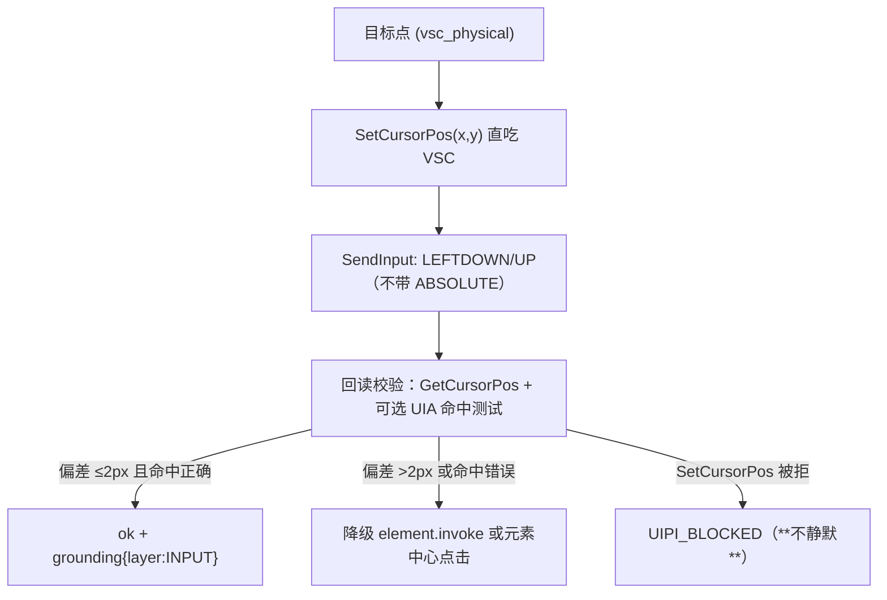
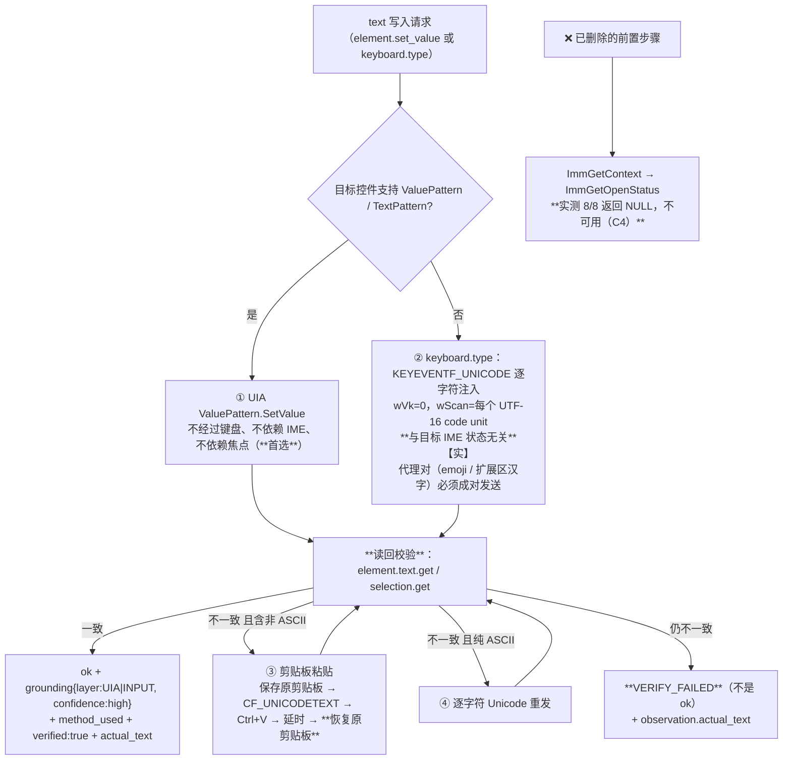
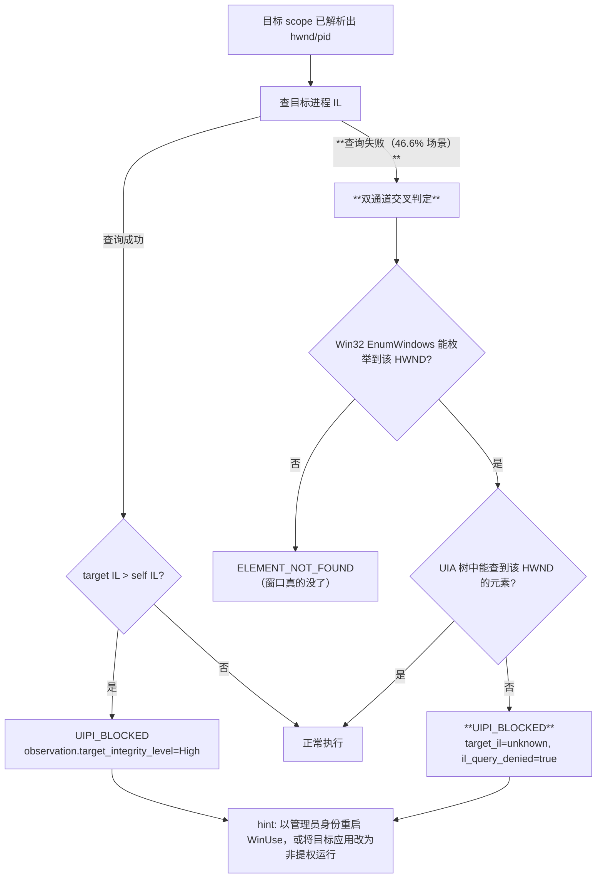

# WinUse 交互协议规范（v1）

> **本文档定位**：把 `05-architecture.md` 的架构决策固化为**可直接实现的线格式（wire format）**。
> 面向两类读者：① WinUse 的 Implementer（照此编码）；② 接入 WinUse 的 Agent 作者（照此调用）。
>
> **上游依赖**：`05-architecture.md`（ADR-001~012）、`07-capability-registry.md` §0.7（能力集权威口径：**v1=100 / v1.5=38 / v2=30，合计 168**；旧稿 108/33/21=162 已按实测行数更正，见 07 §0.7.12）。
> **`tier` 权威源**：`tier: core|extended|advanced|future` 的**唯一权威源是 07 §0.7 的 `tier` 列**（口径见 07 §0.7.13）。本文档**不自带清单**，只定义协议行为。
> **命名权威**：能力 ID 以 `07-capability-registry.md` §0.7 为准。
> **可信度标注**：【实】已核实（附来源）｜【推】推断｜【PoC】待实测。沿用 04/05/07 的体系。
> **实测基线**：本文档中标注【实】的 Windows 行为数据来自第一轮 PoC —— `poc/poc-results.json` ／ `poc/poc-run.log`；环境 **Windows 11 Build 26200（25H2）｜单显示器 1920×1080 @125%（120 DPI）｜探测进程 IL=Medium、未提权｜C#/.NET 10/FlaUI 5.0.0｜非侵入式只读**。完整结论见 `12-poc-findings.md`。

> ⚠️ **数字口径说明（两条，同样重要）**
> **① 以磁盘文件为准**：进程级数据以 `poc/poc-results.json` 为准（IL 查询被拒 **135**、Medium=**103**、Untrusted=**25**、Low=**17**、High=**10**；UIA 隔离枚举 **551ms**，逐窗口合计 439ms）。团队沟通中曾出现 131 / 102 / 28 / 19 与 714ms 这**另一组**数字 —— 那是**上一轮运行**的快照（修复 `DwmGetWindowAttributeInt` 入口点 bug 后重跑过一次，磁盘文件为最新一轮，`meta.generated_at = 2026-09-22 16:30:28`）。两组各自成立，**本文件采用最新一轮**。
> **② 不要把百分比当精确事实**：进程级统计是**瞬时快照**，两次相邻运行的差异可达 **±4**（131 ↔ 135）。因此正确表述是"**约 45%~47% 的进程查不到 IL，且随机器状态波动**"，而不是把"45%"或"46.6%"当作精确值引用。**结论方向不受影响 —— "IL 查不到"是常态而非边缘情况**；但精度不能假装。

---

## 0. 阅读导航

| 章节 | 内容 | 主要读者 |
|---|---|---|
| §1 | 传输层选型与结论 | Implementer |
| §2 | 统一信封（请求/响应） | 双方 |
| §3 | 自描述能力目录与 `tier` 分层 | Agent |
| §4 | Selector 语法 | Agent |
| §5 | 坐标系权威定义 | 双方（**必读**） |
| §6 | 中文 IME 文本输入策略 | 双方（**必读**） |
| §7 | 等待与同步语义 | Agent |
| §8 | 事件流 | Implementer |
| §9 | 错误码体系 | 双方（**必读**） |
| §10 | 幂等与条件写 | Agent |
| §11 | 事务与补偿 | Agent |
| §12 | 风险分级与确认门 | 双方 |
| §13 | 鉴权与安全 | Implementer |
| §14 | 版本协商 | 双方 |
| §15 | 上下文成本控制 | Agent |
| §16 | Windows 特有问题域：文件对话框 | 双方 |
| §17 | Windows 特有问题域：终端 / ConPTY | 双方 |
| §18 | 命名裁定固化 | Implementer |

---

## 1. 传输层选型

### 1.1 候选对比

| 方案 | 建模 167 个能力 | 一键导出 LLM tools | CLI 等价性 | 流式/长连接 | 生态与调试 | 代价 |
|---|---|---|---|---|---|---|
| **REST（资源化）** | ❌ 差。167 个动作用资源 URI 表达极其别扭（大量 `POST /actions/...`），本质还是 RPC | 中。需从 OpenAPI 二次转换，且 OpenAPI 对" polymorphic 参数"表达弱 | 差。curl 拼 URI 远不如子命令直观 | 需另建 SSE/WebSocket | ✅ 最好。浏览器可直调、OpenAPI 工具链成熟 | 语义与形式不匹配 |
| **JSON-RPC 2.0 over HTTP（单端点）** | ✅ 天然。方法名即能力 ID | ✅ 最好。`method` + JSON Schema 可直接映射 OpenAI / Anthropic / MCP tools | ✅ 好。`winuse <method> --param=v` 与 HTTP 走同一 Dispatcher | 需另建 SSE（本方案：SSE 独立于 RPC 端点） | 好。curl 一行可测；抓包即读 | 浏览器地址栏不能直调（可读性略逊 REST） |
| **gRPC** | ✅ 好 | ❌ 差。protobuf 与 LLM tools 的 JSON Schema 之间需双向转换层 | ❌ 差。需额外 CLI 客户端 | ✅ 最好（原生 streaming） | ❌ 差。本地调试需 grpcurl；浏览器不可用 | 引入 protobuf 工具链 + HTTP/2 依赖，对本机回环场景**收益为负** |

### 1.2 结论：**JSON-RPC 2.0 over HTTP**（采纳 D6 倾向）

**决定性理由（按权重）**：

1. **能力 ID 与 `method` 一对一**。167 个能力 → 167 个 method，无映射层、无歧义。REST 会退化成"假 REST"（`POST /invoke`），那还不如直接用 RPC。
2. **导出 LLM tools 是零转换的**。OpenAI / Anthropic / MCP 三家都是 `{name, description, input_schema}` 形态，与 `{method, params}` + JSON Schema 同构（见 §3.4）。这是"Agent 友好"这条产品目标的直接落点。
3. **CLI 与 HTTP 天然等价**。命令行 `winuse element.find --selector='...'` 直接是 method + 参数，与 HTTP body 走同一个 `CapabilityDispatcher`（05 §11.1）。**不会出现"CLI 能跑、HTTP 不行"的行为分叉**。
4. gRPC 的 streaming 优势在本机场景中价值有限：我们的事件流用 SSE 足够（§8），且 SSE 比 gRPC stream 更容易被 Agent 侧消费。

**明确不采纳 gRPC 的原因（避免事后返工）**：本机回环（loopback）下 HTTP/2 的性能优势为零，而 protobuf 带来的构建工具链、调试成本、以及到 LLM tools 的转换层，都是净负担。

### 1.3 端点总览

| 端点 | 方法 | 用途 |
|---|---|---|
| `POST /v1/invoke` | JSON-RPC 2.0 | **唯一的能力调用端点**（v1 实现 100 个 method；全量设计 168 个） |
| `GET /v1/events` | SSE | 事件流（v1.5，见 §8） |
| `GET /v1/health` | — | 健康检查（无鉴权，只返回 `{ok, version, uptime_s, abandon_count}`） |
| `GET /v1/schema` | — | 全部能力的 JSON Schema 打包（供离线生成 SDK/tools） |
| `GET /v1/tools/openai` | — | 导出 OpenAI function-calling 格式 |
| `GET /v1/tools/anthropic` | — | 导出 Anthropic tools 格式 |
| `GET /v1/tools/mcp` | — | 导出 MCP tools 格式 |

> **为什么只有一个 invoke 端点**：可被一条 `location /v1/invoke` 的防火墙/代理规则完整覆盖；鉴权、审计、限流只需在一处实现。

### 1.4 监听与绑定

| 规则 | 值 |
|---|---|
| 默认绑定 | `127.0.0.1:<动态端口>`（**永不默认 `0.0.0.0`**） |
| 端口 | 首次启动随机选取空闲端口，写入 `%LOCALAPPDATA%\WinUse\port`；可用 `--port` 固定 |
| 局域网访问 | 需显式 `--bind 0.0.0.0` + 二次确认 + 强制 token；托盘常驻显示警告图标 |
| TLS | 回环默认 http（本机进程隔离已由 OS 保证）；非回环**强制** https（自签证书 + 指纹固定） |

---

## 2. 统一信封

### 2.1 请求

```jsonc
{
  "jsonrpc": "2.0",
  "id": "req_7f3a",                 // 客户端生成；notification 省略
  "method": "element.invoke",       // = 能力 ID（见 07 §0.7）
  "params": { "elementId": "el_01H8..." },

  // —— 以下为 WinUse 扩展字段（全部可选）——
  "scope":  { "window": { "hwnd": 132456 } },   // 作用域契约，见 §2.4
  "timeout_ms": 5000,                            // 覆盖该能力默认超时
  "idempotency_key": "a1b2c3...",                // 见 §10
  "if_match": { "etag": "v:12" },                // 条件写，见 §10
  "max_tokens": 800,                             // 上下文预算，见 §15
  "coordinate_space": "vsc_physical",            // 见 §5，默认即此项
  "dry_run": false                               // true = 只做风险判定与预检，不执行
}
```

HTTP 头等价物（**头优先于 body**，便于 curl/CLI/网关统一处理）：

| Header | 对应 body 字段 |
|---|---|
| `X-WinUse-Idempotency-Key` | `idempotency_key` |
| `X-WinUse-Timeout-Ms` | `timeout_ms` |
| `X-WinUse-Max-Tokens` | `max_tokens` |
| `X-WinUse-Dry-Run: true` | `dry_run` |
| `Authorization: Bearer <token>` | 鉴权（§13） |
| `X-WinUse-Client` | 客户端标识（写入审计，如 `claude-code/1.2`、`winuse-cli/1.0`） |

> CLI 等价：`winuse element.invoke --element-id el_01H8... --timeout 5000 --idempotency-key a1b2c3 --json`
> CLI 参数到 params 的映射是**机械化**的（`--foo-bar` → `fooBar` → `foo_bar`，由代码实现，不逐个手写）。

### 2.2 响应（成功）

```jsonc
{
  "jsonrpc": "2.0",
  "id": "req_7f3a",
  "result": { /* 能力特有，见 07 各条目 */ },

  // —— WinUse 强制附加字段（每个响应必有）——
  "grounding": {
    "layer": "UIA",                    // UIA|CDP|OFFICE_COM|MSAA|WIN32|INPUT|PIXEL
    "confidence": 0.95,
    "degraded": false,
    "fallbackReason": null,
    "attempts": ["UIA"]                // 实际尝试过的层，按序
  },
  "coordinate_space": "vsc_physical",
  "replayed": false,                   // 幂等重放标记，见 §10
  "risk": { "level": "R1", "escalated": false },
  "audit_id": "aud_01H8...",
  "latency_ms": 42
}
```

### 2.3 响应（失败）

```jsonc
{
  "jsonrpc": "2.0",
  "id": "req_7f3a",
  "error": {
    "code": -32001,                    // 见 §9.1 码表
    "type": "ELEMENT_STALE",           // 稳定字符串，Agent 应据此分支
    "message": "元素句柄已失效（目标窗口已重建）",
    "data": {
      // ↓↓↓ Agent 友好性的核心：错误必须可执行 ↓↓↓
      "recovery": "retry",             // retry|degrade|escalate|abort|wait_resume
      "hint": "elementId 已失效，请重新 element.find 定位后重试。不要复用旧句柄。",
      "retryable": true,
      "suggested_next": ["element.find"],
      "grounding": { "layer": "UIA", "confidence": 0.0 },
      "audit_id": "aud_01H8..."
    }
  }
}
```

> **硬约束（PRD C8「不隐藏失败」）**：任何失败必须显式返回。**禁止**在 `result` 里返回"看起来成功但实际未执行"的响应。
> 特别地：**`SendInput` 在 UIPI 下是静默失败**【实】（04 §2.4）—— 实现上必须在注入后做回读校验（光标位置 / 元素状态），校验失败则返回 `UIPI_BLOCKED`，**不得返回 ok**。

### 2.4 作用域 / 焦点契约（scope）

**为什么必须有**：Windows 上"点击 (100,200)"在没有上下文时是歧义的——它可能落在任何窗口、任何显示器。PRD P0-10 要求显式作用域。

| scope 形式 | 语义 |
|---|---|
| 缺省 | **默认当前前台窗口**；若为桌面则作用于桌面。响应中回显实际解析到的 scope |
| `{window: {hwnd}}` | 限定到该窗口；执行前校验 hwnd 仍存在且非最小化，否则 `TARGET_MINIMIZED` |
| `{window: {pid}}` / `{processName}` | 同上，按进程解析 |
| `{monitor: {id}}` | 限定到显示器（用于截图/坐标换算） |
| `{desktop: true}` | 显式声明作用于整个桌面 |

**契约**：① 若请求带 scope 但目标不在当前虚拟桌面 → 返回 `NOT_SUPPORTED` + hint（不可截图/不可置前台，见 05 §9.2）；② 每次响应**回显实际使用的 scope**，让 Agent 可验证自己没跑偏。

---

## 3. 自描述能力目录

### 3.1 `session.capabilities`

Agent 接入后**第一个应该调用**的方法（WinUse-Bench 把"首轮是否调用它"作为接入成本指标）。

```jsonc
// 请求
{ "jsonrpc":"2.0", "id":"1", "method":"session.capabilities",
  "params": { "tier": "core", "domain": ["element","mouse"], "include_schema": true } }
```

```jsonc
// 响应（节选）
{ "jsonrpc":"2.0", "id":"1", "result": {
  "api_version": "1.0",
  "total": 100, "returned": 46,
  "tiers": { "core": 46, "extended": 48, "advanced": 6, "future": 68 },
  "capabilities": [
    { "id":"element.find", "tier":"core", "domain":"element",
      "name":"查找元素",
      "description":"按选择器在当前作用域内定位 UI 元素。返回 elementId 与属性快照。适合在点击/输入前先确认目标存在。",
      "risk":"R0", "idempotent":"I",
      "layer":"UIA", "fallbackChain":["UIA","MSAA","PIXEL"],
      "latency_p50_ms": 30, "latency_p95_ms": 180,
      "params_schema": { /* JSON Schema */ },
      "result_schema":  { /* JSON Schema */ },
      "errors": ["ELEMENT_NOT_FOUND","AMBIGUOUS","TIMEOUT","UIPI_BLOCKED"] }
  ],
  "next": { "domain":["keyboard"], "hint":"用 domain 参数继续按需展开其余域" }
}}
```

### 3.2 `tier` 分层（采纳 A-3 裁定 · **清单唯一权威源 = 07 §0.7**）

> ⭐ **本节不自带清单**（team-lead 裁定 Q4）。
> `tier` 的**唯一权威源是 `docs/07-capability-registry.md` §0.7 的 `tier` 列**（口径与圈定规则见 **07 §0.7.13**）。
> 本节只定义**协议行为**（怎么暴露、怎么过滤），不定义**哪条属于哪一档**。

**问题**：v1 有 **100** 个能力（07 §0.7.12 实测行数；旧稿写 108 已更正）。把它们全部塞进 LLM 的 tools 数组会**显著降低工具选择准确率**并撑爆上下文【实】（function-calling 领域反复验证的现象）。

| tier | 条数 | 可见性 | 选取原则 |
|---|---|---|---|
| `core` | **46** | **默认可见** | 高频 + 通用 + 跨应用。Agent 完成 80–90% 任务只需要这些 |
| `extended` | **48** | 需在 `session.hello` 声明 `tiers:["extended"]`，或按 `filter:{tier,domain}` 按需拉取 | 中频/域专用（browser、office、shell、registry 等），或可由 core 能力替代的冗余项 |
| `advanced` | **6** | 需显式声明且部分需授权 | 高危/破坏性/高危域（`shell.exec`、`registry.get`、`file.delete`、`process.terminate`、`mouse.drag`、`system.power`） |
| `future` | **68** | **不返回** | v1.5（38）+ v2（30）全部标 `future`，v1 不分发 |

**协议行为（硬性）**

1. `session.capabilities` 不带 `filter.tier` 时**只返回 `core`**；`total` 字段仍报本版本可用总数（100），`returned` 报本次返回条数。
2. `filter.tier` 与 `filter.domain` 可组合使用；**`future` 档在任何情况下都不返回**（v1 二进制里没有实现，返回它等于欺骗）。
3. 调用未声明档位的能力 → `CAPABILITY_NOT_GRANTED`（见 §9.2），并在 `error.data` 里给出**应声明的 `tier` 名**，而不是让 Agent 猜。
4. tier 划分**只影响可见性与授权，不影响能力语义**：同一能力在 core 与 extended 下行为完全一致。
5. 实现端**禁止在代码里硬编码 ID 清单**：`tier` 由 07 §0.7 的 `tier` 列生成（构建期代码生成或资源表），改档位只改 07，不改多处。

> **渐进式发现不是优化项，是必需项**（07 §0.7.13 已提示）。协议必须支持 `domain` 过滤 + 分页，否则 100 个 tools 无法消费。
>
> 🔴 **口径更正记录**：本节原写 `core ~34 / extended ~48 / advanced ~26 / total 108`，并内联了一份 85 条 ID 清单（含 `shell.exec`、`office.*`、`transaction.*`，与硬规则 R1–R4 直接冲突）。**清单已删除、数字已按 07 §0.7 实测值更正**。
> ⚠️ **core 39 → 43 → 44 → 45 → 46**：① 经 **C0 往返复检**，`display.list`、`file.copy`、`file.move`、`file.mkdir` 四条在 core 下**没有 ≤1 次调用的等价路径**，已放回；② 经 **A-17 裁定**，`ocr.recognize` 由 v1.5 提前到 v1 并入 core（自绘 UI 的唯一读取通道）；③ PM 按命名权威补进 02 §5.1 的 `session.resume` 同步入 07 并入 core（挂起-恢复协议的另一半，必须默认可见）；④ **`process.list` 经 C0 复检的 C 类登记后被 team-lead 按 C7②判定闭环裁定放回 core** —— 理由不是"它常用"，而是 **Bench T25** 的判据字面依赖它（10 §3 T25 🟢 判定列 = `process.list` 含 `CalculatorApp.exe`），且 T25 在 G1② 冻结清单内（10 §6.5.1）。⚠️ **T17 不是依据**（其判定走审计日志）。逐条依据见 **07 §0.7.13 C0 复检表**与 **§0.7.14**。

### 3.3 描述文案的验收要求（PRD P0-3）

每条 `description` 必须满足：① 一句话说清**做什么**；② 说清**何时不该用**（若有更合适的能力）；③ 不含实现细节（不提 UIA / SendInput 等内部机制，除非该机制直接决定能力边界）。
**验收方式**：用至少 2 个真实模型（一个强、一个弱）跑 WinUse-Bench 的接入性子集，统计"选错工具"的比例；连续两轮 >10% 则回改文案。

### 3.4 三种 tools 格式导出（零转换）

导出端点返回的即是可直接粘贴的数组。映射规则：

| WinUse | OpenAI `tools[]` | Anthropic `tools[]` | MCP `tools[]` |
|---|---|---|---|
| `id` | `function.name` | `name` | `name` |
| `description` | `function.description` | `description` | `description` |
| `params_schema` | `function.parameters` | `input_schema` | `inputSchema` |
| `risk`/`idempotent`/`layer` | ⚠️ **不传递**（见下） | 同左 | 同左 |

> ⚠️ **导出时的信息损失必须处理**：`risk` / `idempotent` / `fallbackChain` 这三列在三家 schema 里都无对应字段，但它们决定了 Agent 是否该用、能否重试。
> **做法（硬性）**：把这三列**追加进 `description` 文本末尾**，形如
> `"[风险:R1 幂等:I 通道:UIA→PIXEL]"`。
> 理由：宁可多几十个 token，也不能让 Agent 在不知风险的情况下调用 `shell.exec`。这条同时满足 PRD §6.4「安全边界」与 §6.1「可发现性」。

---

## 4. Selector 语法

### 4.1 字段

```jsonc
{
  // 定位字段（可组合，AND 语义）
  "automation_id": "TextBox_01",        // UIA AutomationId
  "control_type":  "Edit",              // Button|Edit|CheckBox|ComboBox|ListItem|MenuItem|TreeItem|TabItem|Document|Text|Hyperlink|Window|Pane|Custom|DataGrid|DataItem|ScrollBar|ToolBar|MenuBar|Dialog...
  "name":          "确定",
  "name_match":    "exact",             // exact|prefix|contains|regex，默认 exact
  "class":         "Edit",              // Win32 类名（UIA ClassName）
  "framework_id":  "Win32",             // Win32|WPF|WinForm|DirectUI|XAML|Chrome|Qt|Java
  "path":          "Window/Pane[2]/Button[1]",   // 树路径（不稳定，仅作兜底）

  // 消歧字段
  "index":         0,                   // 多命中时取第 n 个（默认 0）
  "near":          { "selector": {...}, "max_distance_px": 120 },  // 邻近定位（自绘 UI 常用）
  "within":        { "hwnd": 132456 },  // 限定子树
  "depth":         8,                   // 最大下钻深度（性能保护）

  // 过滤字段
  "visible_only":  true,                // 默认 true，过滤 IsOffscreen
  "enabled_only":  true,                // 默认 true

  // 多语言别名（中文 Windows 刚需）
  "name_aliases":  { "zh": "确定", "en": "OK", "zh-Hans": "确定" }
}
```

### 4.2 解析顺序（实现约定）

1. 若提供 `automation_id` → **优先用它**（最稳定）。
2. 否则按 `control_type` + `name`（按 `name_match` 匹配，含 `name_aliases` 全语言尝试）。
3. 仍多命中 → 用 `near` / `within` 收缩；仍多命中且未给 `index` → **返回 `AMBIGUOUS` + 候选列表**（不要自行猜第一个）。
4. 全部未命中 → 尝试 `fallbackChain` 下一层（MSAA → PIXEL）；最终失败返回 `ELEMENT_NOT_FOUND` + 建议（附上当前树的 top-N 候选，便于 Agent 自我修正）。

> **硬约束**：`element.find` 默认 `require_unique: false`；但当命中数 > 1 且**该能力是写操作**（invoke/set_value 等）时，实现必须**强制要求唯一**，否则返回 `AMBIGUOUS`。
> 理由：PRD P11「歧义时猜测而非询问」被 OSWorld 论文列为长任务失败的四大主因之一。宁可多一轮交互，也不要猜。

### 4.3 中文场景示例（10 条）

| # | 场景 | Selector |
|---|---|---|
| 1 | 记事本"确定"按钮 | `{"control_type":"Button","name":"确定","name_aliases":{"en":"OK"}}` |
| 2 | Win11 内嵌"未保存更改"对话框的"保存" | `{"control_type":"Button","name":"保存","within":{"processName":"notepad.exe"}}` |
| 3 | Win10 子对话框形态的同一个按钮 | `{"control_type":"Button","name":"保存","class":"Button","path":"#32770/DirectUIHWND/CtrlNotifySink/Button"}` |
| 4 | 文件对话框文件名输入框 | `{"control_type":"Edit","automation_id":"1148","within":{"class":"#32770"}}` ← **AutomationId 会变，须降级** `{"control_type":"ComboBox","name":"文件名:","near":{"selector":{"name":"文件名:"}}}` |
| 5 | 微信搜索框（自绘，UIA 大概率缺失） | 先 `element.find` 失败 → `screen.annotate` 取 SoM 编号 → `mouse.click{point}` |
| 6 | Excel 单元格 | `{"control_type":"DataItem","name":"B7"}` 或 `office.excel.range{range:"B7"}`（**后者优先，见 §18 数据层优先**） |
| 7 | Chrome 地址栏 | `{"control_type":"Edit","name":"地址和搜索栏","name_aliases":{"en":"Address and search bar"}}` |
| 8 | 复选框（按邻近标签定位） | `{"control_type":"CheckBox","near":{"selector":{"name":"启用自动更新"},"max_distance_px":80}}` |
| 9 | 任务栏窗口按钮 | `{"control_type":"Button","framework_id":"XAML","name_contains":"记事本"}` |
| 10 | 模态对话框的取消按钮（跨语言） | `{"control_type":"Button","name_aliases":{"zh":"取消","en":"Cancel"},"within":{"class":"#32770"}}` |

> **Win10 / Win11 双形态强制要求（PRD P0-17）**：同一个逻辑对话框在 Win10 与 Win11 下 UIA 树结构不同（Win10 为子对话框 `#32770`、Win11 常为窗口内嵌且不触发 `DialogPresent`）【实】(02 §S9)。
> **实现要求**：`dialog.detect` 必须**同时探测两种形态**，并把"哪个形态命中"写进 `grounding.fallbackReason`。

### 4.4 ⚠️ `framework_id` 在**顶层窗口**无区分度（PoC 第一轮 · 结论 C6）

【实】UIA 桌面直系子元素 **12 个的 `FrameworkId` 全部为 `"Win32"`** —— 包括 Chromium（Chrome/Edge）、Tauri（Clash Verge）、UWP/WinUI（设置）在内，**一个例外都没有**。

| 规则 | 内容 |
|---|---|
| C6-R1 | `framework_id` **只允许用于元素级（控件级）判断**；**禁止**作为顶层窗口的降级/分流决策依据 |
| C6-R2 | `window.*` 返回的 `framework` 字段标注为**不可靠**，Agent 不应依赖它区分应用类型；改用 `process.list` 的 `exe` 路径 + 窗口类名 |
| C6-R3 | ⚠️ 上文示例 #9（`framework_id:"XAML"` 定位任务栏按钮）**不可靠**，已按 C6 作废；任务栏定位应改用类名 `Shell_TrayWnd` + 控件名匹配 |

### 4.5 ⚠️ UIA 顶层元素 ≠ 用户可见窗口列表（结论 C6）

【实】UIA 桌面直系子元素 12 个中，**4 个在 Win32 可见窗口列表中根本不存在**：任务栏 `Shell_TrayWnd`、`Progman`、以及 Tauri/Chromium 的隐藏事件窗口（如 "Tao Thread Event Target"）。

| 规则 | 内容 |
|---|---|
| C6-R4 | `window.list` 的**数据源是 Win32 `EnumWindows` + cloaked 过滤**，**不是** UIA 桌面直系子元素 |
| C6-R5 | 反向也成立：`element.tree(scope={kind:"desktop"})` **会**包含系统窗口与隐藏事件窗口；Agent 不应把 UIA 顶层元素当作"用户可见窗口列表"使用 |

### 4.6 ⭐ `window.list` 必须过滤 cloaked 幽灵窗口（PoC 第一轮 · 结论 C5）

【实】`IsWindowVisible=TRUE` 的 12 个顶层窗口中，**3 个是 `DWMWA_CLOAKED=2`（`CLOAKED_SHELL`）幽灵窗口**：

| 进程 | 窗口类 | 标题 | cloaked | rect |
|---|---|---|---|---|
| SystemSettings | `Windows.UI.Core.CoreWindow` | 设置 | CLOAKED_SHELL | [0, 9, 1920, 1029] |
| ApplicationFrameHost | `ApplicationFrameWindow` | 设置 | CLOAKED_SHELL | [-9, -9, 1929, 1029] |
| TextInputHost | `Windows.UI.Core.CoreWindow` | Windows 输入体验 | CLOAKED_SHELL | [0, 0, 1920, 1080] |

它们**有标题、有类名、有进程、`IsWindowVisible=TRUE`，但用户根本看不到**。若不过滤，Agent 会枚举到"不存在"的窗口并对着空气操作。

| 规则 | 内容 |
|---|---|
| C5-R1 | `window.list` 默认 `include_hidden=false`，**必须过滤** `DWMWA_CLOAKED != 0` 且零尺寸的窗口 |
| C5-R2 | 返回条目含 `cloaked: bool` 与 `truly_visible: bool`；调试时用 `include_hidden=true` 可查看被过滤项 |
| C5-R3 | `window.find` 同样适用该过滤；按 pid/类名精确指定时若目标 cloaked，返回 `TARGET_MINIMIZED` 语义的明确提示，而不是静默跳过 |

> 本机实测：`IsWindowVisible=TRUE` 12 个 → **真正可见 9 个，幽灵 3 个**。

---

## 5. 坐标系权威定义

> 本节是全协议**最容易出错、后果最难排查**的部分。PM 已核实：混合 DPI 下存在**三套坐标系**（UIA 逻辑坐标 / 截图物理像素 / `GetCursorPos` 物理像素），同一窗口可返回 500×500 / 1000×1000 / 1500×1500【实】(02 §S11)。
> 失败表现是"点击偏移一点点"——**不报错，只是错**。

### 5.1 裁定（与 05 ADR-006 一致）

| 规则 | 内容 |
|---|---|
| **R1** | 进程必须在**创建任何窗口之前**声明 Per-Monitor DPI Awareness v2（`SetProcessDpiAwarenessContext(-4)` + manifest `PerMonitorV2` 双保险） |
| **R2** | **对外唯一权威坐标空间 = `vsc_physical`（物理像素 + 虚拟屏幕坐标系 VSC）**，原点为主屏左上角，副屏坐标**可为负** |
| **R3** | 禁止 `GetSystemMetrics(SM_CXSCREEN)`（只返回主屏）与 `GetDpiForSystem`（混合 DPI 无意义）；一律 `GetDpiForWindow` / `GetDpiForMonitor` / `EnumDisplayMonitors`。🔴 **C10 实测后升级为硬禁止**：`GetDpiForSystem` 在**异构 DPI 下恰好等于主屏 DPI**（实测：声明 PMv2 后 = **120**，而主屏 120 / 副屏 **96**）—— 它是一个"看起来对、副屏全错"的值，**禁止用于任何副屏换算**。副屏换算必须走 `MonitorFromPoint` / `MonitorFromWindow` + `GetDpiForMonitor(MDT_EFFECTIVE_DPI)`。见 §5.4.3 |
| **R4** | 视觉矩形用 `DwmGetWindowAttribute(DWMWA_EXTENDED_FRAME_BOUNDS)`，**不用 `GetWindowRect`**（后者含 DWM 阴影/不可见缩放边框）。🔴 **C12 修正原表述**：偏移量**不是常量**，是「**是否最大化 × 该屏 DPI**」的函数 —— 实测 最大化@100% = 每边 **8px**、最大化@125% = 每边 **9px**、非最大化 = 左/右/下各 **8px** 且**上边 0px**（见 §5.4.1 第二轮表） |
| **R6** | ⭐ **必须区分两套坐标系**：`hit`（＝`GetWindowRect`＝UIA `BoundingRectangle`，用于点击/定位，**对外默认值**）与 `visual`（＝DWM extended bounds，用于截图）。二者**不同源**，差值**不是 8–9px 常量**（§5.4.1） |
| **R5** | 所有响应带 `coordinate_space` 自描述；允许输入 `monitor_normalized` / `window_relative`，但响应仍回 `vsc_physical` |
| **R7**（C13 新增） | 🔴 **两条链路的基准必须分开取，不许互推**：`DWMWA_EXTENDED_FRAME_BOUNDS` 是**唯一不受本进程 DPI 感知等级影响的基准**（实测 PMv2 切换前后 `changed_dwm_count = 0` 而 `changed_win32_count = 6`）。→ **截图 / 视觉校验 / SoM 标注框一律以 DWM 为准；Win32 / UIA 只用于点击命中。** 禁止"用 Win32 rect 推算截图像素位置"或反向推算 —— 感知等级一变，Win32 侧整体漂移而 DWM 侧不动，互推出来的偏差是**系统性**的，不是噪声 |
| **R8**（C10 新增） | 🔴 **禁止对外暴露"全局 DPI"标量**。DPI 信息一律**逐显示器数组**（`display.list` 的 `monitors[].dpiX/dpiY/scalePercent`，见 07 §19.1）；`display.dpi` 单点查询**必须**带 `monitorId` 或 `hwnd` 定位到具体显示器，不得返回"系统 DPI"。**理由**：异构 DPI 下根本不存在"系统 DPI"这个正确值 |

### 5.2 为什么选 VSC 物理像素（推导，回应 PM 的质疑）

| 候选 | 致命问题 |
|---|---|
| 逻辑坐标（DPI 虚拟化后的 96dpi） | 混合 DPI 下**同一逻辑坐标在不同显示器对应不同物理像素**；且只有在进程声明为 DPI Unaware / System-Aware 时才自洽，而我们必须声明 PerMonitorV2（否则副屏截图被按 96dpi 缩放而模糊） |
| 窗口相对坐标 | 跨窗口不可比；窗口移动后失效；无法表达"桌面上某点" |
| 归一化 0..65535（`MOUSEEVENTF_ABSOLUTE`） | "显示表面"定义在多显示器（尤其负坐标副屏）下存在版本差异与社区争议【PoC】；且损失精度 |
| ✅ **VSC 物理像素** | 与 `EnumDisplayMonitors` / WGC 帧 / `GetCursorPos` / UIA `BoundingRectangle`（PerMonitorV2 下为物理像素）**全部同源**；负坐标可表达 |

### 5.3 换算公式

```
逻辑坐标 → 物理像素：  physical = logical * (dpi_for_window / 96)
物理像素 → 逻辑坐标：  logical  = physical * (96 / dpi_for_window)
VSC 原点：             (SM_XVIRTUALSCREEN, SM_YVIRTUALSCREEN)   // 可为负
副屏在左侧时：          该屏 x 范围为 [origin_x, origin_x + w)，origin_x < 0
```

### 5.4 误差来源分解与验收

| 误差源 | 量级 | 缓解 |
|---|---|---|
| 未声明 PerMonitorV2 | **整体偏移，可达数十 px** | R1 强制 |
| 用 `GetWindowRect` 而非 DWM extended bounds | 8–9px【实】（**且非常量**，随最大化状态与该屏 DPI 变，见 §5.4.1 第二轮） | R4 |
| 用 `GetDpiForSystem` 做跨屏换算 | 🔴 **副屏系统性错误**（实测副屏真实 96，该 API 返回 120）**且静默** | R3（C10） |
| `MOUSEEVENTF_ABSOLUTE` 归一化 | 不确定（多屏语义争议） | 不用；用 `SetCursorPos` 直吃 VSC，down/up **不带** ABSOLUTE 标志 |
| 鼠标指针加速（相对移动） | 累积漂移 | 只用绝对定位 |
| 目标窗口在移动中 | 不定 | `wait.stable` 先稳定 |

**验收标准（PRD P0-14，按 team-lead 授权修订）**：

| 项 | 内容 |
|---|---|
| 数值 | 跨屏点击误差 **≤2px 满分 / ≤5px 记为 `degraded pass` / >5px 失败** |
| **前置条件（新增，硬性）** | ① 服务端已声明 PMv2 且 `dpi_awareness_ok=true`（否则一律 `DPI_MISMATCH`）；② 坐标显式使用 `hit` 空间；③ 涉及截图/标注时**已完成 DWM↔UIA 换算**（§5.4.1）。**不满足前置条件时该 AC 不适用** |

> ⚠️ **诚实标注**：`≤2px` 在主屏已有间接依据，但**在副屏上仍是目标值【推】，未实测**（12 §8.3 诚实清单：`SetCursorPos` 到负坐标是否可达属侵入式仍未做；副屏实际点击命中误差也未测）。
> **校准责任**：`PoC-P0-COORD` 仍须实测 —— ① 副屏在左（负坐标）场景下 `SetCursorPos` 是否可达；② Medium IL 进程对 High IL 窗口 `SetCursorPos` 是否被 UIPI 拒绝；③ 混合 DPI 跨屏**点击命中**误差；④ ~~8–9px 偏移随缩放比的变化规律~~。
> **④ 已由第二轮部分结案（C12）**：偏移量随「是否最大化 × 该屏 DPI」变化**已有实测**（最大化 @100% → 8px、@125% → 9px；非最大化 → 左/右/下 8px、上 0px）。**仍未测**：150% / 200% 档位，以及**副屏实际点击命中误差**。若 ② 被拒 → 回退 `SendInput`+ABSOLUTE 并**强制走 UIA 通道**。

### 5.4.1 ⭐ 实测校准：两套坐标系的差（PoC 第一轮 C3 ／ 第二轮 C12 修正）

> 来源：`poc/poc-results.json` ／ `poc/poc-run.log`
> 环境：**Windows 11 Build 26200（25H2）｜单显示器 1920×1080 @125%（120 DPI）｜探测进程 IL=Medium、未提权｜C#/.NET 10/FlaUI 5.0.0｜非侵入式只读**
> 样本：12 个窗口参与坐标采样，其中 8 个进入三方比对，全部 `dpi=120`

**实测结果**

| 对比 | 结果 | 判读 |
|---|---|---|
| UIA `BoundingRectangle` − `GetWindowRect` | **`[0, 0, 0, 0]`（8/8 样本完全一致）** | ✅ **修正了"UIA 返回逻辑坐标"的旧推测**：PMv2 下 UIA 与 Win32 同源，都是物理像素 |
| `DWMWA_EXTENDED_FRAME_BOUNDS` − `GetWindowRect`（**最大化**窗口） | `[+9, +9, −9, −9]` | 视觉边界每边内缩 9px（例：`[-9,-9,1929,1029]` vs `[0,0,1920,1020]`） |
| `DWMWA_EXTENDED_FRAME_BOUNDS` − `GetWindowRect`（**非最大化**窗口） | `[+8, 0, −8, −8]` | 左/右/下各内缩 8px，**上边不偏移**（例：`[0,7,1920,1027]` vs `[8,7,1912,1019]`） |

**协议规则（由此实测推出）**

| # | 规则 |
|---|---|
| **C3-R1** | `hit` 空间（默认）＝ `GetWindowRect` ＝ UIA `BoundingRectangle`（物理像素 VSC）；`visual` 空间 ＝ `DWMWA_EXTENDED_FRAME_BOUNDS`。**分别用于"点击定位"与"截图取像"** |
| **C3-R2** | `window.*` 返回**必须同时给** `rect`（hit）与 `visual_rect`（visual）；只给一个视为违约 |
| **C3-R3** | `element.*` 的 `rect`/`center` 一律 `hit` 空间（UIA 原生即 hit，无需换算） |
| **C3-R4** | `screen.capture` 返回 `capture_space`（默认 `visual`）+ `region` + `scale` |
| **C3-R5** | ⭐ **SoM 标注必须做空间换算**：标注框来自 UIA（hit）而图像来自 WGC/PrintWindow（visual），**不换算则编号框整体偏移**（偏移量非常量，见 C3-R6），模型按编号点击必然点偏 |
| **C3-R6** | 偏移量**禁止硬编码**（8 或 9）：必须同时取两套值再相减。🔴 **第二轮实测（C12）把"为什么"从推测换成实证**：偏移 = f(是否最大化, 该屏 DPI) —— 最大化 @100% = 8px、@125% = 9px、非最大化 = 左/右/下 8px 且上 0px。**硬编码即错** |
| **C3-R7**（C13 新增） | 🔴 **DWM 是唯一稳定基准，两条链路不许互推**：PMv2 切换前后 `changed_dwm_count = 0` 而 `changed_win32_count = 6` → `DWMWA_EXTENDED_FRAME_BOUNDS` **不随本进程感知等级漂移**，Win32/UIA 会。**截图 / 视觉校验 / SoM 对齐一律取 DWM；点击命中取 Win32/UIA。禁止用一侧推算另一侧。** |
| **C3-R8**（C10 新增） | 🔴 **换算时禁止用 `GetDpiForSystem`**：异构 DPI 下它等于**主屏** DPI（实测 120），副屏真实值是 96 → **副屏系统性偏错且静默**。必须 `MonitorFromPoint` / `MonitorFromWindow` + `GetDpiForMonitor(MDT_EFFECTIVE_DPI)`（见 §5.4.3） |

> 【实】该偏移源自 DWM 的不可见缩放边框。**第二轮已实测其变化规律的一部分（C12）**：偏移量 = f(是否最大化, 该屏 DPI)，见下方第二轮表。~~该比例关系未实测~~ → **150% / 200% 档位仍未测**（列入 `PoC-P0-COORD`）。
> ✅ **第二轮已补齐**：多显示器 / 负坐标副屏 / 异构 DPI 三项**只读侧全部实测**（12 §8）。**仍未测的只剩侵入式部分**：`SetCursorPos` 到负坐标可达性、副屏实际点击命中误差、跨屏拖拽、`MonitorFromPoint` 在屏间隙的返回。

#### 第二轮实测（双屏异构 DPI · 结论 C12 —— **修正 C3**）

> 环境：**Windows 11 26200/25H2｜双屏 DISPLAY1 主屏 1920×1080 @125%（120 DPI，`[0,0,1920,1080]`）+ DISPLAY2 副屏 1920×1200 @100%（96 DPI，`[0,-1200,1920,0]`）｜VSC = `[0,-1200,1920,2280]`，`origin_is_negative=true`｜只读**
> 来源：`docs/12-poc-findings.md` §8

| 窗口 | 所在屏 / DPI | 状态 | Win32 / UIA | DWM | 差值（DWM − Win32） |
|---|---|---|---|---|---|
| WorkBuddy | 主屏 125% | 最大化 | `[-9,-9,1929,1029]` | `[0,0,1920,1020]` | **9, 9, −9, −9** |
| GitHub（Chrome） | **副屏 100%** | 最大化 | `[-8,-1208,1928,-40]` | `[0,-1200,1920,-48]` | **8, 8, −8, −8** |
| Clash Verge | 主屏 125% | 非最大化 | `[610,95,1803,1014]` | `[618,95,1795,1006]` | **8, 0, −8, −8** |

**两件事同时成立，缺一不可**：

1. ✅ **好消息（C3 坐实）**：全部 6 个样本上 **UIA `BoundingRectangle` 与 `GetWindowRect` 的 delta 恒为 `[0,0,0,0]`** —— **含副屏、含负坐标**。C3 的"UIA == Win32 == 物理像素 VSC"在双屏异构 DPI 下**再次成立**，这条从"单屏实测"升级为"双屏实测"。
2. 🔴 **坏消息（C3 修正）**：**偏移量不是常量**。原表述"125% 下固定差 8~9px"是**单屏数据的巧合** —— 单屏只有 125% 一档，8 与 9 分别来自"非最大化"与"最大化"，被误读成同一个量的取值范围。双屏数据把两个自变量拆开了：

| 自变量 | 取值 | 偏移 |
|---|---|---|
| 是否最大化 × 该屏 DPI | 最大化 @ **100%** | 每边 **8px** |
| | 最大化 @ **125%** | 每边 **9px** |
| | 非最大化（本轮仅 125% 样本） | 左/右/下 各 **8px**，**上 0px** |

→ **协议落点**：偏移量**禁止硬编码 8 或 9**，必须「同时取 `GetWindowRect` 与 DWM 两套值再相减」（C3-R6 已是此规则，第二轮只是把**为什么**从推测换成实测）。**这条直接决定 B-01 的 ≤2px 能否达成** —— 硬编码 8px 的话，125% 最大化窗口每边就错 1px，副屏上再叠加其他误差，2px 阈值会被吃掉一半。

### 5.4.2 ⭐ PMv2 是正确性前提，不是优化（PoC 第一轮 · 结论 C2）

【实】进程默认 `PROCESS_DPI_UNAWARE` 时：`GetDpiForSystem` **谎报 96**（真实 **120**），**12/12** 个窗口的 `GetWindowRect` 全部是被系统虚拟化后的**错误值**；调用 `SetProcessDpiAwarenessContext(PER_MONITOR_AWARE_V2)` 后（本机成功，`lastError=0`）返回 **120**，坐标才正确。

**协议落点**：`session.hello`/`system.info` 必返回 `dpi_awareness` + `dpi_awareness_ok`；`false` 时 `session.preflight` 返回 `DPI_MISMATCH`，且**所有坐标类能力拒绝执行**（而不是返回错坐标）。

### 5.4.3 ⭐🔴 `GetDpiForSystem` 在异构 DPI 下只能代表主屏（第二轮 · 结论 C10）

> 来源：`docs/12-poc-findings.md` §8.2｜双屏异构 DPI（主屏 120 / 副屏 96）

| 进程状态 | `GetDpiForSystem` 返回 | 真实值（主屏 / 副屏） | 副屏换算结果 |
|---|---|---|---|
| DPI-unaware | **96** | 120 / 96 | 主屏错 |
| 声明 PMv2 后 | **120** | 120 / **96** | 🔴 **副屏错，且静默** |

**这是比 C2 更隐蔽的一类错**：C2 的问题是"unaware 时 `GetDpiForSystem` 谎报 96" —— 那个错**在单屏下就能测出来**（真实 120 vs 谎报 96）。而 C10 的问题是：**声明 PMv2 之后这个 API 也不对** —— 它返回的 120 **恰好是主屏的正确值**，所以"看起来完全正常"，只有副屏的换算全错，且**没有任何报错**。

> **判断方法**：`GetDpiForSystem` 在异构 DPI 下**必然**等于某一块屏的 DPI（通常是主屏），因此**在它恰好等于被测屏时，你测不出它是错的**。这决定了它不能被当作可验证的换算依据 —— 一个"错误时静默、正确时无法与真值区分"的 API，不该进正确性链路。

**协议落点（硬规则）**：
- 副屏 / 跨屏换算**必须** `MonitorFromPoint` / `MonitorFromWindow` + `GetDpiForMonitor(MDT_EFFECTIVE_DPI)`。
- **禁止** `GetDpiForSystem` 出现在任何坐标换算路径上（R3 / C3-R8）。
- **对外**不暴露"系统 DPI"标量（R8）；`display.list` 的逐显示器数组是唯一权威。

### 5.4.4 ⭐🔴 单屏测不出 DPI 感知 bug（第二轮 · 结论 C11 —— **测试策略级结论**）

PMv2 切换前后逐窗口对比（`diff_A_vs_B`）：

| 窗口 | 所在屏 / DPI | PMv2 前 | PMv2 后 | 是否变化 |
|---|---|---|---|---|
| WorkBuddy | 主屏 125% | `[-7,-7,1543,823]` | `[-9,-9,1929,1029]` | **变** |
| Clash Verge | 主屏 125% | `[488,76,1442,811]` | `[610,95,1803,1014]` | **变** |
| GitHub（Chrome） | **副屏 100%** | `[-8,-1208,1928,-40]` | `[-8,-1208,1928,-40]` | **没变** |
| 豆包（Chrome） | **副屏 100%** | `[-8,-1208,1928,-40]` | `[-8,-1208,1928,-40]` | **没变** |

`changed_win32_count = 6`，**全是主屏窗口**；副屏窗口**一次都没变**。

**机理**：进程 DPI-unaware 时，Windows 用 `GetDpiForSystem`（= **96**）做坐标虚拟化。对 **100% 的副屏这个值恰好正确**，对 **125% 的主屏是错的**。
→ **副屏坐标"看起来是对的"纯属巧合。**

**这条为什么重要**（它不只是坐标换算的细节）：
- **单屏 100% 环境下永远测不出 DPI 感知 bug** —— unaware 与 PMv2 在该环境下给出**完全相同**的结果。
- 第一轮 C2 只在**单屏 125%** 下测，因此**没暴露这一层**：那一轮看到的"全线错误"恰恰是因为屏幕不在 100%。
- → **MSAA / Win32 路径的 DPI 回归测试必须跑异构 DPI 双屏，跑单屏等于没跑。**（已写入 09 测试策略，见 09 §3 T-C2 验收与 §6 风险登记）

**协议落点**：`session.preflight` 的 `dpi_awareness_ok` 检查**不得**用"当前窗口坐标看起来合理"来判定 —— 那在 100% 屏上是恒真的。必须**直接读进程的 awareness 上下文**（`GetAwarenessFromDpiAwarenessContext(GetThreadDpiAwarenessContext())`）并与 `perMonitorV2` 比对。

### 5.5 点击实现流程



> **关键点**：`SendInput` 在 UIPI 下**静默失败**【实】。没有回读校验 = 永远不知道点没点上。回读校验是强制的，不是可选优化。

---

## 6. 中文 IME 文本输入策略

> 这是 WinUse 在中文 Windows 上**最可能建立差异化优势**的地方，也是最容易翻车的地方。
> 竞品（Windows-MCP / Windows-Use / 微软 UFO）均诞生于英文语境，其 `type_text` 直接用按键模拟，**中文下必然翻车**【实】(07 §18 TOP5①)。

### 6.0 ⚠️ 前置判断已被实测推翻（PoC 第一轮 · 结论 C4）

> 来源：`poc/poc-results.json`　环境：Win11 26200 / 125% / Medium IL / 只读

**原设计**：先检测目标窗口的 IME 状态（中/英、是否组字、候选是否可见），再决定走哪条输入策略。

**实测结果：前置判断不成立。** 对 **8 个真实窗口**调用 `ImmGetContext` **全部返回 NULL**：

| 窗口类 | 数量 | 代表应用 | `ImmGetContext` |
|---|---|---|---|
| `Chrome_WidgetWin_1` | 4 | Chrome / Edge / 豆包 | **NULL** |
| `Tauri Window` | 1 | Clash Verge | **NULL** |
| `Windows.UI.Core.CoreWindow` | 2 | 设置 / Windows 输入体验 | **NULL** |
| `ApplicationFrameWindow` | 1 | 设置 | **NULL** |
| `CabinetWClass` | 1 | 文件资源管理器 | **NULL** |

即：Chromium 系、Tauri 系、UWP/WinUI、Windows 资源管理器**都拿不到 IMM 输入上下文**，`ImmGetOpenStatus` / `ImmGetConversionStatus` 无从调用。

> **口径澄清**：键盘**布局**本身是可查的（本机已装 3 个布局 `en-US` / `zh-CN` / `ja-JP`，当前线程布局 `zh-CN`）。但**"布局可查" ≠ "目标窗口的中文输入法是否打开可查"**，两者不可混为一谈。`keyboard.ime.status` 只能报告前者。

**协议裁定**

| # | 裁定 |
|---|---|
| **C4-R1** | **删除**"先检测 IME 状态再选择输入策略"的前置分支。本协议不再定义任何依赖 `ImmGetContext` 的决策路径 |
| **C4-R2** | 改为 **不做前置预判 + 逐级尝试 + 每一级读回校验判成败**（见 §6.1 修订版流程） |
| **C4-R3** | `keyboard.type` 不提供 `detect_ime_first` 之类的开关 —— 该能力不存在 |
| **C4-R4** | `keyboard.ime.status` **保留但降级**：仅报告键盘布局级信息（当前 HKL、已安装布局），**能力描述必须写明"不能报告目标窗口的中文输入法开关状态"**，避免 Agent 误用 |

### 6.1 策略链（修订版：不做预判，逐级尝试 + 读回校验）



### 6.2 三条硬规则

| # | 规则 | 原因 |
|---|---|---|
| **IME-1** | **禁止**用按键序列模拟中文输入（如发拼音字母再选候选） | 需知道当前 IME 状态与编码方案，无解【实】(04 §5) |
| **IME-2** | Unicode 注入用 `KEYEVENTF_UNICODE`，**每字符**发送 `KeyDown`+`KeyUp`；UTF-16 代理对（emoji、部分汉字扩展区）必须成对发送，不可拆开 | 拆开会产生乱码字符 |
| **IME-3** | **每次写入后必须读回校验**，不一致则降级或返回 `VERIFY_FAILED` | 不校验 = 静默失败，直接违反 PRD C8 |

### 6.3 能力映射

| 能力 | 语义 | 备注 |
|---|---|---|
| `keyboard.type` | Unicode 直注，**绕过 IME** | 默认路径 |
| `element.set_value` | UIA `ValuePattern.SetValue` | 首选路径（不经过键盘） |
| `element.text.get` / `element.selection.get` | 读回校验用 | 是 IME-3 的执行手段 |
| `keyboard.ime.status` | 查**键盘布局级**状态（当前 HKL、已安装布局） | **只读，v1**。**C4：不能报告目标窗口的中文输入法开关状态**（`ImmGetContext` 实测 8/8 返回 NULL），描述必须写明该限制 |
| `keyboard.ime.set` | 切换中/英 | **v1.5，默认禁用**，且必须"自动记录并恢复" |
| `keyboard.type_pinyin` | 走 IME 的真实中文输入 | **v2，且中文场景默认禁用**；仅供测试与特殊场景（某些自绘控件只认真实按键） |

### 6.4 已知难点（诚实列出）

- **自绘控件全军覆没**：微信/企微的输入框不支持 `ValuePattern`，Unicode 注入也可能被吞。只能退到剪贴板粘贴，而**粘贴同样可能被应用拒绝**（返回 `VERIFY_FAILED`）。这是硬边界，不是 bug。
- **PoC-P1-IME 必须实测**：搜狗/微软拼音/QQ拼音 × 记事本/Chrome/微信/企业微信 的组合矩阵，含 emoji。判据：**结果与 IME 状态无关**。

---

## 7. 等待与同步语义

### 7.1 `wait.for` 统一条件表达式

```jsonc
{ "method":"wait.for", "params": {
  "any": [                                  // any / all；支持嵌套
    { "kind":"element", "selector":{...}, "state":"exists|visible|enabled|gone", "timeout_ms":5000 },
    { "kind":"window",  "window":{"pid":1234}, "state":"exists|focused|gone" },
    { "kind":"process", "process":{"pid":1234}, "state":"exited|running" },
    { "kind":"file",    "path":"C:\\dl\\x.zip", "state":"exists|stable" },
    { "kind":"text",    "elementId":"el_x", "contains":"已保存" },
    { "kind":"clipboard","format":"text" }
  ],
  "timeout_ms": 10000,
  "poll_interval_ms": 100
}}
```

### 7.2 四类等待

| 类型 | 能力 | 实现 | 适用 |
|---|---|---|---|
| 条件等待 | `wait.for` | **UIA 事件订阅 + 轮询兜底双保险**【推】(04 §2.2：事件在多进程/多桌面下不可靠) | 元素/窗口/进程/文件/文本 |
| 空闲等待 | `wait.idle` | `input_idle`（无用户输入 N ms）/ `cpu_idle`（目标进程 CPU 低于阈值） | 应用启动完成、渲染完成 |
| 防抖稳定 | `wait.stable` | 连续 N 次采样内容/布局无变化 | 动画、列表加载、页面渲染 |
| 固定等待 | `wait.timeout` | 纯 sleep | **不推荐**；使用时会写入审计并打标记 |

> **硬约束**：禁止把 `wait.timeout` 当作默认同步手段。PRD 需求池把它标为"不推荐，审计标记"，实现上必须在审计记录里留下 `wait_kind: fixed` 以便事后分析。

### 7.3 默认超时

| 类别 | 默认 | 说明 |
|---|---|---|
| 读操作（observe） | 3s | 超时返回 `TIMEOUT` + 当前观测快照（便于 Agent 判断） |
| 写操作（act） | 5s | |
| 等待（wait.*） | 10s | 可被 `timeout_ms` 覆盖，上限 120s |
| 长任务（shell/macro） | 60s | 建议改用 `shell.exec_async` |

---

## 8. 事件流（v1.5）

### 8.1 选型：SSE（而非 WebSocket）

| 维度 | SSE | WebSocket |
|---|---|---|
| 方向 | 单向（服务端→客户端），符合"事件推送"语义 | 双向 |
| 实现 | 就是 `text/event-stream`，无新依赖 | 需握手/帧协议 |
| 断线重连 | **浏览器原生支持**（`Last-Event-ID`） | 需自行实现 |
| 客户端成本 | curl 一行即可消费 | 需 WS 客户端 |

**结论**：事件流只需要单向，SSE 足够且更轻。控制指令仍走 `/v1/invoke`，不需要双向通道。

### 8.2 事件类型

| 事件 | 触发 |
|---|---|
| `focus.changed` | 前台窗口/焦点元素变化 |
| `element.property_changed` | 订阅元素的属性变化 |
| `structure.changed` | 订阅子树的 UIA 结构变化 |
| `window.opened` / `window.closed` | 窗口生命周期 |
| `dialog.opened` | 模态阻断出现（**重要**：让 Agent 不必轮询） |
| `approval.pending` / `approval.resolved` | 确认门状态 |
| `session.suspended` / `session.resumed` | `NEEDS_HUMAN` 挂起/恢复（§9.3） |
| `audit.appended` | 审计条目追加（供外部审计消费） |

### 8.3 可靠性

- `Last-Event-ID` 支持断线重放（服务端保留最近 N 条环形缓冲，默认 1000）。
- 背压：客户端消费过慢时丢弃最旧事件并推送 `stream.lagged` 通知，**不阻塞主流程**。
- 事件是**提示**而非保证。Agent 不得依赖事件替代 `wait.for`（事件在多进程/多桌面下可能丢失【推】）。

---

## 9. 错误码体系

### 9.1 编码规则

JSON-RPC `error.code` 为整数。规则：
- `-32700` ~ `-32600`：JSON-RPC 标准错误（解析/无效请求/方法不存在）。
- `-32000` 起：WinUse 业务错误，按 §9.2 表顺序分配。
- **`error.type` 是稳定字符串，Agent 应据此分支**（不要依赖 `code` 数字，也不要依赖 `message` 文案）。

### 9.2 完整错误码表

> 合并来源：07 §0.4（16 条全局）+ 02 §7（PM 的 17 条机器可读码）+ team-lead 裁定新增。
> `recovery` 取值：`retry` 重试 ｜ `degrade` 走降级链下一层 ｜ `escalate` 交给人 ｜ `abort` 终止 ｜ `wait_resume` 挂起等待后恢复。

| type | 含义 | 触发 | **recovery** | 建议 Agent 行为 |
|---|---|---|---|---|
| `ELEMENT_NOT_FOUND` | 选择器未命中 | `element.find` 等 | `degrade` | 重新 `element.tree` 刷新视图，或退 PIXEL 层 |
| `AMBIGUOUS` | 多命中且未指定 index | 写操作未唯一命中 | `escalate` | **不要猜**。用 `element.count` 看数量，加 `near`/`within` 收缩，或问用户 |
| `ELEMENT_STALE` | elementId 失效（窗口重建/布局变化） | 任意带 elementId 的调用 | `retry` | 重新 `element.find`。**这是最常见的错误** |
| `UIPI_BLOCKED` | 目标 IL 高于 WinUse，**或** Win32 可见但 UIA 完全不可见（见 §9.2.1） | 跨 IL 输入注入 / 跨 IL 结构化读取 | `escalate` | **不要再重试**。提示"以管理员重启 WinUse"，或退回只读能力 |
| `SECURE_DESKTOP` | 处于 UAC 安全桌面 | UAC 弹窗打开时 | `escalate` | 不可自动恢复 → 触发 `NEEDS_HUMAN` 挂起 |
| `SESSION_LOCKED` | 锁屏 | — | `wait_resume` | 等待用户解锁后 resume |
| `SCREENSAVER_ACTIVE` | 屏保激活 | — | `wait_resume` | 同上 |
| `RDP_MINIMIZED` | RDP 会话最小化 | — | `wait_resume` | 同上 |
| `SESSION_NOT_INTERACTIVE` | 会话不可用（含上述 + 休眠） | — | `wait_resume` | 轮询 `session.preflight`；持续失败则终止并告知用户 |
| `TARGET_MINIMIZED` | 目标窗口最小化 | 交互/截图 | `retry` | 先 `window.restore` 再重试 |
| `TARGET_OCCLUDED` | 目标被遮挡（仅影响 PIXEL） | 截图 | `degrade` | 改用 UIA 层 |
| `CAPTURE_PROTECTED` | `WDA_EXCLUDEFROMCAPTURE`/DRM | 截图 | `abort` | **放弃截图**。改 `element.*` 结构化读取 |
| `PATTERN_UNSUPPORTED` | 控件不支持所需 Pattern | invoke/set_value 等 | `degrade` | 查可用 Pattern，走降级链下一层 |
| `NOT_AUTOMATABLE` | 目标为自绘 UI 且无任何结构化通道 | — | `abort` | 见 07 §16 显式不支持清单；只能 PIXEL 层人工确认 |
| `TIMEOUT` | 等待超时 | — | `retry` | 检查前置条件；可延长 timeout 重试一次 |
| `FOCUS_LOST` | 操作过程中焦点被抢 | 输入类 | `retry` | 重新 `window.focus` 后重试（注意 focus 是 best-effort） |
| `PERMISSION_DENIED` | 文件系统/注册表权限不足 | file/registry | `escalate` | 提示授权或换路径 |
| `APPROVAL_REQUIRED` | **动作级**：命中风险分级需确认 | R2+ | `escalate` | 等待确认结果；**不要重试绕过** |
| `APPROVAL_DENIED` | 用户拒绝 | — | `abort` | 停止该动作，询问替代方案 |
| **`NEEDS_HUMAN`** | **任务级挂起**：等 WinUse 无法代替的外部事件 | UAC/验证码/二次验证/登录 | **`wait_resume`** | **这不是失败**。见 §9.3 |
| **`VERIFY_FAILED`** | **独立通道验证失败**（P17） | 读回校验不一致 | `abort` | 结果不可信，**不得向用户宣称完成** |
| `VERIFY_MISMATCH` | 值不匹配（校验的具体差异） | `element.text.get` 比对 | `abort` | 附 `expected`/`actual` 供 Agent 判断。与 `VERIFY_FAILED` 的区别见下 |
| `ROLLBACK_PARTIAL` | 事务部分回滚 | `transaction.rollback` | `escalate` | 告知用户哪些已回滚、哪些没有 |
| `NOT_TRANSACTIONAL` | 该能力不可纳入事务（UI 点击类） | `transaction.begin` 后调 `mouse.click` | `abort` | 拆分：可补偿部分入事务，点击类不入 |
| `PROTECTED_CONTENT` | 受保护内容（网银/密码控件） | 输入/截图 | `abort` | **不应绕过**。告知用户手动处理 |
| `RESERVED_KEY` | 系统保留键（`Win+L`/`Ctrl+Alt+Del`） | keyboard | `abort` | Windows 刻意拦截，无解【实】 |
| `INTEGRITY_MISMATCH` | IL 关系不满足 | 跨 IL 操作 | `escalate` | 同 `UIPI_BLOCKED` |
| `INVALID_COORDS` | 坐标超出虚拟桌面范围 | 坐标类 | `retry` | 用 `display.list` 重新获取拓扑并换算 |
| `STALE_HANDLE` | 句柄失效（同 `ELEMENT_STALE`，保留别名） | — | `retry` | 见 `ELEMENT_STALE` |
| `NOT_SUPPORTED` | 能力被禁用 / 平台不支持 | — | `degrade` | 查显式不支持清单，换等效路径 |
| `CAPABILITY_NOT_GRANTED` | **调用了未声明档位的能力**（该能力属 `extended`/`advanced`/`future`，本次会话未 `want_tiers` 声明） | 任意能力调用 | `escalate` | `error.data.required_tier` 给出应声明的档位名；用 `session.hello{want_tiers:[...]}` 重新声明后重试。**不要**反复重试同一请求 |
| `VERSION_MISMATCH` | API 版本不匹配 | `session.hello` | `abort` | 见 §14 |
| `RATE_LIMITED` | 请求过频 | — | `retry` | 按 `retry_after_ms` 退避 |

> **`VERIFY_FAILED` vs `VERIFY_MISMATCH` 的边界（回应 PM 的 A3-③）**：
> - `VERIFY_FAILED`：**验证动作本身无法完成**（读不回来、通道不可用）。语义是"我不知道成没成"。
> - `VERIFY_MISMATCH`：**验证完成了，但结果不符**。语义是"成了，但结果不对"，且必须附 `expected`/`actual`。

> ⭐ **`reason` 枚举的两层拆分（team-lead 裁定，PM 已同步改 T17 判定）**
> 同一件事（UAC 提权）在**两个层级**出现，用**两个码**，不要混：
>
> | 层级 | 码 | 出现位置 | 语义 |
> |---|---|---|---|
> | **前置校验层** | **`UAC_OPEN`** | `session.preflight` 的检查项结果 | "环境里正开着 UAC 安全桌面"（02 §5.1 授权命名） |
> | **动作执行层** | `SECURE_DESKTOP` | 动作调用返回的 `error.type` | "这个动作撞上了安全桌面，无法执行" |
> | **任务级挂起** | `NEEDS_HUMAN` | `error.type`，其 `error.data.reason` **取值必须是 `UAC_OPEN`** | "我完成不了，需要人来" |
>
> **硬性要求**：`NEEDS_HUMAN.error.data.reason` 的枚举为 `UAC_OPEN`｜`CAPTCHA`｜`2FA`｜`LOGIN_REQUIRED`｜`MANUAL_CONFIRM`，**禁止自由文本**。
> Bench T17 的判定口径（PM 侧）：**`UAC_OPEN` 与 `SECURE_DESKTOP` 任一出现即视为正确上报**。
> `resume_token` 到期 → `TIMEOUT`，**不是 `APPROVAL_DENIED`**（前者"没人来处理"，后者"被明确拒绝"，混了会把 T17 判反）。

> ⚠️ **`VERIFY_FAILED` 有覆盖边界，会直接影响 SFR-server（待 team-lead 裁定）**
> `VERIFY_FAILED` **在码表里**（本表第 24 行），但**不是所有能力都会产生它**。v1 里 `verify` 参数**默认为 true** 的只有 7 族：`element.invoke`、`element.set_value`、`keyboard.type`、`filedialog.set_path`、`dialog.dismiss`、`dialog.button.click`、`macro.run`。
> **`mouse.click`、`file.write`、`file.copy`、`file.move`、`file.mkdir` 没有内置校验** —— 它们失败时**根本不会产生 `VERIFY_FAILED`**。
>
> **🔴 方向性更正（PM 指出，我原措辞错误，已改）**：我原本写"会让 SFR-server **虚假归零 / 自动达标**"——**方向反了**。按 10 §6.2 的**题级**定义 `|{verifier=false ∧ 审计中无 VERIFY_FAILED}| / |{verifier=false}|`，不可校验的动作静默失败时该题**会被计入分子**，SFR-server 是被**推高**的，即当前口径**偏悲观、不偏乐观**。
> **正确的风险表述**：① 现在**不存在"我们占便宜"**，不必急着改口径；② 但首次跑分 SFR-server **必然 > 0**，且其中一部分**纯粹来自覆盖洞而非实现缺陷** —— 到那一刻，"把不可校验的剔出分母"的诱惑会非常真实且看起来合理。**所以分层口径必须在首次跑分前定死，跑完再分层即属事后调口径（10 §6.6 判无效）。**
>
> **建议（PM 已附议并加严）**
> 1. **`file.write/copy/move/mkdir` 加 `verify?: bool = true`，语义 = 回读比对**（回读长度 **且** 内容 hash 与待写内容一致）。
>    ⚠️ **不能用 `file.stat` 代替回读**（PM 加严）：stat 只给存在性 + size，**抓不到"写成功了但内容不对"** —— 内容截断（磁盘满/流未 flush）、编码写反（GBK/UTF-8）都可能让 size 看起来正常。**"size 对"不等于"内容对"**，而这恰恰是最典型的静默失败。
>    **边界**：`verify` 只覆盖**物理写入一致**，**不覆盖语义正确** —— "写进去的是不是用户想要的"归独立 verifier 判，否则两个通道同源（违反 10 §1.3 纪律 1）。
> 2. **`mouse.click` 加可选 `expect?: Condition`**（复用 `wait.for` 的 condition 判别联合）：传了才校验，不传则不产生 `VERIFY_FAILED`（点击无 expectation 时服务端无法定义"成功"，硬造码即假阳性）。
>    **追加（PM）**：不传 `expect` 时**必须在审计中标记 `unverified: true`** —— 否则事后无法统计"多少点击是可校验的"，第 3 条的分母分层就没有数据支撑。
> 3. **SFR-server 分两个分母报**（有内置校验/传了 `expect` 的严格判 0；其余单列，不计入 G1① 的 0 目标），**并同时报 `VCR`（verify coverage rate = 可校验动作占比）** —— 没有 VCR，看到"SFR = 0"也判断不出这个 0 覆盖了多少动作。
>    **连带（PM 报 team-lead）**：G1①「零静默失败」的承诺范围随之收窄为"**在可校验的动作上 SFR-server = 0**"，须同步写进 `03` §2.1 G1①，不能只改 Bench。
> 二者 recovery 不同：前者应换验证通道重试，后者应回滚或上报。

### 9.2.1 ⭐ `UIPI_BLOCKED` 的完整定义（PoC 第一轮 · 结论 C1 + C7）

**实测证据（结论 C1）**

| 项 | 实测值 |
|---|---|
| 探测进程 IL | `Medium`（`elevated=false`，`IL RID=0x2000`） |
| **高 IL 进程窗口在 UIA 中可见数** | **0 / 1**（管理员版 Windows PowerShell，**完全不可见**） |
| 对照组：中 IL 窗口可见数 | 8 / 11（另 3 个为 cloaked 幽灵窗口，见 §4.6 C5） |
| 判定 | **`BLOCKED`** —— 阻断粒度是"高完整性级别进程的**整个 UIA 树**"，不是单个窗口、不是偶发失败 |

> 结论外推性：探测进程为 Medium IL，`conclusion_applicable=true`，可直接外推到"默认不提权"的产品形态（05 ADR-002 方案 A）。

**触发条件（满足任一）**

1. 目标窗口所属进程 IL **可查**且**高于** WinUse 自身 IL；或
2. **IL 查询失败**但满足**双通道交叉判定**：Win32 `EnumWindows` 能枚举到该 HWND，而 UIA 树中**完全不存在**其元素；或
3. 输入注入后读回校验发现界面无变化，且 IL 比较提示可能越权。

**为什么必须有第 2 条（C7 联合推出）**

【实】290 个进程中 **135 个（约 46.6%，瞬时快照，波动 ±4，见 §0 口径说明②）无法查询 IL**（`OpenProcess`/`GetTokenInformation` 失败）；可查部分 Medium=103 / Untrusted=25 / Low=17 / High=10。
→ **只靠查 IL 会漏判近一半场景**；只靠"UIA 找不到"会误报成 `ELEMENT_NOT_FOUND`，Agent 会以为是自己选择器写错而反复重试 —— 这正是 PRD 要消灭的静默失败。



**必带 `observation` 字段**

```jsonc
"data": {
  "type": "UIPI_BLOCKED", "recovery": "escalate",
  "hint": "目标窗口属于更高完整性级别的进程，非提权进程无法读取其 UI（实测：高 IL 窗口 0/1 在 UIA 中可见）。请以管理员身份重启 WinUse，或将目标应用改为非提权运行。",
  "observation": {
    "window_found_in_win32": true,
    "window_found_in_uia": false,
    "self_integrity_level": "Medium",
    "target_integrity_level": "High",     // 或 "unknown"
    "il_query_denied": false
  }
}
```

**协议硬规则**

| # | 规则 |
|---|---|
| C1-R1 | **`element.find` / `element.tree` 对"Win32 可见但 UIA 不可见"的窗口不得返回空列表 + `ok:true`** —— 必须返回 `UIPI_BLOCKED`。**看不到就要说清楚为什么看不到** |
| C1-R2 | `process.list` 的 `integrity_level` 允许为 `"unknown"`；`session.preflight` 增加 `il_query_denied_ratio` 自诊断项 |
| C1-R3 | 未验证项：`SendInput` 在跨 IL 下是否**静默失败**本轮**未测**（PoC 为非侵入式，不做输入注入）。`PoC-P0-UIPI` 的②③两项（控/注）仍待验证 |

### 9.3 `NEEDS_HUMAN` 挂起-恢复协议（P11：挂起 ≠ 失败）

OSWorld 论文把"歧义时猜测而非询问""宣称完成前跳过验证"列为长任务失败的四大主因之二【实】。`NEEDS_HUMAN` 是 WinUse 对这两条的直接兜底。

```jsonc
// ① 服务端返回挂起
{ "jsonrpc":"2.0", "id":"5", "error": {
  "type":"NEEDS_HUMAN",
  "message":"出现 UAC 提权提示，WinUse 无法代替你完成",
  "data": {
    "recovery": "wait_resume",
    "reason": "SECURE_DESKTOP",
    "resume_token": "rt_01H8X...",
    "resume_hint": "请在屏幕上完成 UAC 确认，然后调用 session.resume 带上 resume_token",
    "suspend_timeout_ms": 300000,
    "what_agent_should_tell_user": "需要你在弹窗里点『是』，我等你完成后继续。"
  }
}}

// ② Agent 轮询或订阅恢复
{ "method":"session.status", "params":{ "resume_token":"rt_01H8X..." } }
→ { "state":"suspended", "reason":"SECURE_DESKTOP", "elapsed_ms": 4200 }

// ③ 恢复
{ "method":"session.resume", "params":{ "resume_token":"rt_01H8X..." } }
→ { "state":"running", "resumed": true }

// ④ 放弃
{ "method":"session.cancel", "params":{ "resume_token":"rt_01H8X..." } }
→ { "state":"idle", "cancelled": true }
```

**契约**：
- 挂起期间其他请求返回 `SESSION_SUSPENDED`（只读能力除外）。
- `suspend_timeout_ms` 到期未恢复 → 转为 `TIMEOUT` + 审计记录，**不是 `APPROVAL_DENIED`**（用户可能只是走开了）。
- **Agent 必须把挂起如实转告用户**，不得当作失败终止、更不得伪造成功。

---

## 10. 幂等与条件写

### 10.1 幂等性三态（来自 02 §6）

| 标记 | 含义 | 要求 |
|---|---|---|
| `I` | 幂等 | 可安全重试 |
| `C` | 条件幂等 | 需带 `if_match`，否则返回 `PRECONDITION_REQUIRED` |
| `N` | 非幂等 | **强制** `idempotency_key`，缺失则返回 `IDEMPOTENCY_KEY_REQUIRED` |

### 10.2 `idempotency_key`

| 属性 | 值 |
|---|---|
| 传递 | HTTP 头 `X-WinUse-Idempotency-Key` 优先，body `idempotency_key` 等价；CLI 用 `--idempotency-key` |
| 作用域 | **同一 `method` + 同一规范化 `params`**。同 key 不同 params → `IDEMPOTENCY_KEY_CONFLICT` |
| TTL | 默认 **10 分钟**（可配），到期后同 key 视为新请求 |
| 存储 | 记录 `{key, method, params_hash, response, created_at}`；内存 + 磁盘（进程重启后仍可去重） |
| **响应** | 重放时返回**首次的响应原文**，并置 `"replayed": true` |

> **`replayed: true` 是 Bench T21 的判定依据**（"同一 key 执行两次只追加一行"）。没有它，幂等性无法机械验证。

### 10.3 条件写 `if_match`

```jsonc
{ "method":"file.write", "params":{
    "path":"C:\\a.txt", "content":"x",
    "if_match": { "etag":"W/\"12-abc\"" }     // 或 {"size":1024} / {"mtime":"..."}
}}
→ 不匹配时返回 PRECONDITION_FAILED + 当前实际值，Agent 可据此决定
```

用于实现 02 的 `C` 类幂等与乐观并发。

---

## 11. 事务与补偿

> **诚实前提**：Windows 上**不存在通用真 undo**。本节设计的是**补偿式**回滚，不是 undo。

### 11.1 v1 事务范围（team-lead 裁定）

| 可纳入事务（可补偿） | 补偿方式 |
|---|---|
| `file.write` | 事务内自动备份原内容，回滚时写回 |
| `file.copy` / `file.move` / `file.rename` | 反向操作 + 记录原始路径 |
| `file.delete`（默认进回收站） | 从回收站还原 |
| `clipboard.set` | 保存原剪贴板，回滚时恢复 |
| `element.set_value` | 保存原值，回滚时写回（需读回校验） |

| **不可纳入事务** | 原因 |
|---|---|
| `mouse.click` / `mouse.drag` | 副作用不可预测，不可补偿 |
| `element.invoke` | 同上（可能已触发邮件发送） |
| `shell.exec` | 命令副作用不可知 |
| `process.terminate` / `process.kill` | 终止不可撤销 |
| `office.outlook.send` | 已发出的邮件不可撤回 |

调用方对不可补偿能力发起事务 → 返回 **`NOT_TRANSACTIONAL`**（不是静默接受）。

### 11.2 语义

```jsonc
{ "method":"transaction.begin", "params":{ "name":"批量重命名", "ttl_ms":60000 } }
→ { "tx":"tx_01H8..." }

{ "method":"file.rename", "params":{...}, "tx":"tx_01H8..." }   // header 亦可
{ "method":"file.rename", "params":{...}, "tx":"tx_01H8..." }

{ "method":"transaction.commit", "params":{ "tx":"tx_01H8..." } }
→ { "committed": true, "steps": 2 }

// 或
{ "method":"transaction.rollback", "params":{ "tx":"tx_01H8..." } }
→ { "rolled_back": 2, "failed": 0 }
// 部分失败时：
→ { "rolled_back": 1, "failed": 1,
     "error": { "type":"ROLLBACK_PARTIAL", "data":{ "failed_steps":[...], "reason":"目标文件被占用" } } }
```

- `ttl_ms` 到期自动回滚并告警（防止 Agent 崩溃留下悬空事务）。
- **回滚本身也可能失败** → `ROLLBACK_PARTIAL`，必须把"哪些已回滚、哪些没有"完整返回，禁止只说"回滚失败"。

> `undo.*`（真撤销栈）降 **v1.5**，理由：需要独立的补偿栈设计，v1 不做。（team-lead 裁定）

---

## 12. 风险分级与确认门

### 12.1 五级风险（02 §6）

| 等级 | 含义 | 默认行为 |
|---|---|---|
| **R0** | 只读观察 | 放行 |
| **R1** | 可逆的本地 UI 变更 | 放行 |
| **R2** | 难可逆的本地变更（有备份/回收站可补偿） | 放行，纳入审计 |
| **R3** | 跨应用 / 外部可见副作用 | **确认门**（可预授权） |
| **R4** | 系统级不可逆 | **不可预授权**，每次确认 |

### 12.2 三档权限模式（`session.set_mode`）

| 模式 | R0–R1 | R2 | R3 | R4 |
|---|---|---|---|---|
| `observe` | ✅ | ❌ | ❌ | ❌ |
| `standard`（默认） | ✅ | ✅ | 确认 | 确认（不可预授权） |
| `elevated` | ✅ | ✅ | 确认 | 确认（不可预授权） |

> `elevated` **不等于放宽确认门**。它只改变**执行权限**（能否操作 High IL 进程），不改变风险策略。这个区分必须在 UI 上说明清楚，否则用户会误以为 elevated = 全自动。

### 12.3 动态风险升级（07 §0.6 固化为协议）

`element.invoke` / `mouse.click` / `browser.cdp.call` 静态只能是 R1，但语义上可能点中"发送/删除/付款"。

**机制**：服务端维护**中英双语高危语义词表**（`Send/发送/Delete/删除/Format/格式化/Install/安装/卸载/支付/付款/Submit/提交/Confirm order/确认订单`），对目标元素的 `Name`+`AutomationId`+`ClassName` 匹配；命中则升级到 R3 并触发确认，响应带：

```jsonc
"risk": { "level":"R3", "base_level":"R1", "escalated": true,
          "matched_keyword":"发送", "escalation_source":"semantic_wordlist" }
```

> ⚠️ **必须如实告知用户**：这是**启发式**机制，**存在漏判**。不提供硬保证。
> 词表可配置、可关闭（无人值守场景），但关闭需显式配置项且写入审计。

### 12.4 确认门交互

| 形态 | 适用 | 行为 |
|---|---|---|
| 托盘弹窗 | 默认 | 阻塞请求，用户点"允许/拒绝/总是允许该动作" |
| 阻塞等待 + `APPROVAL_REQUIRED` | Agent 侧 | Agent 收到后轮询或订阅 `approval.resolved` |
| 预授权 | R3 可，R4 不可 | 按 `{method, params_pattern}` 粒度授权，可撤销，写入审计 |

**紧急停止**：托盘常驻提供"立即停止所有动作"；触发后所有进行中请求返回 `APPROVAL_DENIED` + 审计标记 `emergency_stop`。

---

## 13. 鉴权与安全

| 措施 | 规则 |
|---|---|
| 绑定 | 默认 `127.0.0.1`；`0.0.0.0` 需显式确认 + 强制 https |
| Token | 首次启动生成 32 字节随机 token，存于 `%LOCALAPPDATA%\WinUse\token`（600 权限）；`Authorization: Bearer <token>` |
| Token 轮换 | 支持 `winuse auth rotate`；非回环模式建议定期轮换 |
| **DNS rebinding 防护** | 校验 `Host` 头必须为 `127.0.0.1:<port>` 或 `localhost:<port>`，否则 403 |
| **CSRF / 本地网页攻击** | 要求 `Content-Type: application/json` 且 **非简单请求**（浏览器无法构造），或要求自定义头 `X-WinUse-Token`。**浏览器网页不得能调用 WinUse** |
| Origin 校验 | 拒绝任何带 `Origin` 头的请求 |
| 来源标记 | `X-WinUse-Client` 写入审计，用于事后归因 |
| **提示注入标记** | 从 UI 读取的文本（元素名、窗口标题、OCR 结果）在返回时**包裹在不可信标记中**，如 `⟦untrusted:ui_text⟧...⟧`，并在文档与 system prompt 模板中要求 Agent 不得将其当作指令（见 08 §5） |
| 屏幕内容 | **默认不上报任何图像**。`screen.capture` 默认只返回标注元数据；返回图像需显式 `include_image: true` 且该次调用写入审计 |
| 审计 | 100% 覆盖（PRD C10）。每条含 `{audit_id, ts, method, params_hash, result_summary, risk, grounding, approval_state, client}` |

---

## 14. 版本协商

```jsonc
{ "method":"session.hello", "params":{
  "client": { "name":"claude-code", "version":"1.2.0" },
  "api_version": "1.0",
  "tiers": ["core"],                    // 声明要哪些 tier
  "capabilities_negotiation": { "max_tools": 40 }
}}
→ { "api_version":"1.0", "server_version":"1.0.3",
    "session_id":"ses_01H8...",
    "integrity_level":"medium",
    "mode":"standard",
    "granted_tiers":["core"],
    "suggested_first_call":"session.preflight",
    "preflight_required": true }
```

| 情形 | 处理 |
|---|---|
| 客户端版本 = 服务端 | 正常 |
| 客户端版本更低（且在同一 major） | 服务端降级兼容，响应带 `compat_mode: true` |
| **major 不同** | 返回 `VERSION_MISMATCH` + 服务端支持的版本列表，**不静默兼容** |

> 版本号语义：`major.minor.patch`。**major 变更 = 不兼容**（改信封、改错误码语义、改坐标系）。

---

## 15. 上下文成本控制

> 目标：单次观察增量 ≤800 token（PRD P0-19）。

| 手段 | 说明 |
|---|---|
| **默认不返回图像** | `screen.capture` 只返回元素框 + 标签元数据；图像需 `include_image:true` 显式请求 |
| **SoM 标注（Set-of-Mark）** | `screen.annotate` 返回"编号 → 元素"映射，Agent 说"点 7 号"而不是"点 (842,311)"。这既是省 token，也是 PIXEL→UIA 的**回爬桥梁**（07 TOP5 设计 ②） |
| **diff 增量** | `element.tree{since:snapshot_id}` 只返回变化子树；`screen.diff` 只返回差异区域 |
| **`max_tokens` 预算** | 请求级。服务端按预算裁剪返回（优先保留可见 + 可交互元素），并在响应中标注 `truncated: true` 与裁剪策略 |
| **树裁剪默认参数** | `max_depth: 6`、`max_nodes: 200`、`IsControlElement` 过滤、`visible_only: true`。超出则截断并说明 |
| **分页** | `element.tree` 支持 `cursor`；`window.list` 默认只返回当前虚拟桌面的可见窗口 |

### 15.1 典型观察动作 token 开销（目标值【推】，待实测校准）

| 动作 | 预估 token | 说明 |
|---|---|---|
| `session.capabilities`（**core 46 条**，含 schema） | **~3150** | 一次性；可用 `include_schema:false` 降到 ~1200。数字随 07 §0.7 `tier` 列条数浮动 |
| `element.tree`（典型对话框，深度 6） | ~600 | 已裁剪 |
| `element.tree`（资源管理器，深度 6，截断） | ~800 | 触发截断，标注 `truncated` |
| `screen.annotate`（SoM 30 个框） | ~500 | 不含图像 |
| `window.list`（20 个窗口） | ~300 | |
| `screen.capture`（含图像，1080p JPEG） | **不适用** | 图像按视觉模型计费，需显式请求 |

> ⚠️ 上表为**估算【推】**，PoC 阶段需用真实 tokenizer 校准。

---

## 16. Windows 特有问题域：文件对话框

> 为什么单列：**Windows 上极常见且极难缠**【实】(02 §S9)。几乎每个"保存/打开/导出"动作都会撞上。

| 难点 | 事实 | 应对 |
|---|---|---|
| 归属进程 | 文件对话框属于**调用方进程**，不是 Explorer | 不要在 Explorer 里找它；用 `dialog.detect` 按 class `#32770` 检测 |
| AutomationId 不稳定 | 文件名输入框常为 `1148` **但会变**【实】 | 降级到 `control_type:ComboBox` + `near{name:"文件名:"}`；或 `Edit` + 邻近标签 |
| 覆盖确认连环框 | 保存已存在文件时会再弹"是否覆盖" | `filedialog.confirm` 必须**循环检测后续模态框**并处理，不能只点一次 |
| **Win10 / Win11 双形态** | Win10 为子对话框（`#32770`，`DialogPresent` 可检测）；**Win11 常为窗口内嵌，不触发 `DialogPresent`**【实】 | `dialog.detect` 必须同时探测两种形态，并在 `grounding.fallbackReason` 写明命中哪种 |
| 路径输入 | 直接在文件名框输入完整路径通常可行，但中文路径 + IME 有风险 | 优先 `filedialog.set_path`（内部走 `WM_SETTEXT` 或 `ValuePattern`），**不走 `keyboard.type`** |

### 16.1 能力

| 能力 | 语义 | 风险 |
|---|---|---|
| `dialog.detect` | 检测并分类：`UAC` / `FILE_DIALOG` / `MESSAGE_BOX` / `APP_MODAL` / `UNKNOWN` | R0 |
| `dialog.wait` | 等待出现/消失 | R0 |
| `dialog.dismiss` | Esc / 取消 / X | R1 |
| `dialog.button.click` | 按名称点按钮，支持 `name_aliases` 多语言 + 模糊匹配 | R1–R3（动态升级） |
| `filedialog.set_path` | 设置完整路径 | R1 |
| `filedialog.confirm` | 确认，**含覆盖确认连环框处理** | R1–R3 |
| `filedialog.cancel` | 取消 | R1 |

**验收（PRD P0-17）**：Win10 22H2 与 Win11 23H2 双平台跑通"记事本 → 另存为 → 指定路径 → 保存"。→ `PoC-P0-DIALOG`。

---

## 17. Windows 特有问题域：终端 / ConPTY

> 为什么单列：交互式 shell 的读取在 Windows Terminal / ConPTY 下有**明确技术限制**【实】(04 §5、02 §S7)。

| 限制 | 事实 |
|---|---|
| console HWND | ConPTY 下外部进程**拿不到** console HWND【实】 |
| scrollback | `ReadConsoleOutput` **只能读视口，读不到回滚缓冲**【实】 |
| 兜底 | 只能走 UIA（慢，且 Terminal 的 UIA 覆盖不稳） |

### 17.1 归属与规则（team-lead 裁定）

- `console.*` 归 **v1**（不是 v2）：**ConPTY 限制不影响能力归属**。恰恰相反，**能诚实上报限制本身就是能力**（PRD C8「不隐藏失败」）。
- `console.read_buffer` 在 ConPTY 下只返回视口内容，并在 `grounding` 标注 `degraded: true` + `fallbackReason: "conpty_viewport_only"`。
- 无法 attach 时返回 `NOT_SUPPORTED`，**不是失败**。
- Bench T15 保留在主分数，判定标准为「正确上报限制 + 降级完成」或「正确返回 NOT_SUPPORTED」——这道题测的是"不隐藏失败"。

### 17.2 推荐路径

非交互式命令一律用 **`shell.exec`**（拿 exit code + stdout，语义明确）。
交互式会话才用 `console.*`，且**必须接受只能读视口**这一约束。

---

## 18. 命名裁定固化

| # | 裁定 | 位置 |
|---|---|---|
| 1 | **`system.power` 保留为「查询电源状态」**（R0，v1）；电源动作改名 **`system.power.act`**（R4，v2，默认拒绝） | 解决 02 §5.2 与 07 §13.6 的同名冲突（07 §0.7.2 ⚠️） |
| 2 | 新增 `plugin.*` 命名空间：`plugin.list`（R0，v1，只读）/ `plugin.install`（v2）/ `plugin.invoke`（v2） | v1 不分发任何插件（D3），故只暴露只读列表 |
| 3 | **数据层永远优先于 GUI**（02 P10 特例）：读 Excel 单元格优先 `office.excel.range` 而非 `element.*`；写同理。理由：COM 通道更快、更准、且不受 DPI/主题/UIA 覆盖影响 | 见 08 §4 用例 ② |
| 4 | 通用 COM 逃逸口 `app.com.call(prog_id, method, args)` **不做**（v2 亦不优先） | 等于把整个 COM 攻击面暴露给 LLM，审计与风险分级都做不了。改用具体的 `office.*` |
| 5 | `element.caret.get` / `element.caret.set`（字符级光标）、`element.set_range_value`（滑块）**保留** | v1.5 归属，但协议必须先定义（OSWorld-G 把这两项列为精细操作评测项） |
| 6 | **A-3 数字修订**：`tier` 条数原写 `core 34 / extended 48 / advanced 26 / total 108`，**改为 core 46 / extended 48 / advanced 6 / future 68 / total 100**（39 → 43 系 C0 往返复检后放回 4 条；43 → 44 系 A-17 把 `ocr.recognize` 提前到 v1，见 07 §0.7.13 / §0.7.14）| 依 team-lead 裁定 Q1–Q4：条数**服从清单**不预定数字；清单唯一权威源是 **07 §0.7 的 `tier` 列**（口径见 07 §0.7.13）。同时更正 07 §0.7.12 旧统计 108/33/21=162 → 实测行数 100/38/30=168（v1 100 = core 46 + extended 48 + advanced 6）。**45 → 46** 系 `process.list` 按 **C7②判定闭环**放回 core（Bench T17 / T25 的可观测量）；C7 的使用受 07 §0.7.13 约束：**只能用于协议/判定闭环，且必须写明缺了它哪条协议跑不通** |
| 7 | **06 不再自带 tier 清单**：原 §3.2 内联的 85 条 ID 清单已删除 | 同一份清单出现两处必然漂移；改为单点引用 07 §0.7。实现侧用构建期代码生成，禁止硬编码 ID 清单 |
| 8 | **第二轮 PoC（双屏异构 DPI）回写**：新增 **R3 硬禁止 `GetDpiForSystem`**（C10）、**R7 两条链路基准不许互推**（C13）、**R8 禁止对外暴露全局 DPI 标量**；**R4 / R6 / C3-R5 / C3-R6 的"8–9px 偏移"改为非常量表述**（C12：= f(最大化, 该屏 DPI)）；新增 **§5.4.3**（`GetDpiForSystem` 只等于主屏 DPI）与 **§5.4.4**（单屏测不出 DPI 感知 bug） | 来源 `12-poc-findings.md` §8。C3 的"UIA == Win32"由单屏实测**升级为双屏实测**（含副屏、含负坐标）；**偏移量非常量**直接决定 B-01 的 ≤2px 能否达成。同步回写 04 §6.3 / 05 ADR-006（R6–R8）/ 09 §3.0 测试策略 |

---

## 19. 待验证事项（阻塞编码的 PoC）

| PoC | 阻塞本协议哪些条款 | 优先级 |
|---|---|---|
| `PoC-P0-UIPI` | §9.2 `UIPI_BLOCKED` 的 recovery 语义、§12 权限模型 | **P0** |
| `PoC-P0-COORD` | §5 全部（坐标系、≤2px 阈值、`SetCursorPos` 是否受 UIPI） | **P0** |
| `PoC-P0-DIALOG` | §16 文件对话框双形态 | **P0** |
| `PoC-UIA-HANG` | §7 等待超时语义 | **P0** |
| `PoC-P1-IME` | §6 中文输入策略链 | **P0** |
| `PoC-P1-CAPTURE` | §9.2 `CAPTURE_PROTECTED` 触发条件 | P1 |
| **`PoC-P0-OCR`**（由 P1 升级） | §15 OCR 置信度标注；**以及 `ocr.recognize` 是否够格进 v1**（A-17） | **P0** |
| `PoC-P2-ELECTRON` | §4 Selector 对 Electron 的可用性 | P1 |
| `PoC-P2-CONSOLE` | §17 ConPTY 读取 | P2 |

> 完整排期、工作量与依赖见 `09-roadmap.md`。

---

## 20. 参考

- `05-architecture.md` §11 传输层架构、ADR-006 坐标系、ADR-007 稳定句柄
- `07-capability-registry.md` §0.3 共用类型、§0.4 全局错误码、§0.5 坐标系、§0.6 动态风险升级、§0.7 能力集切分
- `02-windows-operation-patterns.md` §5 能力需求清单、§6 风险分级、§7 错误码
- `03-prd.md` 需求池 P0/P1/P2、硬约束 C1–C12
- Microsoft UI Automation 文档；Microsoft UIPI / Mandatory Integrity Control 文档
