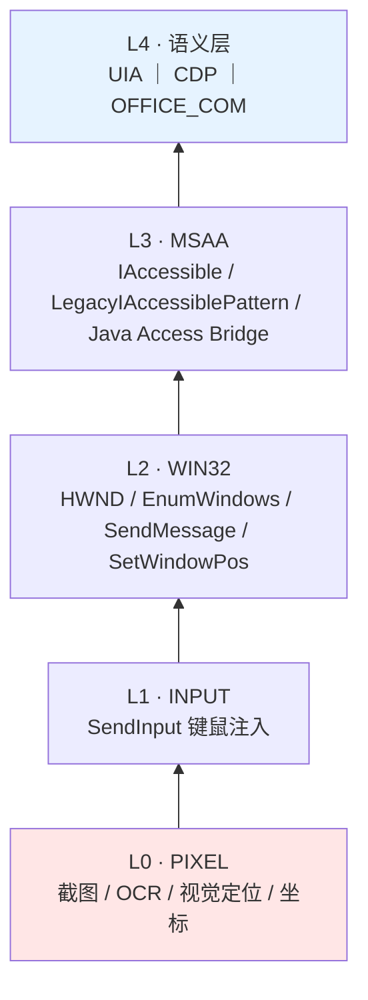

# WinUse 能力注册表（技术侧初稿）

> 文档编号：07 | 作者：高见远（架构师） | 状态：初稿（技术侧，未与产品需求清单合并）
> 上游依据：`docs/04-tech-foundation.md`（技术底座预研，§9 能力可行性矩阵 75 条）
> 用途：**协议设计与 function-calling schema 的直接输入**。本文件的每个条目都应能被机械地翻译成一个 MCP tool / OpenAI function / REST endpoint。
> 与 PM 的分工：许清楚产出"从用户场景反推的能力需求清单"。本文件**从技术可行性出发**，不与她对齐；交集与冲突由 team-lead 合并。

---

## 0. 如何使用本文档

### 0.1 能力条目模板（每个条目均按下表填写）

| 字段 | 含义 |
|---|---|
| `id` | `域.动作`，是协议里的唯一标识 |
| `name` / `desc` | 中文名 + 一句话语义。**`desc` 是写给 LLM 看的**，必须能直接进 function-calling 的 `description` 字段 |
| `layer` | 主要落点层：`UIA` / `CDP` / `OFFICE_COM` / `MSAA` / `WIN32` / `INPUT` / `PIXEL` |
| `fallbackChain` | 降级链 + 各层触发条件 |
| `riskLevel` | `read` / `low` / `high` / `destructive`（决定二次确认策略，见 §1.3） |
| `idempotent` | 是否幂等；不幂等者注明重复执行后果 |
| `params` | 参数表，类型可直接映射 JSON Schema |
| `returns` | 返回结构（**一律含 `grounding`**） |
| `errors` | 能力特有错误码 + **建议 Agent 恢复动作** |
| `precondition` | 前置条件 |
| `latency` | 预期耗时量级 |
| `confidence` | 【实】已核实 /【推】推断 /【PoC】待验证 |

### 0.2 分层词汇表（与 04 号文档 §2.1 一致）

**降级方向永远是"从 L4 往 L0 掉"**，绝不能反向。每掉一级，`grounding.confidence` 必须相应下降。

### 0.3 共用类型定义（JSON Schema 可直接引用）

| 类型 | 定义 |
|---|---|
| `Rect` | `{x:int, y:int, w:int, h:int}` — **物理像素，虚拟桌面坐标系（VSC）**，原点可为负 |
| `Point` | `{x:int, y:int}` — 同上 |
| `NormRect` / `NormPoint` | 归一化到主显示器 `[0,1]` 的等价表示，仅作可选输入 |
| `WindowRef` | `{hwnd:int}` ｜ `{pid:int}` ｜ `{title:string, exact?:bool}` ｜ `{processName:string}` |
| `ElementRef` | `{elementId:string}` ｜ `{hwnd:int}` ｜ `{selector:Selector}` |
| `Selector` | `{name?:string, automationId?:string, controlType?:string, className?:string, frameworkId?:string, isRegex?:bool, index?:int}` |
| `CoordinateSystem` | `"vsc_physical"`（**默认且权威**）｜ `"monitor_normalized"` ｜ `"window_relative"` |
| `Grounding` | `{layer: "UIA"\|"CDP"\|"OFFICE_COM"\|"MSAA"\|"WIN32"\|"INPUT"\|"PIXEL", confidence: number(0..1), degraded: bool, fallbackReason?: string, attempts?: string[]}` |
| `Duration` | 毫秒整数 |

### 0.4 全局错误码（所有能力共用，能力条目内只列**特有**错误码）

| 错误码 | 含义 | **建议 Agent 恢复动作** |
|---|---|---|
| `UIPI_BLOCKED` | 目标进程完整性级别高于 WinUse，被 UIPI 阻断（SendInput 静默失败） | **不要再重试**。提示用户"以管理员身份重启 WinUse"，或改用只读能力 |
| `SECURE_DESKTOP` | 当前处于 UAC 安全桌面 | **不可自动恢复**。要求用户手动完成 UAC 确认后继续 |
| `SESSION_NOT_INTERACTIVE` | 会话不可用（锁屏/屏保/休眠/RDP 断开） | 等待并轮询 `system.environment`；若持续失败则终止任务并告知用户 |
| `TARGET_MINIMIZED` | 目标窗口最小化，无法截图/交互 | 先调用 `window.setPlacement{state:"restore"}` 再重试 |
| `TARGET_OCCLUDED` | 目标被遮挡（仅影响 PIXEL 层） | 改用 UIA 层，或先 `window.activate` |
| `CAPTURE_PROTECTED` | 目标设置 `WDA_EXCLUDEFROMCAPTURE` / DRM | **放弃截图**。改用 `element.*` 结构化读取；若不可行则告知用户关闭应用的"屏幕安全"设置 |
| `ELEMENT_NOT_FOUND` | 选择器未命中 | 重新 `element.find` 或 `element.tree` 刷新视图；**不要用旧 elementId** |
| `ELEMENT_STALE` | `elementId` 已失效（窗口重建/布局变化） | 重新定位元素。**这是最常见的错误，Agent 必须处理** |
| `PATTERN_UNSUPPORTED` | 控件不支持所需的 ControlPattern | 查 `element.patterns` 确认可用模式，走 `fallbackChain` 下一层 |
| `TIMEOUT` | 等待超时 | 检查前置条件是否满足；可延长 timeout 重试一次 |
| `PERMISSION_DENIED` | 文件系统/注册表权限不足 | 提示用户授权或换路径 |
| `APPROVAL_REQUIRED` | 命中风险分级，需用户确认 | 等待确认结果；不要重试绕过 |
| `APPROVAL_DENIED` | 用户拒绝 | 停止该动作，向用户询问替代方案 |
| `NOT_SUPPORTED` | 能力被显式禁用或平台不支持 | 查 §4 显式不支持清单，换等效路径 |
| `INVALID_COORDS` | 坐标超出虚拟桌面范围 | 用 `system.displays` 重新获取拓扑并换算 |

### 0.5 坐标系约定（**硬性，协议必须遵守**）

1. **内部唯一权威坐标系 = 物理像素 + 虚拟桌面坐标系（VSC）**，原点 `GetSystemMetrics(SM_XVIRTUALSCREEN / SM_YVIRTUALSCREEN)`（**可为负**）。
2. WinUse 进程必须声明 **Per-Monitor DPI Awareness v2**（manifest 或启动时 `SetProcessDpiAwarenessContext(-4)`，且必须在创建任何窗口之前）。
3. 每个 `observe` 类返回必须携带显示器拓扑快照（见 `system.displays`）。
4. 对外允许 `monitor_normalized`（相对主显示器）与 `window_relative`，但**响应里必须标注用了哪种**。

### 0.6 动态风险升级（Dynamic Escalation）

**问题**：`element.invoke` 这类通用能力，静态分级只能是 `low`，但它可能点中"发送邮件""删除""格式化"。

**机制**：服务端维护**高危语义词表**（中英文双份，如 `Send/发送/Delete/删除/Format/格式化/Install/安装/卸载/支付/付款/Confirm/确认订单/Submit/提交`），对目标元素的 `Name` + `AutomationId` + `ClassName` 做匹配；命中则**动态升级到 `high` 并触发二次确认**，同时在返回中给出 `riskEscalated: true, matchedKeyword`。
- 该词表**可配置**、**可关闭**（无人值守场景），但关闭需显式配置项。
- 此机制参考微软 UFO 论文的 sensitive actions 分类思路（发送邮件、删除修改文件、关闭应用、访问摄像头麦克风、安装卸载、读取密码/历史等）[^ufo]。

### 0.7 v1 / v1.5 / v2 能力集切分总表（**权威口径**）

> **命名权威口径声明（team-lead 裁定 D5）**：自本版起，**能力 ID 以 `docs/02-windows-operation-patterns.md` §5 为唯一权威**。
> 本文档 §1–§15 中使用的技术侧 ID（如 `window.activate`、`text.set`、`vision.ocr`）**保留为技术可行性描述**，其到权威 ID 的映射见下表「07 技术条目」列；**二者冲突时以本表（02 §5 口径）为准**。
>
> **关于条数**：02 §5.14 自报"约 133 条"是按表格行数统计（其中大量行用 `a / b / c` 合并书写）。**按能力逐个展开后实为 162 条**。本表按展开口径列全，并因此修正统计。

**图例**：`归属` = v1（MVP 必做）/ v1.5 / v2 ｜ `P级` = PRD 需求池编号 ｜ `风险` = 02 §6 的 R0–R4 ｜ `幂等` = I/C/N

#### 0.7.1 `session.*`（7 条）

| 权威 ID | 中文名 | 风险 | 幂等 | P级 | 归属 | 07 技术条目 |
|---|---|---|---|---|---|---|
| `session.hello` | 握手（版本/权限模式/会话 ID） | R0 | I | P0-1 | **v1** | `session.begin` |
| `session.capabilities` | 自描述能力目录（含 Schema/风险/幂等） | R0 | I | P0-3 | **v1** | 新增（07 缺） |
| `session.preflight` | 环境前置校验（锁屏/UAC/屏保/RDP/IL/显示器） | R0 | I | P0-13 | **v1** | `system.environment` |
| `session.status` | 健康与负载（队列/当前动作/uptime） | R0 | I | P0-1 | **v1** | 新增 |
| `session.set_mode` | 切换权限模式 observe/standard/elevated | R1 | I | P0-11 | **v1** | `session.begin.approvalPolicy` |
| `session.subscribe` | 事件订阅（SSE/WS） | R0 | I | P1-7 | **v1.5** | 新增 |
| `session.cancel` | 取消进行中动作 | R1 | I | P1-11 | **v1.5** | `session.abort`（提为 v1 子集） |

#### 0.7.2 `system.*` + `display.*`（8 条）

| 权威 ID | 中文名 | 风险 | 幂等 | P级 | 归属 | 07 技术条目 |
|---|---|---|---|---|---|---|
| `system.info` | OS 版本/构建/语言/区域/会话 ID/完整性级别 | R0 | I | P0-13 | **v1** | `system.environment` 子集 |
| `system.idle` | 用户输入空闲时长 | R0 | I | P0-9 | **v1** | 新增（`wait.idle` 依赖） |
| `system.power` | 电源状态查询 | R0 | I | — | **v1** | 注：与 07 的 `system.power`（**关机/重启，R4**）**同名冲突** → 见下方 ⚠️ |
| `system.setting.get` | 读系统设置项 | R0 | I | — | **v2** | 新增 |
| `system.setting.set` | 写系统设置项 | R4 | C | — | **v2** | 新增（默认禁用） |
| `system.env.get` | 读环境变量 | R0 | I | — | **v1.5** | 新增 |
| `display.list` | 显示器列表（bounds/work_area/primary/scale/dpi/朝向） | R0 | I | P0-14 | **v1** | `system.displays` |
| `display.dpi` | 每显示器 DPI + 本进程感知等级 + 坐标系说明 | R0 | I | P0-14 | **v1** | `system.displays` |

> ⚠️ **命名冲突已记录**：02 §5.2 的 `system.power` 是**查询**（R0），07 §13.6 的 `system.power` 是**关机/重启/锁屏**（destructive）。
> **裁定**：`system.power` 保留为**查询**（遵循 02 口径）；电源动作改名为 **`system.power.act`**（R4，v2，默认拒绝）。此改名需在 06 协议规范中固化。

#### 0.7.3 `process.*`（5 条）+ `window.*`（19 条）

| 权威 ID | 中文名 | 风险 | 幂等 | P级 | 归属 | 07 技术条目 |
|---|---|---|---|---|---|---|
| `process.list` | 进程列表（含完整性级别） | R0 | I | P0-8 | **v1** | `process.list` |
| `process.start` | 启动（exe/开始菜单项/UWP AUMID/关联打开） | R1 | N | P0-8 | **v1** | `process.launch` / `shell.open` |
| `process.terminate` | 温和终止 | R2 | C | P0-8 | **v1** | `window.close`(force) |
| `process.kill` | 强制终止 | R2 | C | — | **v1.5** | `process.terminate`(force) |
| `process.wait` | 等待进程状态 | R0 | I | P0-8 | **v1** | 新增 |
| `window.list` | 窗口列表（z-order/显示器/状态/虚拟桌面/进程） | R0 | I | P0-8 | **v1** | `window.list` |
| `window.find` | 按条件查找（title/class/process） | R0 | I | P0-8 | **v1** | `window.get` |
| `window.focus` | 激活到前台 | R1 | I | P0-8 | **v1** | `window.activate` |
| `window.state.get` | 窗口状态与 rect/monitor | R0 | I | P0-8 | **v1** | `window.get` |
| `window.minimize` | 最小化 | R1 | I | P0-8 | **v1** | `window.setPlacement` |
| `window.maximize` | 最大化 | R1 | I | P0-8 | **v1** | `window.setPlacement` |
| `window.restore` | 还原 | R1 | I | P0-8 | **v1** | `window.setPlacement` |
| `window.close` | 关闭 | R1 | I | P0-8 | **v1** | `window.close` |
| `window.move` | 移动 | R1 | I | P0-8 | **v1** | `window.setPlacement` |
| `window.resize` | 调整大小 | R1 | I | P0-8 | **v1** | `window.setPlacement` |
| `window.set_rect` | 一次设置位置+尺寸 | R1 | I | P0-8 | **v1** | `window.setPlacement` |
| `window.snap` | 贴靠布局（左/右/上/下/象限/最大化） | R1 | I | P1-15 | **v1.5** | 新增 |
| `window.send_to_monitor` | 移到指定显示器（返回 DPI 变化后新尺寸） | R1 | I | P0-14 | **v1.5** | `window.setPlacement.monitorId` |
| `window.virtual_desktop.get` | 查询窗口所在虚拟桌面 | R1 | I | P1-15 | **v1.5** | `system.virtualDesktops` |
| `window.virtual_desktop.move` | 移动窗口到指定虚拟桌面 | R1 | C | P1-15 | **v1.5** | `system.virtualDesktops` |
| `window.virtual_desktop.switch` | **切换**虚拟桌面 | R2 | C | P1-15 | **v2（且标记 ⚠️脆弱）** | 见 §16 显式不支持 #8 |
| `window.wait` | 等待窗口状态 | R0 | I | P0-9 | **v1** | `window.wait` |
| `window.tree` | 窗口 UIA 子树（带 snapshot_id） | R0 | I | P0-5 | **v1** | `element.tree` |
| `window.capture` | 窗口截图 | R0 | I | — | **v1** | `screen.capture` |

#### 0.7.4 `element.*`（23 条，核心）

| 权威 ID | 中文名 | 风险 | 幂等 | P级 | 归属 | 07 技术条目 |
|---|---|---|---|---|---|---|
| `element.find` | 选择器定位（含 require_unique） | R0 | I | P0-5 | **v1** | `element.find` |
| `element.count` | 只问数量（消歧用，便宜） | R0 | I | P0-5 | **v1** | 新增 |
| `element.get` | 用稳定句柄取属性快照 | R0 | I | P0-5 | **v1** | `element.get` |
| `element.tree` | 子树快照 / diff（`since`） | R0 | I | P0-5 | **v1** | `element.tree` |
| `element.property.get` | 读指定属性 | R0 | I | P0-5 | **v1** | `element.get` |
| `element.wait` | 等待元素状态 | R0 | I | P0-9 | **v1** | `element.wait` |
| `element.invoke` | **UIA InvokePattern（首选，可绕 UIPI）** | R1–R3 | C | P0-6 | **v1** | `element.invoke` |
| `element.set_value` | UIA ValuePattern 设值 | R1–R3 | C | P0-6 | **v1** | `text.set`(strategy=valuePattern) |
| `element.set_range_value` | 滑块/数值/进度 | R1 | C | — | **v1.5** | 新增 |
| `element.toggle` | 勾选/开关 | R1 | C | P0-6 | **v1** | `element.invoke`(action=toggle) |
| `element.select` | 列表/树/标签选择 | R1 | C | P0-6 | **v1** | `element.invoke`(action=select) |
| `element.expand_collapse` | 树/组合框展开收起 | R1 | C | P0-6 | **v1** | `element.invoke`(action=expand) |
| `element.scroll` | 滚动 / 滚动到可见 | R1 | C | P0-6 | **v1** | `element.scroll` |
| `element.focus` | 设置键盘焦点 | R1 | I | P0-6 | **v1** | `element.focus` |
| `element.text.get` | 读文本（TextPattern） | R0 | I | P0-5 | **v1** | `text.readback` |
| `element.caret.get` | 读字符级光标位置 | R1 | C | — | **v1.5** | 新增（OSWorld-G 列为精细操作） |
| `element.caret.set` | 设字符级光标位置 | R1 | C | — | **v1.5** | 新增 |
| `element.selection.get` | 读文本选区 | R1 | C | — | **v1** | `text.selection`(get) |
| `element.selection.set` | 设文本选区 | R1 | C | — | **v1** | `text.selection`(set) |
| `element.rect` | 几何矩形 | R0 | I | P0-5 | **v1** | `element.get.rect` |
| `element.center` | 中心点 | R0 | I | P0-5 | **v1** | `mouse.click`(elementId) |
| `element.highlight` | 调试高亮 | R0 | I | P0-12 | **v1** | `element.highlight` |
| `element.exists` | 是否存在 | R0 | I | P0-9 | **v1** | 新增 |

#### 0.7.5 `mouse.*`（8 条）+ `keyboard.*`（9 条）

| 权威 ID | 中文名 | 风险 | 幂等 | P级 | 归属 | 07 技术条目 |
|---|---|---|---|---|---|---|
| `mouse.position.get` | 当前光标位置 | R0 | I | P0-6 | **v1** | `mouse.position` |
| `mouse.move` | 移动（绝对/相对/smooth） | R1 | I | P0-6 | **v1** | `mouse.move` |
| `mouse.click` | 点击 | R1–R3 | N | P0-6 | **v1** | `mouse.click` |
| `mouse.down` | 按下 | R1 | N | P0-6 | **v1** | `mouse.drag` 首段 |
| `mouse.up` | 释放 | R1 | N | P0-6 | **v1** | `mouse.drag` 尾段 |
| `mouse.drag` | 拖拽 | R1–R3 | N | P0-6 | **v1** | `mouse.drag` |
| `mouse.scroll` | 滚轮（lines/pixels） | R1 | C | P0-6 | **v1** | `mouse.wheel` |
| `mouse.hover` | 悬停（含 tooltip 等待） | R0/R1 | I | — | **v1.5** | 新增 |
| `keyboard.type` | **Unicode 直注（KEYEVENTF_UNICODE，绕过 IME）** | R1–R3 | N | P0-7 | **v1** | `text.set`/`text.append` |
| `keyboard.press` | 单键 | R1–R3 | N | P0-7 | **v1** | `keyboard.press` |
| `keyboard.hotkey` | 组合键 | R1–R3 | N | P0-7 | **v1** | `keyboard.press`(modifiers) |
| `keyboard.down` | 按下保持 | R1 | N | P0-7 | **v1** | `keyboard.hold` |
| `keyboard.up` | 释放 | R1 | N | P0-7 | **v1** | `keyboard.release` |
| `keyboard.type_pinyin` | **走 IME 的真实中文输入**（测试/特殊场景） | R2 | N | — | **v2** | `text.typeByKeystroke`（中文场景**禁用**） |
| `keyboard.ime.status` | IME 状态（输入法/中英/是否组字/候选可见） | R0 | I | P0-7 | **v1** | `system.imeState` |
| `keyboard.ime.set` | 切换中/英或输入法（**自动记录并恢复**） | R1 | C | — | **v1.5** | 07 明确不提供 → **依 02 口径补回，但默认禁用** |
| `keyboard.ime.candidates` | 读候选词 | R0 | I | — | **v2** | 新增（UIA 覆盖不稳，标 ⚠️） |

#### 0.7.6 `clipboard.*`（5 条）· `screen.*`/`ocr.*`（6 条）

| 权威 ID | 中文名 | 风险 | 幂等 | P级 | 归属 | 07 技术条目 |
|---|---|---|---|---|---|---|
| `clipboard.get` | 读剪贴板 | R0 | I | P0-18 | **v1** | `clipboard.get` |
| `clipboard.set` | 写剪贴板（**默认记录并恢复**） | R1 | C | P0-18 | **v1** | `clipboard.set` + `clipboard.save/restore` |
| `clipboard.formats` | 可用格式列表 | R0 | I | P0-18 | **v1** | 新增 |
| `clipboard.clear` | 清空 | R1 | I | — | **v1** | 新增 |
| `clipboard.history` | Win+V 历史 | R0 | I | — | **v2（⚠️需 PoC）** | 新增 |
| `screen.capture` | 截图（**默认只返标注元数据，不含图像**） | R0 | I | P1-2 | **v1** | `screen.capture` |
| `screen.annotate` | SoM 标注（编号→元素映射） | R0 | I | P1-2 | **v1** | `vision.annotate` |
| `screen.diff` | 两快照差异区域 | R0 | I | P1-1 | **v1.5** | `screen.diff` |
| `screen.locate` | 模板匹配定位（OpenCV） | R0 | I | P2-4 | **v2** | `vision.locate` |
| `screen.pixel` | 取色 | R0 | I | — | **v2** | 新增 |
| `ocr.recognize` | 区域 OCR（中英） | R0 | I | P1-2 | **v1.5** | `vision.ocr` |

#### 0.7.7 `file.*`（18 条）

| 权威 ID | 中文名 | 风险 | 幂等 | P级 | 归属 | 07 技术条目 |
|---|---|---|---|---|---|---|
| `file.list` | 列目录 | R0 | I | P0-16 | **v1** | `file.list` |
| `file.stat` | 元信息（**P17 主要验证手段**） | R0 | I | P0-16 | **v1** | 新增（**重要**：独立验证主力） |
| `file.exists` | 存在性 | R0 | I | P0-16 | **v1** | 新增 |
| `file.read` | 读文件（含 GBK 编码） | R0 | I | P0-16 | **v1** | `file.read` |
| `file.write` | 写文件（**事务内默认备份原内容**） | R2 | C | P0-16 | **v1** | `file.write` |
| `file.copy` | 复制 | R2 | C | P0-16 | **v1** | `file.copy` |
| `file.move` | 移动 | R2 | C | P0-16 | **v1** | `file.move` |
| `file.rename` | 重命名 | R2 | C | — | **v1** | 新增 |
| `file.delete` | 删除（**默认回收站**） | R2/R3 | C | P0-16 | **v1** | `file.delete` |
| `file.mkdir` | 建目录 | R2 | C | P0-16 | **v1** | 新增 |
| `file.rmdir` | 删目录 | R3 | C | — | **v1.5** | 新增 |
| `file.watch` | 目录变更订阅 | R0 | I | — | **v2** | 新增 |
| `file.archive` | 压缩 | R2 | C | P2-6 | **v2** | 新增 |
| `file.unarchive` | 解压 | R2 | C | P2-6 | **v2** | 新增 |
| `file.recycle.list` | 回收站列表 | R2 | C | P2-6 | **v2** | 新增 |
| `file.recycle.restore` | 回收站还原 | R2 | C | P2-6 | **v2** | 新增 |
| `file.recycle.empty` | 清空回收站 | R3 | C | — | **v2（默认拒绝）** | 新增 |
| `file.wait_stable` | 等待文件大小稳定（下载完成判定） | R0 | I | — | **v1.5** | 新增 |

#### 0.7.8 `dialog.*` / `filedialog.*`（7 条）· `browser.*` / `shell.*` / `console.*`（17 条）

| 权威 ID | 中文名 | 风险 | 幂等 | P级 | 归属 | 07 技术条目 |
|---|---|---|---|---|---|---|
| `dialog.detect` | 检测模态阻断（UAC/文件对话框/消息框/应用模态） | R0 | I | P0-17 | **v1** | 新增（见 §17） |
| `dialog.wait` | 等待对话框出现/消失 | R0 | I | P0-17 | **v1** | 新增 |
| `dialog.dismiss` | 关闭（Esc/取消/X） | R1 | C | P0-17 | **v1** | 新增 |
| `dialog.button.click` | 按名称点按钮（支持多语言别名+模糊） | R1–R3 | N | P0-17 | **v1** | 新增 |
| `filedialog.set_path` | **设置文件路径（Windows 高频专化能力）** | R1 | C | P0-17 | **v1** | 新增 |
| `filedialog.confirm` | 确认（含覆盖确认连环框处理） | R1–R3 | N | P0-17 | **v1** | 新增 |
| `filedialog.cancel` | 取消 | R1 | N | P0-17 | **v1** | 新增 |
| `browser.tabs.list` | 列标签页 | R0/R1 | I | P1-6 | **v1.5** | `browser.tabs` |
| `browser.tabs.open` | 打开标签页 | R1 | N | P1-6 | **v1.5** | 新增 |
| `browser.tabs.close` | 关闭标签页 | R2 | C | P1-6 | **v1.5** | 新增 |
| `browser.tabs.switch` | 切换标签页 | R1 | C | P1-6 | **v1.5** | 新增 |
| `browser.navigate` | 导航 | R1 | C | P1-6 | **v1.5** | `browser.navigate` |
| `browser.cdp.attach` | **CDP 逃逸口**（需授权，可能要求带端口重启） | R2 | I | P1-6 | **v1.5** | `browser.attach` |
| `browser.cdp.call` | 透传 CDP 命令 | R3 | N | P1-6 | **v1.5** | `browser.evaluate` 等泛化 |
| `browser.dom.get` | DOM 快照（需授权） | R2 | I | P1-6 | **v1.5** | `browser.axTree` |
| `shell.exec` | 同步执行命令（cmd/pwsh） | R3 | N | P1-5 | **v1** | `shell.exec` |
| `shell.exec_async` | 异步执行 | R3 | N | P1-5 | **v1.5** | 新增 |
| `shell.job.status` | 任务状态 | R1 | I | P1-5 | **v1.5** | 新增 |
| `shell.job.read` | 读增量输出 | R1 | C | P1-5 | **v1.5** | 新增 |
| `shell.job.cancel` | 取消任务 | R2 | C | P1-5 | **v1.5** | 新增 |
| `console.attach` | 附加到交互式会话（ConPTY） | R1 | I | P1-5 | **v2（⚠️需 PoC）** | 新增（见 §18） |
| `console.detach` | 分离 | R1 | I | P1-5 | **v2** | 新增 |
| `console.read_buffer` | 读终端屏缓冲（**ConPTY 下仅视口，无 scrollback**） | R0 | I | P1-5 | **v2（⚠️需 PoC）** | 新增 |
| `console.send` | 向交互 shell 发送输入 | R2/R3 | N | P1-5 | **v2** | 新增 |

#### 0.7.9 `registry.*` / `notify.*`（12 条）

| 权威 ID | 中文名 | 风险 | 幂等 | P级 | 归属 | 07 技术条目 |
|---|---|---|---|---|---|---|
| `registry.get` | **读注册表** | R0 | I | P1-13 | **v1** | 新增（**P0 补充项**） |
| `registry.set` | 写注册表（**standard 模式下默认拒绝**） | R4 | C | P1-13 | **v2（默认禁用）** | 新增 |
| `registry.delete` | 删注册表 | R4 | C | P1-13 | **v2（默认禁用）** | 新增 |
| `toast.list` | Toast 列表 | R0 | I | P2-5 | **v2** | `system.notifications` |
| `toast.dismiss` | 关闭 Toast | R1 | C | P2-5 | **v2** | 新增 |
| `toast.click` | 点击 Toast | R1 | C | P2-5 | **v2（⚠️覆盖不稳）** | 新增 |
| `tray.list` | 托盘图标列表（含溢出区） | R0 | I | P2-5 | **v2（⚠️见不支持 #10）** | 新增 |
| `tray.click` | 点击托盘图标 | R1 | C | P2-5 | **v2（⚠️）** | 新增 |
| `tray.context_menu` | 托盘右键菜单 | R1 | C | P2-5 | **v2（⚠️）** | 新增 |
| `taskbar.list` | 任务栏列表 | R0 | I | P2-5 | **v2** | 新增 |
| `taskbar.click` | 点击任务栏 | R1 | C | P2-5 | **v2** | 新增 |
| `startmenu.search` | 开始菜单搜索并启动 | R1 | C | — | **v1.5** | `process.start`(AUMID) 子集 |

#### 0.7.10 `macro.*` / `transaction.*` / `undo.*` / `audit.*`（14 条）· `wait.*`（4 条）

| 权威 ID | 中文名 | 风险 | 幂等 | P级 | 归属 | 07 技术条目 |
|---|---|---|---|---|---|---|
| `macro.list` | 发现内置与自定义宏 | R0 | I | P0-20 | **v1** | 新增（见 §20） |
| `macro.describe` | 宏详情 + Schema | R0 | I | P0-20 | **v1** | 新增 |
| `macro.run` | 执行宏（含 items 批量 + on_error） | 视宏 | C/N | P0-20 | **v1** | 新增 |
| `macro.record_start` | 开始录制演示 | R2 | N | P2-1 | **v1.5**（team-lead 裁定：record 做） | `session.record` |
| `macro.record_stop` | 停止录制 | R2 | N | P2-1 | **v1.5** | `session.record`(stop) |
| `macro.record_save` | 保存为宏定义 | R2 | N | P2-1 | **v1.5** | 新增 |
| `transaction.begin` | 开启事务 | — | — | P1-3 | **v1.5** | 新增（见 §20） |
| `transaction.commit` | 提交 | — | — | P1-3 | **v1.5** | 新增 |
| `transaction.rollback` | 回滚（**部分回滚须报 ROLLBACK_PARTIAL**） | — | — | P1-3 | **v1.5** | 新增 |
| `undo.stack` | 当前可撤销栈 | R0 | I | P1-3 | **v1.5** | 新增 |
| `undo.undo` | 撤销 | R2 | C | P1-3 | **v1.5** | 新增 |
| `undo.redo` | 重做 | R2 | C | P1-3 | **v2** | 新增 |
| `audit.query` | 查询审计日志 | R0 | I | P0-15 | **v1** | `session.log` |
| `audit.export` | 导出审计 | R1 | I | P0-15 | **v1** | `session.log`(export) |
| `wait.for` | **统一条件等待**（元素/窗口/进程/文件/文本/剪贴板） | R0 | I | P0-9 | **v1** | 新增（见 §16） |
| `wait.idle` | 空闲等待（input_idle / cpu_idle） | R0 | I | P0-9 | **v1** | 新增 |
| `wait.stable` | 防抖稳定等待 | R0 | I | P0-9 | **v1** | `screen.waitStable` 泛化 |
| `wait.timeout` | 固定等待（**不推荐，审计中标记**） | R0 | I | — | **v1** | 新增 |

#### 0.7.11 `office.*`（4 条，team-lead 裁定：**v1 做 Excel / Word COM**）

| 权威 ID | 中文名 | 风险 | 幂等 | 归属 | 07 技术条目 |
|---|---|---|---|---|---|
| `office.attach` | 连接 Office 应用 | R0 | I | **v1** | `office.attach` |
| `office.excel.range` | 读写 Excel 区域 | R0/R2 | C | **v1** | `office.excel.range` |
| `office.word.text` | 读写 Word 文本 | R0/R2 | C | **v1** | `office.word.text` |
| `office.outlook.send` | 撰写/发送邮件（`mode=draft` 默认） | R3/R4 | N | **v2** | `office.outlook.send` |
| `office.wps.*`（WPS 适配） | WPS COM 兼容层 | — | — | **v1.5**（team-lead 裁定：WPS 降 v1.5） | 新增 |

#### 0.7.12 切分统计

| 归属 | 条数 | 说明 |
|---|---|---|
| **v1（MVP）** | **108** | 覆盖 PRD 全部 P0 + 少量 P1 主干（`shell.exec`、`screen.capture`、`file.stat` 等） |
| **v1.5** | **33** | 覆盖 PRD P1 主体（事务/事件订阅/CDP/终端/Snap/虚拟桌面查询/宏录制） |
| **v2** | **21** | 覆盖 PRD P2 + 明确脆弱能力（托盘/Toast/虚拟桌面切换/模板匹配/回收站/console） |
| **合计** | **162** | 与 02 §5.14 自报的"~133"差异源于该表按行统计（大量 `a / b / c` 合并行），此处按能力逐个展开 |

> **给 PM 的提醒**：v1 就 108 个能力，**远超 LLM 单次能消费的工具数**。因此 PRD §6.1 的"渐进式发现"（`filter` + 分页）不是优化项而是**必需项**；同时建议 v1 默认只向 Agent 暴露**约 30–40 个"核心子集"**（见 06 协议规范的 `tier: core|extended|advanced` 字段设计）。

---

## 1. `window` — 窗口域

> **Windows 特殊约束**：窗口由 HWND 标识，但 HWND **会随窗口重建而变化**，绝不能跨步骤长期缓存，只应在同一步骤内使用或在每步前校验。标题（title）受界面语言影响，不宜作为主键。`GetWindowRect` 含 DWM 阴影，视觉边界须用 `DwmGetWindowAttribute(DWMWA_EXTENDED_FRAME_BOUNDS)`。窗口可能位于非当前虚拟桌面 —— 此时既不可截图也不可置前台。

### 1.1 `window.list` — 枚举顶层窗口
列出当前会话所有顶层窗口及其基本属性。

| 字段 | 值 |
|---|---|
| `layer` | `WIN32` |
| `fallbackChain` | 无（WIN32 是唯一来源） |
| `riskLevel` | `read` |
| `idempotent` | ✅ |
| `latency` | 10–50ms |
| `confidence` | 【实】 |

**params**

| 名 | 类型 | 必填 | 默认 | 含义 |
|---|---|---|---|---|
| `includeMinimized` | bool | 否 | true | 是否包含最小化窗口 |
| `includeInvisible` | bool | 否 | false | 是否包含不可见窗口（含系统隐藏窗口，量大） |
| `onlyCurrentDesktop` | bool | 否 | true | 仅当前虚拟桌面上的窗口 |
| `processName` | string | 否 | — | 按进程名过滤 |

**returns**：`{windows: [{hwnd, pid, tid, title, className, processName, rect: Rect, clientRect: Rect, state: "normal"\|"minimized"\|"maximized", isVisible, isForeground, dpi:int, monitorId:string, desktopId?:string, integrityLevel: "low"\|"medium"\|"high"\|"system"\|"unknown"}], monitorSnapshot: [...], grounding}`

**errors**：`SESSION_NOT_INTERACTIVE`

**precondition**：会话可交互

---

### 1.2 `window.get` — 获取单个窗口详情
按 hwnd / pid / title / processName 定位窗口并返回完整属性快照。

| 字段 | 值 |
|---|---|
| `layer` | `WIN32` |
| `fallbackChain` | 无 |
| `riskLevel` | `read` |
| `idempotent` | ✅ |
| `latency` | 5–30ms |
| `confidence` | 【实】 |

**params**：`WindowRef`（四选一）+ `includeExtendedFrameBounds: bool = true`

**returns**：`{window: {...同 window.list 单条...}, extendedFrameBounds: Rect, isMinimized, isMaximized, canReceiveInput: bool, isUwpApp: bool, grounding}`

**errors**：`ELEMENT_NOT_FOUND`（窗口不存在）｜`UIPI_BLOCKED`（无法查询更高 IL 进程的完整性信息）

---

### 1.3 `window.children` — 枚举子窗口（HWND 树）
枚举指定窗口的原生子 HWND 层级。

| 字段 | 值 |
|---|---|
| `layer` | `WIN32` |
| `fallbackChain` | 无 |
| `riskLevel` | `read` |
| `idempotent` | ✅ |
| `latency` | 20–200ms（子窗口多时） |
| `confidence` | 【实】 |

**说明与坑**：**【实】** `EnumChildWindows` 对自绘 UI 只能拿到极少数真实 HWND（微信/钉钉这类应用可能只有 1–3 个子 HWND）。**这个能力主要用于诊断"该应用是不是自绘 UI"**，而不是作为元素定位手段。若返回节点数 ≤ 3 而窗口视觉上有很多控件，应判定为自绘 UI 并转向 `screen.capture` + `vision.*`。

**params**：`{hwnd:int, maxDepth?:int=3, includeInvisible?:bool=false}`

**returns**：`{tree: [{hwnd, className, title, rect, children: [...]}], totalCount:int, suspectCustomDrawn: bool, grounding}`

**precondition**：窗口存在

---

### 1.4 `window.activate` — 激活窗口（置前台）
将窗口带到前台并给予输入焦点。**尽力而为（best-effort）**。

| 字段 | 值 |
|---|---|
| `layer` | `WIN32`（主）→ `UIA`（`WindowPattern.SetWindowVisualState` 辅助） |
| `fallbackChain` | `WIN32`（ShowWindow + SetForegroundWindow）→ `UIA`（SetWindowVisualState / SetFocus via element.focus） |
| `riskLevel` | `low` |
| `idempotent` | ✅ |
| `latency` | 20–100ms |
| `confidence` | 【实】前台锁定限制；【推】降级路径有效性 |

**params**：`{ref: WindowRef, force?: bool = false, waitMs?: int = 500}`

**returns**：`{activated: bool, isForeground: bool, hwnd:int, grounding}` —— **`activated` 可能为 false，Agent 必须检查**

**errors**

| 错误码 | 含义 | Agent 恢复动作 |
|---|---|---|
| `FOREGROUND_LOCKED` | 系统拒绝前台切换（用户正在操作别的窗口） | 重试 1 次；仍失败则改用 `element.invoke`（UIA 点击**不需要前台**） |
| `TARGET_MINIMIZED` | 目标最小化 | 先 `window.setPlacement{state:"restore"}` |
| `UIPI_BLOCKED` | 目标是更高 IL 进程 | 提示用户以管理员重启 |
| `ON_OTHER_DESKTOP` | 窗口在非当前虚拟桌面 | 告知用户手动切换，或用 `system.virtualDesktops` 把窗口移过来 |

**precondition**：窗口存在、非最小化、位于当前虚拟桌面

**已知坑**：**【实】** 不推荐用 `AttachThreadInput` 强行绑定输入队列来绕过前台锁定（需 UIAccess 权限，且易造成输入队列死锁）。`SwitchToThisWindow`、模拟 Alt 键释放等均为不可靠 hack，WinUse 不实现。

---

### 1.5 `window.setPlacement` — 移动 / 调整大小 / 改变窗口状态
设置窗口位置、尺寸与显示状态（normal/minimized/maximized/restore）。

| 字段 | 值 |
|---|---|
| `layer` | `WIN32` |
| `fallbackChain` | 无 |
| `riskLevel` | `low`（restore/normal）｜`high`（minimize/最大化会打断用户）→ 实际统一按 `low`，但 minimize 记入审计 |
| `idempotent` | ✅（给定相同参数结果相同） |
| `latency` | 10–50ms |
| `confidence` | 【实】 |

**params**：`{ref: WindowRef, rect?: Rect, state?: "normal"\|"minimized"\|"maximized"\|"restore", monitorId?: string}`

**returns**：`{hwnd, rect: Rect, state, monitorId, grounding}`

**errors**：`INVALID_COORDS`（跨屏坐标越界）｜`ELEMENT_NOT_FOUND`

**precondition**：坐标须在 VSC 范围内；**移动窗口到另一显示器时 DPI 会变**，返回新的 `dpi`

---

### 1.6 `window.close` — 关闭窗口 / 应用
向窗口发送 `WM_CLOSE`（温和关闭，应用可拒绝并弹保存提示）。

| 字段 | 值 |
|---|---|
| `layer` | `WIN32` |
| `fallbackChain` | `WIN32`(WM_CLOSE) → `WIN32`(WM_SYSCOMMAND/SC_CLOSE) → `process.terminate`（**需二次确认，属 destructive**） |
| `riskLevel` | `high` |
| `idempotent` | ⚠️ **不幂等**：重复调用第二次会因窗口已不存在而失败；且**可能造成未保存数据丢失** |
| `latency` | 50ms–数秒（若弹出"是否保存"对话框则阻塞） |
| `confidence` | 【实】 |

**params**：`{ref: WindowRef, force?: bool = false, timeoutMs?: int = 3000}`

**returns**：`{closed: bool, promptAppeared: bool, promptWindow?: {hwnd, title}, grounding}`

**errors**

| 错误码 | 含义 | Agent 恢复动作 |
|---|---|---|
| `SAVE_PROMPT` | 弹出"是否保存"确认框 | **必须处理**：调用 `element.find` 定位"保存/不保存/取消"并处理；不要盲目 force |
| `CLOSE_REFUSED` | 应用拒绝关闭 | 询问用户是否强制结束进程（`process.terminate`，destructive） |
| `TIMEOUT` | 关闭超时 | 同上 |

---

### 1.7 `window.wait` — 等待窗口状态
等待某个窗口出现 / 消失 / 变为前台。

| 字段 | 值 |
|---|---|
| `layer` | `WIN32`（基于 `RegisterShellHookWindow` 事件） |
| `fallbackChain` | `WIN32`(Shell hook 事件) → `WIN32`(轮询 `window.list`，250ms) |
| `riskLevel` | `read` |
| `idempotent` | ✅ |
| `latency` | 事件命中 <100ms；轮询兜底 ≤ 250ms + timeout |
| `confidence` | 【实】Shell hook；【推】轮询兜底阈值 |

**params**：`{match: {title?:string, className?:string, processName?:string, pid?:int}, condition: "exists"\|"notExists"\|"foreground"\|"notMinimized", timeoutMs?: int = 10000, pollIntervalMs?: int = 250}`

**returns**：`{matched: bool, elapsedMs:int, window?: {...}, timedOut: bool, lastObservation?: {...}, grounding}`

**errors**：`TIMEOUT`（返回时携带 `lastObservation` 供 Agent 诊断）

**设计要点**：**降级必须用事件 + 轮询双保险**【推】。Shell hook（`RegisterShellHookWindow`）优于全局 `SetWindowsHookEx`（后者需 DLL 注入，见 04 §6.6）。

---

## 2. `element` — UI 元素域（UIA）

> **Windows 特殊约束**：UIA 是**跨进程 COM**，单次 `FindAll` 在复杂窗口（Excel、资源管理器、大型 Electron 应用）上可达数百毫秒甚至秒级 —— **必须开 `CacheRequest`**。元素由 `elementId`（服务端映射，内部基于 UIA RuntimeId）标识，**生命周期短于窗口**，任何"元素不存在/操作失败"都可能是 `ELEMENT_STALE`。`FrameworkId` 取值 `Win32`/`WPF`/`WinForm`/`XAML`/`Chrome`/`Qt`/`DirectUI` 是判断"是否自绘 UI"的关键信号。

### 2.1 `element.find` — 条件查找元素
在指定范围内按条件查找元素，返回匹配列表。

| 字段 | 值 |
|---|---|
| `layer` | `UIA` |
| `fallbackChain` | `UIA`(PropertyCondition/AndCondition) → `MSAA`(`LegacyIAccessiblePattern` 补充字段) → `PIXEL`(`vision.locate`) |
| `riskLevel` | `read` |
| `idempotent` | ✅（但返回的 elementId 每次调用可能不同） |
| `latency` | 30–800ms（取决于范围与条件；开缓存后显著降低） |
| `confidence` | 【实】 |

**params**

| 名 | 类型 | 必填 | 默认 | 含义 |
|---|---|---|---|---|
| `scope` | `WindowRef` ｜ `{elementId}` ｜ `"desktop"` | 是 | — | 查找范围 |
| `selector` | `Selector` | 是 | — | 匹配条件 |
| `scopeType` | `"element"`\|`"children"`\|`"descendants"`\|`"subtree"` | 否 | `"descendants"` | 等价于 UIA `TreeScope` |
| `maxResults` | int | 否 | 50 | 上限 |
| `onlyVisible` | bool | 否 | true | 过滤 `IsOffscreen` |
| `onlyEnabled` | bool | 否 | false | 过滤 `IsEnabled=false` |
| `useCache` | bool | 否 | true | 使用 `CacheRequest` 批量取属性 |
| `timeoutMs` | int | 否 | 5000 | 超时（防大树卡死） |

**returns**：`{elements: [{elementId, name, controlType, automationId, className, frameworkId, rect: Rect, isEnabled, isOffscreen, patterns: string[], hwnd?, depth:int}], totalCount:int, truncated: bool, grounding}`

**errors**：`ELEMENT_NOT_FOUND`｜`TIMEOUT`（树过大，建议缩小 scope 或改用 scopeType=children 分步下钻）｜`ON_OTHER_DESKTOP`

---

### 2.2 `element.get` — 获取元素详情
按 `elementId` 取回元素完整属性快照。

| 字段 | 值 |
|---|---|
| `layer` | `UIA` |
| `fallbackChain` | `UIA` → `MSAA` |
| `riskLevel` | `read` |
| `idempotent` | ✅ |
| `latency` | 5–50ms |
| `confidence` | 【实】 |

**params**：`{elementId: string, includeRect?: bool = true, includePatterns?: bool = true}`

**returns**：`{element: {elementId, name, controlType, automationId, className, frameworkId, processId, hwnd, rect, isEnabled, isOffscreen, isKeyboardFocusable, hasKeyboardFocus, helpText, acceleratorKey, accessKey, value?, legacyIAccessible?: {...}}, grounding}`

**errors**：`ELEMENT_STALE`｜`ELEMENT_NOT_FOUND`

---

### 2.3 `element.tree` — 获取元素子树
以结构化形式返回元素的子树（供 LLM 理解界面结构）。

| 字段 | 值 |
|---|---|
| `layer` | `UIA` |
| `fallbackChain` | `UIA` → `MSAA` → `PIXEL`（`vision.annotate`） |
| `riskLevel` | `read` |
| `idempotent` | ✅ |
| `latency` | 50ms–3s（**强依赖 maxDepth 与节点数**） |
| `confidence` | 【实】 |

**params**：`{scope: ElementRef\|WindowRef, maxDepth?: int = 5, maxNodes?: int = 200, filter?: "control"\|"content"\|"raw", includeOffscreen?: bool = false, compact?: bool = true}`

`compact=true` 时省略空字段、用短字段名 —— **对 token 成本极其重要**。

**returns**：`{root: ElementNode, nodeCount:int, truncated: bool, maxDepthReached:int, frameworkId: string, grounding}`
（`ElementNode = {id, n?:name, t:controlType, r?:Rect, p?:string[], c?:ElementNode[]}`）

**errors**：`TIMEOUT`（降低 maxDepth 或改用 element.find）｜`ELEMENT_STALE`

**设计要点**：**【推】** `nodeCount` 异常少（如 < 5）但窗口视觉复杂 → 判定为自绘 UI，Agent 应转 `vision.*`。这个信号应与 `frameworkId == "DirectUI"` 一并暴露。

---

### 2.4 `element.patterns` — 查询控件支持的模式
查询元素支持哪些 UIA ControlPattern（决定"能对它做什么"）。

| 字段 | 值 |
|---|---|
| `layer` | `UIA` |
| `fallbackChain` | 无 |
| `riskLevel` | `read` |
| `idempotent` | ✅ |
| `latency` | 5–40ms |
| `confidence` | 【实】 |

**params**：`{elementId: string}`

**returns**：`{patterns: ["Invoke","Value","Text","Scroll",...], supportedActions: ["invoke","setValue","select","toggle","expand","scrollIntoView",...], grounding}`

---

### 2.5 `element.invoke` — 调用控件动作
对元素执行语义级动作（点击按钮、勾选、展开、选中、滚动到可见等）。

| 字段 | 值 |
|---|---|
| `layer` | `UIA` |
| `fallbackChain` | `UIA`(InvokePattern/SelectionItemPattern/TogglePattern/ExpandCollapsePattern/ScrollItemPattern) → `INPUT`(`mouse.click` 于 rect 中心) → `PIXEL`(`vision.locate` + `mouse.click`) |
| `riskLevel` | `low`（**受 §0.6 动态风险升级影响**） |
| `idempotent` | ⚠️ **不幂等**：`invoke` 点击按钮两次会触发两次动作（如提交两笔订单）；`select`/`toggle` 则状态可能翻转 |
| `latency` | 20–300ms |
| `confidence` | 【实】 |

**params**：`{elementId: string, action: "invoke"\|"select"\|"toggle"\|"expand"\|"collapse"\|"scrollIntoView"\|"setFocus", toggleState?: bool, verify?: bool = true}`

**returns**：`{ok: bool, action, elementId, postState?: {isSelected?, toggleState?, isExpanded?}, riskEscalated: bool, matchedKeyword?: string, grounding}`

**errors**：`PATTERN_UNSUPPORTED`（查 `element.patterns` 后换动作）｜`ELEMENT_STALE`｜`ELEMENT_OFFSCREEN`（先 scrollIntoView）｜`APPROVAL_REQUIRED`｜`UIPI_BLOCKED`

**设计要点**：**这是最重要的能力之一**。UIA `invoke` **不需要目标窗口在前台**，这是它相对 `mouse.click` 的决定性优势。**优先用 `element.invoke`，`mouse.click` 只在 UIA 不可用时作为降级。**

---

### 2.6 `element.focus` — 设置 UIA 焦点
把键盘焦点设置到元素上（不等同于把窗口置前台）。

| 字段 | 值 |
|---|---|
| `layer` | `UIA` |
| `fallbackChain` | `UIA`(SetFocus) → `INPUT`(`mouse.click` 激活) |
| `riskLevel` | `low` |
| `idempotent` | ✅ |
| `latency` | 10–100ms |
| `confidence` | 【实】 |

**params**：`{elementId: string}`

**returns**：`{focused: bool, hasKeyboardFocus: bool, grounding}`

**errors**：`ELEMENT_STALE`｜`ELEMENT_NOT_FOCUSABLE`（`IsKeyboardFocusable=false`）

---

### 2.7 `element.scroll` — 滚动元素
滚动容器或把元素滚动到可见区域。

| 字段 | 值 |
|---|---|
| `layer` | `UIA` |
| `fallbackChain` | `UIA`(ScrollPattern / ScrollItemPattern.ScrollIntoView) → `INPUT`(`mouse.wheel` 于 rect 中心) |
| `riskLevel` | `low` |
| `idempotent` | ⚠️ 滚动到"已可见"是幂等的；按量滚动不幂等 |
| `latency` | 20–200ms |
| `confidence` | 【实】 |

**params**：`{elementId: string, mode: "scrollIntoView"\|"by"\|"toPercent", dx?: int, dy?: int, percent?: number, direction?: "up"\|"down"\|"left"\|"right", amount?: int}`

**returns**：`{ok, horizontalScrollPercent?, verticalScrollPercent?, horizontallyScrollable, verticallyScrollable, grounding}`

**errors**：`PATTERN_UNSUPPORTED`（无 ScrollPattern，走 `mouse.wheel`）

---

### 2.8 `element.wait` — 等待元素状态
等待元素出现 / 消失 / 变为启用 / 获得焦点 / 属性值变化。

| 字段 | 值 |
|---|---|
| `layer` | `UIA` |
| `fallbackChain` | `UIA`(StructureChanged / AutomationPropertyChanged / FocusChanged 事件) → `UIA`(轮询 element.find) → `PIXEL`(`screen.diff`) |
| `riskLevel` | `read` |
| `idempotent` | ✅ |
| `latency` | 事件命中 <100ms；轮询兜底 ≤ pollInterval |
| `confidence` | 【实】事件机制；【推】轮询兜底必要性 |

**params**：`{scope: WindowRef\|ElementRef, selector?: Selector, condition: "exists"\|"notExists"\|"enabled"\|"disabled"\|"focused"\|"offscreen"\|"propertyEquals", property?: string, value?: any, timeoutMs?: int = 10000, pollIntervalMs?: int = 250}`

**returns**：`{matched: bool, elapsedMs:int, element?: {...}, timedOut: bool, lastObservation?: {...}, grounding}`

**errors**：`TIMEOUT`

**设计要点**：**【推】必须事件 + 轮询双保险**。UIA 事件在多进程 / UWP / 部分自绘应用上会漏报；纯轮询则是性能灾难。

---

### 2.9 `element.highlight` — 高亮元素（可视化标注）
在目标元素周围绘制临时高亮边框。**用于人工二次确认与调试**。

| 字段 | 值 |
|---|---|
| `layer` | `WIN32`（叠加层窗口） |
| `fallbackChain` | 无 |
| `riskLevel` | `low` |
| `idempotent` | ✅ |
| `latency` | 10–50ms |
| `confidence` | 【推】 |

**params**：`{elementId?: string, rect?: Rect, durationMs?: int = 2000, color?: string = "#FF0000", label?: string}`

**returns**：`{ok: bool, expiresAt: number, grounding}`

**设计要点**：**【推】** 这是"二次确认"体验的关键 —— 在弹确认框之前先把目标元素高亮出来，用户才知道要批准什么。**强烈建议 `APPROVAL_REQUIRED` 流程默认自动调用本能力。**

---

## 3. `mouse` — 鼠标域（INPUT 层）

> **Windows 特殊约束**：`SendInput` 是唯一推荐的注入方式，**受 UIPI 约束且失败时静默**（返回值与 `GetLastError` 都不指示 UIPI 阻断）。进程必须声明 Per-Monitor DPI Awareness v2，否则坐标被虚拟化导致点击偏移。`MOUSEEVENTF_ABSOLUTE` 把 0..65535 映射到"显示表面"，**多显示器下副屏（尤其坐标为负时）可达性存疑 → 【PoC】**；稳妥实现为 `SetCursorPos`（接受 VSC 物理坐标）+ `SendInput` 点击事件。相对移动（`MOUSEEVENTF_MOVE`）**受鼠标加速影响，不精确**。锁屏/安全桌面下完全失效。

### 3.1 `mouse.move` — 移动光标
将鼠标光标移动到指定物理像素坐标。

| 字段 | 值 |
|---|---|
| `layer` | `INPUT` |
| `fallbackChain` | 无（INPUT 是唯一路径） |
| `riskLevel` | `low` |
| `idempotent` | ✅ |
| `latency` | 5–20ms |
| `confidence` | 【实】注入机制；【PoC】多屏负坐标 |

**params**：`{point: Point, coordinateSystem?: CoordinateSystem = "vsc_physical", steps?: int = 1}`

**returns**：`{point: Point(实际落点), coordinateSystem, grounding}`

**errors**：`INVALID_COORDS`｜`UIPI_BLOCKED`（若目标位置属于更高 IL 窗口区域，【PoC】）｜`SESSION_NOT_INTERACTIVE`

---

### 3.2 `mouse.click` — 鼠标点击
在指定坐标或元素位置点击。

| 字段 | 值 |
|---|---|
| `layer` | `INPUT` |
| `fallbackChain` | `INPUT` → （若传 `elementId` 则优先走 `element.invoke`，本能力作为其降级） |
| `riskLevel` | `low`（受 §0.6 动态升级） |
| `idempotent` | ❌ **不幂等**：双击会重复触发目标动作 |
| `latency` | 20–80ms |
| `confidence` | 【实】 |

**params**

| 名 | 类型 | 必填 | 默认 | 含义 |
|---|---|---|---|---|
| `point` | `Point` | 二选一 | — | 物理像素坐标 |
| `elementId` | string | 二选一 | — | 元素中心（自动取 rect 中心并校验可见） |
| `button` | `"left"\|"right"\|"middle"` | 否 | left | |
| `count` | 1\|2\|3 | 否 | 1 | 点击次数 |
| `modifiers` | string[] | 否 | [] | `ctrl`/`alt`/`shift`/`win` |
| `coordinateSystem` | `CoordinateSystem` | 否 | vsc_physical | |

**returns**：`{ok, point, button, count, riskEscalated: bool, grounding}`

**errors**：`INVALID_COORDS`｜`ELEMENT_STALE`｜`ELEMENT_OFFSCREEN`｜`UIPI_BLOCKED`｜`TARGET_OCCLUDED`｜`APPROVAL_REQUIRED`

**设计要点**：**传 `elementId` 时应优先内部转换到 `element.invoke`**（语义层更稳、不需要前台）；仅在 UIA 不可用时才真正走坐标注入。返回值 `grounding.layer` 会如实反映走了哪条路。

---

### 3.3 `mouse.drag` — 拖拽
按下 → 移动 → 释放的拖拽操作。

| 字段 | 值 |
|---|---|
| `layer` | `INPUT` |
| `fallbackChain` | `INPUT`(mouse_event 序列) → `UIA`(DragPattern，**支持极少**) |
| `riskLevel` | `low` |
| `idempotent` | ❌ |
| `latency` | 100–500ms（含中间移动步数） |
| `confidence` | 【实】注入；【推】DragPattern 支持面 |

**params**：`{from: Point\|ElementRef, to: Point\|ElementRef, button?: "left"\|"right" = "left", steps?: int = 10, delayPerStepMs?: int = 10, modifiers?: string[]}`

**returns**：`{ok, from: Point, to: Point, steps, grounding}`

**errors**：`INVALID_COORDS`｜`UIPI_BLOCKED`

**已知坑**：**【推】** UIA 的 `DragPattern` 实际支持极少（几乎没有主流应用实现），**不要依赖它**。拖拽本质靠注入；某些应用（如文件管理器、设计软件）对拖拽时序敏感，`steps` 与 `delayPerStepMs` 需可调。

---

### 3.4 `mouse.wheel` — 滚轮滚动
在指定位置滚动滚轮。

| 字段 | 值 |
|---|---|
| `layer` | `INPUT` |
| `fallbackChain` | `INPUT` → （若传 elementId 优先 `element.scroll`） |
| `riskLevel` | `low` |
| `idempotent` | ❌ |
| `latency` | 10–50ms × amount |
| `confidence` | 【实】 |

**params**：`{point?: Point, elementId?: string, direction: "up"\|"down"\|"left"\|"right", amount?: int = 3}`（`amount` 单位 = 滚轮刻度，120 = 一格）

**returns**：`{ok, direction, amount, grounding}`

**errors**：`INVALID_COORDS`｜`UIPI_BLOCKED`

---

### 3.5 `mouse.position` — 获取光标位置
读取当前鼠标光标物理坐标。

| 字段 | 值 |
|---|---|
| `layer` | `WIN32`（`GetCursorPos`） |
| `fallbackChain` | 无 |
| `riskLevel` | `read` |
| `idempotent` | ✅ |
| `latency` | 1–5ms |
| `confidence` | 【实】 |

**params**：`{}`

**returns**：`{point: Point, monitorId: string, dpi:int, coordinateSystem: "vsc_physical"}`

---

## 4. `keyboard` — 键盘域（INPUT 层）

> **Windows 特殊约束**：虚拟键码（VK）**不等于字符** —— 同一个 `VK_A` 在不同键盘布局下产生不同字符。因此**字符输入一律走 `text.*`，不用 `keyboard.*`**。`keyboard.*` 只用于功能键与快捷键。修饰键状态（Shift/CapsLock）是全局的，若上一次操作残留按下状态会导致后续输入错乱 —— WinUse 必须在每次操作前用 `GetAsyncKeyState` 校验并纠正【实】（SendInput 文档明确提醒"已按下的键可能干扰生成的事件"）。

### 4.1 `keyboard.press` — 按下并释放按键
按下并释放一个或多个键（含修饰键组合）。用于功能键与快捷键。

| 字段 | 值 |
|---|---|
| `layer` | `INPUT` |
| `fallbackChain` | `INPUT` → `UIA`(`AcceleratorKey` 属性 + element.invoke，部分菜单项) |
| `riskLevel` | `low`（受 §0.6 升级，如 Ctrl+W 关闭窗口、Alt+F4） |
| `idempotent` | ❌ |
| `latency` | 10–60ms |
| `confidence` | 【实】 |

**params**

| 名 | 类型 | 必填 | 默认 | 含义 |
|---|---|---|---|---|
| `keys` | string[] | 是 | — | 如 `["ctrl","c"]`；键名见下表 |
| `targetWindow` | `WindowRef` | 否 | 前台窗口 | |
| `delayMs` | int | 否 | 20 | 按下与释放之间的间隔 |

**键名词汇表**：`ctrl, alt, shift, win, enter, tab, esc, backspace, delete, space, home, end, pageup, pagedown, up, down, left, right, f1..f24, insert, printscreen, apps, a..z, 0..9` 及符号键

**returns**：`{ok, keys, targetHwnd, riskEscalated, grounding}`

**errors**：`UIPI_BLOCKED`｜`SESSION_NOT_INTERACTIVE`｜`UNKNOWN_KEY`（键名不在词汇表）

---

### 4.2 `keyboard.hold` — 按下并保持
按下键但不释放（用于拖拽配合、组合操作）。**必须配对 `keyboard.release`**。

| 字段 | 值 |
|---|---|
| `layer` | `INPUT` |
| `fallbackChain` | 无 |
| `riskLevel` | `low` |
| `idempotent` | ❌（重复按下会产生重复 keydown） |
| `latency` | 5–20ms |
| `confidence` | 【实】 |

**params**：`{keys: string[]}`

**returns**：`{ok, heldKeys: string[], grounding}`

**errors**：`UIPI_BLOCKED`

**设计要点**：**【推】** 服务端应维护"当前按住的键"状态集，并在 `session.end` 或异常中断时**自动全部释放**，避免残留状态污染用户系统。这是容易被忽略但后果很严重的细节。

---

### 4.3 `keyboard.release` — 释放按键
释放之前按住的键。

| 字段 | 值 |
|---|---|
| `layer` | `INPUT` |
| `fallbackChain` | 无 |
| `riskLevel` | `low` |
| `idempotent` | ✅（释放未按下的键无害） |
| `latency` | 5–20ms |
| `confidence` | 【实】 |

**params**：`{keys?: string[] = "all"}`

**returns**：`{ok, released: string[], grounding}`

---

## 5. `text` — 文本输入域（中文 IME 专项）⭐

> **Windows 特殊约束（本项目最关键的差异化点）**：
> - **【实】** 用"模拟拼音按键序列"输入中文**根本走不通** —— 必须知道目标窗口的 IME 中英文状态与具体编码方案（拼音/五笔/双拼），且 IME 候选窗会浮出来干扰后续操作。**WinUse 明确禁用此路径。**
> - **【实】** `SendInput` + `KEYEVENTF_UNICODE`（`wVk=0`，`wScan=字符 UTF-16 码元`）**不依赖目标窗口的 IME 状态**：输入中文不需要开输入法，输入英文也不需要关输入法。这是正解。
> - **【实】** UTF-16 代理对（emoji、部分生僻字，码点 > 0xFFFF）需拆成两个 `wScan` 分别发送。
> - **优先级**：`ValuePattern.SetValue`（语义层，完全绕过键盘） > `KEYEVENTF_UNICODE` 注入 > 剪贴板粘贴（会污染剪贴板，需先 `clipboard.save` / 后 `clipboard.restore`）。
> - **每种策略后必须 `text.readback` 读回校验** —— 这是防止"静默输入成乱码/拼音字母"的唯一可靠手段。
> - **自绘 UI / 网银密码框 / 安全控件可能全部失败**，此时应显式失败并建议用户手动输入，不要盲目重试。

### 5.1 `text.set` — 设置控件文本 ⭐
**整体替换**目标控件的文本内容。中文输入的首选能力。

| 字段 | 值 |
|---|---|
| `layer` | `UIA`（主）→ `INPUT` → `WIN32`(WM_SETTEXT / 剪贴板) |
| `fallbackChain` | `UIA`(ValuePattern.SetValue) → `INPUT`(KEYEVENTF_UNICODE 逐字符，先清空) → `WIN32`(剪贴板 + Ctrl+V，需先 clipboard.save) |
| `riskLevel` | `low` |
| `idempotent` | ✅（相同文本重复设置结果一致） |
| `latency` | 30ms–2s（逐字符注入时 ≈ 15ms × 字符数） |
| `confidence` | 【实】ValuePattern 与 Unicode 注入；【PoC】自绘/国产客户端成功率 |

**params**

| 名 | 类型 | 必填 | 默认 | 含义 |
|---|---|---|---|---|
| `target` | `ElementRef` ｜ `"focused"` | 是 | — | 目标控件 |
| `text` | string | 是 | — | 目标文本（UTF-8 / UTF-16 均可，服务端转 UTF-16） |
| `strategy` | `"auto"\|"valuePattern"\|"unicode"\|"clipboard"` | 否 | `auto` | 强制策略 |
| `verify` | bool | 否 | true | 是否读回校验 |
| `clearFirst` | bool | 否 | true | 是否先清空 |
| `charDelayMs` | int | 否 | 10 | 逐字符间隔（部分控件过快会丢字） |
| `maskInLog` | bool | 否 | true | 审计日志中脱敏（默认脱敏） |

**returns**：`{ok, strategyUsed: "valuePattern"\|"unicode"\|"clipboard", verified: bool, actualText?: string, mismatchRatio?: number, charCount:int, elapsedMs:int, grounding}`

**errors**

| 错误码 | 含义 | Agent 恢复动作 |
|---|---|---|
| `VERIFY_MISMATCH` | 读回文本与期望不一致 | 换 `strategy` 重试（valuePattern → unicode → clipboard）；仍失败则建议用户手动输入 |
| `PATTERN_UNSUPPORTED` | 无 ValuePattern | 自动降级到 unicode；无需 Agent 干预 |
| `CLIPBOARD_UNAVAILABLE` | 剪贴板被占用 | 重试；若持续失败建议用户关闭占用剪贴板的程序 |
| `PASTE_REJECTED` | 目标控件拒绝粘贴（密码框/安全控件） | **不要继续尝试**。告知用户该控件显式防自动化 |
| `ELEMENT_STALE` | 元素失效 | 重新定位 |
| `UIPI_BLOCKED` | 目标更高 IL | 提示以管理员重启 |

**设计要点**：`mismatchRatio` 让 Agent 能判断"部分成功"而非简单失败 —— 例如 30 个中文字符错了 2 个，Agent 可决定修正而非重来。

---

### 5.2 `text.append` — 追加文本
在控件现有文本末尾追加内容（不清空）。

| 字段 | 值 |
|---|---|
| `layer` | `UIA` → `INPUT` |
| `fallbackChain` | `UIA`(ValuePattern 读取+拼接+SetValue) → `UIA`(TextPattern 定位末尾) → `INPUT`(Unicode 注入) |
| `riskLevel` | `low` |
| `idempotent` | ❌ **重复执行会重复追加** |
| `latency` | 50ms–2s |
| `confidence` | 【推】 |

**params**：`{target: ElementRef\|"focused", text: string, strategy?: "auto"\|"valuePattern"\|"unicode", verify?: bool = true, charDelayMs?: int = 10}`

**returns**：`{ok, strategyUsed, verified, textBefore?: string, textAfter?: string, grounding}`

**errors**：同 `text.set`，另加 `TEXT_TOO_LONG`

**已知坑**：**【推】** 富文本编辑器（Word、Web 编辑器）用 ValuePattern 追加可能丢失格式；此时应退回 `INPUT` 逐字符注入。

---

### 5.3 `text.clear` — 清空控件文本

| 字段 | 值 |
|---|---|
| `layer` | `UIA` → `INPUT` |
| `fallbackChain` | `UIA`(ValuePattern.SetValue("")) → `INPUT`(Ctrl+A → Delete) |
| `riskLevel` | `low` |
| `idempotent` | ✅ |
| `latency` | 20–200ms |
| `confidence` | 【实】 |

**params**：`{target: ElementRef\|"focused", verify?: bool = true}`

**returns**：`{ok, verified, remainingLength:int, grounding}`

**errors**：`PATTERN_UNSUPPORTED`｜`VERIFY_MISMATCH`

---

### 5.4 `text.readback` — 读回控件文本 ⭐
读取控件当前文本，用于**输入后校验**或纯读取。

| 字段 | 值 |
|---|---|
| `layer` | `UIA` → `MSAA` → `WIN32` → `PIXEL` |
| `fallbackChain` | `UIA`(ValuePattern.CurrentValue / TextPattern.DocumentRange.GetText) → `MSAA`(LegacyIAccessiblePattern.Value) → `WIN32`(WM_GETTEXT) → `PIXEL`(`vision.ocr` 于 rect) |
| `riskLevel` | `read` |
| `idempotent` | ✅ |
| `latency` | 10ms–1.5s（OCR 降级时显著变慢） |
| `confidence` | 【实】；【PoC】自绘控件各层命中率 |

**params**：`{target: ElementRef\|"focused", maxLength?: int = 10000, allowOcrFallback?: bool = true}`

**returns**：`{text: string, truncated: bool, length:int, grounding}` —— **`grounding.layer == "PIXEL"` 时 `confidence` 必须 ≤ 0.6**，Agent 应据此降低信任度

**errors**：`ELEMENT_STALE`｜`CAPTURE_PROTECTED`（OCR 降级时）

---

### 5.5 `text.typeByKeystroke` — 逐键模拟打字 ⚠️**中文场景禁用**

| 字段 | 值 |
|---|---|
| `layer` | `INPUT` |
| `fallbackChain` | 无（**不应降级**，失败即失败） |
| `riskLevel` | `low` |
| `idempotent` | ❌ |
| `latency` | ≈ charDelayMs × 字符数 |
| `confidence` | 【实】禁用条件 |

**params**：`{target: ElementRef\|"focused", text: string, charDelayMs?: int = 30, allowNonAscii?: bool = false}`

**禁用条件（服务端强制校验）**：
- `text` 含任何非 ASCII 字符 且 `allowNonAscii !== true` → 直接返回 `NOT_SUPPORTED`
- 错误信息必须明确："中文/非 ASCII 文本禁止用逐键模拟输入，请使用 `text.set`（内部走 `KEYEVENTF_UNICODE`，不受 IME 状态影响）"

**returns**：`{ok, charCount:int, grounding}`

**errors**：`NOT_SUPPORTED`（触发禁用条件）｜`UIPI_BLOCKED`

**保留理由**：某些控件（游戏输入框、有按键监听的控件、需要真实 keydown 序列才能触发前端校验的 Web 表单）确实需要逐键。保留但严格限制。

---

### 5.6 `text.selection` — 获取 / 设置文本选区
读取或设置控件中的文本选区（TextPattern）。

| 字段 | 值 |
|---|---|
| `layer` | `UIA` |
| `fallbackChain` | `UIA`(TextPattern) → `INPUT`(Shift+方向键模拟，**不推荐**) |
| `riskLevel` | `read`（get）｜`low`（set） |
| `idempotent` | ✅ |
| `latency` | 10–100ms |
| `confidence` | 【实】 |

**params**：`{target: ElementRef\|"focused", action: "get"\|"set"\|"selectAll"\|"collapseToStart"\|"collapseToEnd", startOffset?: int, endOffset?: int}`

**returns**：`{text?: string, startOffset?: int, endOffset?: int, length?: int, grounding}`

**errors**：`PATTERN_UNSUPPORTED`（无 TextPattern，常见于简单 Edit 控件；此时可用 `keyboard.press{keys:["ctrl","a"]}`）

---

## 6. `screen` — 屏幕捕获域

> **Windows 特殊约束**：**【实】** 主流方案对比 —— WGC（`Windows.Graphics.Capture`）可捕获遮挡与硬件加速窗口，但**最小化窗口与非当前虚拟桌面上的窗口无帧**；`PrintWindow(PW_RENDERFULLCONTENT)` 对 swapchain / DirectComposition 窗口常返回黑屏；`BitBlt` 慢且拿不到硬件加速内容；**`WDA_EXCLUDEFROMCAPTURE`（Signal 等"屏幕安全"）与 DRM 内容使所有方案失效**。锁屏与安全桌面完全不可捕获。**建议先 `GetWindowDisplayAffinity` 检查**，把"黑屏"从谜题变成一行可行动诊断。

### 6.1 `screen.capture` — 截图
捕获屏幕 / 显示器 / 窗口 / 元素 / 自定义区域。

| 字段 | 值 |
|---|---|
| `layer` | `PIXEL` |
| `fallbackChain` | `PIXEL`(WGC CreateForMonitor/CreateForWindow) → `PIXEL`(PrintWindow PW_RENDERFULLCONTENT) → `PIXEL`(BitBlt / DXGI Desktop Duplication 裁剪) |
| `riskLevel` | `read` |
| `idempotent` | ✅ |
| `latency` | 30–300ms（WGC 4K 整帧约 65ms；降级链最长可达 1s） |
| `confidence` | 【实】各方案特性；【PoC】五场景实测（P5） |

**params**

| 名 | 类型 | 必填 | 默认 | 含义 |
|---|---|---|---|---|
| `target` | `"virtualScreen"` \| `{monitorId}` \| `WindowRef` \| `{elementId}` \| `{rect: Rect}` | 否 | virtualScreen | 捕获目标 |
| `format` | `"png"\|"jpeg"\|"raw"` | 否 | png | |
| `maxWidth` / `maxHeight` | int | 否 | — | 缩放上限（省 token） |
| `scale` | number | 否 | 1.0 | 缩放比 |
| `ensureVisible` | bool | 否 | true | 目标最小化时**自动 restore** |
| `includeCursor` | bool | 否 | false | |
| `returnAnnotated` | bool | 否 | false | 叠加元素框（等价 vision.annotate） |

**returns**：`{image: {data: base64\|path, format, pixelSize: {w,h}, logicalSize: {w,h}, scaleFactor: number}, rect: Rect, monitorId: string, dpi:int, captureMethod: "wgc"\|"printWindow"\|"bitblt"\|"dxgi", ensureVisibleApplied: bool, captureProtected: bool, grounding}`

**errors**

| 错误码 | 含义 | Agent 恢复动作 |
|---|---|---|
| `CAPTURE_PROTECTED` | 防截屏标志 | **放弃截图**，改用 `element.*`；或请用户关闭应用的屏幕保护设置 |
| `TARGET_MINIMIZED` | 最小化（且 `ensureVisible=false`） | 设 `ensureVisible=true` 或先 `window.setPlacement{state:"restore"}` |
| `ON_OTHER_DESKTOP` | 非当前虚拟桌面 | 需用户切换桌面 |
| `SECURE_DESKTOP` / `SESSION_NOT_INTERACTIVE` | 安全桌面/锁屏 | 不可自动恢复 |
| `CAPTURE_TIMEOUT` | WGC 无帧产生（常见于最小化的窗口） | 自动降级到 PrintWindow；若仍失败则报 `NOT_SUPPORTED` |

---

### 6.2 `screen.diff` — 截帧差异检测
对比两次捕获结果，返回变化区域。用于"等待界面变化"与变化检测。

| 字段 | 值 |
|---|---|
| `layer` | `PIXEL` |
| `fallbackChain` | `PIXEL`(分块 hash 比对) |
| `riskLevel` | `read` |
| `idempotent` | ✅ |
| `latency` | 20–200ms（不含捕获） |
| `confidence` | 【推】 |

**params**：`{a: {imageRef\|inline}, b: {imageRef\|inline}, blockSize?: int = 32, threshold?: number = 0.02, returnRegions?: bool = true}`

**returns**：`{changed: bool, changedRatio: number, regions: Rect[], grounding}`

---

### 6.3 `screen.waitStable` — 等待画面稳定
连续采样直到画面在指定窗口期内不再变化（用于等待动画/加载完成）。

| 字段 | 值 |
|---|---|
| `layer` | `PIXEL` |
| `fallbackChain` | `PIXEL`(screen.diff 循环) → `UIA`(element.wait 若目标为元素) |
| `riskLevel` | `read` |
| `idempotent` | ✅ |
| `latency` | ≥ stableMs + 采样间隔 |
| `confidence` | 【推】 |

**params**：`{target: {monitorId}\|WindowRef\|{rect: Rect}, stableMs?: int = 500, timeoutMs?: int = 10000, sampleIntervalMs?: int = 200, threshold?: number = 0.01}`

**returns**：`{stable: bool, elapsedMs:int, lastChangedRatio: number, timedOut: bool, finalSnapshot?: image, grounding}`

**errors**：`TIMEOUT`（返回 `finalSnapshot` 供诊断）｜`CAPTURE_PROTECTED`

---

## 7. `vision` — 视觉理解域

> **Windows 特殊约束**：这是**破解自绘 UI（微信/钉钉/QQ/游戏）的唯一路径**，因此不是"补丁"而是一等公民。**【推】** Windows 原生 OCR（`Windows.Media.Ocr`）零部署成本但中文准确率有限（标准印刷体约 75–85%，低分辨率/复杂背景 <60%，手写体错误率 >40%）；PaddleOCR/RapidOCR 明显更好但需 100MB+ 模型。**【实】** 原生 OCR 依赖系统语言包（LTSC/精简版可能缺失），启动时必须做能力探测。**【推】** 高 DPI 缩放下必须先按 DPI 放大截图再识别，预处理对准确率影响可达 15%+。

### 7.1 `vision.ocr` — OCR 文字识别
识别截图/区域中的文字，返回带坐标的文本块。

| 字段 | 值 |
|---|---|
| `layer` | `PIXEL` |
| `fallbackChain` | `PIXEL`(Windows.Media.Ocr) → `PIXEL`(PaddleOCR/RapidOCR 插件，若安装) |
| `riskLevel` | `read` |
| `idempotent` | ✅ |
| `latency` | 50–500ms（原生）/ 300ms–3s（PaddleOCR，CPU） |
| `confidence` | 【实】原生 OCR 存在；【PoC】中文小字号准确率（P6） |

**params**

| 名 | 类型 | 必填 | 默认 | 含义 |
|---|---|---|---|---|
| `image` | imageRef ｜ inline | 二选一 | — | 输入图 |
| `rect` | `Rect` | 否 | 整图 | ROI |
| `language` | string | 否 | `zh-Hans` | BCP-47 |
| `engine` | `"auto"\|"windows"\|"paddle"` | 否 | auto | |
| `preprocess` | `"none"\|"grayscale"\|"upscale2x"\|"upscale3x"\|"auto"` | 否 | auto | 高 DPI 下建议 upscale |
| `minConfidence` | number | 否 | 0.0 | 过滤低置信结果 |

**returns**：`{lines: [{text, rect: Rect, words?: [{text, rect, confidence}], confidence}], text: string(拼接), engine: "windows"\|"paddle", language, engineAvailable: bool, grounding}` —— **`grounding.confidence` 应取所有词置信度的加权均值**

**errors**

| 错误码 | 含义 | Agent 恢复动作 |
|---|---|---|
| `OCR_LANGUAGE_PACK_MISSING` | 系统缺中文 OCR 语言包 | **明确提示用户安装**（设置 → 语言 → 可选功能 / 手写与语音识别包）。不要静默返回空 |
| `ENGINE_NOT_INSTALLED` | 请求 paddle 但未装插件 | 降级到 windows 引擎 |
| `CAPTURE_PROTECTED` | | 放弃 |

---

### 7.2 `vision.locate` — 视觉元素定位
在截图中定位目标（模板匹配 / 图标检测 / 元素检测模型）。

| 字段 | 值 |
|---|---|
| `layer` | `PIXEL` |
| `fallbackChain` | `PIXEL`(模板匹配 OpenCV matchTemplate) → `PIXEL`(元素检测模型，OmniParser 类插件) |
| `riskLevel` | `read` |
| `idempotent` | ✅ |
| `latency` | 20–200ms（模板）/ 1–3s（模型，CPU） |
| `confidence` | 【PoC】P12 延迟与准确率 |

**params**：`{image: imageRef\|inline, target: {template?: imageRef\|base64, description?: string}, method?: "template"\|"detect"\|"auto", minScore?: number = 0.8, maxResults?: int = 10}`

**returns**：`{matches: [{rect: Rect, score: number, label?: string}], method: string, grounding}`

**errors**：`ENGINE_NOT_INSTALLED`（detect 模式需插件）｜`NO_MATCH`（降低 `minScore` 或改 template）

**已知坑**：**【推】** 模板匹配对**缩放 / DPI / 主题色 / 字体渲染**极其敏感 —— 同一图标在 100% 与 150% 缩放下不匹配。**必须在同一 DPI 下采集模板**，或做多尺度匹配。

---

### 7.3 `vision.annotate` — 生成标注截图
在截图上叠加元素边框与序号（供 VLM 理解界面）。**WinUse 建议的差异化特性**。

| 字段 | 值 |
|---|---|
| `layer` | `PIXEL`（叠加 UIA 元素） |
| `fallbackChain` | `UIA`+`PIXEL`（有元素时）→ `PIXEL`+`vision.locate`（无 UIA 时） |
| `riskLevel` | `read` |
| `idempotent` | ✅ |
| `latency` | 100ms–2s |
| `confidence` | 【推】（依据 UFO 论文做法类推[^ufo]） |

**params**：`{target: WindowRef\|{monitorId}, source?: "uia"\|"detect", maxAnnotations?: int = 50, style?: {color, thickness, showIndex: bool, showLabel: bool}, withLegend?: bool = true}`

**returns**：`{image: {...}, annotations: [{index:int, rect: Rect, label?: string, elementId?: string}], legend: [{index, name, controlType}], grounding}`

**设计要点**：**【推】** 让 Agent "看图选序号" 比 "看图猜坐标" 准确率**高得多**，且返回的 `elementId` 让 Agent 能直接调 `element.invoke` 走回语义层 —— **这是从 PIXEL 层爬回 UIA 层的桥梁**，价值很大。

---

## 8. `clipboard` — 剪贴板域

> **Windows 特殊约束**：剪贴板是**全局共享资源**，写入会破坏用户已有内容 —— 任何粘贴兜底都**必须**先 `clipboard.save`、后 `clipboard.restore`。剪贴板存在多种格式（`CF_UNICODETEXT` / `CF_HDROP` 文件列表 / `CF_BITMAP` / HTML / RTF），读文本时需注意目标应用可能放的是富文本或文件列表。剪贴板访问受前台窗口与 UIPI 的一定影响【推】。

### 8.1 `clipboard.get` — 读取剪贴板

| 字段 | 值 |
|---|---|
| `layer` | `WIN32` |
| `fallbackChain` | 无 |
| `riskLevel` | `read` |
| `idempotent` | ✅ |
| `latency` | 5–50ms |
| `confidence` | 【实】 |

**params**：`{format?: "text"\|"html"\|"rtf"\|"files"\|"image"\|"all", maxLength?: int = 100000}`

**returns**：`{formats: string[], text?: string, html?: string, files?: string[], hasImage: bool, truncated: bool, grounding}`

**errors**：`CLIPBOARD_UNAVAILABLE`（被其他进程锁定，重试）

---

### 8.2 `clipboard.set` — 写入剪贴板

| 字段 | 值 |
|---|---|
| `layer` | `WIN32` |
| `fallbackChain` | 无 |
| `riskLevel` | `low`（**会破坏用户剪贴板**，建议始终与 save/restore 配对） |
| `idempotent` | ✅ |
| `latency` | 5–50ms |
| `confidence` | 【实】 |

**params**：`{text?: string, html?: string, files?: string[], clearFirst?: bool = true}`

**returns**：`{ok, formatsWritten: string[], grounding}`

---

### 8.3 `clipboard.save` — 保存剪贴板快照
在破坏性剪贴板操作前保存当前内容（含所有格式）。

| 字段 | 值 |
|---|---|
| `layer` | `WIN32` |
| `riskLevel` | `read` |
| `idempotent` | ⚠️ 重复调用会**覆盖上次快照**（只保留一份） |
| `latency` | 5–50ms |
| `confidence` | 【推】 |

**params**：`{}`

**returns**：`{snapshotId: string, formats: string[], grounding}`

---

### 8.4 `clipboard.restore` — 恢复剪贴板快照

| 字段 | 值 |
|---|---|
| `layer` | `WIN32` |
| `riskLevel` | `low` |
| `idempotent` | ✅ |
| `latency` | 5–50ms |
| `confidence` | 【推】 |

**params**：`{snapshotId?: string}`（默认最近一次）

**returns**：`{ok, restoredFormats: string[], grounding}`

**errors**：`SNAPSHOT_NOT_FOUND`｜`SNAPSHOT_EXPIRED`

---

## 9. `process` — 进程域

> **Windows 特殊约束**：进程完整性级别（`integrityLevel`）是判断"能否用 UIA/SendInput 操作它"的关键前置信息，**应在 `window.list` / `process.get` 中主动返回**。终止进程是破坏性操作（未保存数据丢失）。以管理员运行的进程，普通权限 WinUse **无法注入输入**（UIPI）。

### 9.1 `process.list` — 列出进程

| 字段 | 值 |
|---|---|
| `layer` | `WIN32`（Toolhelp32 / WMI） |
| `riskLevel` | `read` |
| `idempotent` | ✅ |
| `latency` | 20–200ms |
| `confidence` | 【实】 |

**params**：`{name?: string, hasWindow?: bool, includeSystem?: bool = false}`

**returns**：`{processes: [{pid, name, path?, windowCount:int, integrityLevel, sessionId, memoryBytes?, cpuPercent?}], grounding}`

---

### 9.2 `process.get` — 获取进程详情

| 字段 | 值 |
|---|---|
| `layer` | `WIN32` |
| `riskLevel` | `read` |
| `idempotent` | ✅ |
| `latency` | 10–100ms |
| `confidence` | 【实】 |

**params**：`{pid: int}`

**returns**：`{pid, name, path, commandLine?, integrityLevel, isElevated: bool, sessionId, startedAt, windowHwnds: int[], parentPid?, grounding}`

**errors**：`ELEMENT_NOT_FOUND`｜`PERMISSION_DENIED`（系统进程）

---

### 9.3 `process.launch` — 启动进程

| 字段 | 值 |
|---|---|
| `layer` | `WIN32`（`ShellExecuteEx` / `CreateProcess`） |
| `riskLevel` | `high`（**可执行任意程序**） |
| `idempotent` | ❌ **重复调用会启动多个实例** |
| `latency` | 100ms–数秒（等待主窗口时） |
| `confidence` | 【实】 |

**params**：`{path: string, args?: string[], cwd?: string, waitForWindow?: bool = true, windowTimeoutMs?: int = 10000, elevated?: bool = false, verb?: string}`

**returns**：`{pid, hwnd?, started: bool, elapsedMs, windowTitle?, grounding}`

**errors**

| 错误码 | 含义 | Agent 恢复动作 |
|---|---|---|
| `ELEVATION_REQUIRED` | 目标需要管理员权限 | 提示用户手动启动，或请求以管理员重启 WinUse |
| `UAC_PROMPT` | 触发 UAC（安全桌面） | **不可自动处理**，要求用户确认 |
| `NOT_FOUND` | 路径不存在 | 校验路径 |
| `TIMEOUT` | 未等到主窗口 | 进程可能已启动但无窗口；用 `process.get` 二次确认 |

---

### 9.4 `process.terminate` — 终止进程

| 字段 | 值 |
|---|---|
| `layer` | `WIN32` |
| `fallbackChain` | `WIN32`(WM_CLOSE 温和) → `WIN32`(TerminateProcess 强制) |
| `riskLevel` | `destructive` |
| `idempotent` | ❌ |
| `latency` | 50ms–5s |
| `confidence` | 【实】 |

**params**：`{pid: int, force?: bool = false, timeoutMs?: int = 3000}`

**returns**：`{terminated: bool, method: "wm_close"\|"terminate", exitCode?, grounding}`

**errors**：`PERMISSION_DENIED`（系统/更高 IL 进程）｜`APPROVAL_REQUIRED`｜`APPROVAL_DENIED`

**默认策略：拒绝**。需显式开启配置项 + 强制二次确认。

---

## 10. `file` — 文件域

> **Windows 特殊约束**：路径需处理长路径（`\\?\` 前缀）、UNC、大小写不敏感、以及**受控文件夹访问（Controlled Folder Access）** 可能拦截写入。删除默认进回收站还是永久删除需明确。所有文件操作**必须走路径白名单**（默认仅允许用户目录 + 临时目录，其他需用户授权）。

### 10.1 `file.list` — 列目录

| 字段 | 值 |
|---|---|
| `layer` | `WIN32` / .NET IO |
| `riskLevel` | `read` |
| `idempotent` | ✅ |
| `latency` | 10–500ms |
| `confidence` | 【实】 |

**params**：`{path: string, recursive?: bool = false, maxDepth?: int = 1, pattern?: string, includeHidden?: bool = false, maxResults?: int = 500}`

**returns**：`{entries: [{name, path, isDirectory, sizeBytes?, modifiedAt?}], truncated: bool, grounding}`

**errors**：`PERMISSION_DENIED`｜`NOT_FOUND`｜`PATH_NOT_ALLOWED`（白名单外）

---

### 10.2 `file.read` — 读文本文件

| 字段 | 值 |
|---|---|
| `layer` | .NET IO |
| `riskLevel` | `read` |
| `idempotent` | ✅ |
| `latency` | 5–200ms |
| `confidence` | 【实】 |

**params**：`{path: string, encoding?: "utf8"\|"utf16"\|"gbk"\|"auto" = "auto", maxBytes?: int = 1048576, offset?: int}`
> **中文场景注意**：`gbk` 必须支持 —— 大量国产软件生成的配置文件/日志仍是 GBK。

**returns**：`{content: string, encoding: string, sizeBytes:int, truncated: bool, grounding}`

**errors**：`PERMISSION_DENIED`｜`NOT_FOUND`｜`PATH_NOT_ALLOWED`｜`BINARY_FILE`（拒绝读二进制）

---

### 10.3 `file.write` — 写文本文件

| 字段 | 值 |
|---|---|
| `layer` | .NET IO |
| `riskLevel` | `high` |
| `idempotent` | ✅（覆盖写）/ ❌（append 模式） |
| `latency` | 10–300ms |
| `confidence` | 【实】 |

**params**：`{path: string, content: string, encoding?: string = "utf8", mode?: "overwrite"\|"append" = "overwrite", createDirs?: bool = false}`

**returns**：`{ok, path, bytesWritten:int, overwritten: bool, grounding}`

**errors**：`PERMISSION_DENIED`｜`PATH_NOT_ALLOWED`｜`APPROVAL_REQUIRED`｜`CONTROLLED_FOLDER_BLOCKED`（Windows Defender 受控文件夹访问拦截，提示用户加白）

---

### 10.4 `file.copy` — 复制文件/目录

| 字段 | 值 |
|---|---|
| `layer` | .NET IO |
| `riskLevel` | `high` |
| `idempotent` | ✅（覆盖） |
| `latency` | 10ms–数分钟（大文件） |
| `confidence` | 【实】 |

**params**：`{from: string, to: string, overwrite?: bool = false, recursive?: bool = true}`

**returns**：`{ok, from, to, itemsCopied:int, bytesCopied:int, grounding}`

**errors**：`PERMISSION_DENIED`｜`PATH_NOT_ALLOWED`｜`ALREADY_EXISTS`

---

### 10.5 `file.move` — 移动 / 重命名

| 字段 | 值 |
|---|---|
| `layer` | .NET IO |
| `riskLevel` | `high` |
| `idempotent` | ❌（第二次会因源不存在失败） |
| `latency` | 10–500ms |
| `confidence` | 【实】 |

**params**：`{from: string, to: string, overwrite?: bool = false}`

**returns**：`{ok, from, to, grounding}`

---

### 10.6 `file.delete` — 删除文件/目录

| 字段 | 值 |
|---|---|
| `layer` | .NET IO |
| `riskLevel` | `destructive` |
| `idempotent` | ❌ |
| `latency` | 10–500ms |
| `confidence` | 【实】 |

**params**：`{path: string, recursive?: bool = false, toRecycleBin?: bool = true}`

**returns**：`{ok, itemsDeleted:int, toRecycleBin: bool, grounding}`

**errors**：`PERMISSION_DENIED`｜`PATH_NOT_ALLOWED`（**系统目录默认拒绝**）｜`APPROVAL_REQUIRED`｜`NOT_EMPTY`

**默认策略：`toRecycleBin = true`**，且**系统目录（Windows / Program Files / System32）默认硬拒绝**。

---

## 11. `shell` — Shell / 命令执行域

> **Windows 特殊约束**：PowerShell 是 Windows 上最强大的自动化手段，也**最危险** —— 等同给 Agent 完整的用户权限。必须命令白名单 + 二次确认 + 完整审计（**含完整命令文本，不脱敏**）。注意 PowerShell 执行策略（ExecutionPolicy）与编码（输出中文需设 `[Console]::OutputEncoding = UTF8`）。

### 11.1 `shell.exec` — 执行命令

| 字段 | 值 |
|---|---|
| `layer` | `WIN32`（CreateProcess） |
| `riskLevel` | `high`（`destructive` 若命中高危命令词表） |
| `idempotent` | ❌ |
| `latency` | 100ms–由命令决定 |
| `confidence` | 【实】 |

**params**

| 名 | 类型 | 必填 | 默认 | 含义 |
|---|---|---|---|---|
| `command` | string | 是 | — | 命令文本 |
| `shell` | `"powershell"\|"cmd"\|"pwsh"\|"bash"` | 否 | powershell | |
| `cwd` | string | 否 | — | |
| `timeoutMs` | int | 否 | 30000 | |
| `encoding` | string | 否 | utf8 | 输出编码，**中文必须 utf8** |
| `env` | object | 否 | — | 附加环境变量 |

**returns**：`{exitCode:int, stdout: string, stderr: string, elapsedMs:int, timedOut: bool, truncated: bool, commandEcho: string, grounding}`

**errors**

| 错误码 | 含义 | Agent 恢复动作 |
|---|---|---|
| `COMMAND_BLOCKED` | 命中高危命令词表（rm -rf / del / format / Remove-Item -Recurse -Force / reg delete / net user / schtasks / Set-ExecutionPolicy ...） | **不要重试绕过**。向用户说明并请求许可 |
| `APPROVAL_REQUIRED` | 需确认 | 等待 |
| `TIMEOUT` | 超时 | 拆分为更小步骤 |
| `EXECUTION_POLICY_BLOCKED` | PowerShell 执行策略限制 | 换 `cmd` 或加 `-ExecutionPolicy Bypass`（后者本身应被标 high） |

**默认策略**：**默认拒绝高危命令词表**，需显式开启。

---

### 11.2 `shell.open` — 用默认程序打开
用系统默认关联程序打开文件 / URL / 文件夹（`ShellExecute`）。

| 字段 | 值 |
|---|---|
| `layer` | `WIN32`（ShellExecuteEx） |
| `riskLevel` | `low`（文件）｜`high`（URL —— 会在用户浏览器打开，且可能带登录态） |
| `idempotent` | ❌（会打开多个窗口/标签） |
| `latency` | 100ms–数秒 |
| `confidence` | 【实】 |

**params**：`{target: string, verb?: string = "open", args?: string, waitMs?: int = 0}`

**returns**：`{ok, target, pid?, hwnd?, grounding}`

**errors**：`NOT_FOUND`｜`NO_ASSOCIATION`（无关联程序）｜`APPROVAL_REQUIRED`（URL 场景）

---

## 12. `browser` — 浏览器域（CDP）⚠️ 高危域

> **Windows 特殊约束**：**【实】** CDP 需浏览器以 `--remote-debugging-port=<port>` 启动，且**必须使用独立 user-data-dir**（默认 profile 被占用时无法开启调试端口）。流程：`GET http://127.0.0.1:<port>/json/version` 取 `webSocketDebuggerUrl` → `Target.getTargets` 枚举 tab。**【推】** CDP 等同把用户**登录态**交给 Agent（可读任意 tab cookie、以用户身份导航、执行 JS）—— 这是本项目中**风险等级最高**的域，必须二次确认且建议独立 profile。**【实】** CDP 输入（`Input.dispatchMouseEvent`）直接进入浏览器合成器，**不需要窗口前台**，比 UIA/注入都稳。若无法开调试端口，只能退到 Chromium UIA 树（需 `--force-renderer-accessibility`，Electron **默认禁用**）或 `vision.*`。

### 12.1 `browser.discover` — 探测可用调试端口
扫描常见调试端口，发现可接管的浏览器实例。

| 字段 | 值 |
|---|---|
| `layer` | `CDP` |
| `riskLevel` | `read` |
| `idempotent` | ✅ |
| `latency` | 10–500ms |
| `confidence` | 【实】 |

**params**：`{ports?: int[] = [9222,9223,9333], timeoutMs?: int = 300}`

**returns**：`{found: [{port, browser: "chrome"\|"edge"\|"chromium"\|"unknown", version, webSocketUrl, userDataDir?, profileIsDefault: bool}], grounding}`

**errors**：无（未发现返回空数组）

---

### 12.2 `browser.attach` — 连接浏览器

| 字段 | 值 |
|---|---|
| `layer` | `CDP` |
| `riskLevel` | `high`（建立连接即获得完整控制能力） |
| `idempotent` | ✅ |
| `latency` | 50–500ms |
| `confidence` | 【实】 |

**params**：`{port?: int, webSocketUrl?: string, sessionLabel?: string}`

**returns**：`{sessionId: string, browser, version, targetCount:int, profileIsDefault: bool, warning?: string, grounding}`

**errors**：`CONNECTION_FAILED`｜`APPROVAL_REQUIRED`

**设计要点**：若 `profileIsDefault === true`，**必须返回强警告**并建议用户改用独立 profile。这条要在 UI 与返回里双重体现。

---

### 12.3 `browser.tabs` — 列出标签页

| 字段 | 值 |
|---|---|
| `layer` | `CDP`（`Target.getTargets`） |
| `riskLevel` | `read` |
| `idempotent` | ✅ |
| `latency` | 10–100ms |
| `confidence` | 【实】 |

**params**：`{sessionId: string, type?: "page"\|"all"}`

**returns**：`{tabs: [{targetId, url, title, faviconUrl?, type}], grounding}`

---

### 12.4 `browser.navigate` — 导航

| 字段 | 值 |
|---|---|
| `layer` | `CDP`（`Page.navigate`） |
| `riskLevel` | `high`（以用户身份访问，带登录态） |
| `idempotent` | ❌ |
| `latency` | 100ms–数秒 |
| `confidence` | 【实】 |

**params**：`{sessionId, targetId?: string, url: string, waitUntil?: "load"\|"domcontentloaded"\|"networkidle", timeoutMs?: int = 30000}`

**returns**：`{ok, url, title, httpStatus?, elapsedMs, grounding}`

**errors**：`NAVIGATION_BLOCKED`（域名白名单）｜`TIMEOUT`｜`APPROVAL_REQUIRED`

---

### 12.5 `browser.axTree` — 获取页面无障碍树
获取页面的 AX 树（比 DOM 紧凑、语义更贴近 UIA）。

| 字段 | 值 |
|---|---|
| `layer` | `CDP`（`Accessibility.getFullAXTree`） |
| `fallbackChain` | `CDP` → `UIA`（Chromium UIA 树，需无障碍已开启） → `PIXEL`（`vision.*`） |
| `riskLevel` | `read` |
| `idempotent` | ✅ |
| `latency` | 50ms–2s |
| `confidence` | 【实】 |

**params**：`{sessionId, targetId?: string, maxDepth?: int = 10, maxNodes?: int = 300, interestingOnly?: bool = true, withBoxModel?: bool = true}`

**returns**：`{nodes: [{nodeId, role, name, value?, state?: {...}, rect?: Rect, backendDOMNodeId?, depth}], nodeCount:int, truncated: bool, url, title, grounding}`

**errors**：`CONNECTION_FAILED`｜`TIMEOUT`

**设计要点**：**【实】** Chromium 的 AX 树缓存在 browser 进程，**可能滞后渲染进程几分之一秒** —— 关键操作前建议配合 `screen.waitStable` 或短暂等待。

---

### 12.6 `browser.input` — 派发浏览器输入事件

| 字段 | 值 |
|---|---|
| `layer` | `CDP`（`Input.dispatchMouseEvent` / `dispatchKeyEvent` / `Input.insertText`） |
| `riskLevel` | `low`（受 §0.6 升级） |
| `idempotent` | ❌ |
| `latency` | 5–50ms |
| `confidence` | 【实】 |

**params**：`{sessionId, targetId?, action: "click"\|"dblclick"\|"type"\|"key"\|"hover"\|"scroll", nodeId?: int, point?: Point(页面坐标), text?: string, key?: string, modifiers?: string[]}`

**returns**：`{ok, action, target: {nodeId?, point?}, riskEscalated, grounding}`

**errors**：`NODE_NOT_FOUND`｜`CONNECTION_FAILED`

**中文输入要点**：**优先用 `action="type"`（`Input.insertText`）—— 它直接插入文本，完全绕过 IME**，等同 `text.set` 的浏览器版本。**不要**用 `key` 逐键模拟中文。

---

### 12.7 `browser.evaluate` — 执行 JavaScript ⚠️
在页面上下文执行 JS。**本项目风险最高的单一能力**。

| 字段 | 值 |
|---|---|
| `layer` | `CDP`（`Runtime.evaluate`） |
| `riskLevel` | `high`（默认）→ 命中敏感 API 时 `destructive`（如访问 cookie/localStorage/密码字段、发起 fetch 携带凭证） |
| `idempotent` | ❌ |
| `latency` | 10ms–数秒 |
| `confidence` | 【实】 |

**params**：`{sessionId, targetId?, expression: string, awaitPromise?: bool = false, returnByValue?: bool = true, timeoutMs?: int = 10000}`

**returns**：`{result: any, exception?: {text, stack}, grounding}`

**errors**

| 错误码 | 含义 | Agent 恢复动作 |
|---|---|---|
| `SENSITIVE_API` | 表达式命中敏感 API 词表（`document.cookie` / `localStorage` / `sessionStorage` / `navigator.credentials` / `fetch`+credentials / `indexedDB`） | 需独立二次确认；**不要换写法绕过** |
| `EVALUATION_FAILED` | 表达式异常 | 看 `exception.stack` 修正 |
| `APPROVAL_REQUIRED` | | |

**默认策略**：**默认需要二次确认**；敏感 API **默认拒绝**。

---

### 12.8 `browser.capture` — 页面截图

| 字段 | 值 |
|---|---|
| `layer` | `CDP`（`Page.captureScreenshot`） |
| `fallbackChain` | `CDP` → `PIXEL`（`screen.capture` 于浏览器窗口） |
| `riskLevel` | `read` |
| `idempotent` | ✅ |
| `latency` | 50–500ms |
| `confidence` | 【实】 |

**params**：`{sessionId, targetId?, fullPage?: bool = false, clip?: Rect, format?: "png"\|"jpeg", maxWidth?: int}`

**returns**：`{image: {...}, pixelSize, grounding}`

**优势**：**【实】** CDP 截图**不受窗口遮挡与最小化影响**（走渲染管线），这是它相对 `screen.capture` 的关键优势。

---

## 13. `system` — 系统环境域

> **Windows 特殊约束**：**【实】** 虚拟桌面的官方 API 只暴露三个方法（查询/判断/移动窗口），切换与创建依赖未文档化的 `IVirtualDesktopManagerInternal`（社区需维护 8+ 个 Windows 版本变体）。微软官方明确建议"应用不应主动切换用户的虚拟桌面"。**【实】** 多显示器 + 混合 DPI 是最容易被忽视的坐标灾难来源，WinUse 必须声明 Per-Monitor DPI Awareness v2 并提供拓扑快照。

### 13.1 `system.environment` — 环境可用性探测 ⭐
检测会话是否可自动化（是否锁屏 / 安全桌面 / RDP 断开 / 屏保）。**所有操作的前置检查**。

| 字段 | 值 |
|---|---|
| `layer` | `WIN32` |
| `riskLevel` | `read` |
| `idempotent` | ✅ |
| `latency` | 5–30ms |
| `confidence` | 【实】 |

**params**：`{}`

**returns**：`{automatable: bool, sessionId:int, isLocked: bool, isSecureDesktop: bool, isScreenSaver: bool, isRdpDisconnected: bool, foregroundHwnd?: int, winuseIntegrityLevel: "low"\|"medium"\|"high", isDpiAwareV2: bool, osBuild:int, blockingReason?: string, grounding}`

**errors**：无

**设计要点**：**【推】** 这个能力应该**廉价到可以被每个动作前置调用**（5–30ms），或服务端内部缓存 1s。它是把"超时"这种模糊失败转化为"锁屏了"这种可行动诊断的关键。

---

### 13.2 `system.displays` — 显示器拓扑与 DPI ⭐

| 字段 | 值 |
|---|---|
| `layer` | `WIN32`（`EnumDisplayMonitors` + `GetDpiForMonitor`） |
| `riskLevel` | `read` |
| `idempotent` | ✅ |
| `latency` | 10–50ms |
| `confidence` | 【实】 |

**params**：`{}`

**returns**：`{monitors: [{monitorId, isPrimary, rect: Rect(物理像素), workArea: Rect, dpiX:int, dpiY:int, scalePercent:int, deviceName}], virtualScreen: Rect, dpiAwareness: "unaware"\|"system"\|"perMonitor"\|"perMonitorV2", coordinateSystem: "vsc_physical", grounding}`

**设计要点**：**任何坐标换算都必须依赖这份快照**。Agent 或客户端应在会话开始时拉取一次并缓存，监听 `WM_DISPLAYCHANGE` 变化时刷新。

---

### 13.3 `system.virtualDesktops` — 虚拟桌面查询与窗口迁移
查询虚拟桌面信息、判断窗口所在桌面、把窗口移到指定桌面。**（不提供切换/创建/删除）**

| 字段 | 值 |
|---|---|
| `layer` | `WIN32`（`IVirtualDesktopManager` 公开 API） |
| `riskLevel` | `read`（查询）｜`low`（移动窗口） |
| `idempotent` | ✅ |
| `latency` | 10–100ms |
| `confidence` | 【实】 |

**params**：`{action: "list"\|"getWindowDesktop"\|"isOnCurrent"\|"moveWindowTo", hwnd?: int, desktopId?: string}`

**returns**：`{desktops?: [{desktopId, name?, isCurrent}], desktopId?: string, isOnCurrent?: bool, moved?: bool, grounding}`

**errors**：`NOT_SUPPORTED`（切换/创建/删除不在本能力范围内 —— **明确拒绝，见 §21 显式不支持清单 #8**）｜`DESKTOP_NOT_FOUND`

**设计要点**：**【实】** 虚拟桌面名称存储在注册表，非官方 API；社区实现按 Windows build number 分发至少 8 个 COM 接口变体。**即便只做公开的三个方法，也应做版本兼容探测与降级**（失败时返回 `NOT_SUPPORTED` 而非崩溃）。

---

### 13.4 `system.imeState` — 查询输入法状态（诊断用）

| 字段 | 值 |
|---|---|
| `layer` | `WIN32`（`GetKeyboardLayout` / IME API） |
| `riskLevel` | `read` |
| `idempotent` | ✅ |
| `latency` | 5–30ms |
| `confidence` | 【推】 |

**params**：`{hwnd?: int}`（默认前台窗口线程）

**returns**：`{keyboardLayout: string(如 "00000804"), localeId:int, imeName?: string, isImeEnabled?: bool, conversionMode?: string, isOpen?: bool, grounding}`

**用途**：**诊断**。当 `text.set` 失败时，Agent 可查此能力判断"是否目标窗口处于特殊 IME 状态"，从而决定换策略。
**注意**：**【推】** WinUse **不提供"修改 IME 状态"的能力** —— 修改用户输入法是强侵入行为，且 `text.set` 的 Unicode 路径本就不需要它。

---

### 13.5 `system.notifications` — 读取系统通知

| 字段 | 值 |
|---|---|
| `layer` | `UIA`（Toast 通知窗口） |
| `riskLevel` | `read` |
| `idempotent` | ✅ |
| `latency` | 50–500ms |
| `confidence` | 【推】覆盖范围有限 |

**params**：`{max?: int = 20, includeHistory?: bool = false}`

**returns**：`{notifications: [{title?, body?, appName?, timestamp?, rect?: Rect}], grounding}`

**errors**：`NOT_SUPPORTED`（`includeHistory=true` —— **历史通知不可读**，见 §4 #9）

**已知限制**：**【推】** 只能读取**当前可见**的 Toast；Windows 通知中心（Action Center）的历史记录无法通过 UIA 可靠获取。

---

### 13.6 `system.power` — 电源操作

| 字段 | 值 |
|---|---|
| `layer` | `WIN32`（`ExitWindowsEx` / `InitiateSystemShutdown`） |
| `riskLevel` | `destructive` |
| `idempotent` | ❌ |
| `latency` | 立即（异步生效） |
| `confidence` | 【实】 |

**params**：`{action: "shutdown"\|"restart"\|"sleep"\|"hibernate"\|"lock", force?: bool = false, delaySec?: int = 0}`

**returns**：`{ok, action, scheduledAt?, grounding}`

**errors**：`PERMISSION_DENIED`｜`APPROVAL_REQUIRED`

**默认策略：默认拒绝**，需显式配置项开启。`action="lock"` 例外 —— 它是**安全操作**（锁屏），可降为 `low`。

---

## 14. `session` — 会话 / 审批 / 录制回放域

> **Windows 特殊约束**：本地 HTTP server 的威胁模型有两类攻击者 —— ① 本机恶意进程（可读 token 文件 → token 文件必须 ACL 到当前用户）；② 用户浏览器中的恶意网页（DNS rebinding + CSRF → 靠 `Host` 与 `Origin` 头校验防御）。**【实】** WinUse **不能**做成 Windows Service（Session 0 隔离，服务无法访问交互桌面），必须是用户会话内的桌面应用。

### 14.1 `session.begin` — 开始操作会话
建立会话，设定审批策略与作用域。

| 字段 | 值 |
|---|---|
| `layer` | 协议层 |
| `riskLevel` | `read` |
| `idempotent` | ⚠️（重复调用返回已有会话或新建，取决于 `reuse`） |
| `latency` | 5–50ms |
| `confidence` | 【推】 |

**params**：`{label?: string, approvalPolicy?: {autoApproveUpTo: "read"\|"low"\|"high"\|"none" = "low", confirmTimeoutMs?: int = 60000, requireConfirmFor?: string[]}, scope?: {allowedProcesses?: string[], allowedPaths?: string[], deniedDomains?: string[]}, record?: bool = false}`

**returns**：`{sessionId, startedAt, approvalPolicy, winuseIntegrityLevel, environment: {...system.environment 快照...}, grounding}`

---

### 14.2 `session.end` — 结束会话
结束会话，**自动释放所有残留按住的键**、恢复剪贴板、停止录制。

| 字段 | 值 |
|---|---|
| `layer` | 协议层 |
| `riskLevel` | `low` |
| `idempotent` | ✅ |
| `latency` | 10–100ms |
| `confidence` | 【推】 |

**params**：`{sessionId?: string, restoreClipboard?: bool = true, releaseKeys?: bool = true}`

**returns**：`{ok, durationMs:int, actionsExecuted:int, releasedKeys: string[], clipboardRestored: bool, grounding}`

---

### 14.3 `session.abort` — 紧急停止 ⭐
立即中断当前动作队列。**Kill Switch。**

| 字段 | 值 |
|---|---|
| `layer` | 协议层 |
| `riskLevel` | `read`（**永远允许，不受审批限制**） |
| `idempotent` | ✅ |
| `latency` | <10ms |
| `confidence` | 【推】 |

**params**：`{reason?: string, releaseKeys?: bool = true}`

**returns**：`{ok, abortedAt:int, abortedActionId?: string, queueCleared:int, releasedKeys: string[], grounding}`

**设计要点**：**【推】** 除 HTTP 端点外，还必须提供 **托盘菜单项 + 全局热键**（用 `WH_KEYBOARD_LL` 低级钩子，无需 DLL 注入）。这是产品化必备，不是可选项。

---

### 14.4 `session.record` — 录制操作
开始/停止录制操作序列。

| 字段 | 值 |
|---|---|
| `layer` | 协议层 + `UIA` |
| `riskLevel` | `low` |
| `idempotent` | ❌ |
| `latency` | 5–50ms |
| `confidence` | 【推】 |

**params**：`{action: "start"\|"stop"\|"pause", includeScreenshots?: bool = false, maskText?: bool = true}`

**returns**：`{recording: bool, actionCount:int, recordingId?: string, outputPath?: string, grounding}`

**设计要点**：**【推】** 录制以 **UIA 元素为主键（Name/AutomationId/ControlType/祖先链）+ 坐标为辅**。纯坐标录制回放稳定性极差。

---

### 14.5 `session.replay` — 回放录制

| 字段 | 值 |
|---|---|
| `layer` | `UIA` → `INPUT` → `PIXEL` |
| `riskLevel` | `high`（回放可能重放文件删除等高危动作） |
| `idempotent` | ❌ **重复回放会重复执行副作用** |
| `latency` | 取决于录制长度 |
| `confidence` | 【推】稳定性有限 |

**params**：`{recordingId?: string, path?: string, dryRun?: bool = true, stopOnError?: bool = true, speedFactor?: number = 1.0}`

**returns**：`{ok, stepsTotal:int, stepsExecuted:int, failures: [{stepIndex, action, errorCode}], dryRun: bool, grounding}`

**errors**：`ELEMENT_STALE`（回放中最常见）｜`APPROVAL_REQUIRED`

**默认策略：`dryRun = true`**（演练模式），避免误放。

---

### 14.6 `session.log` — 查询审计日志

| 字段 | 值 |
|---|---|
| `layer` | 协议层 |
| `riskLevel` | `read` |
| `idempotent` | ✅ |
| `latency` | 10–500ms |
| `confidence` | 【推】 |

**params**：`{sessionId?: string, since?: timestamp, until?: timestamp, actionIds?: string[], riskLevels?: string[], limit?: int = 100, includeParams?: bool = false}`

**returns**：`{entries: [{timestamp, actionId, action, target: {...}, riskLevel, layer, elapsedMs, result: "ok"\|"error"\|"denied", errorCode?, approvalSource: "auto"\|"user"\|"policy", paramsMasked: bool}], total:int, grounding}`

**设计要点**：**【推】** `includeParams` 默认 false（文本输入默认脱敏），避免审计日志本身成为隐私泄漏源。

---

## 15. `office` — Office COM 域

> **Windows 特殊约束**：**【实】** Office 的文档编辑区（Word 画布、Excel 单元格网格）是**自绘**的，UIA 拿不到内容 —— 唯一可靠路径是 **Office COM 自动化**（需本机安装 Office；WPS 不兼容 Excel/Word COM 的 ProgID，需单独适配）。**【推】** COM 自动化**要求 Office 应用可见或至少已启动**，且后台调用 Excel COM 可能残留 `EXCEL.EXE` 僵尸进程 —— 必须确保 `Marshal.ReleaseComObject` 与进程回收。**【实】** 若仅需读 `.xlsx` 内容而不装 Excel，应走 OpenXML 直接解析（更轻、更稳）。

### 15.1 `office.attach` — 连接 Office 应用

| 字段 | 值 |
|---|---|
| `layer` | `OFFICE_COM` |
| `riskLevel` | `read` |
| `idempotent` | ✅ |
| `latency` | 200ms–5s（可能需启动 Office） |
| `confidence` | 【实】 |

**params**：`{app: "excel"\|"word"\|"outlook"\|"powerpoint", openPath?: string, visible?: bool = false, createIfNotRunning?: bool = true}`

**returns**：`{appSessionId, app, version?, documents: [{name, path?, isActive}], grounding}`

**errors**：`OFFICE_NOT_INSTALLED`（**返回明确提示**，并可建议 `file.read` + OpenXML 解析路径）｜`COM_BUSY`（Office 弹出模态对话框会阻塞 COM —— 提示用户关闭对话框）

---

### 15.2 `office.excel.range` — 读写 Excel 区域

| 字段 | 值 |
|---|---|
| `layer` | `OFFICE_COM` |
| `fallbackChain` | `OFFICE_COM` → `UIA`(`GridPattern`，**性能差**) → 文件解析(OpenXML，仅读) |
| `riskLevel` | `read`（get）｜`high`（set，会修改用户文件） |
| `idempotent` | ✅（set 相同值） |
| `latency` | 50ms–数秒（大区域） |
| `confidence` | 【实】 |

**params**

| 名 | 类型 | 必填 | 默认 | 含义 |
|---|---|---|---|---|
| `appSessionId` | string | 是 | — | |
| `workbook` | string | 否 | 活动工作簿 | 文件名或路径 |
| `sheet` | string | 否 | 活动表 | 表名 |
| `range` | string | 是 | — | 如 `A1:C10` / `A:A` / `A1` |
| `action` | `"get"\|"set"\|"getFormulas"\|"clear"` | 否 | get | |
| `values` | any[][] | set 时必填 | — | |

**returns**：`{range, values?: any[][], formulas?: string[][], rowCount:int, colCount:int, sheet, grounding}`

**errors**：`SHEET_NOT_FOUND`｜`RANGE_INVALID`｜`OFFICE_NOT_INSTALLED`｜`APPROVAL_REQUIRED`（set）｜`COM_BUSY`

---

### 15.3 `office.word.text` — 读写 Word 文档文本

| 字段 | 值 |
|---|---|
| `layer` | `OFFICE_COM` |
| `fallbackChain` | `OFFICE_COM` → `UIA`(`TextPattern`，**支持有限**) → 文件解析(OpenXML，仅读) |
| `riskLevel` | `read`（get）｜`high`（set） |
| `idempotent` | ✅（set 相同文本） |
| `latency` | 50ms–2s |
| `confidence` | 【实】 |

**params**：`{appSessionId, document?: string, action: "getAll"\|"getSelection"\|"setAll"\|"replace"\|"insertAtEnd", text?: string, find?: string, replaceWith?: string, matchCase?: bool = false}`

**returns**：`{text?: string, length?: int, replacedCount?: int, grounding}`

**errors**：`DOCUMENT_NOT_FOUND`｜`OFFICE_NOT_INSTALLED`｜`APPROVAL_REQUIRED`

---

### 15.4 `office.outlook.send` — 撰写 / 发送邮件 ⚠️

| 字段 | 值 |
|---|---|
| `layer` | `OFFICE_COM` |
| `riskLevel` | `high`（撰写草稿）→ `destructive`（**实际发送，不可撤回**） |
| `idempotent` | ❌ **重复发送会发出多封邮件** |
| `latency` | 500ms–数秒 |
| `confidence` | 【实】 |

**params**：`{appSessionId, to: string[], cc?: string[], subject: string, body: string, bodyFormat?: "text"\|"html", attachments?: string[], mode: "draft"\|"send" = "draft"}`

**returns**：`{ok, mode, draftId?: string, sentAt?: timestamp, recipientCount:int, grounding}`

**errors**：`APPROVAL_REQUIRED`（`mode="send"` **强制二次确认**）｜`APPROVAL_DENIED`｜`ATTACHMENT_NOT_FOUND`｜`COM_BUSY`

**默认策略：`mode = "draft"` —— 只创建草稿，不发送。** 这是微软 UFO 论文明确列出的敏感动作（"Send Action for a Message or Email … the dispatched message becomes irretrievable"）[^ufo]。**发送必须显式请求 + 强制确认。**

---

## 16. `wait` — 等待与同步域 ⭐（PRD P0-9）

> **Windows 特殊约束**：等待是 Windows 自动化**成败的分水岭**。UIA 事件（`StructureChanged` / `AutomationPropertyChanged` / `WindowClosed` / `MenuOpened`）是正解，但**在多进程、UWP、部分自绘应用上会漏报** —— 因此**必须事件 + 轮询双保险**【推】。轮询间隔默认 250ms，且**超时必须返回末次观察快照**，否则 Agent 无法诊断。`wait.idle` 依赖 `GetLastInputInfo`，`wait.stable` 依赖截帧 diff 或属性采样。
> **注意**：`wait.*` 是**统一入口**，内部委派到 `element.wait` / `window.wait` / `process.wait` / `file.wait_stable` / `dialog.wait`。Agent 简单场景用 `wait.for`，需要精确控制时用域内专用等待。

### 16.1 `wait.for` — 统一条件等待 ⭐

| 字段 | 值 |
|---|---|
| `layer` | `UIA` / `WIN32` / `PIXEL`（取决于 condition） |
| `fallbackChain` | `UIA`(事件) → `UIA`(轮询) → `WIN32`(窗口/进程轮询) → `PIXEL`(`screen.diff`) |
| `riskLevel` | `read` |
| `idempotent` | ✅ |
| `latency` | 事件命中 <100ms；轮询兜底 ≤ pollInterval；超时 = timeoutMs |
| `confidence` | 【实】事件机制；【推】双保险必要性 |

**params**

| 名 | 类型 | 必填 | 默认 | 含义 |
|---|---|---|---|---|
| `condition` | object（判别联合） | 是 | — | 见下表 |
| `timeoutMs` | int | 否 | 10000 | |
| `pollIntervalMs` | int | 否 | 250 | 轮询兜底间隔 |
| `requireStableMs` | int | 否 | 0 | >0 时要求条件连续满足该时长（防抖） |
| `returnSnapshot` | bool | 否 | true | 超时时是否返回末次观察 |

**condition 判别联合**

| kind | 参数 | 语义 |
|---|---|---|
| `element` | `scope`, `selector` 或 `handle`, `state: exists\|visible\|enabled\|text_contains\|stable` | 委派 `element.wait` |
| `window` | `handle`/`title`/`process`, `state: exists\|notExists\|foreground\|notMinimized` | 委派 `window.wait` |
| `process` | `pid`/`name`, `state: running\|exited` | 委派 `process.wait` |
| `file` | `path`, `state: exists\|stable\|sizeGt` | 委派 `file.wait_stable` |
| `clipboard` | `state: changed\|contains` | 剪贴板变更 |
| `dialog` | `scope`, `state: exists\|notExists` | 委派 `dialog.wait` |

**returns**：`{matched: bool, timedOut: bool, elapsedMs:int, condition, lastObservation?: {...}, snapshotId?: string, grounding}`

**errors**：`TIMEOUT`（**必带 `lastObservation`**）｜`SCOPE_INVALID`｜`STALE_HANDLE`

---

### 16.2 `wait.idle` — 空闲等待
等待用户输入空闲 + CPU 空闲（用于"应用已就绪"判定）。

| 字段 | 值 |
|---|---|
| `layer` | `WIN32`（`GetLastInputInfo` + 性能计数器） |
| `riskLevel` | `read`｜`idempotent` ✅｜`latency` ≥ inputIdleMs｜`confidence` 【实】 |

**params**：`{inputIdleMs?: int = 500, cpuIdlePercent?: number = 10, cpuIdleMs?: int = 500, scopePid?: int, timeoutMs?: int = 10000}`

**returns**：`{idle: bool, inputIdleMs:int, cpuPercent?: number, timedOut: bool, grounding}`

**errors**：`TIMEOUT`

**设计要点**：**【推】** `process.start{wait_ready:true}` 的内部实现应基于本能力 + `wait.for(window)`，而不是固定 sleep。固定 sleep 是脆弱性的主要来源。

---

### 16.3 `wait.stable` — 防抖稳定等待
要求某个条件**连续稳定**满足指定时长（用于等待动画结束、列表加载完成）。

| 字段 | 值 |
|---|---|
| `layer` | `UIA` / `PIXEL` |
| `fallbackChain` | `UIA`(属性采样) → `PIXEL`(`screen.diff` 循环) |
| `riskLevel` | `read`｜`idempotent` ✅｜`latency` ≥ stableMs｜`confidence` 【推】 |

**params**：`{condition: object, stableMs?: int = 500, timeoutMs?: int = 10000, sampleIntervalMs?: int = 200, source?: "uia"\|"pixel" = "uia"}`

**returns**：`{stable: bool, elapsedMs:int, stableSince?: number, lastChangeAt?: number, timedOut: bool, grounding}`

**errors**：`TIMEOUT`｜`CAPTURE_PROTECTED`（pixel 源时）

---

### 16.4 `wait.timeout` — 固定等待（不推荐）
固定 sleep。**实现但审计中标记**，用于兼容与调试。

| 字段 | 值 |
|---|---|
| `layer` | 协议层｜`riskLevel` `read`｜`idempotent` ✅｜`latency` = ms｜`confidence` 【实】 |

**params**：`{ms: int}`

**returns**：`{waitedMs:int, warning: "fixed sleep is discouraged; prefer wait.for / wait.idle / wait.stable", grounding}`

**设计要点**：**【推】** 审计日志对 `wait.timeout` 打 `anti_pattern: true` 标记，并在 `audit.query` 中可筛选 —— 让"用了多少固定 sleep"成为可度量的技术债指标。

---

## 17. `dialog` / `filedialog` — 对话框域 ⭐（PRD P0-17）

> **Windows 特殊约束**：**【实】** 对话框是 Windows 上**最高频的失败源**（02 §2-S9 标红）：它是模态的，会阻塞后续所有输入；且 **Win10 与 Win11 的同一逻辑对话框 UIA 树存在差异**（已核实，见 04 §10.3 P7）。标准对话框类名为 `#32770`，其"文件名"输入框的 `AutomationId` 在不同 Windows 版本/应用间**不稳定** —— 这正是需要 `filedialog.set_path` 这种专化能力的原因。**UAC 对话框是特例：位于安全桌面，`dialog.detect` 应能识别它并返回 `NOT_AUTOMATABLE`，而不是尝试操作。**

### 17.1 `dialog.detect` — 检测模态阻断 ⭐

| 字段 | 值 |
|---|---|
| `layer` | `UIA` → `WIN32` |
| `fallbackChain` | `UIA`(ControlType=Window/Pane + 模态标志) → `WIN32`(EnumWindows 找 `#32770` + 所有者窗口被禁用) |
| `riskLevel` | `read`｜`idempotent` ✅｜`latency` 20–200ms｜`confidence` 【实】#32770；【PoC】Win10/Win11 差异清单 |

**params**：`{scope?: WindowRef\|ProcessRef\|"desktop", includeUac?: bool = true}`

**returns**：`{blocked: bool, dialogs: [{handle, kind: "UAC"\|"FILE_DIALOG"\|"MESSAGE_BOX"\|"APP_MODAL"\|"UNKNOWN", title, buttons: string[], ownerHandle?, rect: Rect, automatable: bool, isSecureDesktop?: bool}], grounding}`

**errors**：无（未检测到返回 `blocked:false`）

**设计要点**：**UAC 必须返回 `automatable:false` + `isSecureDesktop:true`**，并引导 `NEEDS_HUMAN`。Win11 的文件对话框（新版）比 Win10 的 `#32770` 结构差异明显，需按 OS build 适配选择器库【PoC】。

---

### 17.2 `dialog.wait` — 等待对话框出现/消失

| 字段 | 值 |
|---|---|
| `layer` | `UIA` → `WIN32`｜`fallbackChain` `UIA`(事件) → `WIN32`(轮询) |
| `riskLevel` | `read`｜`idempotent` ✅｜`latency` 事件 <100ms / 轮询 ≤250ms｜`confidence` 【推】 |

**params**：`{scope?: WindowRef\|ProcessRef, kind?: string, state: "exists"\|"notExists", timeoutMs?: int = 10000}`

**returns**：`{matched: bool, dialog?: {...}, timedOut: bool, lastObservation?: {...}, grounding}`

**errors**：`TIMEOUT`

---

### 17.3 `dialog.dismiss` — 关闭对话框

| 字段 | 值 |
|---|---|
| `layer` | `UIA` → `INPUT` |
| `fallbackChain` | `UIA`(InvokePattern 点"取消"/"关闭") → `INPUT`(Esc) → `WIN32`(WM_CLOSE) |
| `riskLevel` | `low`（受 §0.6 升级：点"确定"可能是提交动作） |
| `idempotent` | ✅（对话框已关闭时无害） |
| `latency` | 20–200ms｜`confidence` 【实】 |

**params**：`{handle: string, method?: "auto"\|"cancel"\|"esc"\|"close" = "auto", verifyClosed?: bool = true}`

**returns**：`{closed: bool, methodUsed, remainingDialogs: [...], grounding}`

**errors**：`UAC_NOT_DISMISSIBLE`（**安全桌面，不可自动关闭** → 转 `NEEDS_HUMAN`）｜`NOT_FOUND`

---

### 17.4 `dialog.button.click` — 按名称点按钮

| 字段 | 值 |
|---|---|
| `layer` | `UIA` → `INPUT` → `PIXEL` |
| `fallbackChain` | `UIA`(InvokePattern by Name/AutomationId) → `INPUT`(坐标点击 rect 中心) → `PIXEL`(`vision.locate` + 点击) |
| `riskLevel` | `high`（受 §0.6 升级：可能是"确定删除""发送""付款"） |
| `idempotent` | ❌ |
| `latency` | 20–300ms｜`confidence` 【实】 |

**params**：`{handle: string, buttonName: string, aliases?: string[]（多语言）, fuzzy?: bool = true, verifyClosed?: bool = true}`

**returns**：`{clicked: bool, matchedButton?: {name, rect}, dialogClosedAfter: bool, riskEscalated: bool, matchedKeyword?: string, grounding}`

**errors**：`BUTTON_NOT_FOUND`（返回可用按钮列表供 Agent 重新选择）｜`UAC_NOT_DISMISSIBLE`｜`APPROVAL_REQUIRED`

---

### 17.5 `filedialog.set_path` — 设置文件对话框路径 ⭐

| 字段 | 值 |
|---|---|
| `layer` | `UIA` → `INPUT` → `WIN32` |
| `fallbackChain` | `UIA`(ValuePattern 设文件名框) → `UIA`(地址栏 ComboBox Edit + Enter) → `INPUT`(Unicode 注入 + Enter) → `WIN32`(剪贴板粘贴路径) |
| `riskLevel` | `low` |
| `idempotent` | ✅（设相同路径结果一致） |
| `latency` | 50–500ms｜`confidence` 【实】；【PoC】文件名框 AutomationId 稳定性（02 §8-5） |

**params**：`{handle: string, path: string, filename?: string, filter?: string, strategy?: "auto"\|"editbox"\|"addressbar"\|"paste", verify?: bool = true}`

**returns**：`{ok, strategyUsed, verifiedPath?: string, filenameSet?: bool, grounding}`

**errors**：`INVALID_PATH`｜`EDIT_NOT_FOUND`（找不到文件名输入框 → 返回该对话框的所有 Edit 控件供诊断）｜`VERIFY_MISMATCH`

**设计要点**：这是 **PRD US-10 明确点名的能力**（"希望有专门的 `filedialog.set_path`，以便我不必为此写一堆视觉定位逻辑"）。**必须 v1 交付**。降级链最后一环用剪贴板（配合 `clipboard.save/restore`）。

---

### 17.6 `filedialog.confirm` / `filedialog.cancel` — 确认 / 取消

| 字段 | 值 |
|---|---|
| `layer` | `UIA` → `INPUT` |
| `riskLevel` | `high`（confirm 会写文件，可能覆盖已有文件）／`low`（cancel） |
| `idempotent` | ❌（confirm 重复执行会触发覆盖确认） |
| `latency` | 100ms–数秒｜`confidence` 【实】 |

**params**：`{handle: string, action: "confirm"\|"cancel", overwriteIfPrompted?: bool = false, waitClosedMs?: int = 5000}`

**returns**：`{ok, action, dialogClosed: bool, chainedDialog?: {handle, kind, title, buttons[]}, savedPath?: string, grounding}`

**errors**：`OVERWRITE_PROMPT`（**返回连环对话框 handle**，Agent 需再决策；若 `overwriteIfPrompted=true` 则自动点"是"）｜`TIMEOUT`｜`APPROVAL_REQUIRED`

**设计要点**：**【推】** `chainedDialog` 字段很关键 —— "另存为"在文件已存在时会弹出"覆盖确认"，Agent 如果不知道有第二个对话框就会卡死。**返回连环对话框而不是等超时**，是这类能力做"好用"的分水岭。

---

## 18. `console` — 终端会话域（⚠️ 需 PoC）

> **Windows 特殊约束**：**【推】** Windows Terminal / ConPTY 架构下，**终端没有外部可访问的 HWND**，屏幕缓冲由终端进程内维护 —— 这使得"读取终端内容"比 Linux 的 `/dev/pts` 或 macOS 的 pty 困难得多。`console.read_buffer` 在 ConPTY 下**只能拿到视口内容，没有 scrollback**（02 §8-6 明确列为待验证）。老式 `conhost.exe` 有 HWND，可通过 `ReadConsoleOutput` 读取，但 Windows 11 默认终端已是 Windows Terminal。
> **结论**：本域**整体降级到 v2**，且必须先 PoC。v1 的终端能力只提供 `shell.exec`（一次性执行 + 拿 stdout），这已覆盖 90% 场景。

### 18.1 `console.attach` / `console.detach` — 附加/分离交互式会话

| 字段 | 值 |
|---|---|
| `layer` | `WIN32`（ConPTY） |
| `riskLevel` | `low`（attach）／`low`（detach） |
| `idempotent` | ✅ |
| `latency` | 100ms–2s｜`confidence` 【推】｜**归属 v2（需 PoC）** |

**params**：`{target: WindowRef\|{pid}, action: "attach"\|"detach"}`

**returns**：`{sessionId?: string, attached: bool, terminalKind?: "windows_terminal"\|"conhost"\|"unknown", limitations?: string[], grounding}`

**errors**：`UNSUPPORTED`（ConPTY 无外部 HWND）｜`NOT_FOUND`

---

### 18.2 `console.read_buffer` — 读终端屏缓冲

| 字段 | 值 |
|---|---|
| `layer` | `WIN32` |
| `fallbackChain` | `WIN32`(ReadConsoleOutput，仅 conhost) → `UIA`(TextPattern 读终端控件) → `PIXEL`(`ocr.recognize`) |
| `riskLevel` | `read`｜`idempotent` ✅｜`latency` 50ms–1.5s｜`confidence` 【推】｜**归属 v2（需 PoC）** |

**params**：`{sessionId: string, region?: Rect, maxLines?: int = 200}`

**returns**：`{text: string, lines: [...], viewportOnly: bool, hasScrollback: bool, limitations?: string[], grounding}`

**errors**：`UNSUPPORTED`（**ConPTY 下仅视口、无 scrollback** —— 必须明确返回此限制，不要让 Agent 以为读到了全部历史）

---

### 18.3 `console.send` — 向交互 shell 发送输入

| 字段 | 值 |
|---|---|
| `layer` | `INPUT` / `WIN32`(WriteConsoleInput) |
| `riskLevel` | `high`（在 shell 里执行任意命令，等同 R3） |
| `idempotent` | ❌ |
| `latency` | 20–200ms｜`confidence` 【推】｜**归属 v2** |

**params**：`{sessionId: string, text: string, sendEnter?: bool = true, escapeMode?: bool = false}`

**returns**：`{sent: bool, byteCount:int, grounding}`

**errors**：`SESSION_ENDED`｜`APPROVAL_REQUIRED`｜`COMMAND_BLOCKED`（同样走 `shell.exec` 的高危命令词表）

---

## 19. `display` — 显示器域（PRD P0-14）

> **Windows 特殊约束**：**【实】** 这是坐标系的**唯一真相来源**。WinUse 进程必须声明 **Per-Monitor DPI Awareness v2**（manifest 或启动时 `SetProcessDpiAwarenessContext(-4)`，**必须在创建任何窗口之前**），否则 Windows 会对 `GetWindowRect`/`BitBlt`/点击坐标做 **DPI 虚拟化**，表现为"整体偏移一点点"—— 不报错，只是错。**【实】** 混合 DPI（主屏 100% + 副屏 150%）下 `GetDpiForSystem` 只返回主屏值，必须用 `GetDpiForMonitor`。**【实】** 虚拟桌面坐标系原点 `SM_XVIRTUALSCREEN` **可为负数**。

### 19.1 `display.list` — 显示器列表 ⭐

| 字段 | 值 |
|---|---|
| `layer` | `WIN32`｜`fallbackChain` 无 |
| `riskLevel` | `read`｜`idempotent` ✅｜`latency` 10–50ms｜`confidence` 【实】 |

**params**：`{includeVirtualScreen?: bool = true}`

**returns**：`{monitors: [{id, name, isPrimary, bounds: Rect, workArea: Rect, dpiX:int, dpiY:int, scalePercent:int, orientation: "landscape"\|"portrait"\|..., bitsPerPixel?}], virtualScreen: Rect, primaryMonitorId: string, dpiAwareness: "unaware"\|"system"\|"perMonitor"\|"perMonitorV2", coordinateSpace: "physical_pixel_vsc", grounding}`

**errors**：无

**设计要点**：`dpiAwareness` 必须返回 —— 若不是 `perMonitorV2`，服务端应打 WARN 日志并在 `winuse doctor` 中报警。**这是坐标正确性的自检点。**

---

### 19.2 `display.dpi` — 每显示器 DPI 与感知等级 ⭐

| 字段 | 值 |
|---|---|
| `layer` | `WIN32`｜`riskLevel` `read`｜`idempotent` ✅｜`latency` 5–20ms｜`confidence` 【实】 |

**params**：`{monitorId?: string, hwnd?: int}`（二选一；都不传则取主显示器）

**returns**：`{monitorId, dpiX:int, dpiY:int, scalePercent:int, processAwareness: "perMonitorV2"\|..., windowAwareness?: string, logicalToPhysicalFactor: number, coordinateSpaceNote: string, grounding}`

**errors**：`NOT_FOUND`

**PRD 验收对齐**：**P0-14 AC③** 要求"主屏 100% + 副屏 200% 时跨屏点击误差 ≤ 2px"。达成此目标的三个必要条件：
1. 进程声明 `PerMonitorV2`（本能力可自检）
2. 所有坐标以**物理像素 + VSC** 为内部权威（§0.5）
3. 元素 rect 用 `GetDpiForWindow(GetAncestor(hwnd, GA_ROOT))` 换算，而非全局 DPI

---

## 20. `macro` / `transaction` / `undo` / `audit` / `registry` — 组合与治理域

> **Windows 特殊约束**：事务与回滚在桌面 GUI 上**没有系统级支持**（不像数据库）。因此"回滚"只能是**补偿动作**（compensating action）：`file.write` 的补偿是"恢复备份内容"，`file.delete` 的补偿是"从回收站还原"，`clipboard.set` 的补偿是"恢复快照"。**有些动作根本不可补偿**（`shell.exec`、`process.kill`、已发送的邮件）—— 必须显式声明 `compensable: false` 并在确认门中提示用户。**【推】** 部分回滚必须返回 `ROLLBACK_PARTIAL` + 详细报告，绝不能静默。

### 20.1 `macro.list` / `macro.describe` — 发现宏

| 字段 | 值 |
|---|---|
| `layer` | 协议层｜`riskLevel` `read`｜`idempotent` ✅｜`latency` 5–100ms｜`confidence` 【推】｜**v1** |

**params**：`{namespace?: string, includeCustom?: bool = true}`

**returns**：`{macros: [{name, title, description, paramsSchema, returnsSchema, riskLevel, idempotent, steps: number, builtin: bool, tags: string[]}], grounding}`

**设计要点**：**宏必须与普通能力在 `/capabilities` 中并列**（PRD §6.2 AC），Agent 无需区分。这就是"宏 = 一等公民"的落地方式。

---

### 20.2 `macro.run` — 执行宏 ⭐

| 字段 | 值 |
|---|---|
| `layer` | 委派到各原子能力 |
| `riskLevel` | 取宏内最高风险动作；**R3+ 仍需确认门** |
| `idempotent` | ❌（默认）／✅（带 `idempotency_key`） |
| `latency` | 取决于宏（典型 1–30s） |
| `confidence` | 【推】｜**v1** |

**params**

| 名 | 类型 | 必填 | 默认 | 含义 |
|---|---|---|---|---|
| `name` | string | 是 | — | 宏名 |
| `params` | object | 否 | — | 宏参数 |
| `items` | any[] | 否 | — | 批量模式：对每项跑一次 |
| `on_error` | `"abort"\|"continue"\|"rollback"` | 否 | abort | |
| `transactional` | bool | 否 | false | 整体成功或整体回滚 |
| `idempotency_key` | string | 否 | — | 非幂等宏必填 |
| `verify` | bool | 否 | true | 是否执行宏内声明的验证步骤 |

**returns**：`{ok, macro: string, stepsTotal:int, stepsCompleted:int, itemsTotal?: int, itemsCompleted?: int, trace: [{index, capability, paramsMasked, ok, durationMs, channelUsed, errorCode?}], failedAt?: {index, capability, errorCode, observation}, rolledBack?: bool, rollbackReport?: {...}, grounding}`

**errors**

| 错误码 | 含义 | Agent 恢复动作 |
|---|---|---|
| `MACRO_FAILED_AT_STEP` | 某步失败 | 读 `trace` 与 `failedAt.observation` 定位；可针对性重试 |
| `ROLLBACK_PARTIAL` | 部分回滚 | **读 `rollbackReport`** 决定后续；不要假设已完全还原 |
| `APPROVAL_REQUIRED` | 宏内含 R3+ 动作 | 等待确认 |
| `MACRO_NOT_FOUND` | | 查 `macro.list` |

**v1 最小内置宏集（PRD P0-20 要求 ≥5）**：`open_app_and_wait` / `save_file_as` / `fill_form` / `close_all_dialogs` / `wait_ready`

---

### 20.3 `macro.record_start` / `.stop` / `.save` — 录制演示为宏

| 字段 | 值 |
|---|---|
| `layer` | 协议层 + `UIA`（录制主键） |
| `riskLevel` | `high`（录制会真实执行用户操作，副作用真实发生） |
| `idempotent` | ❌ |
| `latency` | 录制时长 + 编译 1–5s |
| `confidence` | 【推】｜**v1.5**（team-lead 裁定：record 做；**回放/重放工具不做**） |

**params**：`{action: "start"\|"stop"\|"save", name?: string, maskText?: bool = true, captureScreenshots?: bool = false, definition?: object}`

**returns**：`{recording: bool, actionCount:int, macroDefinition?: object, savedAs?: string, grounding}`

**errors**：`RECORDING_NOT_STARTED`｜`NAME_CONFLICT`

**重要说明（诚实性）**：**【推】** 录制的宏**回放稳定性差**（UI 一变就崩，这正是 PRD 里 U3 用户"现有 RPA 脚本脆弱"的痛点）。因此：
- v1.5 提供**录制 → 生成可读的宏定义（JSON/YAML）**；
- **不承诺"录制后可无 LLM 稳定重放"**（PRD P2-1 的这一 AC 应下调）；
- 宏的**价值主要在"LLM 可读的模板"**而非"免 LLM 回放"。这个预期管理需在产品文档中明确。

---

### 20.4 `transaction.begin` / `.commit` / `.rollback` — 事务边界

| 字段 | 值 |
|---|---|
| `layer` | 协议层（补偿日志驱动） |
| `riskLevel` | `low`（begin/commit）｜`high`（rollback 会改状态） |
| `idempotent` | ❌ |
| `latency` | 10–100ms（begin/commit）；rollback 取决于补偿动作数 |
| `confidence` | 【推】｜**v1.5**（PRD P1-3） |

**params**：`{action: "begin"\|"commit"\|"rollback", txId?: string, name?: string, isolation?: "none"\|"snapshot"}`

**returns**：`{txId?, committed?: bool, rolledBack?: bool, compensationsAttempted:int, compensationsSucceeded:int, rollbackReport?: {succeeded: [...], failed: [{stepIndex, capability, reason}], notCompensable: [...]}, grounding}`

**errors**：`ROLLBACK_PARTIAL`（**必带 `rollbackReport`**）｜`TX_NOT_FOUND`｜`NO_ACTIVE_TX`

**设计要点**：**【推】** 补偿能力矩阵必须写进能力元数据：`compensable: true|false` + `compensation: "restore_backup"|"recycle_restore"|"clipboard_restore"|"inverse_action"|null`。`shell.exec`、`process.kill`、`office.outlook.send(mode=send)` 一律 `compensable: false`。

---

### 20.5 `undo.stack` / `undo.undo` / `undo.redo` — 撤销栈

| 字段 | 值 |
|---|---|
| `layer` | 协议层｜`riskLevel` `read`（stack）／`high`（undo/redo）｜`idempotent` ❌ |
| `latency` | 10–500ms｜`confidence` 【推】｜**v1.5**（redo 可延到 v2） |

**params**：`{action: "stack"\|"undo"\|"redo", txId?: string, steps?: int = 1}`

**returns**：`{entries?: [{index, capability, compensationType, compensable: bool, timestamp}], undone?: int, redone?: int, failedAt?: {...}, grounding}`

**errors**：`NOT_UNDOABLE`（该动作不可补偿）｜`TX_NOT_FOUND`

---

### 20.6 `audit.query` / `audit.export` — 审计日志 ⭐（PRD P0-15）

| 字段 | 值 |
|---|---|
| `layer` | 协议层｜`riskLevel` `read` / `low`｜`idempotent` ✅｜`latency` 10–500ms｜`confidence` 【推】｜**v1** |

**params**：`{action: "query"\|"export", since?: timestamp, until?: timestamp, riskLevels?: string[], results?: string[], capabilities?: string[], antiPatternOnly?: bool = false, includeParams?: bool = false, limit?: int = 100, format?: "json"\|"jsonl"\|"csv"}`

**returns**：`{entries: [{timestamp, actionId, capability, paramsMasked: bool, riskLevel, layer, channelUsed, degradedFrom?, durationMs, result: "ok"\|"error"\|"denied"\|"needs_human", errorCode?, approvalSource: "auto"\|"user"\|"policy", antiPattern?: "fixed_sleep"\|..., snapshotRefs?: {...}], total:int, exportPath?: string, grounding}`

**errors**：`EXPORT_FAILED`

**PRD 硬约束**：**100% 动作落日志**；**日志默认不出机**；`includeParams` 默认 false（文本输入脱敏）。

---

### 20.7 `registry.get` / `.set` / `.delete` — 注册表 ⭐（PRD P1-13，team-lead 指定补）

| 字段 | 值 |
|---|---|
| `layer` | `WIN32`（Advapi32） |
| `riskLevel` | `read`（get）｜`destructive`（set/delete，PRD R4） |
| `idempotent` | ✅（get/set 相同值）／❌（delete 第二次失败） |
| `latency` | 5–50ms｜`confidence` 【实】 |
| **归属** | **`registry.get` = v1**；`registry.set` / `registry.delete` = **v2 且默认禁用** |

**params**：`{action: "get"\|"set"\|"delete", hive: "HKLM"\|"HKCU"\|"HKCR"\|"HKU"\|"HKCC", path: string, name?: string, value?: any, type?: "REG_SZ"\|"REG_DWORD"\|"REG_QWORD"\|"REG_BINARY"\|"REG_EXPAND_SZ"\|"REG_MULTI_SZ"}`

**returns**：`{action, hive, path, name?, value?, type?, previousValue?, grounding}`

**errors**：`NOT_FOUND`｜`PERMISSION_DENIED`（**standard 模式下 set/delete 默认拒绝**）｜`APPROVAL_REQUIRED`｜`WRONG_TYPE`

**默认策略**：**`registry.get` 可用；`registry.set` / `registry.delete` 默认禁用**（PRD P0-21 ④），需 `permission_mode=elevated` + 逐次确认。

---

## 21. 显式不支持清单（❌ 17 条）

> **本节最终会进产品文档。** 列出的是**技术上的硬边界**，不是"暂未实现"。任何需求若落到这些条目上，应在需求阶段就砍掉或重构，而不是排进开发排期。

| # | 不支持的能力 | 原因 | 建议替代 |
|---|---|---|---|
| 1 | **自绘 UI 应用的元素级控制**（微信 / 企业微信 / 钉钉 / QQ / 网易云音乐 / 各类 DirectUI 客户端） | 【实】不上报 UIA 树，只能拿到窗口外壳（标题 + 矩形）。`FrameworkId == "DirectUI"` | 降级到 `screen.capture` + `vision.ocr` / `vision.locate` + `mouse.click`（坐标点击，脆弱）；或改用官方 API/RPA 接口 |
| 2 | **操控 UAC 弹窗** | 【实】UAC 在**安全桌面（Secure Desktop）**渲染，Windows 刻意设计成自动化不可达；无任何捕获或注入 API 能触及 | 返回 `SECURE_DESKTOP`，要求用户手动确认 |
| 3 | **锁屏 / 屏保 / 休眠状态下的任何操作** | 【实】输入注入与屏幕捕获全部失效（Power Automate 官方文档列为主要失败原因） | `system.environment` 前置探测；等待用户解锁 |
| 4 | **RDP 会话断开后继续自动化** | 【实/推】会话断开后无桌面合成 | 需 `tscon` 重连到控制台会话；或从控制台会话运行 |
| 5 | **最小化窗口的截图** | 【实】WGC 亦不产生帧（最小化和非当前虚拟桌面上的窗口都无帧） | 先 `window.setPlacement{state:"restore"}` |
| 6 | **非当前虚拟桌面上窗口的截图** | 【实/推】同上 | 需用户切换桌面 |
| 7 | **防截屏 / DRM 内容捕获**（`WDA_EXCLUDEFROMCAPTURE`，如 Signal 的"屏幕安全"、DRM 视频、网银控件） | 【实】WGC / PrintWindow / GDI / DXGI **全部**返回黑屏 | `GetWindowDisplayAffinity` 预检并返回 `CAPTURE_PROTECTED`；改用 `element.*` 结构化读取，或请用户关闭该应用的屏幕保护设置 |
| 8 | **虚拟桌面的切换 / 创建 / 重命名 / 删除** | 【实】官方只暴露 3 个方法（查询 / 判断 / 移动窗口）；切换等依赖未文档化的 `IVirtualDesktopManagerInternal`，社区需维护 8+ 个 Windows build 变体，**随系统更新失效**。微软官方明确建议应用不应主动切换用户虚拟桌面 | 仅支持 `system.virtualDesktops` 的三个公开操作 |
| 9 | **读取通知中心历史通知** | 【推】Toast 通知仅当前可见者可通过 UIA 读取；Action Center 历史无可靠 API | 仅支持 `system.notifications`（当前 Toast） |
| 10 | **系统托盘图标的点击 / 读取** | 【实】`Shell_NotifyIcon` 图标不是 UIA 元素；Win11 通知区溢出后更不可达 | 脆弱的坐标点击（不推荐）；或改用 CLI / 应用自带快捷键 |
| 11 | **游戏（DirectX / OpenGL 全屏）内 UI 控制** | 【实】完全无 UIA；且反作弊驱动会拦截输入注入 | 不支持 |
| 12 | **远程桌面（mstsc）内部的窗口控制** | 【推】本地只能看到 mstsc 窗口本身，内部窗口不在本地 UIA 树中 | 需在远端部署 WinUse，或走 RDP 虚拟通道 |
| 13 | **以 Windows Service 形式后台运行** | 【实】**Session 0 隔离**：服务无法创建/访问交互式桌面 | 必须是用户会话内的桌面应用（托盘常驻）；开机自启用 Task Scheduler |
| 14 | **用模拟按键序列输入中文** | 【实】需知目标窗口 IME 中英文状态与编码方案（拼音/五笔/双拼），且候选窗会干扰后续操作 —— "若真要以这样的思路来实现，则必定是难以成功的" | `text.set`（`ValuePattern` / `KEYEVENTF_UNICODE`，不受 IME 状态影响） |
| 15 | **从普通权限进程读取/操作管理员（High IL）进程** | 【实】UIPI 阻断；UIA 客户端默认 Medium IL；且 `SendInput` 被 UIPI 阻断时**静默失败** | 以管理员重启 WinUse；或后续版本申请 UIAccess（需 EV/OV 签名 + 安装到 Program Files） |
| 16 | **绕过网银 / 密码 / 安全控件的输入保护** | 【实】此类控件显式设计用于防自动化（拒绝粘贴、不响应合成输入） | **不应绕过**。返回 `PASTE_REJECTED`，建议用户手动输入 |
| 17 | **自动化开始前无需交互地静默启动屏幕捕获** | 【实】WGC 在 Win10 上会显示黄色捕获边框（Win11 无）；且需要用户会话处于交互状态 | 属设计行为，需在文档中说明 |

**补充：两项"能做但明确不实现"的决定**

| 能力 | 不实现的理由 |
|---|---|
| 用 `AttachThreadInput` 强行绕过前台窗口锁定 | 【实】需 UIAccess 权限，且易造成输入队列死锁/系统卡顿。WinUse 只做 best-effort 的 `window.activate` |
| 需 DLL 注入的全局钩子（`WH_GETMESSAGE` / `WH_CALLWNDPROC`） | 【实】需注入**所有 GUI 进程**，位数必须匹配，一个崩溃拖垮 shell；且杀软/EDR 高度敏感。改用 `RegisterShellHookWindow` |

---

## 22. 能力 × 降级层覆盖矩阵

行 = 能力域；列 = 分层。**图例**：● 主要落点 ｜ ◐ 可用降级 ｜ ○ 理论可用但极少用 ｜ — 不适用

| 能力域 | L0 PIXEL | L1 INPUT | L2 WIN32 | L3 MSAA | L4 UIA | L4 CDP | L4 OFFICE_COM |
|---|---|---|---|---|---|---|---|
| `window` | — | — | ● | — | ◐ | — | — |
| `element` | ◐ | ◐ | — | ◐ | ● | — | — |
| `mouse` | — | ● | ○ | — | ◐(invoke 优先) | — | — |
| `keyboard` | — | ● | ○ | — | ○(AcceleratorKey) | — | — |
| `text` | ◐(readback OCR) | ◐(Unicode 注入) | ◐(WM_GETTEXT/剪贴板) | ◐ | ●(ValuePattern) | ◐(insertText) | — |
| `screen` | ● | — | — | — | — | — | — |
| `vision` | ● | — | — | — | ○(annotate 取框) | — | — |
| `clipboard` | — | — | ● | — | — | — | — |
| `process` | — | — | ● | — | — | — | — |
| `file` | — | — | ● | — | — | — | — |
| `shell` | — | — | ● | — | — | — | — |
| `browser` | ◐(截图兜底) | — | — | — | ◐(Chromium UIA) | ● | — |
| `system` | — | ○ | ● | — | ◐(Toast) | — | — |
| `session` | ◐(回放降级) | ◐ | ◐ | — | ●(录制主键) | — | — |
| `office` | ◐(OCR 兜底) | — | — | — | ◐(性能差) | — | ● |

**矩阵读法要点**：
1. **只有 3 个域（`element` / `text` / `office`）真正具备完整的降级链** —— 它们是 WinUse 的核心价值所在，也是工程投入重点。
2. **`screen` / `vision` 是纯 L0** —— 它们是自绘 UI 的唯一解，但也意味着**一旦落到这两层，`confidence` 天然低**。
3. **`browser` 是唯一有两套 L4 语义层（CDP 与 UIA）的域**，协议必须让 Agent 明确知道走的是哪套。
4. **`window` / `process` / `file` / `shell` / `clipboard` 是纯 L2** —— 它们**没有降级**，所以稳定性最高，但也意味着"做不到就是做不到"。

---

## 23. 统计与 TOP5「看起来简单、实际很难」

### 23.1 能力总数

| 域 | 能力数 |
|---|---|
| `window` | 7 |
| `element` | 9 |
| `mouse` | 5 |
| `keyboard` | 3 |
| `text` | 6 |
| `screen` | 3 |
| `vision` | 3 |
| `clipboard` | 4 |
| `process` | 4 |
| `file` | 6 |
| `shell` | 2 |
| `browser` | 8 |
| `system` | 6 |
| `session` | 6 |
| `office` | 4 |
| **合计** | **76** |

### 23.2 风险等级分布（按静态主等级统计，共 76 条）

| riskLevel | 数量 | 占比 | 明细说明 |
|---|---|---|---|
| `read` | **37** | 49% | 无副作用，自动执行。含 2 条读写混合能力（`text.selection`、`system.virtualDesktops`），按只读路径计入 |
| `low` | **23** | 30% | 默认自动执行。含 1 条条件升级项（`shell.open` 在 URL 场景升为 `high`） |
| `high` | **13** | 17% | 默认二次确认。含 2 条读写混合能力（`office.excel.range`、`office.word.text` 按写操作计入） |
| `destructive` | **3** | 4% | 默认拒绝，需显式配置项 + 强制确认 |

**`destructive`（静态）3 条**：`process.terminate`、`file.delete`、`system.power`

**条件升级为 `destructive` 的 3 条**（默认 `high`，命中词表时升为 `destructive`）：
- `shell.exec` — 命中高危命令词表（`rm -rf` / `del` / `format` / `Remove-Item -Recurse -Force` / `reg delete` / `net user` / `schtasks` …）
- `browser.evaluate` — 命中敏感 API 词表（`document.cookie` / `localStorage` / `navigator.credentials` / 带凭证的 `fetch` …）
- `office.outlook.send` — `mode="send"`（撰写草稿为 `high`，实际发送不可撤回）

**⚠️ 关于"low 偏多"的说明**：`element.invoke`、`mouse.click`、`browser.input` 三条**静态为 `low`，但语义上是"点击任意按钮"** —— 它们可能点中"发送/删除/付款/提交"。这类风险**无法用静态分级解决**，必须依赖 §0.6 的**动态风险升级**（高危语义词表 + 强制确认）。
**因此真实的风险分布应理解为：静态 `low` 23 条中有 3 条实质风险不定，靠运行时词表兜底。** 词表覆盖面是 v1 的一个实质风险点，建议在 PRD 中明确"高危动作识别依靠启发式，存在漏判"。

### 23.3 TOP5「看起来简单、实际很难」

这五项是我在做技术预研时**预期与实际落差最大**的，建议在架构与排期上重点投入：

**① `text.set`（中文文本输入）—— 难度被严重低估**
表面上"就是输入一段文字"，实际是**四层策略 + 读回校验 + UTF-16 代理对 + 逐字符时序 + 剪贴板保存恢复 + 自绘控件全军覆没**的组合。而且**中文场景是竞品（Windows-MCP / Windows-Use / UFO）的系统性盲区** —— 它们诞生于英文语境，`type_text` 直接用按键模拟，在中文下必然翻车。这是 WinUse 最可能建立差异化优势的地方，也是最需要 PoC 铺路的地方（P1）。

**② `mouse.click`（多显示器 + 混合 DPI 下的坐标点击）**
"点一下而已"，实际要解决：**DPI 虚拟化**（不声明 PMv2 就整体偏移）、**虚拟桌面坐标系原点为负**、`SendInput` 的 `MOUSEEVENTF_ABSOLUTE` 在**副屏负坐标**下可达性存疑、`SetCursorPos` 是否受 UIPI 存疑、相对移动受**鼠标加速**影响、`GetWindowRect` 含 DWM 阴影。任何一个没处理就会表现为"点击偏移一点点" —— 这是最难排查的 bug 类型（不报错，只是错）。P2 是 P0 级 PoC。

**③ `screen.capture`（截图）**
"截个图而已"，实际是**四套捕获 API 各有各的失败模式**：WGC 拿不到最小化窗口的帧、`PrintWindow` 对 swapchain 窗口返回黑屏、`BitBlt` 拿不到硬件加速内容、防截屏标志让全部方案失效。而且**失败往往表现为"返回一张黑图"而不是报错**，Agent 会对着黑图反复猜测原因。这就是为什么必须先 `GetWindowDisplayAffinity` 预检 —— 把一个"谜题"变成一行可行动诊断。P5 是 P0 级 PoC。

**④ `element.find` / `element.tree`（UIA 树遍历的性能）**
"读一下界面结构"，实际是**跨进程 COM**，在 Excel / 资源管理器 / 大型 Electron 应用上单次 `FindAll` 可达**秒级**。必须开 `CacheRequest`、必须支持分步下钻（`scopeType=children`）、必须有 `maxNodes`/`maxDepth` 硬限制和超时。不做这些，协议在真实应用上根本不可用（Agent 每一步等 3 秒）。同时 `elementId` **极易 stale**，绝大多数"自动化不稳定"的根因都在这里。

**⑤ `window.activate`（置前台）**
"激活窗口"，实际是 Windows **明确设计成不让程序随意抢前台**。`SetForegroundWindow` 在非前台进程调用时通常只闪烁任务栏。`AttachThreadInput` 等 hack 有死锁风险且需 UIAccess。**这是唯一一个我建议把语义直接定义成 best-effort（`activated: bool` 可返回 false）并写进协议的能力** —— 试图把它做成"保证成功"是错误方向。真正的解法是**尽量不依赖前台**：`element.invoke` 不需要前台，这才是正道。

---

## 24. 遗留问题（需第二轮或 PM 输入后确定）

1. **`element.invoke` 的高危语义词表**是否需要按行业/应用定制（如财务软件的"过账"、ERP 的"审批"）？需 PRD 输入。
2. **`file` 域的路径白名单默认范围** —— 我暂定"用户目录 + 临时目录"，需产品确认。
3. **`browser` 域是否默认启用** —— 我倾向默认可发现但 `attach` 需确认；需产品就"风险 vs 便利性"拍板。
4. **`office` 域是否 v1 就做** —— COM 自动化的稳定性与 Office 版本差异是显著工作量，需排期决策。
5. **`session.record/replay` 是否 v1 就做** —— 我评估为 ⚠️ 有限能力、回放稳定性差，倾向 v2。
6. **是否需要 `system.setting`（修改系统设置、读写注册表）能力** —— 我暂未列入（风险高、面太广），需 PRD 明确是否有场景驱动。
7. **WPS 兼容**：国产环境 WPS 占有率高，但 WPS 的 COM ProgID 与 Excel 不完全兼容。是否 v1 适配需产品决定。

---

## 25. 参考

[^ufo]: Zhang et al., "UFO: A UI-Focused Agent for Windows OS Interaction", arXiv:2402.07939 —— 双 Agent 架构、ControlType 主力集、sensitive actions 分类、annotated screenshot 做法
[^tech]: 本文档全部技术判断的出处见 `docs/04-tech-foundation.md` §12 参考来源（Microsoft Learn / Chromium / Electron / Akamai 等 12 条）

---

*初稿结束。等待 PRD 后进行第二轮：系统架构 + 交互协议设计 + 任务分解。本文档的 76 个能力条目将直接成为协议的能力层。*
