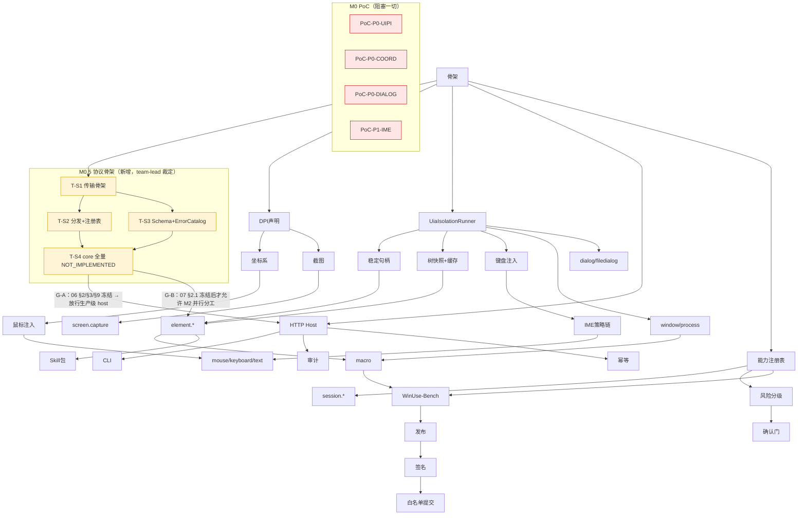

# WinUse 路线图、任务分解与风险登记

> **定位**：把 `05-architecture.md`（架构）、`06-protocol-spec.md`（协议）、`07-capability-registry.md`（能力集）、`03-prd.md`（需求）落成**可执行的排期与文件清单**。
>
> **能力集基线**：**不写死数字**，一律以 `07-capability-registry.md` §0.7 的**实测表行**为准（v1 / v1.5 / v2 条数见 §0.7.12，`tier` 分档见 §0.7.13）。
> **技术栈**：C# / .NET 8+，self-contained 单文件（ADR-001）。

---

## 0. TL;DR

| 项 | 结论 |
|---|---|
| **最大风险** | 不是技术，是**分发**。WinUse 的行为特征（全局输入注入 + 截屏 + 常驻 + 单文件）与键盘记录器/RAT 高度重合，天生处于杀软/EDR 关注名单。签名与白名单需**以周计**的提前量 |
| **最先要做的** | 不是写代码，是 **5 个 P0 PoC**。它们决定坐标系、权限模型、降级链、IME 策略能否成立 |
| **v1 交付** | v1 全部能力（条数见 07 §0.7.12）+ core 子集对外暴露（条数见 07 §0.7.13）+ HTTP/CLI/MCP 三通道 + 审计 + 确认门 + WinUse-Bench 27 题 |
| **明确不做** | 自绘 UI 元素级控制、UAC 自动化、视觉模型内置（AGPL 风险）、WPS COM、真 undo、企业专属构建 |

---

## 1. 里程碑总览

```mermaid
gantt
    title WinUse 里程碑（相对时间，非日历）
    dateFormat X
    axisFormat %s
    section M0 PoC
    5 项阻塞性 PoC            :crit, m0, 0, 3
    section M0.5 协议骨架
    传输+分发+Schema（G-A 门禁后） :m05a, after m0, 1
    core 全量 NOT_IMPLEMENTED :crit, m05b, after m05a, 1
    section M1 内核
    进程骨架 + 传输层          :m1a, after m05b, 3
    UIA 引擎 + 稳定句柄        :m1b, after m1a, 4
    输入引擎 + IME             :m1c, after m1a, 3
    感知 + 坐标系              :m1d, after m1a, 3
    section M2 协议
    能力目录 + 分层暴露        :m2a, after m1b, 2
    v1 能力实现（见 07 0.7.12）  :m2b, after m2a, 6
    section M3 治理
    风险分级 + 确认门 + 审计   :m3a, after m1a, 3
    事务 + 幂等                :m3b, after m2b, 2
    section M4 生态
    CLI + MCP + SDK            :m4a, after m2b, 2
    Skill 包 + Bench           :m4b, after m4a, 3
    签名 + 白名单提交          :crit, m4c, after m2b, 8
```



| 里程碑 | 目标 | 出口标准 |
|---|---|---|
| **M0 — PoC** | 5 项阻塞性 PoC 出结果 | 全部 PoC 有明确结论（含"推翻原设计"的结论） |
| **M0.5 — 协议骨架** | 传输 + 分发 + Schema + 错误目录；**core 全量返回 `NOT_IMPLEMENTED`** | ① core 每一条可调用且返回 `NOT_IMPLEMENTED`（条数见 07 §0.7.13）② 两条硬门禁（G-A / G-B）已写入 CI 断言 |
| **M1 — 内核** | 进程骨架、传输层、UIA 引擎、输入引擎、感知、坐标系 | `session.preflight` 可返回真实环境数据；能稳定点击并读回校验 |
| **M2 — 协议** | 能力目录、v1 能力实现、分层暴露 | `session.capabilities` 返回完整 core 目录；core 子集全部可调用（条数见 07 §0.7.13） |
| **M3 — 治理** | 风险分级、确认门、审计、事务、幂等 | R3 触发确认门；审计 100% 覆盖；幂等键可重放 |
| **M4 — 生态** | CLI / MCP / SDK / Skill 包 / Bench | 新 Agent ≤30 分钟跑通 T01；Bench v1 27 题可跑 |

---

## 2. 项目目录结构

```
WinUse/
├── WinUse.sln
├── Directory.Build.props                 # 统一版本、Nullable、Warnings-as-Errors
├── src/
│   ├── WinUse.Core/                      # 领域模型与接口（无平台依赖）
│   │   ├── Capabilities/
│   │   │   ├── CapabilityDescriptor.cs   # 能力元数据（id/tier/risk/idempotent/layer）
│   │   │   ├── CapabilityRegistry.cs     # 能力注册与查找（条数见 07 §0.7；由构建期代码生成，禁止硬编码）
│   │   │   └── ICapability.cs            # 能力实现接口
│   │   ├── Protocol/
│   │   │   ├── RpcRequest.cs             # 统一信封（06 §2.1）
│   │   │   ├── RpcResponse.cs
│   │   │   ├── Grounding.cs              # {layer, confidence, degraded, fallbackReason, attempts}
│   │   │   ├── ErrorCatalog.cs           # 全部错误码 + recovery + hint（06 §9.2）
│   │   │   └── Enums.cs                  # RiskLevel / Idempotency / Layer / Tier
│   │   ├── Selector/
│   │   │   ├── Selector.cs               # 06 §4 选择器模型
│   │   │   └── SelectorParser.cs
│   │   ├── Dispatch/
│   │   │   ├── CapabilityDispatcher.cs   # 唯一编排入口
│   │   │   ├── ScopeResolver.cs          # 作用域/焦点契约（06 §2.4）
│   │   │   └── FallbackChain.cs          # L4→L0 降级编排
│   │   ├── Policy/
│   │   │   ├── RiskClassifier.cs         # R0–R4 + 动态升级词表
│   │   │   ├── ApprovalGate.cs           # 确认门 + 预授权 + 紧急停止
│   │   │   └── PathPolicy.cs             # 文件路径白名单
│   │   ├── Idempotency/
│   │   │   ├── IdempotencyStore.cs       # key → 首次响应，replayed:true
│   │   │   └── ConditionalWrite.cs       # if_match / etag
│   │   ├── Transaction/
│   │   │   ├── TransactionManager.cs     # begin/commit/rollback
│   │   │   └── Compensators/             # file/clipboard/element 的补偿器
│   │   └── Audit/
│   │       ├── AuditWriter.cs            # 100% 审计，结构化
│   │       └── AuditQuery.cs
│   │
│   ├── WinUse.Platform.Windows/          # 全部 Windows 原生实现（唯一含 P/Invoke 的工程）
│   │   ├── Uia/
│   │   │   ├── UiaIsolationRunner.cs     # ★ 可放弃线程 + 硬超时（05 §10.3）
│   │   │   ├── ElementFingerprint.cs     # ★ 稳定句柄指纹（ADR-007）
│   │   │   ├── ElementHandleStore.cs     # LRU + 失效重解析
│   │   │   ├── UiaTreeSnapshot.cs        # 快照 + snapshot_id + diff
│   │   │   ├── UiaEventBroker.cs         # 事件订阅 + 轮询兜底
│   │   │   └── UiaCachePolicy.cs         # CacheRequest 属性集
│   │   ├── Input/
│   │   │   ├── MouseInjector.cs          # SetCursorPos + SendInput（**回读校验**）
│   │   │   ├── KeyboardInjector.cs       # KEYEVENTF_UNICODE + 代理对处理
│   │   │   ├── TextInputStrategy.cs      # ★ 四层策略链（06 §6.1）
│   │   │   └── ImeInspector.cs           # IME 状态只读探测
│   │   ├── Windowing/
│   │   │   ├── WindowEnumerator.cs
│   │   │   ├── WindowPlacer.cs           # DWM extended bounds（不用 GetWindowRect）
│   │   │   └── ForegroundService.cs      # best-effort 置前台
│   │   ├── Capture/
│   │   │   ├── WgcCapturer.cs            # Windows.Graphics.Capture（主）
│   │   │   ├── FallbackCapturer.cs       # PrintWindow / BitBlt
│   │   │   └── ProtectionProbe.cs        # GetWindowDisplayAffinity 预检
│   │   ├── Coordinates/
│   │   │   ├── DpiAwareness.cs           # ★ PerMonitorV2 声明（创建窗口之前）
│   │   │   ├── VirtualScreen.cs          # VSC 原点 + 显示器拓扑
│   │   │   └── CoordinateConverter.cs    # 逻辑↔物理换算
│   │   ├── Dialogs/
│   │   │   ├── DialogDetector.cs         # ★ Win10/Win11 双形态探测
│   │   │   └── FileDialogDriver.cs       # set_path / confirm（含覆盖连环框）
│   │   ├── Office/                        # v1：Excel/Word COM
│   │   │   ├── OfficeComBridge.cs        # ReleaseComObject 严格配对
│   │   │   └── ExcelRangeService.cs
│   │   └── System/
│   │       ├── EnvironmentProbe.cs       # 锁屏/UAC/屏保/RDP/IL
│   │       ├── IntegrityLevel.cs
│   │       └── ProcessService.cs
│   │
│   ├── WinUse.Transport.Http/            # ASP.NET Core minimal host
│   │   ├── HttpTransport.cs              # ITransport 实现
│   │   ├── InvokeEndpoint.cs             # POST /v1/invoke（唯一端点）
│   │   ├── ToolsExportEndpoint.cs        # /v1/tools/{openai,anthropic,mcp}
│   │   ├── SseEventEndpoint.cs           # GET /v1/events（v1.5）
│   │   └── Security/
│   │       ├── TokenAuth.cs
│   │       └── LoopbackGuard.cs          # Host 校验 / DNS rebinding / CSRF
│   │
│   ├── WinUse.Transport.Cli/             # 进程内直连
│   │   ├── CliTransport.cs
│   │   └── CommandLineParser.cs          # --foo-bar → foo_bar 机械映射
│   │
│   ├── WinUse.Transport.Mcp/             # stdio JSON-RPC（v1.5+，P1-10）
│   │   └── McpTransport.cs
│   │
│   ├── WinUse.Host/                      # 托盘常驻进程入口
│   │   ├── Program.cs                    # ★ DPI 声明必须在最前
│   │   ├── TrayApplication.cs
│   │   ├── ApprovalWindow.cs             # 确认门 UI
│   │   └── app.manifest                  # PerMonitorV2 + IL 声明
│   │
│   └── WinUse.Plugin.Abstractions/       # 外进程插件协议（v1 只有 plugin.list）
│       └── IPluginClient.cs
│
├── tests/
│   ├── WinUse.Core.Tests/                # 纯逻辑单测（无 Windows 依赖）
│   ├── WinUse.Platform.Tests/            # 需真实 Windows 的集成测试
│   └── WinUse.Bench/                     # WinUse-Bench harness
│       ├── tasks/                        # 30 个任务定义
│       ├── verifiers/                    # 独立通道验证器（**必过反证测试**）
│       └── fixtures/
│
├── docs/                                 # 本目录
├── skill/                                # AI Skill 包（08 §3）
└── build/
    ├── sign.ps1                          # Authenticode 签名
    └── av-submission/                    # 白名单提交文档包
```

---

## 3. 任务分解

> `W` = 工作量 T-shirt（S <1d / M 1–3d / L 3–7d / XL >1w）

### 3.0 🔴 测试策略：DPI 回归**必须跑异构双屏，跑单屏等于没跑**（第二轮 PoC 结论 C11）

> 来源：`docs/12-poc-findings.md` §8.2 C11。这是一条**测试策略级**结论，不只是坐标换算细节 —— 它决定"什么算测过"。

**实测事实**：PMv2 切换前后逐窗口对比，主屏（125%）6 个窗口**全变**，**副屏（100%）窗口一次都没变**（`uia_rect_A == uia_rect_B`）。

**机理**：进程 DPI-unaware 时，Windows 用 `GetDpiForSystem`（= **96**）做坐标虚拟化。对 **100% 的副屏这个值恰好正确**，对 125% 的主屏是错的。
→ **副屏窗口"看起来是对的"纯属巧合。在单屏 100% 环境下，unaware 与 PMv2 给出完全相同的结果 —— 你测不出这个 bug。**

**由此推出的硬性测试要求**：

| # | 要求 | 理由 |
|---|---|---|
| **TS-1** | **DPI 感知回归测试必须跑异构 DPI 双屏**（至少 主 125% + 副 100%，且**副屏在左**以覆盖负坐标） | 单屏下"unaware 与 PMv2 结果一致"是**恒真**的，测试必然通过且不具鉴别力 |
| **TS-2** | **禁止只用 100% 单屏跑 DPI 相关用例** | 100% 屏上 `GetDpiForSystem` 的虚拟化值恰好正确，bug 被完全掩盖 |
| **TS-3** | 断言方式：**直接读进程 awareness 上下文**（`GetAwarenessFromDpiAwarenessContext(GetThreadDpiAwarenessContext())` 与 `perMonitorV2` 比对），**不得**用"当前窗口坐标看起来合理"判定 | 后者在 100% 屏上恒真（06 §5.4.4） |
| **TS-4** | 涉及 `GetDpiForSystem` 的换算，**必须在副屏上单独断言** | 异构 DPI 下该 API 恒等于主屏 DPI（实测 120 vs 副屏真实 96），只在主屏测永远对（06 §5.4.3） |
| **TS-5** | 视觉/截图链路的基准断言用 `DWMWA_EXTENDED_FRAME_BOUNDS`，命中链路用 `GetWindowRect`/UIA，**两条链路分开断言，不许互推** | PMv2 切换前后 `changed_dwm_count = 0` 而 `changed_win32_count = 6`：DWM 不受感知等级影响，Win32/UIA 会漂（结论 C13） |

> **排期含义**：TS-1 意味着 DPI 相关的 CI **不能只跑在单屏构建机上**。若 CI 只有单屏，DPI 用例必须**显式标记为 manual-only**，而不是标成"已通过" —— 后者会制造虚假的绿色。

#### 🔴 侵入式四项的里程碑挂载（**全部依赖双屏在位**）

第二轮 PoC 把双屏异构 DPI 的**只读侧**结案了（12 §8 / 11 §7.1 C9–C13），但**侵入式四项仍未测**。它们此前只是笼统挂在 `PoC-P0-COORD` 上 —— 现在逐条挂到里程碑，并写明环境依赖：

| # | 侵入式探测项 | 挂到 | 依赖 | 🔴 **需要副屏在位** |
|---|---|---|---|---|
| 1 | `SetCursorPos` 到**负坐标**是否可达（副屏 y ∈ [−1200, 0]） | **M0 / T-P2** | 副屏在上方或左方（VSC 原点为负） | ✅ **是** —— 单屏下 VSC 原点非负，**这个场景根本不存在，测了也是空跑** |
| 2 | **副屏实际点击命中误差**（B-01 的 ≤2px 在异构 DPI 下是否成立） | **M1 / T-C7**（鼠标注入 + 回读校验落地后） | 双屏 + 异构 DPI（主 125% / 副 100%）+ T-C7 的回读校验 | ✅ **是** —— 单屏测出的 ≤2px **只证明主屏成立**，不能外推到副屏；且此项直接决定 B-01 与 Bench T23/T24 阈值能不能定 |
| 3 | **跨屏拖拽**（`mouse.drag` 跨显示器边界） | **M2 / T-A8** | 双屏 + `mouse.drag` 实现 | ✅ **是** —— 单屏无"跨屏"可跨 |
| 4 | `MonitorFromPoint` 在**屏间隙**的返回值 | **M1 / T-C6**（坐标系模块） | 双屏且两屏**分辨率不同**（屏间隙真实存在） | ✅ **是** —— 单屏无屏间隙；本轮拓扑主 1920×1080 / 副 1920×1200，**间隙真实存在**，可直接测 |

**为什么必须逐条标注「需要副屏在位」**（这正是 TS-1 那条要防的事）：
> 这四项在**单屏机器上也能"跑完"** —— `SetCursorPos` 不会报错、点击误差能算出一个数、`MonitorFromPoint` 会返回一个值。**它们不会失败，只会给出一个没有鉴别力的答案。**
> 若不写明环境依赖，将来有人在单屏机器上跑这四项，会得到"测了且通过"的结论，而该结论对双屏场景**没有任何信息量** —— 与 C11 揭示的"单屏 100% 测不出 DPI bug"是同一个陷阱，只不过这次陷阱在**测试执行环节**而不是被测代码里。

**执行约束**：这四项的验收记录必须包含**当时的显示器拓扑**（各屏 rect / DPI / VSC 原点）。**没有拓扑记录的探测结果视为无效**，与 10 §6.5.1「题号清单冻结需逐题校验能力归属」同一类纪律。

### M0 — PoC（**必须先做**）

| ID | 任务 | 依赖 | W | 验收标准 |
|---|---|---|---|---|
| **T-P1** | `PoC-P0-UIPI`：Medium IL 进程对 High IL 目标 —— ① 能否读 UIA 树 ② `element.invoke` 是否成功 ③ `SendInput` 是否静默失败 | — | M | 三条结果分别记录；据实回写 05 ADR-002 与 PRD P0-6 AC③ |
| **T-P2** | 🔴 `PoC-P0-COORD`：**双屏侵入式四项** —— ① 负坐标 `SetCursorPos` 可达性 ② `SetCursorPos` 是否被 UIPI 拒 ③ **副屏**实际点击命中误差 ④ `MonitorFromPoint` 在屏间隙的返回 | — | M | 🔴 **必须双屏在位**（副屏在主屏上方或左方 → VSC 原点为负；两屏 DPI 不同 → 异构；两屏分辨率不同 → 有屏间隙）。**记录当时显示器拓扑，无拓扑记录的结果无效**。得出 ≤2px 在**副屏**是否成立；校准 Bench T23/T24 阈值。详见 §3.0「侵入式四项的里程碑挂载」 |
| **T-P3** | `PoC-P0-DIALOG`：Win10 22H2 + Win11 23H2 跑通"记事本→另存为→指定路径→保存" | — | M | 两平台均成功；记录 UIA 树差异点 |
| **T-P4** | `PoC-UIA-HANG`：挂死窗口夹具下 `UiaIsolationRunner` 的 abandon 策略有效性 | T-C3 | M | 主进程不挂死；abandon 达阈值后拒绝服务且可观测 |
| **T-P5** | `PoC-P1-IME`：`KEYEVENTF_UNICODE` × {搜狗/微软拼音/QQ拼音} × {记事本/Chrome/微信/企业微信}，含 emoji 代理对 | — | M | 结果与 IME 状态无关；产出 Top-10 应用可靠性矩阵 |
| **T-P6** | 国产 IM UIA 覆盖率实测（微信/企微/钉钉/飞书） | — | S | 明确每个应用哪些区域有 UIA、哪些只能 PIXEL |
| **T-P7** | T17（UAC 题）harness 可行性验证 | — | S | 若不可行 → Bench T17 改判为"审计日志检查" |

### M0.5 — 协议骨架周（**新增，team-lead 裁定**）

> **⚠️ 命名说明（我必须报出来，不擅自折叠）**：team-lead 裁定要求"独立的 **M0：协议骨架周**"。但 09 里 **M0 已被「PoC」占用**（T-P1~T-P7、§1 gantt、§3.1 依赖图三处引用）。
> 若把 PoC 后移改名，会连带改动全文编号与 06/07/08 的引用。故我按裁定**意图**（"独立成段、位于 M1 之前、有两条硬门禁"）插入为 **M0.5**，**未改动既有 M0 的编号**。
> 若你要它正式叫 `M0`（PoC 改称 `P0`/`M-1`），说一声，我一次性全文改名并同步 06/08。

**为什么单独切一段**：M1 是**内核**（UIA/输入/感知/坐标系），M2 是**能力实现**。二者之间长期缺一段 —— 谁先把"传输 + 分发 + Schema + 错误目录"跑起来。
结果是：M2 的能力实现一直**依附在内核进度上**，而协议层（06）与能力层（07）的定稿与否对编码顺序毫无约束力。切出 M0.5 后，**协议有了可执行的锚点**，06/07 的定稿才真正成为门禁而不是纸面声明。

| ID | 任务 | 依赖 | W | 涉及文件 | 验收 |
|---|---|---|---|---|---|
| **T-S1** | **最小** JSON-RPC 2.0 传输骨架：`POST /v1/rpc` 收/发信封（⚠️ **不含**生产级回环守卫与 Token 鉴权，那是 M1 的 T-C12；本任务的代码在 T-C12 落地时整体替换） | T-C1 | S | `WinUse.Transport.Http/*` | 任意合法信封都能收到并回一个结构化响应（含 `id` 回显） |
| **T-S2** | `CapabilityDispatcher` + `CapabilityRegistry`（条数与 `tier` **由 07 §0.7 构建期生成，禁止硬编码**） | T-S1 | S | `Dispatch/*`、`Capabilities/*` | 未知 method → `METHOD_NOT_FOUND`；已知但未实现 → `NOT_IMPLEMENTED` |
| **T-S3** | Schema 校验层 + `ErrorCatalog` 骨架（错误码/`recovery`/`hint` 全量占位） | T-S1 | M | `Protocol/ErrorCatalog.cs` | 参数不合法 → `INVALID_PARAMS` 并带字段级提示 |
| **T-S4** | ⭐ **core 全部能力注册为占位实现，调用返回 `NOT_IMPLEMENTED`**（core 条数见 **07 §0.7.13**，不写死） | T-S2, T-S3 | S | `Capabilities/*` | **core 每一条都能被调用且返回 `NOT_IMPLEMENTED`**（不是 `METHOD_NOT_FOUND`）；返回条数与 07 §0.7 的 core 计数**逐条对得上** |
| **T-S5** | `session.hello` / `session.capabilities` 先于其他能力可用（骨架自检入口） | T-S4 | S | Session 能力占位 | 客户端能拉到完整 core 目录并看到全部 `NOT_IMPLEMENTED` |

> **T-S4 的意义**：它把"协议是否已定义完"变成一个**可跑、可数、可 CI 断言**的事实 —— `for id in core: assert call(id).error.code == "NOT_IMPLEMENTED"`。
> 在此之前，"06 定稿了没有"只能靠人读文档判断；在此之后，CI 能直接判。这也是两条硬门禁能真正生效的前提。

#### 🔴 两条硬门禁（**team-lead 裁定，M0.5 的核心产出**）

| 门禁 | 条件 | 放行什么 | 不放行的后果 |
|---|---|---|---|
| **G-A：06 冻结门禁** | **06 §2（信封）/ §3（能力目录）/ §9（错误码）冻结** | 放行 **T-S1~T-S3**（传输 + 分发 + Schema）与 M1 的传输相关任务 | 骨架按错误码草稿实现 → 后续每改一个码要动全链路；`ErrorCatalog` 会在 M2 被反复重写 |
| **G-B：07 §2.1 冻结门禁** | **07 §2.1（`element` 域：选择器模型 / 返回结构 / `grounding` 语义）冻结** | 放行 **M2 的能力实现并行分工** | `element.*`（T-A7，XL 级）被 T-A8/A10/A13/A15/E3/E4 依赖，其接口取决于 §2.1；未定稿就分工 = 六条下游任务按各自的猜测实现，合并时全部返工 |

> **⚠️ 明确声明**：**M1 与 M2 在 06 / 07 §2.1 定稿前不得并行启动。**
> 这条不是"建议串行"——M1 与 M2 技术栈不同、可由不同人做，看起来天然可并行，极易被排成并行。但它们共享同一份**尚未冻结**的协议契约；并行只会把"定稿"这件事推到合并时才暴露，而那时成本已经沉没。

### M1 — 内核

| ID | 任务 | 依赖 | W | 涉及文件 | 验收 |
|---|---|---|---|---|---|
| **T-C1** | 解决方案骨架 + `Directory.Build.props` + 分层依赖强制（架构测试） | — | S | `WinUse.sln`、`Directory.Build.props` | 分层违规会导致测试失败 |
| **T-C2** | **DPI Awareness 声明**（必须在创建任何窗口之前）+ app.manifest | T-C1 | S | `Program.cs`、`app.manifest`、`DpiAwareness.cs` | 混合 DPI 下坐标不虚拟化。🔴 **验收必须跑异构 DPI 双屏（主 125% + 副 100%，副屏在左）** —— 单屏通过**不算通过**，见 §3.0 TS-1/TS-2 |
| **T-C3** | `UiaIsolationRunner`：可放弃线程 + MTA COM + 硬超时 + abandon 计数 | T-C1 | **L** | `UiaIsolationRunner.cs` | T-P4 通过 |
| **T-C4** | `ElementFingerprint` + `ElementHandleStore` + `STALE_HANDLE` 检测与重解析 | T-C3 | M | `ElementFingerprint.cs`、`ElementHandleStore.cs` | 窗口重建后能检出失效并给出重定位提示 |
| **T-C5** | `UiaTreeSnapshot` + `snapshot_id` + diff + `CacheRequest` 策略 | T-C3 | M | `UiaTreeSnapshot.cs`、`UiaCachePolicy.cs` | Excel/Explorer 上 `element.tree` P95 ≤500ms |
| **T-C6** | 坐标系统：`VirtualScreen` + `CoordinateConverter` + DWM extended bounds | T-C2 | M | `VirtualScreen.cs`、`CoordinateConverter.cs`、`WindowPlacer.cs` | T-P2 通过 |
| **T-C7** | 鼠标注入：`SetCursorPos` + `SendInput` + **回读校验** | T-C6 | M | `MouseInjector.cs` | 偏差 >2px 或命中错误时降级；UIPI 下**不静默** |
| **T-C8** | 键盘注入 + Unicode 代理对 + IME 状态探测 | T-C3 | M | `KeyboardInjector.cs`、`ImeInspector.cs` | T-P5 通过 |
| **T-C9** | `TextInputStrategy` 四层策略链 + 读回校验 | T-C8 | M | `TextInputStrategy.cs` | 每层失败都能降级；最终失败返回 `VERIFY_FAILED` |
| **T-C10** | 感知：`WgcCapturer` + `ProtectionProbe` + `FallbackCapturer` | T-C2 | L | `Capture/*` | 受保护内容返回 `CAPTURE_PROTECTED` 而非黑图 |
| **T-C11** | `EnvironmentProbe`：锁屏/UAC/屏保/RDP/IL | T-C1 | S | `EnvironmentProbe.cs` | `session.preflight` 七项检查可用 |
| **T-C12** | HTTP host + `InvokeEndpoint` + `LoopbackGuard` + Token 鉴权 | T-C1 | M | `WinUse.Transport.Http/*` | 只听 127.0.0.1；DNS rebinding/CSRF 被拒 |
| **T-C13** | CLI transport（`--foo-bar → foo_bar` 机械映射） | T-C12 | S | `WinUse.Transport.Cli/*` | CLI 与 HTTP 行为完全一致 |

### M2 — 协议与能力

| ID | 任务 | 依赖 | W | 涉及文件 | 验收 |
|---|---|---|---|---|---|
| **T-A1** | `CapabilityDescriptor` + `CapabilityRegistry`（注册条数与 `tier` 由 07 §0.7 构建期生成） | T-C1 | M | `Capabilities/*` | 与 07 §0.7 完全一致 |
| **T-A2** | `ErrorCatalog`：全部错误码 + `recovery` + `hint` | T-A1 | M | `ErrorCatalog.cs` | 每条错误都有可执行恢复指引 |
| **T-A3** | `session.hello` / `capabilities` / `preflight` / `status` | T-A1, T-C11 | M | Session 能力实现 | 可发现性达标 |
| **T-A4** | `tier` 分层暴露（档位条数见 07 §0.7.13，不写死） | T-A3 | S | `CapabilityRegistry` | 默认只返 core；`domain` 过滤可用 |
| **T-A5** | tools 导出（OpenAI / Anthropic / MCP）+ description 尾部风险标注 | T-A4 | S | `ToolsExportEndpoint.cs` | 三种格式可直接使用 |
| **T-A6** | `window.*` + `process.*`（**条数见 07 §1 / §9**，不写死） | T-C3, T-C6 | L | Windowing + Process | — |
| **T-A7** | `element.*`（**条数见 07 §2**，M2 中工作量最大） | T-C4, T-C5 | **XL** | Uia/* | `element.invoke` 走 UIA Pattern 优先 |
| **T-A8** | `mouse.*` / `keyboard.*` / `text.*` | T-C7, T-C8, T-C9 | M | Input/* | — |
| **T-A9** | `file.*`（**条数见 07 §10**，含 `file.stat` 独立验证主力） | T-C1 | M | File 能力 | 路径白名单生效 |
| **T-A10** | **`dialog.*` / `filedialog.*`（Win10/Win11 双形态）** | T-C3 | M | `Dialogs/*` | T-P3 通过 |
| **T-A11** | `clipboard.*`（含"保存并恢复"语义） | T-C1 | S | Clipboard 能力 | 不污染用户剪贴板 |
| **T-A12** | `screen.capture` / `annotate`（SoM 标注） | T-C10 | M | Capture + SoM | 默认不返图像 |
| **T-A13** | `wait.*`（**条数见 07 §16**）+ UIA 事件订阅与轮询兜底 | T-C3, T-A7 | M | `UiaEventBroker.cs` | 四类等待可用 |
| **T-A14** | `office.attach` / `excel.range` / `word.text`（COM） | T-C1 | M | `Office/*` | ReleaseComObject 严格配对，无泄漏 |
| **T-A15** | `macro.list/describe/run` + **5 个内置宏** | T-A6~A14 | M | Macro 能力 | 典型任务 ≤4 次往返 |
| **T-A16** | `registry.get`（只读）+ `shell.exec` | T-C1 | S | — | 写操作默认禁用 |

### M3 — 治理

| ID | 任务 | 依赖 | W | 涉及文件 | 验收 |
|---|---|---|---|---|---|
| **T-G1** | `RiskClassifier`：R0–R4 + **动态语义升级**（中英词表） | T-A1 | M | `RiskClassifier.cs` | 命中"发送/删除"升级到 R3 |
| **T-G2** | `ApprovalGate`：托盘确认 + 预授权 + 紧急停止 | T-G1 | M | `ApprovalGate.cs`、`ApprovalWindow.cs` | R4 不可预授权 |
| **T-G3** | `AuditWriter` + `audit.query/export`（100% 覆盖） | T-C12 | M | `Audit/*` | 每个请求都有审计条目 |
| **T-G4** | `IdempotencyStore`（TTL 10min）+ `replayed:true` | T-C12 | M | `Idempotency/*` | Bench T21 可判定 |
| **T-G5** | `TransactionManager` + 补偿器（仅可补偿域）+ `NOT_TRANSACTIONAL` | T-A9, T-A11 | M | `Transaction/*` | UI 点击类入事务被明确拒绝 |
| **T-G6** | `session.resume` / `cancel`：`NEEDS_HUMAN` 挂起-恢复协议 | T-A3 | M | Session 能力 | 挂起可恢复，超时转 TIMEOUT 而非 DENIED |
| **T-G7** | 提示注入标记（UI 文本包裹不可信标记） | T-A7 | S | Protocol 层 | 从 UI 读的文本带标记 |
| **T-G8** | `PathPolicy`：用户目录+临时目录白名单，越界确认门 | T-A9 | S | `PathPolicy.cs` | 授权可审计可撤销 |

### M4 — 生态与分发

| ID | 任务 | 依赖 | W | 涉及文件 | 验收 |
|---|---|---|---|---|---|
| **T-E1** | MCP transport | T-C13 | M | `WinUse.Transport.Mcp/*` | 可注册到 Claude Desktop |
| **T-E2** | Python SDK + TypeScript SDK | T-A5 | M | `sdk/` | — |
| **T-E3** | **AI Skill 包**（`SKILL.md` + tools.json + 5 examples + pitfalls） | T-A15, 08 | M | `skill/` | Agent 读完能跑通 T01 |
| **T-E4** | **WinUse-Bench harness** + 30 题 + 验证器（**每个验证器必过反证测试**） | T-A1~A16 | L | `tests/WinUse.Bench/` | v1 可执行 27 题 |
| **T-E5** | 单文件发布 + trimming（目标 ≤60MB）+ 降级预案（单目录+启动器） | 全部 | M | `build/` | 体积达标或走降级预案 |
| **T-E6** | Authenticode 签名（OV，建议 EV） | T-E5 | S | `build/sign.ps1` | — |
| **T-E7** | **白名单提交文档包**（行为说明 + 哈希占位 + 各厂商入口） | T-E5 | M | `build/av-submission/` | 见 §5 |
| **T-E8** | 编码约束 Code Review Checklist（降低误报特征） | — | S | `docs/` | 纳入 CI |

### 3.1 依赖图



> **M0.5 → M1 边**（`S4 --> C12`，即"协议骨架 → M1 的生产级 HTTP host"）：core 全量 `NOT_IMPLEMENTED` 的骨架**必须先于** M1 的生产级传输层完成。
> 理由：M1 的传输层若先按各自理解实现，M0.5 再回来套信封，等于把同一件事做两遍；反之先立骨架，M1 只需把占位换成真实 host。
> ⚠️ **T-S1 与 T-C12 是同一件事的两次实现，不是两个功能**：T-S1 是**最小骨架**（够收/发信封即可，不做生产级鉴权与回环守卫），T-C12 是它的**生产级替代**。二者不并行，T-S1 的代码在 T-C12 落地时整体替换 —— 这条若不写清楚，排期时会被当成两项独立工作各派一人。
> ⚠️ 依赖图**不画** `S4 --> C1`：T-C1（解决方案骨架）是 M0.5 与 M1 的**共同前置**（`C1 --> S1`），若再画 `S4 --> C1` 会构成环 `C1→S1→S2→S4→C1`，图就不可读了。M0.5 → M1 的门禁边落在 `C12` 上。
> 边的**标签即是门禁**：`G-A`（06 冻结）管 T-S1~T-S3，`G-B`（07 §2.1 冻结）管 M2 能否并行 —— **M1 与 M2 在 06 / 07 §2.1 定稿前不得并行启动**。

---

## 4. 合并后的 PoC 清单

> 合并来源：04 §10.3（12 项）+ 02 §8（12 项）+ 05 §16（10 项），去重后按"阻塞什么"排序。

| # | PoC | 优先级 | 阻塞什么 | 判据 |
|---|---|---|---|---|
| 1 | **PoC-P0-UIPI** | **P0** | 权限模型、降级链、PRD P0-6 AC③ | 三条结果分别记录（读树 / invoke / SendInput 静默失败） |
| 2 | **PoC-P0-COORD** | **P0** | 坐标系、≤2px 阈值、鼠标实现 | 负坐标副屏可达 + 不被 UIPI 拒 + 误差 ≤2px |
| 3 | **PoC-P0-DIALOG** | **P0** | 文件对话框双形态 | Win10 + Win11 均跑通另存为 |
| 4 | **PoC-UIA-HANG** | **P0** | 稳定性（挂死防护） | 主进程不挂死 |
| 5 | **PoC-P1-IME** | **P0** | 中文输入策略链 | 结果与 IME 状态无关 |
| 6 | 国产 IM UIA 覆盖率 | **P0** | 自绘 UI 天花板、Bench T03/T08/T09/T10 | 逐应用记录可用区域 |
| 7 | T17 UAC harness 可行性 | P1 | Bench T17 是否可保留 | 安全桌面是否可被 harness 干预 |
| 8 | PoC-P1-CAPTURE（4 通道 × 5 场景） | P1 | 截图降级链 | 明确每类应用默认通道 |
| 9 | PoC-P1-OCR（`Windows.Media.Ocr` 中文小字） | P1 | OCR 置信度阈值 | ≥100 张样本，得出分档阈值 |
| 10 | PoC-P2-ELECTRON（无障碍未开启时） | P1 | Element 域覆盖度 | 是否有非侵入式开启手段 |
| 11 | PoC-P2-CONSOLE（ConPTY 读取） | P2 | `console.*` 设计 | 是否真的只有视口 |
| 12 | PoC-P3-AOT（NativeAOT + COM/WinRT） | P3 | 体积优化 | 仅体积阻塞时启动 |
| 13 | 杀软误报实测 | **P1** | **发布节奏** | 需先有二进制；见 §5 |

---

## 5. 杀毒软件 / EDR 白名单：可执行清单

> **为什么单列**：WinUse 的行为特征 —— `UIAutomationCore.dll` 被加载到未知进程、`UIA_PIPE_*` 命名管道、全局输入注入、屏幕捕获、开机常驻、单文件分发 —— **与键盘记录器/RAT 高度重合**【实】（Akamai 安全研究把前两项明确列为 UIA 滥用检测指标）。
> 这是**产品化障碍**，不是"发布时顺便做一下"的事。

### 5.1 需提交白名单的对象

| 对象 | 入口 | 建议提前量 | 备注 |
|---|---|---|---|
| **Microsoft Defender SmartScreen** | Windows Defender 提交门户（声誉建立） | 4–8 周（新签发证书需累积声誉） | **EV 证书可显著加速** |
| **Microsoft Defender for Endpoint** | 企业侧由 IT 管理员加指示器例外 | 2–4 周 | 需提供哈希 + 行为说明 |
| **360 安全卫士 / 360 杀毒** | 360 软件开放平台 - 误报申诉 | 2–4 周 | 国内覆盖广，优先级高 |
| **火绒安全** | 火绒误报反馈（官网/论坛） | 1–3 周 | 用户口碑好，响应较快 |
| **腾讯电脑管家** | 腾讯安全 - 误报申诉 | 2–4 周 | — |
| **卡巴斯基 / 诺顿 / 迈克菲** | 各自厂商误报提交页 | 2–6 周 | 按目标市场选 |
| **企业 EDR（CrowdStrike/SentinelOne 等）** | 企业侧策略配置 | 需客户提供 | v1 只出文档包，不做企业构建 |

### 5.2 降低误报特征的编码约束（**写入 Code Review Checklist**）

| # | 约束 | 原因 |
|---|---|---|
| 1 | **禁止** `WriteProcessMemory` / `CreateRemoteThread` / `VirtualAllocEx` | 典型注入特征 |
| 2 | **禁止**需要 DLL 注入的全局钩子（`WH_GETMESSAGE` / `WH_CALLWNDPROC`） | 只用 `WH_MOUSE_LL` / `WH_KEYBOARD_LL`（无需注入）与 `RegisterShellHookWindow` |
| 3 | **禁止**静态链接未签名的第三方 DLL | 供应链风险 |
| 4 | 单文件发布需保留**有效的 Authenticode 签名**（单文件 bundle 的签名校验有特殊处理） | 未签名单文件是最强误报信号 |
| 5 | 进程名、公司名、文件描述、版本信息**必须完整且真实** | 空元数据 = 可疑 |
| 6 | 网络监听**默认仅回环**；非回环必须显式确认 | 规避"后门监听"判定 |
| 7 | 自启动项需在 UI 中**可关闭且默认可见** | 隐蔽自启 = 可疑 |
| 8 | 提供**完整的隐私政策与行为说明**，并在安装包中可见 | 申诉时的关键材料 |

### 5.3 时间线建议（以公开发布日 T 为基准）

| 时点 | 动作 |
|---|---|
| T-12 周 | 采购 EV/OV 证书（EV 需更长） |
| T-8 周 | Defender SmartScreen 提交（开始累积声誉） |
| T-6 周 | 国产杀软（360/火绒/腾讯）提交 |
| T-4 周 | PoC-杀软误报实测（需先有可分发二进制） |
| T-2 周 | 复检；处理未通过项 |
| T | 发布 |

---

## 6. 风险登记册

| # | 类别 | 风险 | 影响 | 缓解 |
|---|---|---|---|---|
| **R-01** | 分发 | **杀软/EDR 误报导致应用无法启动** | **致命**：产品不可用 | §5 全套流程；EV 证书；开源透明（代码可见是最强背书） |
| **R-02** | 技术 | 自绘 UI（微信/企微/钉钉/QQ）元素级控制不可行 | 核心场景受限 | 诚实列入不支持清单；PIXEL 层 + SoM 定位；Bench 中标注预期降级 |
| **R-03** | 技术 | UIPI 导致无法操作管理员进程 | 部分场景不可用 | PoC-P0-UIPI 定论；返回 `UIPI_BLOCKED` + 引导重启；预留 High IL worker 接缝 |
| **R-04** | 技术 | 混合 DPI 坐标漂移 | 点击错误且不报错 | PoC-P0-COORD；强制回读校验；≤2px/≤5px 分级判定。**🔴 第二轮追加**：① 禁止 `GetDpiForSystem`（异构下恒等于主屏 DPI，副屏静默错，C10）；② 偏移量**非常量**（= f(最大化, 该屏 DPI)，禁止硬编码 8/9，C12）；③ 两条链路基准分开取（DWM 用于截图、Win32/UIA 用于命中，不许互推，C13） |
| **R-15** | **测试** | **DPI 感知 bug 在单屏环境下测不出来**（C11：100% 屏上 unaware 与 PMv2 结果完全一致） | 🟠 **高** —— 会制造"CI 全绿但线上偏错"的虚假信心 | DPI 回归**必须跑异构 DPI 双屏**（§3.0 TS-1~TS-5）；CI 只有单屏时 DPI 用例标 `manual-only`，**不得标为通过** |
| **R-05** | 技术 | UIA 挂死拖垮主进程 | 服务不可用 | `UiaIsolationRunner` + abandon 阈值 + 部分可用性降级 |
| **R-06** | 技术 | 中文 IME 输入不可靠 | **核心差异化失效** | 四层策略链 + 强制读回校验；PoC-P1-IME 覆盖 Top-10 应用 |
| **R-07** | 法律 | OmniParser icon_detect 为 **AGPL** | 传染性 | v1 不内置；视觉定位为外置插件且**不分发的二进制**；仅选 Apache-2.0/MIT 模型 |
| **R-08** | 产品 | v1 全部 tools 超出 LLM 消费能力（条数见 07 §0.7.12） | 工具选择准确率下降 | `tier` 分层（默认只暴露 core，条数见 07 §0.7.13）+ 按需展开 |
| **R-09** | 产品 | 动态风险升级是启发式，**存在漏判** | 误点高危按钮 | 如实写入文档，不给硬保证；词表可配置；R3/R4 确认门兜底 |
| **R-10** | 产品 | Win10/Win11 UIA 差异导致适配成本翻倍 | 排期失控 | Win11 优先、Win10 尽力兼容；双形态选择器；支持矩阵明确写出 |
| **R-11** | 产品 | Bench 阈值（≤2px、Δ≥30pp、SR比≥0.6）无实测依据 | 目标不可信 | 已登记进假设登记表；第一轮跑完必须回校 |
| **R-12** | 分发 | 单文件 70–100MB 过大 | 用户反感 | trimming 目标 ≤60MB；降级预案（单目录+启动器） |
| **R-13** | 生态 | 开源后核心被大厂吸收（微软已有 UFO²） | 商业空间 | 待决策（见 §7） |
| **R-14** | 范围 | Office COM 跨版本差异 + 崩溃泄漏 | 稳定性 | ReleaseComObject 严格配对；可选独立进程（v2） |
| **R-15** | 环境 | 锁屏/休眠/RDP 断开后自动化失效 | 无人值守场景不可用 | `session.preflight` 前置校验；`NEEDS_HUMAN` 挂起而非失败 |

---

## 7. 待用户/决策层确认的事项

> 以下为**分析而非结论**，需业务侧拍板（源自 `10-winuse-bench.md` §开源策略）。

| # | 事项 | PM 倾向 | 反方风险 |
|---|---|---|---|
| **Q-A** | 开源 vs 闭源 vs Open-core | **核心 Apache-2.0 开源 + 企业版闭源特性** | ① 核心被大厂吸收；② 商业化与社区期待冲突；③ 开源后无法转闭源 |
| **Q-B** | MCP 定位 | MCP 作为**冷启动入口**，但核心叙事必须是「Windows 桌面能力服务端」而非「一个 MCP server」 | 若做成纯 MCP server 会退化成 Windows-MCP 竞品 |
| **Q-C** | 是否接受"单文件 ≤60MB"作为 v1 形态 | 接受，附降级预案 | trimming 可能破坏 COM/WinRT 反射 |
| **Q-D** | 默认权限（Medium IL）带来的"管不了管理员进程"是否可接受 | 接受，代价已明确列出 | 用户可能为了方便而始终以管理员运行 → 放大审计面 |

**关于开源的补充约束（若采纳开源）**：安全默认值必须**硬编码在核心里、不可配置关闭** —— R3/R4 确认门、`registry.*` 默认禁用、不可自动化清单（UAC/锁屏/凭据/验证码）、全量审计不可关闭。理由：开源确实降低恶意使用门槛，所以这些不能做成"可选关闭项"。

---

## 8. 参考

- `05-architecture.md` — ADR-001~012、§13 分发与 AV/EDR、§16 PoC
- `06-protocol-spec.md` — 协议全部条款
- `07-capability-registry.md` §0.7 — 能力集权威口径与切分
- `03-prd.md` — 需求池与硬约束
- `10-winuse-bench.md` — Bench 任务定义与评分体系
